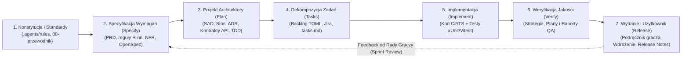

<!-- CONFLUENCE 1:1 EXPORT | Source: docs/00-przewodnik-i-setup/02-architektura-dokumentacji-sdd.md @ a2bf2a4 (2026-11-02) -->
# 0.2 Architektura dokumentacji pod Spec-Driven Development (SDD) i mapowanie Confluence

> **Źródło prawdy:** repozytorium (`docs/00-przewodnik-i-setup/02-architektura-dokumentacji-sdd.md`) · **Kategoria dokumentacji:** dokumentacja procesowa — standardy i architektura dokumentacji · **Etap SDD:** Fundamenty i organizacja · **Powiązane decyzje:** [ADR-0003](../01-dokumentacja-systemowa/07-decyzje-adr/0003-openspec-i-konstytucja.md), [ADR-0011](../01-dokumentacja-systemowa/07-decyzje-adr/0011-dokumentacja-hybryda-repo-confluence.md)

Ten dokument realizuje Zadanie 01. Projektujemy w nim strukturę dokumentacji w **Atlassian Confluence** i w repozytorium Git. Struktura ma wspierać dalszą pracę metodą **Spec-Driven Development (SDD)**, czyli „najpierw specyfikacja, potem kod”.

Opieramy się na klasyfikacji dokumentacji technicznej z artykułu AltexSoft: *[Technical Documentation in Software Development: Types, Best Practices, and Tools](https://www.altexsoft.com/blog/technical-documentation-in-software-development-types-best-practices-and-tools/)*.

Skróty używane w tym dokumencie:

- **PRD** (Product Requirements Document) — dokument wymagań produktu.
- **SAD** (Software Architecture Document) — dokument architektury systemu.
- **ADR** (Architecture Decision Record) — zapis pojedynczej decyzji architektonicznej.
- **TDD** (Technical Design Document) — projekt techniczny konkretnej zmiany.
- **NFR** (Non-Functional Requirement) — wymaganie niefunkcjonalne (jakościowe).
- **PB** — Politechnika Białostocka. „Confluence PB” i „Jira PB” to instancje uczelniane.

---

## 1. Założenia SDD w projekcie RE:JOLTANCE

W projektach studenckich dokumentację często pisze się na końcu, „na zaliczenie”. Taka dokumentacja szybko się dezaktualizuje i nie pomaga w decyzjach. W SDD, wspieranym przez agentów AI, odwracamy tę kolejność. **Dokumentacja to kontrakt, który powstaje przed implementacją i da się go sprawdzić.**



### Pięć zasad naszej dokumentacji

1. **Najpierw specyfikacja, potem kod.** Niektóre zadania wymagają zatwierdzonej specyfikacji przed kodowaniem. Dotyczy to zmian reguł gry, zmian kontraktów komunikacyjnych i funkcjonalności o rozmiarze ≥ 3 Story Points (SP, punkty oszacowania). Specyfikacja zawiera wymagania i scenariusze `GIVEN / WHEN / THEN`.
2. **Układ 1:1 między `docs/` a Confluence.** Katalogi w `docs/` odpowiadają stronom nadrzędnym i podstronom w przestrzeni Confluence PB. Wiadomo więc, gdzie co leży. Dokumentację przenosi do Confluence skrypt `python tools/confluence/sync_confluence.py`.
3. **Jedno źródło prawdy dla każdego typu treści (Single Source of Truth):**
   - **Repozytorium Git (`docs/` i `openspec/`)** to źródło prawdy dla dokumentacji, która steruje tworzeniem oprogramowania. Należą tu: PRD, reguły gry, SAD, stos technologiczny, ADR, API, UX, strategia testów i konfiguracja agentów AI. Każda zmiana przechodzi przez Pull Request i walidację w CI (`npm run check`).
   - **Confluence PB** zawiera całe drzewo dokumentacji. Są tam kopie dokumentów z repozytorium z nagłówkiem wersji. Confluence to też miejsce edycji „żywych” protokołów i raportów ze spotkań: raportów z testów sprintu, protokołów Sprint Review i notatek z Daily Scrum.
   - **Jira PB** służy do śledzenia zadań, rejestrowania czasu pracy (*Log Work*) i wykresów spalania (*Burndown Chart*).
4. **Śledzalność od wymagania do testu (traceability).** Każde wymaganie ma unikalny identyfikator. Reguły gry mają numery `R-01..R-84`. Wymagania jakościowe według ISO/IEC 25010 mają numery `NFR-01..NFR-70`. Identyfikator łączy kolejne ogniwa: **PRD** → specyfikacja **OpenSpec** → zadanie w **Jirze (`REJ-123`)** → test automatyczny (`R14_...`) → raport testowy w **Confluence**.
5. **Język zrozumiały dla ludzi i precyzyjny dla agentów AI.** Piszemy prostą polszczyzną techniczną i unikamy niewyjaśnionych skrótów. Wymagania dotyczące zachowania zapisujemy jako scenariusze `GIVEN / WHEN / THEN`. Człowiek łatwo je czyta, a model językowy interpretuje jednoznacznie.

---

## 2. Porównanie dwóch wariantów organizacji dokumentacji

Rozważyliśmy dwa sposoby układania drzewa w repozytorium i w Confluence:

- **Wariant A — taksonomia AltexSoft z przepływem SDD.** Najwyższy poziom dzielimy według typów dokumentacji z artykułu AltexSoft: *Product: System Documentation*, *Product: User Documentation*, *Process Documentation*. Dodajemy moduł o pracy z agentami AI i bibliotekę szablonów. Każdy dokument ma jawnie przypisany etap SDD.
- **Wariant B — układ chronologiczny według faz SDD.** Najwyższy poziom dzielimy według kroków procesu: *1. Fundamenty*, *2. Specyfikacja/Analiza*, *3. Plan/Architektura*, *4. Realizacja*, *5. Weryfikacja/Jakość*, *6. Wydania*, *7. Proces Scrum*.

### Zestawienie dla naszego projektu

| Kryterium (projekt PB, 6 osób, SDD + AI) | Wariant A: taksonomia AltexSoft + SDD *(wybrany)* | Wariant B: fazy SDD *(odrzucony po audycie)* |
|---|---|---|
| **1. Zgodność z wymaganiami prowadzącego (Zadanie 01)** | **Bardzo wysoka (10/10).** Prowadzący wymaga struktury opartej na sekcji *"Types of technical documentation"* z artykułu AltexSoft. PRD i SAD mają być głównymi dokumentami, a pozostałe typy szablonami. W wariancie A prowadzący widzi tę klasyfikację od razu w Confluence i w `docs/`. | **Średnia (6/10).** Typy dokumentów z AltexSoft są rozrzucone po 7 gałęziach procesu. Żeby sprawdzić pokrycie wszystkich typów, potrzebna jest dodatkowa tabela mapująca. |
| **2. Spójność tematyczna (wygoda dla ludzi)** | **Bardzo wysoka (9/10).** Każdy dokument ma jedno naturalne miejsce, wynikające z tego, czym jest. Dokumentacja systemowa leży w `01-dokumentacja-systemowa/`, szablony w `05-szablony/`, wiedza o agentach w `04-system-agentow-ai/`. | **Niska (4/10).** Jedna dziedzina rozpada się na kilka faz. Na przykład UX trafia w trzy miejsca: persony w fazie 2, mapa ekranów w fazie 3, testy użyteczności w fazie 5. Podobnie roadmapy. |
| **3. Łatwość utrzymania przez 6-osobowy zespół** | **Bardzo wysoka (9/10).** Jest sześć czytelnych katalogów nadrzędnych. Osoba odpowiedzialna za epik (EU1) albo dokumentację modułu (EU5) wie, gdzie pracować. Nie musi przeszukiwać 35 drobnych podstron. | **Niska (5/10).** W poprzedniej wersji repozytorium łączyliśmy 12 katalogów roboczych z 7-etapowym drzewem Confluence. Nikt nie wiedział, gdzie szukać plików. |
| **4. Praca z agentami AI i OpenSpec** | **Bardzo wysoka (10/10).** Agenci mają stałe ścieżki: wymagania w `01-dokumentacja-systemowa/`, reguły wykonywalne w `openspec/specs/`, własne procedury w `04-system-agentow-ai/` i `.agents/`. | **Dobra (7/10).** Agenci radzą sobie ze ścieżkami wpisanymi w reguły. Ludzie sprawdzający ich pracę gubią się jednak w rozproszonych katalogach. |
| **5. Synchronizacja repozytorium ↔ Confluence (1:1)** | **Automatyczna (10/10).** Drzewo `docs/` i drzewo stron w Confluence są identyczne. Jeden skrypt (`sync_confluence.py`) eksportuje i waliduje całą przestrzeń. | **Utrudniona (5/10).** Trzeba ręcznie utrzymywać tabelę przekierowań między plikami w repozytorium a stronami w wiki. |

**Wniosek:** wybieramy **wariant A**, czyli układ 1:1 według taksonomii AltexSoft połączony z cyklem SDD. Foldery i drzewo Confluence dzielimy tak jak w artykule AltexSoft. Każdy dokument ma w nagłówku i w tabeli nawigacyjnej przypisaną fazę SDD (`Constitution`, `Specify`, `Plan`, `Tasks`, `Implement`, `Verify`, `Release`). Spełniamy w ten sposób w 100% polecenie prowadzącego i zachowujemy dyscyplinę procesu SDD.

---

## 3. Pokrycie typów dokumentacji według AltexSoft

Tabela pokazuje, gdzie w naszej strukturze znajduje się każdy typ z sekcji *"Types of technical documentation"* artykułu AltexSoft. PRD i SAD mają pełne opracowania. Pozostałe typy mają szablony lub specyfikacje.

| Kategoria AltexSoft | Typ dokumentacji (wg AltexSoft) | Stan w RE:JOLTANCE | Ścieżka w `docs/` / miejsce w Confluence | Etap SDD |
|---|---|---|---|---|
| **Product: System** | Product Requirements Document (PRD) | Pełny dokument analityczny + szablon | [`01-dokumentacja-systemowa/01-prd-wymagania-produktu.md`](../01-dokumentacja-systemowa/01-prd-wymagania-produktu.md) (+ szablon [`05-szablony/szablon-prd.md`](../05-szablony/szablon-prd.md)) | `Specify` |
| **Product: System** | Functional & Non-Functional Requirements (SRS / Rules) | Pełna specyfikacja (55 reguł R‑nn + 18 NFR) | [`01-dokumentacja-systemowa/02-specyfikacja-regul-gry.md`](../01-dokumentacja-systemowa/02-specyfikacja-regul-gry.md), [`03-indeks-regul-r-nn.md`](../01-dokumentacja-systemowa/03-indeks-regul-r-nn.md) oraz `openspec/specs/*` | `Specify` |
| **Product: System** | UX Design: Personas, Scenarios & Story Maps | Opisane w PRD i DIP + szablon | [`01-dokumentacja-systemowa/01-prd-wymagania-produktu.md`](../01-dokumentacja-systemowa/01-prd-wymagania-produktu.md) §3 + szablon [`05-szablony/szablon-ux-persona-scenariusz.md`](../05-szablony/szablon-ux-persona-scenariusz.md) | `Specify` |
| **Product: System** | UX Design: Site Map, User Flows, Wireframes, UI Style Guide, Prototype | Pełny dokument UX + działający prototyp JS | [`01-dokumentacja-systemowa/10-ux-design-i-przeplywy.md`](../01-dokumentacja-systemowa/10-ux-design-i-przeplywy.md) oraz `prototype/revibance/` | `Plan` |
| **Product: System** | UX Design: Usability Testing Reports | Szablon do użycia na Sprint Review | [`05-szablony/szablon-ux-test-uzytecznosci.md`](../05-szablony/szablon-ux-test-uzytecznosci.md) | `Verify` |
| **Product: System** | Software Architecture Document (SAD) | Pełny dokument architektury (AltexSoft + arc42 + C4) + szablon | [`01-dokumentacja-systemowa/05-sad-architektura-systemu.md`](../01-dokumentacja-systemowa/05-sad-architektura-systemu.md), [`06-stos-technologiczny.md`](../01-dokumentacja-systemowa/06-stos-technologiczny.md), [`07-decyzje-adr/`](../01-dokumentacja-systemowa/07-decyzje-adr/README.md) (+ szablon [`05-szablony/szablon-sad.md`](../05-szablony/szablon-sad.md)) | `Plan` |
| **Product: System** | Technical Design Document (TDD) | Szablon TDD + pliki `openspec/changes/*/design.md` | [`05-szablony/szablon-tdd.md`](../05-szablony/szablon-tdd.md) oraz `openspec/changes/<id>/design.md` | `Plan` / `Tasks` |
| **Product: System** | Source Code Documentation | Mapa modułów + karty `src/*/README.md` + szablon | [`01-dokumentacja-systemowa/08-mapa-kodu-i-modulow.md`](../01-dokumentacja-systemowa/08-mapa-kodu-i-modulow.md), `src/*/README.md` (+ szablon [`05-szablony/szablon-karta-modulu.md`](../05-szablony/szablon-karta-modulu.md)) | `Implement` |
| **Product: System** | Quality Assurance (QA): Test Strategy, Test Plan, Test Cases, Checklists | Pełna strategia testów + szablony planu i raportu QA | [`01-dokumentacja-systemowa/11-strategia-testow-qa.md`](../01-dokumentacja-systemowa/11-strategia-testow-qa.md) + szablony [`szablon-qa-plan-testow.md`](../05-szablony/szablon-qa-plan-testow.md), [`szablon-qa-raport-i-checklista.md`](../05-szablony/szablon-qa-raport-i-checklista.md) | `Verify` |
| **Product: System** | API Documentation | Pełna specyfikacja kontraktów REST i SignalR | [`01-dokumentacja-systemowa/09-kontrakty-i-api.md`](../01-dokumentacja-systemowa/09-kontrakty-i-api.md) | `Plan` / `Implement` |
| **Product: User** | End-User Documentation (Quick Start, Manual, Troubleshooting, FAQ) | Podręcznik gracza + szablon | [`02-dokumentacja-uzytkownika/01-podrecznik-gracza.md`](../02-dokumentacja-uzytkownika/01-podrecznik-gracza.md) (+ szablon [`05-szablony/szablon-podrecznik-gracza.md`](../05-szablony/szablon-podrecznik-gracza.md)) | `Release` |
| **Product: User** | System Administrator Documentation (Installation, Config, Security, Backup) | Instrukcja wdrożenia i utrzymania + szablon | [`02-dokumentacja-uzytkownika/02-instrukcja-wdrozenia-i-utrzymania.md`](../02-dokumentacja-uzytkownika/02-instrukcja-wdrozenia-i-utrzymania.md) (+ szablon [`05-szablony/szablon-instrukcja-wdrozenia-admin.md`](../05-szablony/szablon-instrukcja-wdrozenia-admin.md)) | `Release` |
| **Process** | Agile Product Roadmaps (Strategic, Technology, Release Plan) | Opisane w PRD, stosie technologicznym i backlogu | [`01-prd-wymagania-produktu.md`](../01-dokumentacja-systemowa/01-prd-wymagania-produktu.md) §2, [`06-stos-technologiczny.md`](../01-dokumentacja-systemowa/06-stos-technologiczny.md) §3, [`03-dokumentacja-procesowa/02-backlog/BACKLOG.md`](../03-dokumentacja-procesowa/02-backlog/BACKLOG.md) | `Constitution` / `Plan` |
| **Process** | Product & Sprint Backlogs | Pełny backlog (TOML + CSV do Jiry) | [`03-dokumentacja-procesowa/02-backlog/`](../03-dokumentacja-procesowa/02-backlog/README.md) | `Tasks` |
| **Process** | Standards (Coding, Testing, Git, AI Governance) | Standardy i konstytucja projektu | [`00-przewodnik-i-setup/03-proces-pracy-i-git-scrum.md`](03-proces-pracy-i-git-scrum.md), [`04-system-agentow-ai/`](../04-system-agentow-ai/README.md), `.agents/rules/` | `Constitution` |
| **Process** | Plans, Estimates, Schedules & Project Charter (DIP) | Dokument Inicjujący Projekt (DIP) | [`03-dokumentacja-procesowa/01-dip-dokument-inicjujacy.md`](../03-dokumentacja-procesowa/01-dip-dokument-inicjujacy.md) | `Constitution` / `Specify` |
| **Process** | Working Papers (Spikes, Technical Comparisons, Discrepancy Notes) | Analizy techniczne i rejestr rozbieżności | [`03-dokumentacja-procesowa/04-badania-i-analizy/`](../03-dokumentacja-procesowa/04-badania-i-analizy/README.md), [`01-dokumentacja-systemowa/04-rozbieznosci-prototypu.md`](../01-dokumentacja-systemowa/04-rozbieznosci-prototypu.md) | `Plan` |
| **Process** | Reports, Metrics (Burndown, Velocity), Release Checklists & Meeting Notes | Szablony Scrum, informacji o wydaniu i agendy spotkań | [`03-dokumentacja-procesowa/03-scrum-i-spotkania/`](../03-dokumentacja-procesowa/03-scrum-i-spotkania/README.md), [`05-szablony/szablon-informacja-o-wydaniu.md`](../05-szablony/szablon-informacja-o-wydaniu.md) | `Verify` / `Release` |

---

## 4. Drzewo stron w Confluence (1:1 z katalogiem `docs/`)

Poniżej widać układ przestrzeni projektu w **Confluence PB**. Każda strona odpowiada katalogowi lub plikowi w `docs/`:

```text
RE:JOLTANCE — Strona Główna Przestrzeni (docs/README.md)
│
├── 0. Przewodnik, Setup i Architektura SDD (docs/00-przewodnik-i-setup/)
│   ├── 0.1 Szybki start i instalacja środowiska (01-szybki-start-i-instalacja.md)
│   ├── 0.2 Architektura dokumentacji SDD i mapowanie Confluence (02-architektura-dokumentacji-sdd.md)
│   ├── 0.3 Proces pracy, Git, Jira i Scrum (03-proces-pracy-i-git-scrum.md)
│   ├── 0.4 Ściąga komend deweloperskich i SDD (04-sciaga-komend.md)
│   ├── 0.5 Słownik pojęć domenowych i technicznych (05-slownik-pojec.md)
│   └── 0.6 Decyzje otwarte i założenia projektowe (06-decyzje-otwarte-i-zalozenia.md)
│
├── 1. Dokumentacja Produktowa — Systemowa (docs/01-dokumentacja-systemowa/)
│   ├── 1.1 Wymagania Produktu — PRD (01-prd-wymagania-produktu.md)                      [★ GŁÓWNY DOKUMENT ANALITYCZNY]
│   ├── 1.2 Specyfikacja funkcjonalna zasad gry (02-specyfikacja-regul-gry.md)
│   ├── 1.3 Indeks reguł R-nn i śledzalność testów (03-indeks-regul-r-nn.md)
│   ├── 1.4 Analiza rozbieżności prototypu D-01..D-20 (04-rozbieznosci-prototypu.md)
│   ├── 1.5 Dokument Architektury Systemu — SAD (05-sad-architektura-systemu.md)        [★ GŁÓWNY DOKUMENT ARCHITEKTURY]
│   ├── 1.6 Stos technologiczny i roadmapa IT (06-stos-technologiczny.md)               [★ DOKUMENT STOSU TECHNOLOGICZNEGO]
│   ├── 1.7 Decyzje architektoniczne — ADR (07-decyzje-adr/README.md + ADR 0001..0011)
│   ├── 1.8 Mapa kodu źródłowego i modułów (08-mapa-kodu-i-modulow.md + src/*/README.md)
│   ├── 1.9 Dokumentacja kontraktów i API REST/SignalR (09-kontrakty-i-api.md)
│   ├── 1.10 Projekt UX, przepływy i przewodnik stylu (10-ux-design-i-przeplywy.md)
│   └── 1.11 Strategia zapewnienia jakości i testów QA (11-strategia-testow-qa.md)
│
├── 2. Dokumentacja Produktowa — Użytkownika i Administratora (docs/02-dokumentacja-uzytkownika/)
│   ├── 2.1 Podręcznik gracza i szybki start (01-podrecznik-gracza.md)
│   └── 2.2 Instrukcja wdrożenia, konfiguracji i utrzymania (02-instrukcja-wdrozenia-i-utrzymania.md)
│
├── 3. Dokumentacja Procesowa i Zarządzanie Scrum (docs/03-dokumentacja-procesowa/)
│   ├── 3.1 Dokument Inicjujący Projekt — DIP (01-dip-dokument-inicjujacy.md)
│   ├── 3.2 Backlog produktu i plan wydań (02-backlog/BACKLOG.md + instrukcja-importu-jira.md)
│   ├── 3.3 Ceremonie Scrum i spotkania zespołu (03-scrum-i-spotkania/)
│   │   └── [W Confluence podstrony dla kolejnych sprintów: Sprint 0, Sprint 1..5 -> Daily, Review, Retro, Raporty QA]
│   └── 3.4 Badania techniczne i analizy porównawcze (04-badania-i-analizy/)
│
├── 4. Inżynieria Agentowa i Automatyzacja SDD (docs/04-system-agentow-ai/)
│   ├── 4.1 Architektura i konfiguracja systemu agentów AI (01-architektura-i-konfiguracja-agentow.md)
│   ├── 4.2 Katalog ról agentów i wbudowanych skilli (02-katalog-rol-i-wbudowanych-skilli.md)
│   ├── 4.3 Przewodnik pisania specyfikacji w OpenSpec (03-jak-pisac-specyfikacje-openspec.md)
│   └── 4.4 Warsztat: jak samodzielnie budować agentów, skille, karty i dokumentację (04-warsztat-tworzenie-agentow-skilli-i-kart.md)
│
└── 5. Biblioteka Szablonów Dokumentacji (docs/05-szablony/)
    ├── 5.1 Standard nagłówka strony Confluence (naglowek-strony-confluence.md)
    ├── 5.2 Szablon PRD — Wymagania Produktu (szablon-prd.md)
    ├── 5.3 Szablon SAD — Architektura Systemu (szablon-sad.md)
    ├── 5.4 Szablon TDD — Projekt Techniczny Zmiany (szablon-tdd.md)
    ├── 5.5 Szablon UX — Persony, scenariusze i mapa historyjek (szablon-ux-persona-scenariusz.md)
    ├── 5.6 Szablon UX — Raport z testów użyteczności (szablon-ux-test-uzytecznosci.md)
    ├── 5.7 Szablon Dokumentacji Modułu Kodu — EU5 (szablon-karta-modulu.md)
    ├── 5.8 Szablon QA — Plan testów i przypadki testowe — EU6 (szablon-qa-plan-testow.md)
    ├── 5.9 Szablon QA — Raport z wykonania testów i checklista — EU6 (szablon-qa-raport-i-checklista.md)
    ├── 5.10 Szablon Dokumentacji Użytkownika — Podręcznik gracza (szablon-podrecznik-gracza.md)
    ├── 5.11 Szablon Dokumentacji Administratora — Wdrożenie i utrzymanie (szablon-instrukcja-wdrozenia-admin.md)
    └── 5.12 Szablon Informacji o Wydaniu — Release Notes (szablon-informacja-o-wydaniu.md)
```

Drzewo powyżej nie pokazuje jeszcze strony 0.7 (plan wdrożenia i migracji). Ta strona leży w tej samej sekcji: [`07-plan-wdrozenia-i-migracji.md`](07-plan-wdrozenia-i-migracji.md).

---

## 5. Synchronizacja: repozytorium Git → Confluence (`sync_confluence.py`)

Nie chcemy ręcznie formatować stron ani pilnować, czy wersje w repozytorium i w Confluence PB się zgadzają. Dlatego przygotowaliśmy narzędzie `tools/confluence/sync_confluence.py` i skill agentowy `rj-sync-confluence`.

### Jak przenosimy dokumentację do Confluence?

1. **Sprawdzenie drzewa (`--check`).**
   Polecenie `python tools/confluence/sync_confluence.py --check` sprawdza trzy rzeczy. Czy każda strona ze struktury docelowej istnieje w `docs/`. Czy ma poprawny Markdown. Czy nie zawiera zepsutych linków. CI uruchamia ten krok automatycznie.
2. **Paczka eksportowa (`--export`).**
   Polecenie `python tools/confluence/sync_confluence.py` buduje pliki gotowe do publikacji w katalogu `.artifacts/confluence-export/`. Git ignoruje ten katalog. Skrypt dodaje do każdego dokumentu jednolity **nagłówek metadanych Confluence**:

   ```text
   Źródło prawdy: Repozytorium Git — docs/01-dokumentacja-systemowa/05-sad-architektura-systemu.md (gałąź develop)
   Kategoria AltexSoft: Product: System Documentation (SAD) · Etap SDD: Plan · Status: Zatwierdzony
   ```

3. **Publikacja w Confluence PB (ręczna albo przez REST API).**
   - **Tryb ręczny (bez tokena):** otwórz plik z `.artifacts/confluence-export/` i skopiuj jego treść. W edytorze Confluence PB wybierz *Wstaw (Insert) → Znaczniki (Markup) → Markdown*.
   - **Tryb automatyczny (z tokenem PAT, Personal Access Token):** ustaw zmienne środowiskowe `CONFLUENCE_URL`, `CONFLUENCE_SPACE_KEY` i `CONFLUENCE_PERSONAL_TOKEN`. Potem uruchom `python tools/confluence/sync_confluence.py --publish`. Skrypt utworzy lub zaktualizuje drzewo stron przez REST API Confluence Server/Data Center 8.4.
