```mermaid
flowchart LR
  J1["1. Jira: To Do → In Progress<br/>+ Log Work"] --> B["2. Gałąź z develop<br/>typ/REJ-123-opis"]
  B --> S["3. Specyfikacja SDD<br/>(dla ≥3 SP, reguł, kontraktów)"]
  S --> A["4. Akceptacja specyfikacji<br/>przez człowieka (PO / Architekt)"]
  A --> T["5. Najpierw test (TDD)<br/>Rnn_... / NFRnn_..."]
  T --> K["6. Implementacja kodu<br/>i weryfikacja lokalna"]
  K --> PR["7. Kontrola rj-pr-ready<br/>i Pull Request do develop"]
  PR --> CR["8. Code Review (≥1 osoba)<br/>+ Zielone CI"]
  CR --> M["9. Squash Merge<br/>+ Archiwizacja OpenSpec"]
  M --> C["10. Aktualizacja Confluence<br/>+ Jira: Resolved"]
```

<!-- CONFLUENCE 1:1 EXPORT | Source: docs/00-przewodnik-i-setup/03-proces-pracy-i-git-scrum.md @ 10829d3 (2026-11-02) -->
# 0.3 Proces pracy zespołu, przepływ Git, Jira i Scrum

> **Źródło prawdy:** repozytorium (`docs/00-przewodnik-i-setup/03-proces-pracy-i-git-scrum.md`) · **Kategoria dokumentacji:** Dokumentacja procesowa — Standardy pracy deweloperskiej i Scrum · **Etap SDD:** Cały cykl SDD

Niniejszy dokument definiuje jednolity standard pracy dla wszystkich 6 członków zespołu oraz wspierających ich agentów AI. Przestrzeganie tego przepływu gwarantuje spełnienie wymagań uczelnianych (**EU1–EU6**), utrzymanie czystej historii w GitHubie i Bitbuckecie oraz pełną śledzalność między wymaganiami a kodem.

---

## 1. Cykl życia zadania (Od zgłoszenia w Jirze do wdrożenia i Confluence)

Każda zmiana w projekcie przechodzi przez 10 uporządkowanych kroków:

### Szczegółowa instrukcja krok po kroku

| Krok | Co należy zrobić | Narzędzie / Polecenie / Skill AI |
|---|---|---|
| **1. Podjęcie zadania** | Podczas *Sprint Planningu* bierzesz zadanie z rejestru sprintu, weryfikujesz jego estymację (pojedynczy sub-task maks. **4 h**) i zmieniasz status w Jirze na **In Progress**. | Jira PB |
| **2. Utworzenie gałęzi** | Tworzysz nową gałąź roboczą bezpośrednio od aktualnej gałęzi `develop`. | `git switch develop && git pull && git switch -c feature/REJ-123-krotki-opis` *(lub skill `/rj-start-feature`)* |
| **3. Specyfikacja SDD** | Jeśli zadanie ma **≥ 3 SP**, zmienia **regułę gry (`R-nn`)** lub modyfikuje **kontrakt komunikacyjny**, przed napisaniem kodu tworzysz propozycję zmiany w OpenSpec (`proposal.md`, delta specyfikacji `GIVEN/WHEN/THEN`, opcjonalnie `design.md` oraz `tasks.md`). | `/opsx:propose` ([Przewodnik OpenSpec](../04-system-agentow-ai/03-jak-pisac-specyfikacje-openspec.md)) |
| **4. Akceptacja planu** | Przedstawiasz propozycję specyfikacji na kanale zespołu lub w krótkim PR. Implementację rozpoczynasz dopiero po zatwierdzeniu zakresu przez człowieka (Product Ownera sprintu lub właściciela modułu). | Człowiek (PO / właściciel epiku) |
| **5. Test przed kodem** | Piszesz test automatyczny opisujący docelowe zachowanie (dla reguł gry nazwa testu musi zaczynać się od identyfikatora reguły, np. `R14_drawing_from_empty_deck_deals_growing_fatigue_damage`). Upewniasz się, że test początkowo nie przechodzi z oczekiwanego powodu. | Skill `/rj-add-rule-test` lub ręcznie w `tests/` |
| **6. Implementacja** | Piszesz kod produkcyjny w najmniejszym możliwym kroku, aż testy staną się zielone. Tworzysz czytelne commity z kluczem Jira: `REJ-123: implement fatigue damage rule`. | Agenci `rj-backend-engineer` / `rj-frontend-engineer` |
| **7. Kontrola przed PR** | Uruchamiasz pełną listę kontrolną jakości (kompilacja, testy jednostkowe, testy granic architektury, walidacja OpenSpec i markdownlint). | Skill `/rj-pr-ready` lub `npm run check && dotnet test` |
| **8. Pull Request i Review** | Wypychasz gałąź na GitHub i otwierasz Pull Request do gałęzi `develop`, wypełniając szablon PR. Przynajmniej jedna osoba z zespołu przeprowadza merytoryczne Code Review (można wspomóc się agentem `rj-reviewer`). | GitHub PR + agent `rj-reviewer` |
| **9. Scalenie (Merge)** | Po uzyskaniu akceptacji recenzenta i przejściu wszystkich testów w GitHub Actions autor wykonuje **Squash and merge** do `develop`. Jeśli zadanie miało zmianę OpenSpec, archiwizuje ją (`/opsx:archive`). | Człowiek (agenci mają zakaz wykonywania merge!) |
| **10. Zamknięcie i ewidencja** | Rejestrujesz przepracowany czas w Jirze (**Log Work**), zmieniasz status zadania na **Resolved** i aktualizujesz powiązaną stronę dokumentacji w Confluence PB. | Jira PB + Confluence PB (skill `/rj-sync-confluence`) |

---

## 2. Strategia rozgałęzień Git i konwencje nazewnicze

W projekcie stosujemy uproszczony model **GitFlow dopasowany do sprintów Scrumowych**:

| Gałąź | Przeznaczenie | Zasady ochrony i aktualizacji |
|---|---|---|
| **`main`** | Stabilne wydania na koniec każdego sprintu (wersja prezentowana na *Sprint Review*). | Chroniona. Aktualizowana wyłącznie przez Pull Request `develop → main` na koniec sprintu, oznaczana tagiem `sprint-N` (np. `sprint-1`). |
| **`develop`** | Główna gałąź integracyjna bieżącego sprintu. | Chroniona. Kod trafia tu wyłącznie przez zrecenzowane Pull Requesty z zielonym statusem CI. |
| **`feature/REJ-123-opis`** | Nowa funkcjonalność lub historyjka użytkownika. | Tworzona z `develop`. Czas życia gałęzi nie powinien przekraczać **3 dni** bez integracji (Konstytucja, Art. VII). |
| **`fix/REJ-123-opis`** | Naprawa błędu zidentyfikowanego w testach lub na Review. | Tworzona z `develop`, scalana przez PR z testem reprodukującym błąd. |
| **`docs/REJ-123-opis`** | Tworzenie lub aktualizacja dokumentacji, ADR lub szablonów. | Tworzona z `develop`, weryfikowana przez linter Markdown i walidator OpenSpec. |
| **`chore/REJ-123-opis`** | Konfiguracja narzędzi, skryptów, CI/CD, agentów lub zależności. | Tworzona z `develop`. |
| **`spike/REJ-123-opis`** | Krótkie badanie techniczne (maks. 2 h) zakończone notatką badawczą. | Tworzona z `develop`; wynik trafia do `docs/03-dokumentacja-procesowa/04-badania-i-analizy/`. |

### Wymogi walidowane automatycznie przez potok CI (`pr-conventions.yml`)

- **Nazwa gałęzi** musi pasować do wyrażenia regularnego: `^(feature|fix|docs|chore|spike)/REJ-[0-9]+-[a-z0-9-]+$`
- **Tytuł Pull Requesta oraz wiadomości commitów** muszą zaczynać się od klucza zadania w Jirze i dwukropka, po których następuje opis po angielsku w trybie rozkazującym, np.:
  - `REJ-45: add turn order selection after mulligan`
  - `REJ-12: update SAD deployment diagram for Aspire`

---

## 3. Zasady bezpiecznej i odpowiedzialnej pracy z agentami AI

Agenci AI (Claude Code, Antigravity, GitHub Copilot, Gemini, Codex) są w naszym projekcie traktowani jako wyspecjalizowani asystenci inżynierscy, jednak **pełną odpowiedzialność za kod, dokumentację i ocenę na przedmiocie ponosi człowiek**.

### Co jest dobrą praktyką, a co błędem?

| Dobra praktyka inżynierska | Błąd / Antywzorzec |
|---|---|
| Zlecanie agentowi konkretnego zadania z odwołaniem do zaakceptowanej specyfikacji: *„Zrealizuj zadanie REJ-45 zgodnie z `openspec/changes/rej-45-choose-order/tasks.md`, zaczynając od testu `R04_...`”*. | Ogólnikowe polecenia bez specyfikacji: *„Zaprogramuj walkę w grze”*. |
| Wymaganie od agenta faktycznego uruchomienia komend testowych (`dotnet test`, `npm test`) i przedstawienia ich wyjścia w raporcie końcowym. | Przyjmowanie na wiarę deklaracji agenta *„kod powinien działać poprawnie”*. |
| Dokładne przeczytanie zmian (`git diff`) przed utworzeniem commita i otwarciem Pull Requesta. | Bezrefleksyjne commitowanie wygenerowanego kodu, którego autor nie potrafi wyjaśnić na zajęciach. |
| Używanie niezależnego agenta weryfikującego (`rj-reviewer`, `rj-test-verifier`) przed poproszeniem kolegi z zespołu o Code Review. | Proszenie tego samego agenta o napisanie kodu i samodzielne wystawienie sobie ostatecznej akceptacji. |

> **Bezwzględny zakaz dla agentów AI (Konstytucja, Art. X):** Żaden agent nie ma prawa wykonywać `git push` na gałęzie `main` i `develop`, scalać Pull Requestów, zamykać zadań w Jirze ani odczytywać plików `.env` i tokenów dostępowych.

---

## 4. Automatyczny mirror repozytorium do Bitbucket PB

Zgodnie z decyzją [ADR-0002](../01-dokumentacja-systemowa/07-decyzje-adr/0002-github-i-mirror-bitbucket.md), głównym miejscem codziennej pracy (Pull Requesty, GitHub Actions CI, integracje AI) jest GitHub, natomiast gałęzie `main`, `develop` oraz tagi `sprint-*` są automatycznie synchronizowane do uczelnianego serwera **Bitbucket Data Center PB**.

### Jednorazowa konfiguracja mirrora (wykonuje administrator repozytorium)

1. Po utworzeniu repozytorium w Bitbucket PB przez prowadzącego zaloguj się do Bitbucket PB i przejdź do: *Profil → Manage account → HTTP access tokens → Create token* (uprawnienie: *Repository write*).
2. W repozytorium na GitHubie przejdź do: *Settings → Secrets and variables → Actions* i skonfiguruj:
   - **Repository secret** `BITBUCKET_TOKEN`: wygenerowany token dostępowy z Bitbucket PB.
   - **Repository variable** `BITBUCKET_REPO_URL`: pełny adres HTTPS repozytorium, np. `https://devtools.wi.pb.edu.pl/bitbucket/scm/<PROJEKT>/<repo>.git`.
   - **Repository variable** `BITBUCKET_USER`: Twój identyfikator uczelniany (np. `wi00000`).
3. Przejdź do zakładki *Actions → Mirror to Bitbucket PB → Run workflow*, aby zweryfikować pierwszą synchronizację. Dopóki powyższe zmienne nie są ustawione, workflow mirrora bezpiecznie pomija wykonanie i nie blokuje CI.

---

## 5. Kryteria Gotowości (DoR) i Kryteria Ukończenia (DoD)

### Kryteria Gotowości (DoR) — kiedy zadanie może wejść do sprintu?

1. Zadanie posiada wpis w Jirze z przypisanym epikiem, opisem w formacie *User Story* (*Jako… chcę… aby…*) oraz mierzalnymi kryteriami akceptacji w formacie `GIVEN / WHEN / THEN`.
2. Zadanie zostało oszacowane przez zespół w *Story Points* (skala Fibonacciego) i podzielone na podzadania (*Sub-tasks*) o pracochłonności **≤ 4 h**.
3. Dla zadań o rozmiarze ≥ 3 SP lub zmieniających reguły gry wskazano powiązane identyfikatory reguł `R-nn` / `NFR-nn`.
4. Zidentyfikowano zależności od innych modułów oraz potwierdzono ze współpracującymi członkami zespołu, że kontrakty wejścia/wyjścia są jasne.

### Kryteria Ukończenia (DoD) — kiedy zadanie uznajemy za ukończone?

1. Kod znajduje się na gałęzi nazwanej zgodnie ze standardem `typ/REJ-123-opis`, a commity zawierają klucz Jira.
2. Wszystkie nowe reguły gry i wymagania posiadają testy automatyczne (`Rnn_...` / `NFRnn_...`), a cały potok CI na GitHubie jest zielony (`dotnet test`, `npm test`, `npm run check`).
3. Dla zadań ≥ 3 SP zmiana w `openspec/` została zwalidowana i zarchiwizowana po wdrożeniu.
4. Pull Request został sprawdzony i zaakceptowany przez co najmniej jednego innego członka zespołu i scalony do `develop` (oraz zsynchronizowany z Bitbucket PB).
5. Dokumentacja modułu (`src/<moduł>/README.md`), indeks reguł (`03-indeks-regul-r-nn.md`) oraz odpowiadająca strona w **Confluence PB** zostały zaktualizowane.
6. Rzeczywisty czas pracy został rzetelnie zarejestrowany w Jirze za pomocą funkcji **Log Work**, a przyrost został zademonstrowany i zaakceptowany przez reprezentanta użytkowników końcowych (Radę Graczy).
