<!-- CONFLUENCE 1:1 EXPORT | Source: docs/00-przewodnik-i-setup/03-proces-pracy-i-git-scrum.md @ a2bf2a4 (2026-11-02) -->
# 0.3 Proces pracy zespołu, przepływ Git, Jira i Scrum

> **Źródło prawdy:** repozytorium (`docs/00-przewodnik-i-setup/03-proces-pracy-i-git-scrum.md`) · **Kategoria dokumentacji:** dokumentacja procesowa — standardy pracy deweloperskiej i Scrum · **Etap SDD:** Cały cykl SDD

Ten dokument opisuje wspólny sposób pracy dla 6 osób w zespole i wspierających nas agentów AI. Jeśli go przestrzegamy:

- spełniamy wymagania uczelniane (efekty **EU1–EU6**),
- mamy czystą historię w GitHubie i Bitbuckecie,
- łatwo prześledzimy drogę od wymagania do kodu.

SDD (Spec-Driven Development) oznacza u nas, że specyfikację piszemy przed kodem. SP (Story Points) to punkty, w których szacujemy rozmiar zadania. PR to Pull Request, a CI (Continuous Integration) to automatyczne sprawdzanie zmian w GitHub Actions.

---

## 1. Cykl życia zadania (od Jiry do wdrożenia i Confluence)

Każda zmiana przechodzi przez 10 kroków:

```mermaid
flowchart LR
  J1["1. Jira: To Do → In Progress<br/>+ Log Work"] --> B["2. Gałąź z develop<br/>typ/REJ-123-opis"]
  B --> S["3. Specyfikacja SDD<br/>(dla ≥3 SP, reguł, kontraktów)"]
  S --> A["4. Akceptacja specyfikacji<br/>przez człowieka (PO / Architekt)"]
  A --> T["5. Najpierw test (TDD)<br/>Rnn_... / NFRnn_..."]
  T --> K["6. Implementacja kodu<br/>i weryfikacja lokalna"]
  K --> PR["7. Kontrola rj-pr-ready<br/>i Pull Request do develop"]
  PR --> CR["8. Code Review (≥1 osoba)<br/>+ Zielone CI"]
  CR --> M["9. Squash Merge<br/>+ Archiwizacja OpenSpec"]
  M --> C["10. Aktualizacja Confluence<br/>+ Jira: Resolved"]
```

TDD na diagramie oznacza tu Test-Driven Development: najpierw piszesz test, potem kod. PO to Product Owner.

### Krok po kroku

| Krok | Co robisz | Narzędzie / polecenie / skill AI |
|---|---|---|
| **1. Podjęcie zadania** | Na *Sprint Planningu* bierzesz zadanie z rejestru sprintu. Sprawdzasz estymację: jedno podzadanie to maks. **4 h**. Zmieniasz status w Jirze na **In Progress**. | Jira PB (uczelniana Jira Politechniki Białostockiej) |
| **2. Utworzenie gałęzi** | Tworzysz gałąź roboczą od aktualnej gałęzi `develop`. | `git switch develop && git pull && git switch -c feature/REJ-123-krotki-opis` *(albo skill `/rj-start-feature`)* |
| **3. Specyfikacja SDD** | Przed kodem tworzysz propozycję zmiany w OpenSpec, jeśli zadanie ma **≥ 3 SP**, zmienia **regułę gry (`R-nn`)** albo **kontrakt komunikacyjny**. Propozycja to `proposal.md` i delta specyfikacji `GIVEN/WHEN/THEN`. Opcjonalnie dochodzą `design.md` i `tasks.md`. | `/opsx:propose` ([Przewodnik OpenSpec](../04-system-agentow-ai/03-jak-pisac-specyfikacje-openspec.md)) |
| **4. Akceptacja planu** | Pokazujesz propozycję na kanale zespołu albo w krótkim PR. Kod zaczynasz pisać dopiero, gdy człowiek zatwierdzi zakres. Zatwierdza Product Owner sprintu albo właściciel modułu. | Człowiek (PO / właściciel epiku) |
| **5. Test przed kodem** | Piszesz test automatyczny, który opisuje docelowe zachowanie. Test reguły gry zaczyna się od numeru reguły, np. `R14_drawing_from_empty_deck_deals_growing_fatigue_damage`. Sprawdzasz, że na początku test nie przechodzi, i to z oczekiwanego powodu. | Skill `/rj-add-rule-test` albo ręcznie w `tests/` |
| **6. Implementacja** | Piszesz kod małymi krokami, aż testy przejdą. Commity mają klucz Jiry, np. `REJ-123: implement fatigue damage rule`. | Agenci `rj-backend-engineer` / `rj-frontend-engineer` (reguły w Kernelu: `rj-rules-engineer`, karty: `rj-card-author`) |
| **7. Kontrola przed PR** | Uruchamiasz listę kontrolną jakości: kompilacja, testy jednostkowe, testy granic architektury, walidacja OpenSpec, markdownlint. | Skill `/rj-pr-ready` albo `npm run check && dotnet test` |
| **8. Pull Request i przegląd** | Wypychasz gałąź na GitHub i otwierasz PR do `develop`. Wypełniasz szablon PR. Co najmniej jedna osoba z zespołu robi merytoryczny przegląd kodu (Code Review). Może pomóc agent `rj-qa-verifier`. | GitHub PR + agent `rj-qa-verifier` |
| **9. Scalenie (merge)** | Gdy recenzent zaakceptuje zmianę, a testy w GitHub Actions przejdą, autor robi **Squash and merge** do `develop`. Jeśli zadanie miało zmianę OpenSpec, autor ją archiwizuje (`/opsx:archive`). | Człowiek (agenci nie mogą robić merge!) |
| **10. Zamknięcie** | Rejestrujesz czas pracy w Jirze (**Log Work**). Zmieniasz status zadania na **Resolved**. Aktualizujesz powiązaną stronę w Confluence PB. | Jira PB + Confluence PB (skill `/rj-sync-confluence`) |

---

## 2. Gałęzie Git i nazewnictwo

Używamy uproszczonego **GitFlow dopasowanego do sprintów Scrum**:

| Gałąź | Do czego służy | Ochrona i aktualizacja |
|---|---|---|
| **`main`** | Stabilne wydanie na koniec sprintu (wersja z *Sprint Review*). | Chroniona. Zmienia się tylko przez PR `develop → main` na koniec sprintu. Dostaje tag `sprint-N` (np. `sprint-1`). |
| **`develop`** | Główna gałąź integracyjna bieżącego sprintu. | Chroniona. Kod trafia tu tylko przez zrecenzowane PR z zielonym CI. |
| **`feature/REJ-123-opis`** | Nowa funkcjonalność albo historyjka użytkownika. | Tworzona z `develop`. Bez integracji żyje maks. **3 dni** (krótkie gałęzie: Konstytucja, Art. VIII). |
| **`fix/REJ-123-opis`** | Naprawa błędu znalezionego w testach albo na Review. | Tworzona z `develop`. Scalana przez PR z testem, który odtwarza błąd. |
| **`docs/REJ-123-opis`** | Nowa lub poprawiona dokumentacja, ADR albo szablon. ADR (Architecture Decision Record) to zapis decyzji architektonicznej. | Tworzona z `develop`. Sprawdzana linterem Markdown i walidatorem OpenSpec. |
| **`chore/REJ-123-opis`** | Konfiguracja narzędzi, skryptów, CI/CD, agentów albo zależności. | Tworzona z `develop`. |
| **`spike/REJ-123-opis`** | Krótkie badanie techniczne (maks. 2 h) zakończone notatką. | Tworzona z `develop`. Wynik trafia do `docs/03-dokumentacja-procesowa/04-badania-i-analizy/`. |

### Co sprawdza automatycznie CI (`pr-conventions.yml`)

- **Nazwa gałęzi** musi pasować do wyrażenia: `^(feature|fix|docs|chore|spike)/REJ-[0-9]+-[a-z0-9-]+$`
- **Tytuł PR i wiadomości commitów** zaczynają się od klucza zadania z Jiry i dwukropka. Dalej jest opis po angielsku w trybie rozkazującym, np.:
  - `REJ-45: add turn order selection after mulligan`
  - `REJ-12: update SAD deployment diagram for Aspire`

---

## 3. Bezpieczna praca z agentami AI

Agenci AI (Claude Code, Antigravity, GitHub Copilot, Gemini, Codex) to dla nas wyspecjalizowani asystenci. **Za kod, dokumentację i ocenę z przedmiotu odpowiada jednak człowiek.**

### Dobre praktyki i błędy

| Dobra praktyka | Błąd |
|---|---|
| Dajesz agentowi konkretne zadanie i wskazujesz zaakceptowaną specyfikację: *„Zrealizuj zadanie REJ-45 zgodnie z `openspec/changes/rej-45-choose-order/tasks.md`, zaczynając od testu `R04_...`”*. | Wydajesz ogólne polecenie bez specyfikacji: *„Zaprogramuj walkę w grze”*. |
| Wymagasz, żeby agent naprawdę uruchomił testy (`dotnet test`, `npm test`) i pokazał wynik w raporcie. | Wierzysz agentowi na słowo, gdy pisze *„kod powinien działać poprawnie”*. |
| Czytasz zmiany (`git diff`) przed commitem i przed otwarciem PR. | Commitujesz wygenerowany kod bez czytania i nie umiesz go potem wyjaśnić na zajęciach. |
| Przed prośbą o Code Review do kolegi uruchamiasz niezależnego agenta weryfikującego (`rj-qa-verifier`). | Prosisz tego samego agenta, żeby napisał kod i sam go zaakceptował. |

> **Zakaz dla agentów AI (Konstytucja, Art. X):** żaden agent nie może robić `git push` na `main` i `develop`, scalać PR, zamykać zadań w Jirze ani czytać plików `.env` i tokenów dostępowych.

---

## 4. Automatyczna kopia repozytorium w Bitbucket PB

Decyzja [ADR-0002](../01-dokumentacja-systemowa/07-decyzje-adr/0002-github-i-mirror-bitbucket.md) ustala podział. Na co dzień pracujemy na GitHubie: tam są PR, CI w GitHub Actions i integracje AI. Gałęzie `main`, `develop` i tagi `sprint-*` kopiują się automatycznie (mirror) na uczelniany serwer **Bitbucket Data Center PB**.

### Jednorazowa konfiguracja mirrora (robi to administrator repozytorium)

1. Prowadzący tworzy repozytorium w Bitbucket PB. Wtedy zaloguj się do Bitbucket PB i przejdź do: *Profil → Manage account → HTTP access tokens → Create token* (uprawnienie: *Repository write*).
2. W repozytorium na GitHubie przejdź do: *Settings → Secrets and variables → Actions* i ustaw:
   - **Repository secret** `BITBUCKET_TOKEN`: token z Bitbucket PB.
   - **Repository variable** `BITBUCKET_REPO_URL`: pełny adres HTTPS repozytorium, np. `https://devtools.wi.pb.edu.pl/bitbucket/scm/<PROJEKT>/<repo>.git`.
   - **Repository variable** `BITBUCKET_USER`: twój identyfikator uczelniany (np. `wi00000`).
3. Przejdź do *Actions → Mirror to Bitbucket PB → Run workflow* i sprawdź pierwszą synchronizację. Dopóki zmienne nie są ustawione, workflow mirrora po prostu się pomija i nie blokuje CI.

---

## 5. Definicja gotowości (DoR) i definicja ukończenia (DoD)

DoR (Definition of Ready) mówi, kiedy zadanie może wejść do sprintu. DoD (Definition of Done) mówi, kiedy uznajemy je za skończone.

### DoR — kiedy zadanie może wejść do sprintu?

1. Zadanie ma wpis w Jirze z przypisanym epikiem. Ma opis w formacie *User Story* (*Jako… chcę… aby…*). Ma mierzalne kryteria akceptacji `GIVEN / WHEN / THEN`.
2. Zespół oszacował zadanie w *Story Points* (skala Fibonacciego). Zadanie jest podzielone na podzadania (*Sub-tasks*) po **≤ 4 h**.
3. Zadania ≥ 3 SP i zadania zmieniające reguły gry mają wskazane numery reguł `R-nn` / `NFR-nn`.
4. Znamy zależności od innych modułów. Osoby współpracujące potwierdziły, że kontrakty wejścia i wyjścia są jasne.

### DoD — kiedy zadanie jest ukończone?

1. Kod jest na gałęzi nazwanej według wzorca `typ/REJ-123-opis`. Commity zawierają klucz Jiry.
2. Nowe reguły gry i wymagania mają testy automatyczne (`Rnn_...` / `NFRnn_...`). Całe CI na GitHubie jest zielone (`dotnet test`, `npm test`, `npm run check`).
3. W zadaniach ≥ 3 SP zmiana w `openspec/` jest zwalidowana i po wdrożeniu zarchiwizowana.
4. Co najmniej jedna inna osoba z zespołu sprawdziła i zaakceptowała PR. PR jest scalony do `develop` i zsynchronizowany z Bitbucket PB.
5. Zaktualizowane są: dokumentacja modułu (`src/<moduł>/README.md`), indeks reguł (`03-indeks-regul-r-nn.md`) i odpowiednia strona w **Confluence PB**.
6. Rzeczywisty czas pracy jest zapisany w Jirze przez **Log Work**. Przyrost został pokazany i zaakceptowany przez przedstawicieli użytkowników (Radę Graczy).
