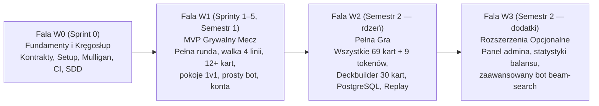

<!-- CONFLUENCE 1:1 EXPORT | Source: docs/01-dokumentacja-systemowa/01-prd-wymagania-produktu.md @ a2bf2a4 (2026-11-02) -->
# 1.1 Wymagania produktu (PRD) — RE:JOLTANCE

> **Źródło prawdy:** repozytorium (`docs/01-dokumentacja-systemowa/01-prd-wymagania-produktu.md`) · **Kategoria dokumentacji:** Dokumentacja produktowa — systemowa (wymagania produktu, PRD) · **Etap SDD:** Specyfikacja · **Wersja:** 1.0 (2026-11-02)

Ten dokument to PRD (Product Requirements Document), czyli opis wymagań produktu dla gry RE:JOLTANCE. Układ rozdziałów pochodzi z klasyfikacji AltexSoft. Uwzględniamy też efekty uczenia się przedmiotu *Projekt zespołowy* (EU1–EU6). PRD opisuje produkt z perspektywy biznesu i gracza. Szczegółowe, wykonywalne specyfikacje są w katalogu `openspec/specs/`.

SDD (Spec-Driven Development) to nasz sposób pracy: najpierw zapisujemy specyfikację, potem piszemy kod.

---

## 1. Role i odpowiedzialności

Pracujemy w Scrumie jako 6-osobowy zespół studencki. Zgodnie z sylabusem (EU1) każdy z nas jest właścicielem i autorem wymagań jednego epiku (`E1–E6`). Rolę Product Ownera pełnimy rotacyjnie, co sprint inna osoba (EU3, EU4).

| Rola | Osoba / jednostka | Za co odpowiada | Efekty uczenia się |
|---|---|---|---|
| **Scrum Master / opiekun dydaktyczny** | Prowadzący zajęcia (*Politechnika Białostocka*) | Nadzór nad metodyką, ocena przyrostów na *Sprint Review*, rozstrzyganie sporów o zakres sprintu, administracja Jira/Confluence/Bitbucket PB. | Ocena EU1–EU7 |
| **Product Owner (rotacyjnie, co sprint)** | Wyznaczony członek zespołu (harmonogram w DIP §6) | Priorytety *Product Backlogu*, prowadzenie ceremonii (*Planning*, *Daily*, *Review*, *Retro*), wykres spalania (*Burndown Chart*), kontakt z Radą Graczy. | EU3, EU4, EU5 |
| **Właściciel epiku E1 (silnik reguł — Kernel)** | Członek zespołu #1 *(do wpisania po zatwierdzeniu #9)* | Wymagania i implementacja deterministycznego silnika reguł (`R-01..R-54`, `R-70..R-72`), projekcja widoku, testy jednostkowe reguł. | EU1, EU2, EU5, EU6 |
| **Właściciel epiku E2 (karty i DSL efektów)** | Członek zespołu #2 *(do wpisania po zatwierdzeniu #9)* | Katalog kart i talii (`cards.json`), walidator słownika DSL, obsługa efektów i wyzwalaczy kart (`R-60..R-69`). | EU1, EU2, EU5, EU6 |
| **Właściciel epiku E3 (serwer i sieć SignalR)** | Członek zespołu #3 *(do wpisania po zatwierdzeniu #9)* | Autorytatywny serwer meczu (`MatchHub`, `MatchSessionManager`), pokoje PvP, rozłączenia i powroty do meczu (`R-73`, `R-80..R-84`). | EU1, EU2, EU5, EU6 |
| **Właściciel epiku E4 (klient webowy i UX)** | Członek zespołu #4 *(do wpisania po zatwierdzeniu #9)* | Interfejs w React + TypeScript (`src/web`), plansza 4 linii, interakcje (`PendingInteraction`), animacje, podręcznik gracza. | EU1, EU2, EU5, EU6 |
| **Właściciel epiku E5 (bot AI i symulator)** | Członek zespołu #5 *(do wpisania po zatwierdzeniu #9)* | Wyrocznia referencyjna (testy różnicowe względem prototypu JS), heurystyczny bot AI do gry solo, symulator partii bot-vs-bot. | EU1, EU2, EU5, EU6 |
| **Właściciel epiku E6 (platforma, dane i jakość)** | Członek zespołu #6 *(do wpisania po zatwierdzeniu #9)* | Orkiestracja Aspire, konta graczy, kreator talii (*Deckbuilder*), migracja SQLite → PostgreSQL, CI/CD, testy E2E w Playwright, wersja demo. | EU1, EU2, EU5, EU6 |
| **Rada Graczy Testowych (użytkownicy końcowi)** | 3 graczy spoza zespołu | Walidacja wymagań, testy użyteczności, odbiór przyrostów na *Sprint Review*. | Walidacja EU1 i EU2 |

DSL (Domain-Specific Language) to nasz mały język do opisu efektów kart w danych JSON. CI/CD to automatyczne budowanie, testowanie i wdrażanie. E2E (end-to-end) to testy całej aplikacji z perspektywy użytkownika.

---

## 2. Cele zespołu, cele biznesowe i dopasowanie strategiczne

### 2.1 Tło projektu i problem do rozwiązania

RE:JOLTANCE to autorska gra karciana dla dwóch osób typu *lane battler*. Gracze walczą na 4 liniach, korzystają z odnawialnego zasobu *Blood*, mają talie po 30 kart, a bohater ma 20 punktów zdrowia. Przed naszym projektem powstały dwa prototypy:

1. **Wersja desktopowa (C# / Godot).** Trzeba ją było zainstalować lokalnie. Nie miała gry przez internet.
2. **Prototyp przeglądarkowy w czystym JavaScripcie (`prototype/revibance`, v11).** Ma pełny zestaw 69 kart kolekcjonerskich i 9 tokenów i działa w przeglądarce. Komunikacja sieciowa działa jednak Peer-to-Peer (PeerJS), bez serwera. Z tego wynikają problemy:
   - klient gościa widział identyfikatory, które zdradzały rękę i kolejność talii hosta (brak *Fog of War*, czyli ukrywania informacji przed przeciwnikiem),
   - serwer nie sprawdzał celów, więc klient mógł zmienić komunikat i poświęcić jednostkę przeciwnika,
   - kod był podatny na XSS (`innerHTML`),
   - losowość z `Math.random()` była niedeterministyczna, więc nie dało się odtworzyć powtórki (*replay*),
   - nie było żadnych testów automatycznych.

### 2.2 Cel główny produktu i miary sukcesu

Budujemy webową wersję gry RE:JOLTANCE z autorytatywnym serwerem w .NET 10 i klientem w React + TypeScript. Gra ma być bezpieczna, deterministyczna i przetestowana. Gracz otwiera link w przeglądarce i od razu gra 1v1 albo trenuje z botem AI. Nie musi niczego instalować.

| Wymiar celu | Miara sukcesu (KPI / kryterium odbioru) | Kiedy sprawdzamy |
|---|---|---|
| **Dostępność bez instalacji (Zero-Install)** | Nowy gracz z Rady Graczy uruchamia mecz z botem lub z drugim graczem przez link i kończy pierwszą partię w **≤ 15 minut** bez naszej pomocy (NFR-20). | Sprint Review S3 i S5 |
| **Uczciwość i bezpieczeństwo (Server Authority)** | **0% wycieku ukrytych informacji** w pakietach SignalR. Klient dostaje tylko projekcję `MatchView`, bez ręki i kolejności talii przeciwnika (R-80, R-81, NFR-41). | Każdy sprint (testy `ProjectionTests`) |
| **Poprawność i determinizm reguł** | **100% zaimplementowanych reguł (`R-nn`)** ma testy jednostkowe xUnit. Ten sam `seed` i ta sama lista intencji zawsze dają ten sam stan końcowy meczu (R-83, NFR-51). | Każdy PR w GitHub Actions CI |
| **Wydajność w czasie rzeczywistym** | Serwer przetwarza intencję i rozsyła `MatchUpdated` w czasie **p95 ≤ 200 ms** przy 50 równoległych meczach (NFR-01). | Sprint Review S4 i S5 |

KPI (Key Performance Indicator) to mierzalny wskaźnik sukcesu. NFR (Non-Functional Requirement) to wymaganie niefunkcjonalne, np. wydajność albo bezpieczeństwo. p95 oznacza, że 95% pomiarów mieści się w limicie.

### 2.3 Roadmapa strategiczna i fale wydań (W0–W3)

Mamy ograniczony czas: 6 osób × 5 h tygodniowo. Żeby na pewno dowieźć działający produkt, dzielimy zakres na cztery fale priorytetów. Granica między falami to **linia cięcia**: jeśli zabraknie czasu, tniemy od ostatniej fali.

---

## 3. Persony użytkowników i scenariusze użycia

Szablon person i mapy historyjek jest w [`05-szablony/szablon-ux-persona-scenariusz.md`](../05-szablony/szablon-ux-persona-scenariusz.md). Poniżej są trzy główne persony. Opracowaliśmy je razem z użytkownikami końcowymi (EU1).

| Persona | Kim jest i jak gra | Co mu przeszkadza (*pain points*) | Co dostaje w RE:JOLTANCE |
|---|---|---|---|
| **1. Gracz okazjonalny (student WI PB)** | Gra w 15-minutowych przerwach między zajęciami, na laptopie uczelnianym lub prywatnym. | Instalowanie klienta gry, długie szukanie przeciwnika, skomplikowane ekrany konfiguracji. | Wejście przez link w 5 sekund, gotowe talie startowe, szybki mecz z kolegą przez kod pokoju albo z botem. |
| **2. Gracz turniejowy / taktyk** | Zna gry karciane (*Magic*, *Runeterra*, *Inscryption*). Analizuje synergie kart i dokładne zasady. | Niejasne interakcje słów kluczowych, oszukiwanie w prototypie P2P, błędy silnika przy długich łańcuchach efektów. | Jednoznaczne, deterministyczne reguły (`R-nn`), podświetlanie tylko legalnych ruchów (`legalActions`), uczciwy serwer, pełny dziennik meczu. |
| **3. Projektant balansu gry** | Autorzy koncepcji RE:JOLTANCE, którzy rozwijają pulę kart i talii. | Brak narzędzi, które szybko pokażą, czy nowa karta psuje balans albo zawiesza silnik. | Karty jako dane JSON sprawdzane przy starcie (`ContentValidator`), symulator setek partii bot-vs-bot, deterministyczny replay z ziarna (`seed`). |

---

## 4. Zakres funkcjonalny: epiki, historyjki i kryteria akceptacji

Pełny rejestr historyjek i podzadań jest w pliku [`03-dokumentacja-procesowa/02-backlog/backlog.toml`](../03-dokumentacja-procesowa/02-backlog/backlog.toml). Wygenerowane zestawienie znajdziesz w [`BACKLOG.md`](../03-dokumentacja-procesowa/02-backlog/BACKLOG.md). Poniżej jest skrót 7 epików i kilka przykładowych historyjek z kryteriami w formacie `GIVEN / WHEN / THEN`.

### Zestawienie epików

| ID | Nazwa epiku | Moduł w kodzie | Liczba story (S1 / S2) | Główny cel |
|---|---|---|---|---|
| **E0** | Fundamenty i środowisko SDD | Repo, `tools/`, `docs/` | 4 story (Sprint 0) | Działający szkielet Aspire, CI/CD, uzgodnienie rozbieżności reguł z Radą Graczy, import backlogu do Jiry. |
| **E1** | Silnik reguł gry (Kernel) | `src/Rejoltance.Kernel` | 8 story | Deterministyczny przebieg rundy, zagrywanie jednostek, walka na 4 liniach, słowa kluczowe, koniec meczu. |
| **E2** | Katalog kart i interpreter efektów (DSL) | `src/Rejoltance.Content`, `Kernel` | 8 story | Walidacja danych 78 kart, wyzwalacze (`OnPlayed`, `OnDeath`, `OnSacrificed`), wybór celów, akcje kart. |
| **E3** | Autorytatywny serwer i sieć czasu rzeczywistego | `src/Rejoltance.Server` | 6 story | Pokoje 1v1 przez SignalR, projekcja `MatchView` (*Fog of War*), zegar tury, rozłączenie i powrót gracza. |
| **E4** | Klient webowy i doświadczenie gracza (UI/UX) | `src/web` | 7 story | Plansza 4 linii, wachlarz ręki, podświetlanie `legalActions`, okna `PendingInteraction`, dziennik meczu, dźwięki, animacje. |
| **E5** | Bot AI, wyrocznia testowa i symulator | `src/Rejoltance.Sim` *(planowany)* | 5 story | Wyrocznia porównująca Kernel C# z prototypem JS, bot AI grający przez kontrakt `Intent`, symulator bot-vs-bot. |
| **E6** | Platforma, trwałość danych, QA i wdrożenie | `Server`, `AppHost`, `tests/` | 9 story | Testy E2E w Playwright, konta graczy (Identity), *Deckbuilder*, migracja na PostgreSQL, kontenery, demo, replay. |

### Przykładowe historyjki z kryteriami akceptacji (`GIVEN / WHEN / THEN`)

1. **Przygotowanie meczu i wybór kolejności (`E1-S01`, reguły: `R-04`, `R-10`, `R-11`):**
   - *Jako* gracz rozpoczynający mecz *chcę* po mulliganie zadeklarować, czy wolę zaczynać jako pierwszy, czy jako drugi, *aby* przejść do pierwszej rundy z odnowionym zasobem Blood.
   - **Kryterium 1:** `GIVEN` obaj gracze zatwierdzili mulligan `WHEN` gracz 0 wybiera „pierwszy”, a gracz 1 wybiera „drugi” `THEN` rundę 1 zaczyna gracz 0 w kroku jednostek (`unitStep`), a obaj gracze mają `1/1 Blood`.
   - **Kryterium 2:** `GIVEN` obaj gracze wybrali tę samą kolejność `WHEN` obie deklaracje dotrą do serwera `THEN` gracza rozpoczynającego rundę 1 wyznacza deterministycznie `SeededRng` meczu.
2. **Automatyczna walka na 4 liniach (`E1-S03`, reguły: `R-30`, `R-32`, `R-33`, `R-50`, `R-70`, `R-71`):**
   - *Jako* gracz *chcę*, żeby po kroku akcji walka rozstrzygnęła się sama od linii 0 do linii 3, *aby* jednostki stoczyły pojedynek i zadały obrażenia bohaterom.
   - **Kryterium 1:** `GIVEN` na linii 0 stoją naprzeciw siebie jednostki naziemne `3/2` i `2/3` `WHEN` linia 0 się rozstrzyga `THEN` obie uderzają jednocześnie, obie dostają śmiertelne obrażenia i trafiają na stosy kart odrzuconych.
   - **Kryterium 2:** `GIVEN` na linii 1 jednostka z `Flying` i atakiem `4` stoi naprzeciw jednostki naziemnej bez `Flying` `WHEN` linia 1 się rozstrzyga `THEN` jednostka latająca zadaje `4` obrażenia bezpośrednio bohaterowi przeciwnika.
3. **Mecz 1v1 w pokoju sieciowym z ochroną Fog of War (`E3-S01`, `E3-S02`, reguły: `R-80`, `R-81`, `R-82`):**
   - *Jako* gracz *chcę* utworzyć pokój i przekazać kod drugiemu graczowi, *aby* rozegrać uczciwy pojedynek 1v1, w którym żaden z nas nie podejrzy kart przeciwnika.
   - **Kryterium 1:** `GIVEN` gracz A utworzył pokój i dostał kod `WHEN` gracz B wywołuje `JoinRoom(code)` `THEN` serwer uruchamia mecz, przypisuje graczy do miejsc `0` i `1` i wysyła każdemu jego własny widok `MatchView`.
   - **Kryterium 2:** `GIVEN` trwa mecz gracza 0 z graczem 1 `WHEN` serwer wysyła `MatchUpdated` do gracza 0 `THEN` pole `opponent` zawiera tylko liczbę kart w ręce i talii przeciwnika, bez identyfikatorów kart.

---

## 5. Wymagania funkcjonalne

Wymagania funkcjonalne dzielimy na dwie grupy: reguły gry i funkcje platformy webowej.

### 5.1 Reguły mechaniki gry (`R-01..R-84`)

Mamy **55 reguł domenowych**. Każda jest formalnie zapisana w pliku `openspec/specs/<obszar>/spec.md`. CI sprawdza te pliki poleceniem `npx openspec validate --all --strict`. Te same reguły opisujemy zwykłym językiem w dokumencie [1.2 Specyfikacja funkcjonalna zasad gry](02-specyfikacja-regul-gry.md). Zestawienie z testami jest w [1.3 Indeks reguł R‑nn](03-indeks-regul-r-nn.md).

| Zakres numerów | Obszar | Plik OpenSpec | Liczba reguł |
|---|---|---|---|
| **`R-01 .. R-04`** | Przygotowanie meczu, walidacja talii, mulligan, wybór kolejności | `openspec/specs/match-setup/spec.md` | 4 |
| **`R-10 .. R-15`** | Przebieg rundy, odnawianie Blood, kroki A/B, limit ręki, obrażenia Fatigue | `openspec/specs/round-flow/spec.md` | 6 |
| **`R-20 .. R-25`** | Zagrywanie jednostek i akcji, koszt, efekty w ręce, wybór celów | `openspec/specs/playing-cards/spec.md` | 6 |
| **`R-30 .. R-35`** | Walka na 4 liniach, efekty przed walką, Flying, Bonus Attack | `openspec/specs/combat/spec.md` | 6 |
| **`R-40 .. R-48`** | Słowa kluczowe i statusy (`Armored`, `Marked`, `Stunned`, `Burning`, `SplashDamage`, `Breakthrough`, `SoulGuard`, `Unkillable`) | `openspec/specs/keywords/spec.md` | 9 |
| **`R-50 .. R-54`** | Śmierć jednostek, poświęcenie (`Sacrifice`), wyciszenie (`Silence`), powrót do ręki, limit pętli reakcji | `openspec/specs/death-and-removal/spec.md` | 5 |
| **`R-60 .. R-69`** | Interpreter efektów kart (DSL): wyzwalacze, warunki, statystyki, dobieranie, tokeny, transformacja | `openspec/specs/card-effects/spec.md` | 10 |
| **`R-70 .. R-73`** | Koniec meczu: HP spada do 0, remis, poddanie się, walkower po rozłączeniu | `openspec/specs/match-end/spec.md` | 4 |
| **`R-80 .. R-84`** | Autorytet serwera, projekcja *Fog of War*, deterministyczny RNG, obsługa `PendingInteraction` | `openspec/specs/server-authority/spec.md` | 5 |

### 5.2 Wymagania funkcjonalne platformy webowej

1. **Piaskownica i trening z botem (`StartSandbox` / `StartBotMatch`).** Gracz od razu uruchamia mecz testowy albo pojedynek z botem AI. Wybiera jedną z 5 gotowych talii startowych.
2. **Lobby i prywatne pokoje 1v1 (`CreateRoom` / `JoinRoom`).** Gracz tworzy pokój z krótkim kodem i linkiem zapraszającym. System łączy dwóch graczy w parę.
3. **Odporność na chwilową utratę połączenia (`Reconnect`).** Serwer trzyma sesję meczu przez 60 sekund od zerwania połączenia WebSocket. Po powrocie gracz dostaje pełny widok `MatchView`.
4. **Konta użytkowników i logowanie (od Sprintu 2).** Rejestracja i logowanie działają na bezpiecznych ciasteczkach `HttpOnly` (ASP.NET Core Identity). Można też zagrać szybko jako gość.
5. **Kreator talii (*Deckbuilder*, fala W2).** Gracz tworzy, sprawdza (30 kart, maks. 3 kopie, bez tokenów) i zapisuje własne talie na swoim koncie.
6. **Historia meczów i deterministyczny replay (fala W2).** Baza danych przechowuje ziarno losowości (`Seed`) i uporządkowaną listę intencji (`Intent[]`). Z tych danych odtwarzamy przebieg zakończonego meczu.

---

## 6. Wymagania niefunkcjonalne (wg normy ISO/IEC 25010:2023)

Pełna specyfikacja 18 wymagań niefunkcjonalnych (NFR) ze scenariuszami testowymi jest w pliku [`openspec/specs/quality-attributes/spec.md`](../../openspec/specs/quality-attributes/spec.md). Tabela poniżej to skrót najważniejszych parametrów.

| Charakterystyka wg ISO/IEC 25010 | ID wymagania | Wymóg mierzalny (metryka i próg) |
|---|---|---|
| **Wydajność (*Performance*)** | `NFR-01`, `NFR-02` | Obsługa ruchu na serwerze **p95 ≤ 200 ms** przy 50 równoległych meczach. Paczka startowa JS **≤ 500 kB (gzip)**, czas do interaktywności **≤ 3 s**. |
| **Kompatybilność (*Compatibility*)** | `NFR-10`, `NFR-11` | Działa w 2 ostatnich wersjach Chrome, Edge, Firefox i Safari (od `1280×720`). Build zatrzymuje się, gdy kontrakt C# ↔ TS się nie zgadza. |
| **Użyteczność i dostępność (*Usability*)** | `NFR-20..NFR-22` | Nowy gracz kończy pierwszy mecz w **≤ 15 min** bez pomocy. UI podświetla tylko legalne ruchy z `legalActions`. Obsługa z klawiatury i kontrast tekstu **WCAG 2.1 AA (≥ 4.5:1)**. |
| **Niezawodność (*Reliability*)** | `NFR-30`, `NFR-31` | Instancja demo dostępna **≥ 99%** czasu w tygodniu przed *Sprint Review*. Błąd w jednym meczu nie wpływa na inne mecze. Powrót po rozłączeniu w ciągu **60 s** opisuje reguła `R-73`. |
| **Bezpieczeństwo (*Security*)** | `NFR-40..NFR-42` | Żadna karta przeciwnika nie wycieka w danych sieciowych. Serwer sprawdza miejsce przy stole (`Seat`) i limituje żądania (≤ 10 intencji/s). Brak sekretów w repozytorium. |
| **Utrzymywalność (*Maintainability*)** | `NFR-50..NFR-52` | Testy `NetArchTest` pilnują jednokierunkowych granic modułów. Pokrycie kodu `Rejoltance.Kernel` testami **≥ 80%**. Zero ostrzeżeń kompilatora w CI (`TreatWarningsAsErrors`). |
| **Przenośność (*Portability*)** | `NFR-60`, `NFR-61` | Całe środowisko lokalne startuje jednym poleceniem, bez Dockera (Sprinty 0–3). Wersja demo/produkcyjna działa w jednym kontenerze OCI. |
| **Bezpieczeństwo użytkownika (*Safety*)** | `NFR-70` | Żadne efekty świetlne nie migają częściej niż 3 razy na sekundę. Gra respektuje systemowe ustawienie `prefers-reduced-motion`. |

---

## 7. Interakcja użytkownika i projekt interfejsu

Mapę ekranów, układ planszy (*wireframe*), przepływy użytkownika i przewodnik stylu (*UI Style Guide*) opisuje dokument [1.10 Projekt UX, przepływy i przewodnik stylu](10-ux-design-i-przeplywy.md). Działającym wzorem interakcji, grafiki i dźwięku jest prototyp w katalogu [`prototype/revibance/`](../../prototype/README.md).

---

## 8. Poza zakresem projektu

Żeby zakres nie rozrastał się bez kontroli (*scope creep*), świadomie **nie robimy** tych rzeczy:

1. **Natywne aplikacje mobilne (iOS / Android) i pionowy układ dla smartfonów.** Gra jest dla przeglądarek na komputerach, w orientacji poziomej (od `1280×720`).
2. **Mikropłatności, sklep z paczkami kart i waluty premium.** Wszystkie karty są odblokowane dla każdego gracza w kreatorze talii.
3. **Architektura wieloserwerowa (klastry Kubernetes, szyna komunikatów Redis/RabbitMQ) w Semestrze 1.** Zgodnie z Konstytucją (Art. VIII) budujemy modularny monolit. Aktywne mecze żyją w pamięci jednego procesu serwera.
4. **Czat tekstowy i głosowy w grze.** Gracze rozmawiają przez zewnętrzne komunikatory (np. Discord). Dzięki temu nie musimy budować moderacji treści.
5. **Tryby dla więcej niż 2 graczy (2v2, Free-for-All).** Silnik reguł `Rejoltance.Kernel` jest zaprojektowany pod pojedynek 1 na 1.
