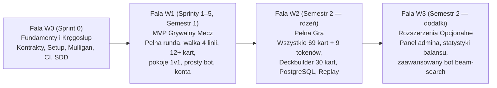

<!-- CONFLUENCE 1:1 EXPORT | Source: docs/01-dokumentacja-systemowa/01-prd-wymagania-produktu.md @ 10829d3 (2026-11-02) -->
# 1.1 Wymagania produktu (PRD) — RE:JOLTANCE

> **Źródło prawdy:** repozytorium (`docs/01-dokumentacja-systemowa/01-prd-wymagania-produktu.md`) · **Kategoria dokumentacji:** Dokumentacja produktowa — systemowa (Wymagania produktu PRD) · **Etap SDD:** Specyfikacja · **Wersja:** 1.0 (2026-11-02)

Niniejszy dokument stanowi kompletną specyfikację wymagań produktu (**PRD**) dla systemu **RE:JOLTANCE**, opracowaną zgodnie ze strukturą wskazaną w klasyfikacji AltexSoft oraz wymaganiami przedmiotu *Projekt zespołowy* (**EU1–EU6**). Dokument łączy perspektywę biznesową i użytkową z wykonywalnymi specyfikacjami technicznymi w katalogu `openspec/specs/`.

---

## 1. Role i odpowiedzialności

Projekt realizowany jest w metodyce **Scrum** przez 6-osobowy zespół studencki. Zgodnie z wymogami sylabusowymi (**EU1**), każdy członek zespołu jest indywidualnym właścicielem i autorem wymagań jednego Epiku (`E1–E6`), a rola Właściciela Produktu (*Product Owner*) jest pełniona rotacyjnie w kolejnych sprintach (**EU3, EU4**).

| Rola w projekcie | Osoba / Jednostka | Zakres odpowiedzialności | Powiązane efekty uczenia się |
|---|---|---|---|
| **Scrum Master / Opiekun dydaktyczny** | Prowadzący zajęcia (*Politechnika Białostocka*) | Nadzór metodyczny, ocena przyrostów na *Sprint Review*, arbitraż zakresu sprintów, administracja projektami w Jira/Confluence/Bitbucket PB. | Ocena EU1–EU7 |
| **Product Owner (rotacyjnie per sprint)** | Wyznaczony członek zespołu (zgodnie z harmonogramem w DIP §6) | Zarządzanie priorytetami *Product Backlogu*, prowadzenie ceremonii (*Planning*, *Daily*, *Review*, *Retro*), aktualizacja wykresów spalania (*Burndown Chart*), kontakt z Radą Graczy. | EU3, EU4, EU5 |
| **Właściciel Epiku E1 (Silnik Reguł — Kernel)** | Członek zespołu #1 *(do wpisania po zatwierdzeniu #9)* | Analiza wymagań i implementacja deterministycznego silnika reguł gry (`R-01..R-54`, `R-70..R-72`), projekcji widoku oraz testów jednostkowych reguł. | EU1, EU2, EU5, EU6 |
| **Właściciel Epiku E2 (Karty i DSL Efektów)** | Członek zespołu #2 *(do wpisania po zatwierdzeniu #9)* | Katalog kart i talii (`cards.json`), walidator słownika DSL oraz implementacja handlerów efektów i wyzwalaczy kart (`R-60..R-69`). | EU1, EU2, EU5, EU6 |
| **Właściciel Epiku E3 (Serwer i Sieć SignalR)** | Członek zespołu #3 *(do wpisania po zatwierdzeniu #9)* | Autorytatywny serwer meczu (`MatchHub`, `MatchSessionManager`), pokoje gier PvP, obsługa rozłączeń i powrotów do meczu (`R-73`, `R-80..R-84`). | EU1, EU2, EU5, EU6 |
| **Właściciel Epiku E4 (Klient Webowy i UX)** | Członek zespołu #4 *(do wpisania po zatwierdzeniu #9)* | Interfejs użytkownika w React + TypeScript (`src/web`), wizualizacja planszy 4 linii, obsługa interakcji (`PendingInteraction`), animacje i podręcznik gracza. | EU1, EU2, EU5, EU6 |
| **Właściciel Epiku E5 (Bot AI i Symulator)** | Członek zespołu #5 *(do wpisania po zatwierdzeniu #9)* | Silnik wyroczni referencyjnej (testy różnicowe względem prototypu JS), heurystyczny bot AI do gry solo oraz symulator partii bot-vs-bot. | EU1, EU2, EU5, EU6 |
| **Właściciel Epiku E6 (Platforma, Dane i Jakość)** | Członek zespołu #6 *(do wpisania po zatwierdzeniu #9)* | Orkiestracja Aspire, konta użytkowników, kreator talii (*Deckbuilder*), migracja SQLite → PostgreSQL, CI/CD, testy E2E Playwright i wdrożenie wersji demo. | EU1, EU2, EU5, EU6 |
| **Rada Graczy Testowych (Użytkownicy końcowi)** | 3 reprezentantów graczy spoza zespołu projektowego | Walidacja wymagań, udział w sesjach testów użyteczności i odbiór kolejnych przyrostów produktu podczas *Sprint Review*. | Walidacja EU1 i EU2 |

---

## 2. Cele zespołu, cele biznesowe i dopasowanie strategiczne

### 2.1 Tło projektu i rozwiązywany problem

**RE:JOLTANCE** to autorska, dwuosobowa gra karciana typu *lane battler* (4 linie walki, odnawialny zasób *Blood*, talie złożone z 30 kart, 20 punktów zdrowia bohatera). Przed rozpoczęciem niniejszego projektu powstały dwa niezależne prototypy:

1. **Wersja desktopowa (C# / Godot)** — wymagała lokalnej instalacji na komputerze gracza i nie oferowała rozgrywki sieciowej przez internet.
2. **Prototyp przeglądarkowy w czystym JavaScripcie (`prototype/revibance`, v11)** — zawierał pełny zestaw 69 kart kolekcjonerskich i 9 tokenów oraz pozwalał na grę w przeglądarce, jednak opierał komunikację sieciową na architekturze Peer-to-Peer (PeerJS), w której:
   - klient gościa miał wgląd w identyfikatory ujawniające zawartość ręki i kolejność kart w talii hosta (brak *Fog of War*),
   - brakowało serwerowej walidacji celów (klient mógł zmodyfikować komunikat i poświęcić jednostkę przeciwnika),
   - występowały podatności typu XSS (`innerHTML`), niedeterministyczna losowość (`Math.random()`) uniemożliwiająca odtwarzanie powtórek (*replay*) oraz całkowity brak testów automatycznych.

### 2.2 Cel główny produktu i miary sukcesu

Głównym celem projektu jest wytworzenie **bezpiecznej, deterministycznej i w pełni przetestowanej webowej wersji gry RE:JOLTANCE z autorytatywnym serwerem w technologii .NET 10 oraz nowoczesnym klientem React + TypeScript**, która umożliwia natychmiastową rozgrywkę 1v1 przez link w przeglądarce lub trening z botem AI bez konieczności instalacji jakiegokolwiek oprogramowania.

| Wymiar celu | Mierzalny wskaźnik sukcesu (KPI / Kryterium odbioru) | Termin weryfikacji |
|---|---|---|
| **Dostępność rozgrywki (Zero-Install)** | Nowy gracz z Rady Graczy uruchamia mecz z botem lub drugim graczem przez link w przeglądarce i kończy pierwszą partię w czasie **≤ 15 minut** bez wsparcia zespołu (NFR-20). | Sprint Review S3 i S5 |
| **Uczciwość i bezpieczeństwo (Server Authority)** | **0% wycieku ukrytych informacji** w pakietach sieciowych SignalR — klient otrzymuje wyłącznie projekcję `MatchView` bez zawartości ręki i kolejności talii przeciwnika (R-80, R-81, NFR-41). | Każdy Sprint (testy `ProjectionTests`) |
| **Poprawność i determinizm reguł** | **100% zaimplementowanych reguł gry (`R-nn`)** posiada automatyczne testy jednostkowe xUnit, a ten sam `seed` + lista intencji zawsze daje identyczny stan końcowy meczu (R-83, NFR-51). | Każdy PR w GitHub Actions CI |
| **Wydajność czasu rzeczywistego** | Czas przetworzenia intencji gracza przez serwer i rozesłania aktualizacji widoku `MatchUpdated` wynosi **p95 ≤ 200 ms** przy 50 równoległych meczach (NFR-01). | Sprint Review S4 i S5 |

### 2.3 Roadmapa strategiczna i fale wydań (Fale W0–W3)

Aby zabezpieczyć terminowe dowiezienie działającego produktu przy budżecie czasowym zespołu (6 osób × 5 h/tydz.), zakres funkcjonalny podzielono na cztery fale priorytetów (**linia cięcia**):

---

## 3. Persony użytkowników i scenariusze użycia

Szczegółowy szablon person i mapy historyjek znajduje się w [`05-szablony/szablon-ux-persona-scenariusz.md`](../05-szablony/szablon-ux-persona-scenariusz.md). Poniżej zestawiono trzy główne persony zidentyfikowane we współpracy z użytkownikami końcowymi (**EU1**):

| Persona | Charakterystyka i kontekst użycia | Główne bolączki (Pain Points) | Oczekiwana wartość w RE:JOLTANCE |
|---|---|---|---|
| **1. Gracz okazjonalny (Student WI PB)** | Gra w 15-minutowych przerwach między zajęciami na laptopie uczelnianym lub prywatnym. | Konieczność instalowania klienta gry, długie szukanie przeciwnika, skomplikowane ekrany konfiguracji. | Wejście przez link w przeglądarce w 5 sekund, gotowe talie startowe, natychmiastowy mecz z kolegą przez kod pokoju lub z botem. |
| **2. Gracz turniejowy / Taktyk karciany** | Doświadczony gracz karcianek (*Magic*, *Runeterra*, *Inscryption*), analizujący synergie kart i dokładne zasady. | Niejasne interakcje słów kluczowych, możliwość oszukiwania w prototypie P2P, przypadkowe błędy silnika przy złożonych łańcuchach efektów. | Jednoznaczne, zdeterminowane reguły (`R-nn`), podświetlanie wyłącznie legalnych ruchów (`legalActions`), uczciwy serwer i pełny dziennik zdarzeń meczu. |
| **3. Projektant balansu gry** | Twórcy oryginalnej koncepcji RE:JOLTANCE rozwijający pulę kart i talii. | Brak narzędzi do szybkiego sprawdzania, czy nowa karta nie psuje balansu lub nie zawiesza silnika. | Karty definiowane jako dane JSON z walidacją słownika DSL przy starcie (`ContentValidator`), symulator setek partii bot-vs-bot oraz deterministyczny replay z ziarna (`seed`). |

---

## 4. Zakres funkcjonalny: Epiki, historyjki użytkownika i kryteria akceptacji

Kompletny rejestr wszystkich historyjek użytkownika i podzadań znajduje się w pliku źródłowym [`03-dokumentacja-procesowa/02-backlog/backlog.toml`](../03-dokumentacja-procesowa/02-backlog/backlog.toml) oraz w wygenerowanym zestawieniu [`BACKLOG.md`](../03-dokumentacja-procesowa/02-backlog/BACKLOG.md). Poniżej przedstawiono syntetyczny przegląd 7 epików wraz z reprezentatywnymi historyjkami i kryteriami akceptacji w standardzie `GIVEN / WHEN / THEN`:

### Zestawienie Epików Projektu

| ID Epiku | Nazwa Epiku | Moduł w kodzie | Liczba Story (S1 / S2) | Główny cel funkcjonalny |
|---|---|---|---|---|
| **E0** | **Fundamenty i środowisko SDD** | Repo, `tools/`, `docs/` | 4 story (Sprint 0) | Uruchamialny szkielet Aspire, konfiguracja CI/CD, uzgodnienie rozbieżności reguł z Radą Graczy, import backlogu do Jiry. |
| **E1** | **Silnik reguł gry (Kernel)** | `src/Rejoltance.Kernel` | 8 story | Czysta, deterministyczna implementacja przebiegu rundy, zagrywania jednostek, walki na 4 liniach, słów kluczowych i warunków końca meczu. |
| **E2** | **Katalog kart i interpreter efektów (DSL)** | `src/Rejoltance.Content`, `Kernel` | 8 story | Walidacja danych 78 kart, obsługa wyzwalaczy (`OnPlayed`, `OnDeath`, `OnSacrificed`), wyboru celów i akcji kart czarów oraz jednostek. |
| **E3** | **Autorytatywny serwer i sieć czasu rzeczywistego** | `src/Rejoltance.Server` | 6 story | Pokoje meczowe 1v1 przez SignalR, projekcja widoku `MatchView` (*Fog of War*), zegar tury, obsługa rozłączenia i powrotu gracza. |
| **E4** | **Klient webowy i doświadczenie gracza (UI/UX)** | `src/web` | 7 story | Interaktywna plansza 4 linii, wachlarz ręki, podświetlanie `legalActions`, modale `PendingInteraction`, dziennik meczu, dźwięki i animacje. |
| **E5** | **Bot AI, wyrocznia testowa i symulator** | `src/Rejoltance.Sim` *(planowany)* | 5 story | Wyrocznia porównująca Kernel C# z prototypem JS, bot AI grający przez kontrakt `Intent` oraz symulator partii bot-vs-bot. |
| **E6** | **Platforma, trwałość danych, QA i wdrożenie** | `Server`, `AppHost`, `tests/` | 9 story | Testy E2E Playwright, konta graczy (Identity), kreator talii (*Deckbuilder*), migracja na PostgreSQL, konteneryzacja, hosting demo i replay. |

### Przykładowe kluczowe historyjki użytkownika z kryteriami akceptacji (`GIVEN / WHEN / THEN`)

1. **Przygotowanie meczu i wybór kolejności (`E1-S01`, Reguły: `R-04`, `R-10`, `R-11`):**
   - *Jako* gracz rozpoczynający mecz, *chcę* po zakończeniu mulliganu zadeklarować, czy wolę zaczynać jako pierwszy czy jako drugi, *aby* przejść do pierwszej rundy rozgrywki z odnowionym zasobem Blood.
   - **Kryterium 1:** `GIVEN` obaj gracze zatwierdzili mulligan `WHEN` gracz 0 wybiera „pierwszy”, a gracz 1 wybiera „drugi” `THEN` rundę 1 rozpoczyna gracz 0 w kroku jednostek (`unitStep`), a obaj gracze posiadają `1/1 Blood`.
   - **Kryterium 2:** `GIVEN` obaj gracze wybrali tę samą preferencję kolejności `WHEN` obie deklaracje dotrą do serwera `THEN` gracz rozpoczynający rundę 1 zostaje wyznaczony deterministycznie na podstawie `SeededRng` meczu.
2. **Automatyczne rozstrzygnięcie walki na 4 liniach (`E1-S03`, Reguły: `R-30`, `R-32`, `R-33`, `R-50`, `R-70`, `R-71`):**
   - *Jako* gracz, *chcę* aby po zakończeniu kroku akcji walka rozstrzygnęła się automatycznie od linii 0 do linii 3, *aby* jednostki stoczyły pojedynek i zadały obrażenia bohaterom.
   - **Kryterium 1:** `GIVEN` na linii 0 naprzeciw siebie stoją jednostki naziemne o statystykach `3/2` oraz `2/3` `WHEN` następuje rozstrzygnięcie linii 0 `THEN` uderzenia są jednoczesne, obie jednostki otrzymują śmiertelne obrażenia i zostają przeniesione na stosy kart odrzuconych.
   - **Kryterium 2:** `GIVEN` na linii 1 jednostka z cechą `Flying` i atakiem `4` stoi naprzeciw jednostki naziemnej bez `Flying` `WHEN` linia 1 się rozstrzyga `THEN` jednostka latająca zadaje `4` obrażenia bezpośrednio bohaterowi przeciwnika.
3. **Mecz 1v1 przez pokój sieciowy z ochroną Fog of War (`E3-S01`, `E3-S02`, Reguły: `R-80`, `R-81`, `R-82`):**
   - *Jako* gracz, *chcę* utworzyć pokój meczowy i przekazać kod drugiemu graczowi, *aby* rozegrać uczciwy pojedynek 1v1, w którym żaden z nas nie może podejrzeć kart przeciwnika.
   - **Kryterium 1:** `GIVEN` gracz A utworzył pokój i otrzymał kod pokoju `WHEN` gracz B wywołuje `JoinRoom(code)` `THEN` serwer uruchamia mecz, przypisuje graczy do miejsc `0` i `1` oraz wysyła każdemu z nich indywidualny widok `MatchView`.
   - **Kryterium 2:** `GIVEN` trwa mecz pomiędzy graczem 0 i graczem 1 `WHEN` serwer wysyła aktualizację `MatchUpdated` do gracza 0 `THEN` pole `opponent` zawiera wyłącznie liczbę kart w ręce i talii przeciwnika, bez identyfikatorów kart.

---

## 5. Wymagania funkcjonalne

Wymagania funkcjonalne dzielą się na dwa komplementarne zbiory:

### 5.1 Reguły mechaniki gry (`R-01..R-84`)

Wszystkich **55 reguł domenowych** zostało formalnie zdefiniowanych w wykonywalnych plikach specyfikacji `openspec/specs/<obszar>/spec.md` (walidowanych w CI poleceniem `npx openspec validate --all --strict`) oraz opisanych przystępnym językiem w dokumencie **[1.2 Specyfikacja funkcjonalna zasad gry](02-specyfikacja-regul-gry.md)** i zestawionych w macierzy **[1.3 Indeks reguł R‑nn](03-indeks-regul-r-nn.md)**:

| Grupa identyfikatorów | Obszar funkcjonalny | Plik wykonywalny OpenSpec | Liczba reguł |
|---|---|---|---|
| **`R-01 .. R-04`** | Przygotowanie meczu, walidacja talii, mulligan i wybór kolejności | `openspec/specs/match-setup/spec.md` | 4 |
| **`R-10 .. R-15`** | Przebieg rundy, odnawianie Blood, kroki A/B, limit ręki i obrażenia Fatigue | `openspec/specs/round-flow/spec.md` | 6 |
| **`R-20 .. R-25`** | Zagrywanie jednostek i akcji, obliczanie kosztu, efekty w ręce i wybór celów | `openspec/specs/playing-cards/spec.md` | 6 |
| **`R-30 .. R-35`** | Rozstrzyganie walki na 4 liniach, efekty przed walką, Flying i Bonus Attack | `openspec/specs/combat/spec.md` | 6 |
| **`R-40 .. R-48`** | Słowa kluczowe i statusy (`Armored`, `Marked`, `Stunned`, `Burning`, `SplashDamage`, `Breakthrough`, `SoulGuard`, `Unkillable`) | `openspec/specs/keywords/spec.md` | 9 |
| **`R-50 .. R-54`** | Śmierć jednostek, poświęcenie (`Sacrifice`), wyciszenie (`Silence`), powrót do ręki i limit pętli reakcji | `openspec/specs/death-and-removal/spec.md` | 5 |
| **`R-60 .. R-69`** | Interpreter efektów kart (DSL): wyzwalacze, warunki, modyfikacje statystyk, dobieranie, tworzenie tokenów i transformacja | `openspec/specs/card-effects/spec.md` | 10 |
| **`R-70 .. R-73`** | Warunki zakończenia meczu (spadek HP do 0, remis, poddanie się, walkower po rozłączeniu) | `openspec/specs/match-end/spec.md` | 4 |
| **`R-80 .. R-84`** | Autorytet serwera, projekcja *Fog of War*, deterministyczny RNG i obsługa `PendingInteraction` | `openspec/specs/server-authority/spec.md` | 5 |

### 5.2 Wymagania funkcjonalne platformy webowej

1. **Tryb piaskownicy i treningu z botem (`StartSandbox` / `StartBotMatch`):** Możliwość natychmiastowego uruchomienia meczu testowego lub pojedynku z botem AI przy użyciu jednej z 5 predefiniowanych talii startowych.
2. **Lobby i pokoje prywatne 1v1 (`CreateRoom` / `JoinRoom`):** Tworzenie pokoju z krótkim kodem tekstowym i linkiem zapraszającym oraz automatyczne parowanie dwóch graczy.
3. **Odporność na chwilową utratę połączenia (`Reconnect`):** Utrzymanie sesji meczu na serwerze przez 60 sekund od utraty połączenia WebSocket i odtworzenie pełnego widoku `MatchView` po powrocie gracza.
4. **System kont użytkowników i autoryzacja (od Sprintu 2):** Rejestracja i logowanie za pomocą bezpiecznych ciasteczek `HttpOnly` (ASP.NET Core Identity) oraz możliwość gry szybkiej jako gość.
5. **Kreator talii (*Deckbuilder*, Fala W2):** Tworzenie, walidacja (30 kart, maks. 3 kopie, brak tokenów) i zapisywanie własnych talii przypisanych do konta użytkownika.
6. **Zapis historii meczów i deterministyczny Replay (Fala W2):** Przechowywanie w bazie danych ziarna losowości (`Seed`) oraz uporządkowanej listy intencji (`Intent[]`), umożliwiające odtworzenie przebiegu zakończonego meczu.

---

## 6. Wymagania niefunkcjonalne (wg normy ISO/IEC 25010:2023)

Pełna specyfikacja 19 wymagań niefunkcjonalnych wraz z mierzalnymi scenariuszami testowymi znajduje się w pliku [`openspec/specs/quality-attributes/spec.md`](../../openspec/specs/quality-attributes/spec.md). Poniższa tabela podsumowuje kluczowe parametry jakościowe systemu:

| Charakterystyka wg ISO/IEC 25010 | ID wymagania | Wymóg mierzalny (Metryka i próg akceptacji) |
|---|---|---|
| **Wydajność czasowa (*Performance*)** | `NFR-01`, `NFR-02` | Czas obsługi ruchu na serwerze **p95 ≤ 200 ms** przy 50 równoległych meczach; rozmiar paczki startowej JS klienta **≤ 500 kB (gzip)**, czas do interaktywności **≤ 3 s**. |
| **Kompatybilność (*Compatibility*)** | `NFR-10`, `NFR-11` | Poprawne działanie w 2 ostatnich wersjach przeglądarek Chrome, Edge, Firefox i Safari (od `1280×720`); automatyczna blokada buildu przy niezgodności kontraktu C# ↔ TS. |
| **Użyteczność i dostępność (*Usability*)** | `NFR-20..NFR-22` | Rozegranie pierwszego meczu przez nowego gracza w **≤ 15 min** bez pomocy; podświetlanie wyłącznie legalnych ruchów z `legalActions`; obsługa z klawiatury i kontrast tekstu **WCAG 2.1 AA (≥ 4.5:1)**. |
| **Niezawodność (*Reliability*)** | `NFR-30..NFR-32` | Dostępność instancji demo **≥ 99%** w tygodniu przed *Sprint Review*; pełna izolacja błędów między meczami; obsługa ponownego połączenia w ciągu **60 s**. |
| **Bezpieczeństwo (*Security*)** | `NFR-40..NFR-42` | Całkowity brak wycieku kart przeciwnika w payloadach sieciowych; serwerowa autoryzacja miejsca przy stole (`Seat`) i limit szybkości żądań (≤ 10 intencji/s); brak sekretów w repozytorium. |
| **Utrzymywalność (*Maintainability*)** | `NFR-50..NFR-52` | Wymuszenie jednokierunkowych granic modułów testami `NetArchTest`; pokrycie kodu `Rejoltance.Kernel` testami **≥ 80%**; zero ostrzeżeń kompilatora w CI (`TreatWarningsAsErrors`). |
| **Przenaszalność (*Portability*)** | `NFR-60`, `NFR-61` | Uruchomienie pełnego środowiska lokalnego jednym poleceniem bez Dockera (w Sprintach 0–3); wdrożenie produkcyjne/demo w pojedynczym kontenerze OCI. |
| **Bezpieczeństwo użytkownika (*Safety*)** | `NFR-70` | Brak efektów świetlnych migających częściej niż 3 razy na sekundę oraz pełne respektowanie ustawienia systemowego `prefers-reduced-motion`. |

---

## 7. Interakcja użytkownika i projekt interfejsu

Szczegółowa mapa ekranów, układ planszy (wireframe), przepływy użytkownika oraz przewodnik stylu wizualnego (*UI Style Guide*) zostały opisane w dokumencie **[1.10 Projekt UX, przepływy i przewodnik stylu](10-ux-design-i-przeplywy.md)**, a działającym punktem odniesienia dla interakcji i oprawy audiowizualnej jest prototyp w katalogu [`prototype/revibance/`](../../prototype/README.md).

---

## 8. Poza zakresem projektu

W celu zachowania dyscypliny zakresowej i uniknięcia rozrostu wymagań (*Scope Creep*), poniższe elementy zostają **jawnie wyłączone z zakresu projektu**:

1. **Natywne aplikacje mobilne (iOS / Android) oraz układ pionowy dla małych ekranów smartfonów** — gra projektowana jest dla przeglądarek komputerowych w orientacji poziomej (od `1280×720`).
2. **Mikropłatności, sklep z paczkami kart i ekonomia walut premium** — wszystkie karty kolekcjonerskie są odblokowane i dostępne dla każdego gracza w kreatorze talii.
3. **Rozproszona architektura wieloserwerowa (klastry Kubernetes, szyna komunikatów Redis/RabbitMQ) w Semestrze 1** — zgodnie z Konstytucją (Art. VIII) budujemy czysty modularny monolit obsługujący aktywne sesje meczowe w pamięci jednego procesu serwera.
4. **Czat tekstowy i głosowy wewnątrz gry** — komunikacja graczy odbywa się przez zewnętrzne komunikatory (np. Discord), co eliminuje konieczność budowania systemów moderacji treści.
5. **Tryby rozgrywki dla więcej niż 2 graczy (2v2, Free-for-All)** — silnik reguł `Rejoltance.Kernel` jest zoptymalizowany pod taktyczny pojedynek 1 na 1.
