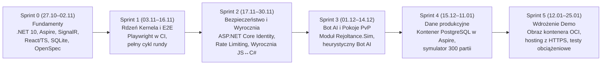

<!-- CONFLUENCE 1:1 EXPORT | Source: docs/01-dokumentacja-systemowa/06-stos-technologiczny.md @ 10829d3 (2026-11-02) -->
# 1.6 Stos technologiczny i roadmapa technologiczna

> **Źródło prawdy:** repozytorium (`docs/01-dokumentacja-systemowa/06-stos-technologiczny.md`) · **Kategoria dokumentacji:** Dokumentacja produktowa — systemowa (Stos technologiczny i roadmapa IT) · **Etap SDD:** Planowanie · **Powiązane decyzje:** [ADR-0001](07-decyzje-adr/0001-stos-technologiczny.md), [ADR-0003](07-decyzje-adr/0003-openspec-i-konstytucja.md), [ADR-0007](07-decyzje-adr/0007-sqlite-potem-postgresql.md)

Dokument definiuje kompletny stos technologiczny projektu **RE:JOLTANCE**, dokładne wersje używanych narzędzi i bibliotek (zweryfikowane z plikami `global.json`, `Directory.Packages.props` oraz `package.json`), uzasadnienie przyjętych wyborów architektonicznych oraz harmonogram wprowadzania technologii w kolejnych sprintach (*Technology Roadmap*).

---

## 1. Specyfikacja stosu technologicznego

### 1.1 Backend, silnik reguł i orkiestracja (.NET)

| Warstwa | Technologia / Pakiet | Wersja | Rola w architekturze systemu | Powiązana decyzja |
|---|---|---|---|---|
| **Język i platforma uruchomieniowa** | C# 14 / .NET SDK | `10.0` LTS (`rollForward: latestFeature`) | Implementacja czystego silnika reguł (`Kernel`), katalogu kart (`Content`), kontraktów (`Contracts`) i serwera gry (`Server`). | [ADR-0001](07-decyzje-adr/0001-stos-technologiczny.md) |
| **Serwer HTTP i komunikacja czasu rzeczywistego** | ASP.NET Core + SignalR | `10.0.0` | Obsługa punktów końcowych REST (`/api/*`), dwukierunkowego kanału WebSocket (`/api/hubs/match`) oraz serwowanie zbudowanego klienta webowego w środowisku demo. | [ADR-0001](07-decyzje-adr/0001-stos-technologiczny.md), [ADR-0006](07-decyzje-adr/0006-serwer-autorytatywny-fog-of-war.md) |
| **Warstwa dostępu do danych (ORM)** | Entity Framework Core | `10.0.14` | Mapowanie obiektowo-relacyjne dla kont graczy, talii oraz zapisów zakończonych meczów (`RejoltanceDb`). | [ADR-0007](07-decyzje-adr/0007-sqlite-potem-postgresql.md) |
| **Baza danych (Sprinty 0–3)** | SQLite (`Microsoft.EntityFrameworkCore.Sqlite`) | `10.0.14` | Lokalna, bezserwerowa baza danych w pliku `.data/rejoltance.db`, niewymagająca instalacji Dockera na laptopach zespołu. | [ADR-0007](07-decyzje-adr/0007-sqlite-potem-postgresql.md) |
| **Baza danych (od Sprintu 4)** | PostgreSQL | `16+` | Docelowa relacyjna baza danych dla środowiska demonstracyjnego i produkcyjnego, uruchamiana lokalnie jako kontener w Aspire. | [ADR-0007](07-decyzje-adr/0007-sqlite-potem-postgresql.md) |
| **Orkiestracja deweloperska** | .NET Aspire (`Aspire.AppHost.Sdk`, `Aspire.Hosting.JavaScript`) | `13.6.4` | Uruchamianie serwera backendowego i klienta Vite jednym poleceniem, automatyczna konfiguracja zmiennych środowiskowych, proxy i panelu diagnostycznego. | [ADR-0001](07-decyzje-adr/0001-stos-technologiczny.md) |
| **Telemetria i obserwowalność** | OpenTelemetry (.NET) | `1.17.0` | Zbieranie logów strukturalnych, metryk i śladów wykonania (*Distributed Tracing*) w `Rejoltance.ServiceDefaults`. | [ADR-0001](07-decyzje-adr/0001-stos-technologiczny.md) |

### 1.2 Klient webowy (Frontend SPA)

| Warstwa | Technologia / Pakiet | Wersja | Rola w architekturze systemu | Powiązana decyzja |
|---|---|---|---|---|
| **Biblioteka interfejsu użytkownika** | React + React DOM | `19.3.0` | Deklaratywne budowanie komponentów planszy 4 linii, wachlarza ręki, nakładek interakcji (`PendingInteraction`) i ekranów menu. | [ADR-0001](07-decyzje-adr/0001-stos-technologiczny.md) |
| **Język i system typów** | TypeScript | `5.9.0` | Ścisłe typowanie kontraktów komunikacyjnych (`MatchView`, `Intent`, `DomainEvent`) oraz komponentów UI. | [ADR-0010](07-decyzje-adr/0010-kontrakt-csharp-ts-przez-probke.md) |
| **Narzędzie budowania i serwer deweloperski** | Vite | `8.3.0` | Błyskawiczny serwer deweloperski z Hot Module Replacement (HMR) i optymalizacją paczki produkcyjnej (budżet ≤ 500 kB gzip). | [ADR-0001](07-decyzje-adr/0001-stos-technologiczny.md) |
| **Zarządzanie stanem klienta** | Zustand | `5.0.13` | Lekki, przewidywalny magazyn stanu (`createMatchStore`) oddzielony od warstwy transportowej (łatwe testowanie na sztucznym transporcie). | — |
| **Klient komunikacji czasu rzeczywistego** | `@microsoft/signalr` | `10.0.0` | Utrzymywanie połączenia WebSocket z `MatchHub`, automatyczne wznawianie połączenia i odbiór zdarzeń `MatchUpdated`. | [ADR-0006](07-decyzje-adr/0006-serwer-autorytatywny-fog-of-war.md) |

### 1.3 Jakość kodu, testowanie automatyczne, SDD i narzędzia AI

| Obszar | Technologia / Narzędzie | Wersja | Zastosowanie w projekcie |
|---|---|---|---|
| **Testy jednostkowe i integracyjne .NET** | xUnit + `Microsoft.AspNetCore.Mvc.Testing` | `2.9.3` / `10.0.14` | Testy reguł domenowych (`Rnn_...`), determinizmu, projekcji oraz in-memory testy serwera z prawdziwym klientem SignalR. |
| **Testy granic architektonicznych** | `NetArchTest.Rules` | `1.3.2` | Automatyczna weryfikacja braku niedozwolonych zależności pomiędzy modułami oraz braku logiki w kontraktach (`NFR-50`). |
| **Testy dymne całej aplikacji** | `Aspire.Hosting.Testing` | `13.6.4` | Test integracyjny uruchamiający cały graf zasobów Aspire i weryfikujący odpowiedź `/health` oraz proxy klienta webowego (`NFR-60`). |
| **Statyczna analiza kodu C#** | Roslyn Analyzers + `BannedApiAnalyzers` | `5.6.0` | Blokowanie niedeterministycznych API (`System.Random`, `DateTime`, `File`) wewnątrz modułu `Rejoltance.Kernel` na etapie kompilacji. |
| **Testy jednostkowe i komponentowe UI** | Vitest + React Testing Library + jsdom | `4.1.0` / `16.3.2` | Testowanie komponentów React, magazynu Zustand oraz zgodności próbki kontraktu JSON po stronie TypeScript. |
| **Testy End-to-End (E2E)** | Playwright | *Planowane w S1 (`E6-S01`)* | Automatyczne testy pełnych scenariuszy rozgrywki w przeglądarkach Chromium, Firefox i WebKit (`NFR-10`). |
| **Spec-Driven Development (SDD)** | OpenSpec (`@fission-ai/openspec`) | `1.15.0` | Zarządzanie żywymi specyfikacjami (`openspec/specs/`) i propozycjami zmian (`openspec/changes/`) wraz z walidacją `openspec validate --strict` w CI. |
| **Walidacja dokumentacji** | `markdownlint-cli2` | `0.20.0` | Kontrola jakości i spójności formatowania wszystkich plików Markdown w repozytorium. |
| **Skrypty automatyzujące (`tools/`)** | Python (biblioteka standardowa, `tomllib`) | `3.11+` (zalecany `3.13`) | Synchronizacja adapterów agentów AI (`sync_agents.py`), ekstrakcja kart (`extract_cards.py`), generator CSV do Jiry (`gen_jira_csv.py`), eksporter Confluence (`sync_confluence.py`). |
| **Ekosystem Agentów AI** | Claude Code, Antigravity, GitHub Copilot, Gemini CLI, OpenAI Codex | — | Wsparcie procesu SDD na bazie jednego źródła zasad w `.agents/` i `AGENTS.md` ([ADR-0009](07-decyzje-adr/0009-kanon-agentow-i-adaptery.md)). |

---

## 2. Uzasadnienie wyborów technologicznych i odrzucone alternatywy

| Obszar decyzyjny | Wybrane rozwiązanie | Odrzucone alternatywy | Uzasadnienie architektoniczne wyboru |
|---|---|---|---|
| **Stos serwerowy i język domeny** | **C# / .NET 10 LTS** | Full-stack TypeScript (Node.js), C# + Godot | Większość 6-osobowego zespołu posiada doświadczenie w C# z wcześniejszych projektów; .NET 10 zapewnia silne typowanie rekordów, dojrzały serwer SignalR, EF Core oraz długoterminowe wsparcie LTS (wsparcie dla .NET 8 wygasa w listopadzie 2026 r.). |
| **Protokół komunikacji czasu rzeczywistego** | **ASP.NET Core SignalR** | Surowe gniazda WebSocket, WebRTC / PeerJS (P2P) | Architektura P2P w prototypie umożliwiała oszustwa i podglądanie kart przeciwnika. SignalR zapewnia natywne wsparcie dla autorytatywnego serwera, grup meczowych, automatycznego wznawiania połączeń i silnie typowanych hubów. |
| **Technologia klienta webowego** | **React 19 + TypeScript + Vite** | Czysty JS (Vanilla DOM z prototypu), Blazor WebAssembly | Czysty JS w prototypie prowadził do trudnego w utrzymaniu kodu imperatywnego i podatności XSS (`innerHTML`). React + TypeScript zapewnia bezpieczne, komponentowe renderowanie widoku `MatchView` przy zachowaniu niskiego rozmiaru paczki i łatwego wykorzystania stylów CSS z prototypu. |
| **Strategia bazy danych** | **SQLite (S0–S3) → PostgreSQL (od S4)** | PostgreSQL w kontenerze od pierwszego dnia | Wymuszenie instalacji i konfiguracji Dockera u wszystkich 6 osób w pierwszym tygodniu stanowiło ryzyko zablokowania startu prac. EF Core izoluje kod od dostawcy bazy, pozwalając na bezinwazyjną pracę na pliku SQLite i przejście na kontener PostgreSQL w Sprincie 4. |
| **Narzędzie Spec-Driven Development** | **OpenSpec 1.15 + Konstytucja w `.agents/`** | GitHub Spec Kit (`specify-cli`), BMAD | W przeprowadzonych testach porównawczych (`04-badania-i-analizy/faza-1-porownanie.md`) Spec Kit wykazał konflikty przy instalacji dla wielu narzędzi AI jednocześnie i generował blisko 10 tys. linii szablonów. OpenSpec instaluje się czysto dla wszystkich 5 narzędzi AI i posiada szybki walidator CLI dla potoku CI. |
| **Kontrola zgodności kontraktów C# ↔ TS** | **Wspólna próbka JSON (`match-view.sample.json`)** | Generator OpenAPI / NSwag, brak automatycznej kontroli | Główne komunikaty gry przechodzą przez SignalR, którego standard OpenAPI nie obejmuje. Złoty plik JSON generowany przez testy C# i weryfikowany kompilatorem TypeScript (`tsc`) daje 100% gwarancji wykrycia niezgodności bez narzutu zewnętrznych generatorów. |

---

## 3. Roadmapa technologiczna

Poniższy harmonogram określa moment wprowadzania kolejnych elementów technologicznych w powiązaniu z zaplanowanymi sprintami i historyjkami w backlogu:

| Sprint / Etap | Wprowadzana technologia lub mechanizm | Powiązane zadanie (Backlog) | Weryfikowane wymaganie jakościowe |
|---|---|---|---|
| **Sprint 0** *(zrealizowane)* | Szkielet solucji .NET 10, `Rejoltance.AppHost` (Aspire), `MatchHub` (SignalR), klient React + Vite, baza SQLite, walidacja OpenSpec i CI w GitHub Actions. | `E0-S01`, `E0-S02` | `NFR-11`, `NFR-50`, `NFR-52`, `NFR-60` |
| **Sprint 1** | Wdrożenie testów przeglądarkowych End-to-End **Playwright** (Chromium, Firefox, WebKit) w potoku GitHub Actions. | `E6-S01` | `NFR-10` |
| **Sprint 2** | Wdrożenie **ASP.NET Core Identity** (rejestracja, logowanie, ciasteczka `HttpOnly`), middleware **Rate Limiting** dla huba SignalR oraz **wyroczni testów różnicowych** uruchamiającej silnik prototypu JS w Node.js. | `E6-S02`, `E3-S06`, `E5-S02` | `NFR-40`, `NFR-41`, `NFR-51` |
| **Sprint 3** | Utworzenie projektu **`Rejoltance.Sim`** z interfejsem `IBotPolicy` i implementacją bota AI grającego przez standardowy kontrakt `Intent`. | `E5-S03` | `NFR-20` |
| **Sprint 4** | Włączenie kontenera **PostgreSQL 16+** w `Rejoltance.AppHost`, weryfikacja migracji EF Core na obu silnikach bazodanowych oraz uruchomienie symulatora masowych gier bot-vs-bot. | `E6-S03`, `E5-S04` | `NFR-01`, `NFR-31`, [ADR-0007](07-decyzje-adr/0007-sqlite-potem-postgresql.md) |
| **Sprint 5** | Publikacja zunifikowanego **obrazu kontenera OCI** (`PublishWithContainerFiles`) i wdrożenie publicznej instancji demonstracyjnej z certyfikatem TLS/HTTPS. | `E6-S05` | `NFR-30`, `NFR-61` |
| **Semestr 2** | Rozbudowa trwałości o tabelę talii (`Deckbuilder`), zapisywanie pełnego dziennika intencji do deterministycznego **Replayu** oraz ewaluacja generatora kontraktów C# → TS. | `E6-S04`, `E6-S07` | [ADR-0010](07-decyzje-adr/0010-kontrakt-csharp-ts-przez-probke.md) |

---

## 4. Polityka zarządzania wersjami i zależnościami

1. **Centralne zarządzanie pakietami NuGet (Central Package Management):** Wszystkie wersje pakietów .NET są zdefiniowane w jednym pliku `Directory.Packages.props` w katalogu głównym. Projekty `.csproj` nie mogą deklarować własnych atrybutów `Version`.
2. **Deterministyczne instalacje npm:** Zarówno katalog główny narzędzi, jak i projekt `src/web` posiadają zatwierdzone pliki `package-lock.json`. W potoku CI oraz skryptach startowych używane jest polecenie `npm ci`.
3. **Automatyczne aktualizacje bezpieczeństwa:** Usługa GitHub **Dependabot** (`.github/dependabot.yml`) co tydzień sprawdza aktualizacje pakietów NuGet, npm oraz akcji GitHub, grupując poprawki z ekosystemów Microsoft i Aspire. Podatności o priorytecie wysokim i krytycznym są aktualizowane w czasie ≤ 7 dni (`NFR-42`).
