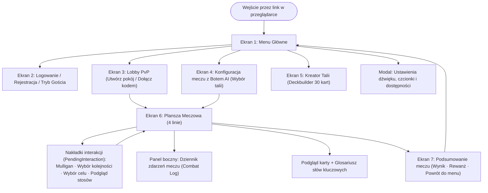
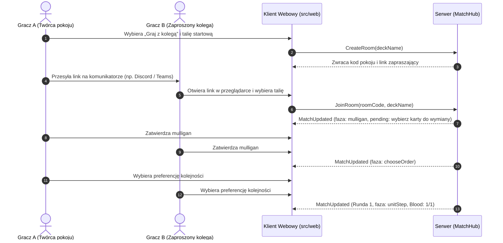

<!-- CONFLUENCE 1:1 EXPORT | Source: docs/01-dokumentacja-systemowa/10-ux-design-i-przeplywy.md @ 10829d3 (2026-11-02) -->
# 1.10 Projekt UX, mapa ekranów, przepływy i przewodnik stylu

> **Źródło prawdy:** repozytorium (`docs/01-dokumentacja-systemowa/10-ux-design-i-przeplywy.md`) · **Kategoria dokumentacji:** Dokumentacja produktowa — systemowa (Projekt UX i przewodnik stylu) · **Etap SDD:** Planowanie

Niniejszy dokument opisuje architekturę informacji, mapę ekranów, szkielet układu planszy (*wireframe*), kluczowe przepływy użytkownika (*User Flows*) oraz przewodnik stylu wizualnego (*UI Style Guide*) dla klienta webowego **RE:JOLTANCE** (`src/web`). Działającym prototypem referencyjnym dla interakcji oraz zasobów audiowizualnych jest aplikacja w katalogu [`prototype/revibance/`](../../prototype/README.md).

Szablony do dokumentowania badań z użytkownikami znajdują się w katalogu [`05-szablony/`](../05-szablony/README.md):

- [`szablon-ux-persona-scenariusz.md`](../05-szablony/szablon-ux-persona-scenariusz.md) — persony, scenariusze i mapa historyjek użytkownika,
- [`szablon-ux-test-uzytecznosci.md`](../05-szablony/szablon-ux-test-uzytecznosci.md) — raport z sesji testów użyteczności z Radą Graczy.

---

## 1. Architektura informacji i mapa ekranów



### Zestawienie ekranów i powiązanych zadań w backlogu

| Ekran / Widok | Odpowiednik w prototypie (`index.html`) | Status w kliencie React (`src/web`) | Powiązane zadanie (Jira / Backlog) |
|---|---|---|---|
| **Menu główne** | `#menu` | W backlogu (obecnie bezpośredni start piaskownicy) | `E4-S07` |
| **Logowanie i rejestracja** | *(brak w prototypie)* | W backlogu | `E6-S02`, `E6-S09` |
| **Lobby 1v1 (kod pokoju, link)** | `#lobby` | W backlogu | `E3-S01`, `E4-S07` |
| **Wybór talii i mecz z botem** | `#botmenu` | W backlogu | `E5-S05` |
| **Plansza meczowa (4 linie, HP, Blood, ręka)** | `#game` | **Zaimplementowany szkielet w `src/web`** | `E4-S01`, `E4-S02` |
| **Nakładki wyboru (`PendingInteraction`)** | `#mul` | **Zaimplementowany mulligan**, pozostałe w backlogu | `E4-S03` |
| **Powiększenie karty i glosariusz słów kluczowych** | `#zoom` | W backlogu | `E4-S04` |
| **Dziennik rozgrywki (Log zdarzeń)** | `#hist` | W backlogu | `E4-S05` |
| **Koniec meczu i potwierdzenie poddania** | `#ov`, `#modal` | **Zaimplementowane poddanie i wynik** | `E4-S06` |
| **Kreator talii (*Deckbuilder*)** | `#bld` | W backlogu (Fala W2 — Semestr 2) | `E6-S04` |

---

## 2. Makieta układu ekranu rozgrywki

Ekran rozgrywki zaprojektowano w proporcjach panoramicznych (`16:9`, rozdzielczość bazowa `1920×1080` skalowana responsywnie do okna przeglądarki od `1280×720`):

```text
┌──────────────────────────────────────────────────────────────────────────────────┐
│ [Poddaj mecz]    Faza: Krok Jednostek (Twój ruch)     [Dziennik] [⚙]    Runda 3  │
│ Ostatnie zdarzenia: [Dobrano kartę] [Zagrano: Iron Hound -> Linia 1]             │
├──────────────────────────────────────────────────────────────────────────────────┤
│ PRZECIWNIK   ❤ 17/20 HP   💧 Blood: ●●○ (2/3)   Ręka: 4 karty   Talia: 22  Stos: 3│
│                                                                                  │
│     ┌──────────────┐   ┌──────────────┐   ┌──────────────┐   ┌──────────────┐    │
│     │   Linia 0    │   │   Linia 1    │   │   Linia 2    │   │   Linia 3    │    │
│     │  [Wroga J.]  │   │   (pusto)    │   │  [Wroga J.]  │   │   (pusto)    │    │
│     └──────────────┘   └──────────────┘   └──────────────┘   └──────────────┘    │
│                            ─── TOR WALKI 4 LINII ───                             │
│     ┌──────────────┐   ┌──────────────┐   ┌──────────────┐   ┌──────────────┐    │
│     │   Linia 0    │   │   Linia 1    │   │   Linia 2    │   │   Linia 3    │    │
│     │  [Twoja J.]  │   │  [Twoja J.]  │   │   (pusto)    │   │   (pusto)    │    │
│     └──────────────┘   └──────────────┘   └──────────────┘   └──────────────┘    │
│                                                                                  │
│ TY (Miejsce 0) ❤ 20/20 HP  💧 Blood: ●●● (3/3)  Talia: 21  Stos: 2  [Zakończ krok]│
│             ╭─────────╮ ╭─────────╮ ╭─────────╮ ╭─────────╮ ╭─────────╮          │
│             │ Karta 1 │ │ Karta 2 │ │ Karta 3 │ │ Karta 4 │ │ Karta 5 │          │
│             ╰─────────╯ ╰─────────╯ ╰─────────╯ ╰─────────╯ ╰─────────╯          │
└──────────────────────────────────────────────────────────────────────────────────┘
```

### Zasady interakcji i ergonomii (`NFR-21`, `NFR-22`)

1. **Podświetlanie wyłącznie legalnych ruchów (`legalActions`):** Po wybraniu karty z ręki interfejs podświetla wyłącznie te sloty linii i cele, które znajdują się w tablicy `view.legalActions` przesłanej przez serwer. Próba zagrania karty zbyt drogiej wyświetla czytelny komunikat w języku polskim (np. *„Niewystarczająca ilość Blood”*).
2. **Obsługa za pomocą myszy i klawiatury:**
   - Klawisze `1–8` wybierają odpowiednią kartę z ręki gracza.
   - Klawisze strzałek / `1–4` pozwalają wskazać linię lub cel.
   - Klawisz `Enter` lub `Spacja` zatwierdza wybór lub kończy bieżący krok (`endStep`).
   - Klawisz `Escape` lub prawy przycisk myszy anuluje bieżące zaznaczenie karty.

---

## 3. Przepływ użytkownika: Rozpoczęcie pojedynku 1v1 przez link



---

## 4. Przewodnik stylu wizualnego

Oprawa wizualna gry utrzymana jest w mrocznej, kontrastowej stylistyce *dark tactical pixel-art*, przeniesionej bezpośrednio z prototypu `prototype/revibance/style.css`.

### 4.1 Paleta barw i weryfikacja kontrastu WCAG 2.1 AA (`NFR-22`)

| Token CSS | Wartość HEX | Zastosowanie w interfejsie | Współczynnik kontrastu względem tła `#050505` | Status WCAG 2.1 |
|---|---|---|---|---|
| `--bg` | `#050505` | Główne tło planszy i ekranów aplikacji. | — | Tło bazowe |
| `--ln` | `#2a2a2a` | Obramowania slotów linii, kart i kontenerów. | `1.4 : 1` | Element dekoracyjny |
| `--tx` | `#8d8d8d` | Tekst pomocniczy, etykiety statystyk i opisów. | **`6.1 : 1`** | **Spełnia AA** (wymagane ≥ 4.5:1) |
| `--hi` | `#cfcfcf` | Tekst główny, nazwy kart, wartości HP i nagłówki. | **`13.1 : 1`** | **Spełnia AAA** (wymagane ≥ 7.0:1) |
| `--red` | `#c4161c` | Akcent kolorystyczny zasobu *Blood*, obrażeń i zagrożenia. | `3.4 : 1` | Dozwolony dla dużych napisów (≥ 24 px) i ikon z etykietą |
| `--dim` | `#3a3a3a` | Tło nieaktywnych przycisków i niedostępnych akcji. | `1.8 : 1` | Wyłącznie dla elementów wyłączonych (`disabled`) |

### 4.2 Typografia, grafika i udźwiękowienie

- **Zestawy czcionek (`prototype/revibance/fonts/`):** Styl pikselowy (*Pixelify Sans*, *Silkscreen*, *DotGothic16*, *Jersey 15*) oraz czytelny styl klasyczny (*Cinzel* dla nagłówków + *Alegreya Sans* dla opisów kart), przełączane w ustawieniach dostępności.
- **Zasoby kart (`prototype/revibance/img/`):** Ilustracje kart w formacie WebP (`1.webp` .. `69.webp`, tokeny `900.webp` .. `908.webp`), rewers karty `back.webp` oraz ramka awersu `CardFront.png`.
- **Bezpieczeństwo wizualne (`NFR-70`):** Wszystkie animacje uderzeń i podpaleń są pozbawione błysków przekraczających 3 Hz oraz automatycznie skracane przy wykryciu flagi systemowej `@media (prefers-reduced-motion: reduce)`.
