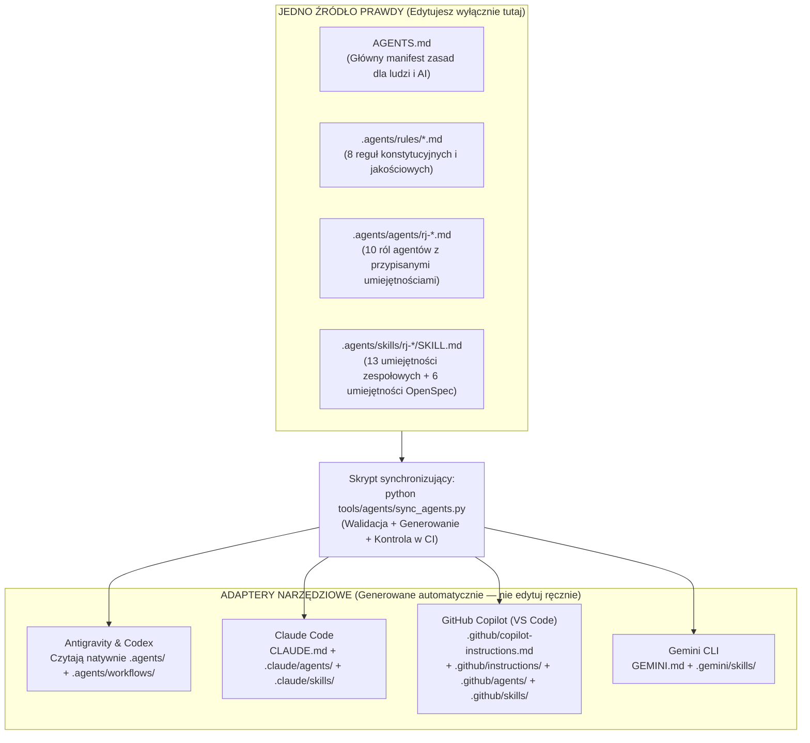

<!-- CONFLUENCE 1:1 EXPORT | Source: docs/04-system-agentow-ai/01-architektura-i-konfiguracja-agentow.md @ 10829d3 (2026-11-02) -->
# 4.1 Architektura i konfiguracja systemu agentów AI

> **Źródło prawdy:** repozytorium (`docs/04-system-agentow-ai/01-architektura-i-konfiguracja-agentow.md`) · **Kategoria dokumentacji:** Dokumentacja procesowa — Standardy inżynierii agentowej i narzędzi · **Etap SDD:** Fundamenty · **Powiązana decyzja:** [ADR-0009](../01-dokumentacja-systemowa/07-decyzje-adr/0009-kanon-agentow-i-adaptery.md)

Sześciu członków naszego zespołu korzysta na co dzień z różnych środowisk programistycznych i asystentów AI: **Claude Code**, **Antigravity**, **GitHub Copilot (VS Code)**, **Gemini CLI**, **OpenAI Codex** oraz czatów przeglądarkowych (**ChatGPT**, **DeepSeek**). Aby wszyscy agenci stosowali dokładnie te same zasady architektoniczne, te same konwencje nazewnicze i ten sam proces SDD, zaprojektowaliśmy architekturę **Jednego Źródła Prawdy (`.agents/`) z automatycznym generatorem adapterów**.

---

## 1. Jak zbudowany jest system agentowy w repozytorium?



### Cztery filary katalogu `.agents/`

| Katalog | Rola w architekturze | Jak działa w praktyce? |
|---|---|---|
| **`.agents/rules/`** | **Konstytucja i Reguły Nadrzędne** | Sześć plików definiujących nieprzekraczalne granice projektu: `00-konstytucja.md` (ładowana zawsze), `10-prawda-i-niepewnosc.md` (ładowana zawsze), `20-plan-i-zakres.md`, `30-granice-architektury.md`, `40-jakosc-kodu.md` oraz `50-git-i-jira.md`. |
| **`.agents/agents/`** | **Role Agentów (Subagenci)** | Jedenaście wyspecjalizowanych profili (np. `rj-architect`, `rj-backend-engineer`, `rj-reviewer`). Każdy profil definiuje: grupę funkcjonalną (`category`), dozwolone narzędzia (`tools`), **wbudowane skille (`skills`)**, procedurę działania oraz listę zakazów. |
| **`.agents/skills/`** | **Umiejętności (Skille)** | Ustrukturyzowane procedury krok po kroku (`SKILL.md`). Gdy zlecasz zadanie (np. dodanie karty lub przygotowanie PR), agent ładuje odpowiedni skill i wykonuje jego instrukcję punkt po punkcie. |
| **`.agents/workflows/`** | **Przepływy ukośnikowe (`/rj-...`)** | Wygenerowane skróty pozwalające wywołać dowolny skill bezpośrednio z linii poleceń czatu w IDE za pomocą komendy `/rj-start-feature`, `/rj-pr-ready` czy `/opsx:propose`. |

---

## 2. Jak skonfigurować i uruchomić agentów w swoim narzędziu IDE?

Po sklonowaniu repozytorium **wszystkie konfiguracje agentów są już gotowe i zatwierdzone w repozytorium**. Nie musisz instalować żadnych dodatkowych wtyczek poza swoim wybranym narzędziem AI:

| Twoje narzędzie AI | Skąd narzędzie pobiera zasady projektu? | Jak wywołać konkretną rolę agenta lub skill? |
|---|---|---|
| **Claude Code** | Automatycznie wczytuje `CLAUDE.md` (wskazujący na `AGENTS.md`), subagentów z `.claude/agents/` oraz skille z `.claude/skills/`. | - **Skill / Workflow:** Wpisz `/rj-start-feature` lub `/opsx:propose` w terminalu Claude.<br/>- **Rola subagenta:** Wpisz *„Użyj subagenta `rj-reviewer` do sprawdzenia zmian na bieżącej gałęzi”*. |
| **Antigravity** | Natywnie wczytuje `AGENTS.md` oraz cały katalog `.agents/` (`rules`, `agents`, `skills`, `workflows`). | - **Rola agenta:** Wybierz rolę (np. `rj-orchestrator` lub `rj-backend-engineer`) z rozwijanego menu agentów.<br/>- **Skill / Workflow:** Wpisz `/rj-add-card` lub `/opsx-propose`. |
| **GitHub Copilot (VS Code)** | Automatycznie wczytuje `.github/copilot-instructions.md`, reguły z `.github/instructions/`, agentów z `.github/agents/` i skille z `.github/skills/`. | - **Rola agenta:** W oknie Copilot Chat wybierz custom agenta (np. `@rj-architect` lub `@rj-reviewer`).<br/>- **Skill:** Wpisz `/opsx-propose` lub poproś o wykonanie skilla `rj-pr-ready`. |
| **Gemini CLI** | Automatycznie wczytuje `GEMINI.md` oraz skille z `.gemini/skills/`. | - **Skill:** Wpisz `/opsx:propose` lub wskaż nazwę skilla `rj-add-rule-test`.<br/>- **Rola:** Wpisz *„Działaj zgodnie z rolą `.agents/agents/rj-backend-engineer.md`”*. |
| **OpenAI Codex CLI** | Natywnie wczytuje `AGENTS.md` oraz skille z `.agents/skills/`. | - **Skill:** Wywołaj `$openspec-propose` lub `$rj-start-feature`. |
| **Czaty przeglądarkowe (ChatGPT, DeepSeek)** | Nie mają bezpośredniego dostępu do plików na dysku. | Stosuj **Protokół 3 Plików**: na początku rozmowy wklej zawartość `AGENTS.md`, `docs/01-dokumentacja-systemowa/08-mapa-kodu-i-modulow.md` oraz `README.md` modułu, w którym pracujesz. |

---

## 3. Integracja agentów z Jirą PB i Confluence PB (Serwer MCP)

W repozytorium skonfigurowano opcjonalny serwer **Model Context Protocol (`mcp-atlassian`)** w plikach `.mcp.json` (dla Claude Code) oraz `.vscode/mcp.json` (dla VS Code). Pozwala on agentom AI **bezpośrednio odczytywać** treść zadań z uczelnianej Jiry PB oraz stron z Confluence PB (np. *„Przeczytaj zgłoszenie REJ-45 z Jiry i przygotuj propozycję OpenSpec”*).

Ze względów bezpieczeństwa oraz wymagań oceniania przedmiotu (efekty EU2–EU4 oceniane są indywidualnie dla studenta), serwer MCP działa domyślnie w trybie **tylko do odczytu (`READ_ONLY_MODE=true`)**.

### Instrukcja konfiguracji połączenia MCP krok po kroku

1. **Zainstaluj menedżer narzędzi Python `uv`:**

   ```powershell
   winget install astral-sh.uv
   ```

2. **Wygeneruj osobiste tokeny dostępowe (Personal Access Tokens — PAT):**
   - Zaloguj się do **Jiry PB** (`https://devtools.wi.pb.edu.pl/jira`), kliknij swój awatar w prawym górnym rogu → **Profile** → **Personal Access Tokens** → **Create token**. Nadaj nazwę (np. `rejoltance-mcp`) i skopiuj wygenerowany ciąg znaków.
   - Powtórz tę samą czynność w **Confluence PB** (`https://devtools.wi.pb.edu.pl/confluence`).
   - **Pamiętaj:** Token PAT jest równoważny Twojemu hasłu uczelnianemu. Nigdy nie wklejaj go do plików śledzonych przez Git ani do treści wiadomości na czacie.

3. **Ustaw zmienne środowiskowe użytkownika w systemie Windows (PowerShell):**

   ```powershell
   [Environment]::SetEnvironmentVariable("JIRA_PERSONAL_TOKEN", "TWOJ_TOKEN_JIRA", "User")
   [Environment]::SetEnvironmentVariable("CONFLUENCE_PERSONAL_TOKEN", "TWOJ_TOKEN_CONFLUENCE", "User")
   ```

   Po wykonaniu powyższych poleceń uruchom ponownie terminal oraz środowisko IDE.

4. **Weryfikacja połączenia:**
   - W **Claude Code** wpisz polecenie `/mcp` i upewnij się, że serwer `atlassian-pb` ma status `connected`.
   - W **VS Code** otwórz paletę poleceń (`Ctrl+Shift+P`) → `MCP: List Servers` → uruchom `atlassian-pb`.
