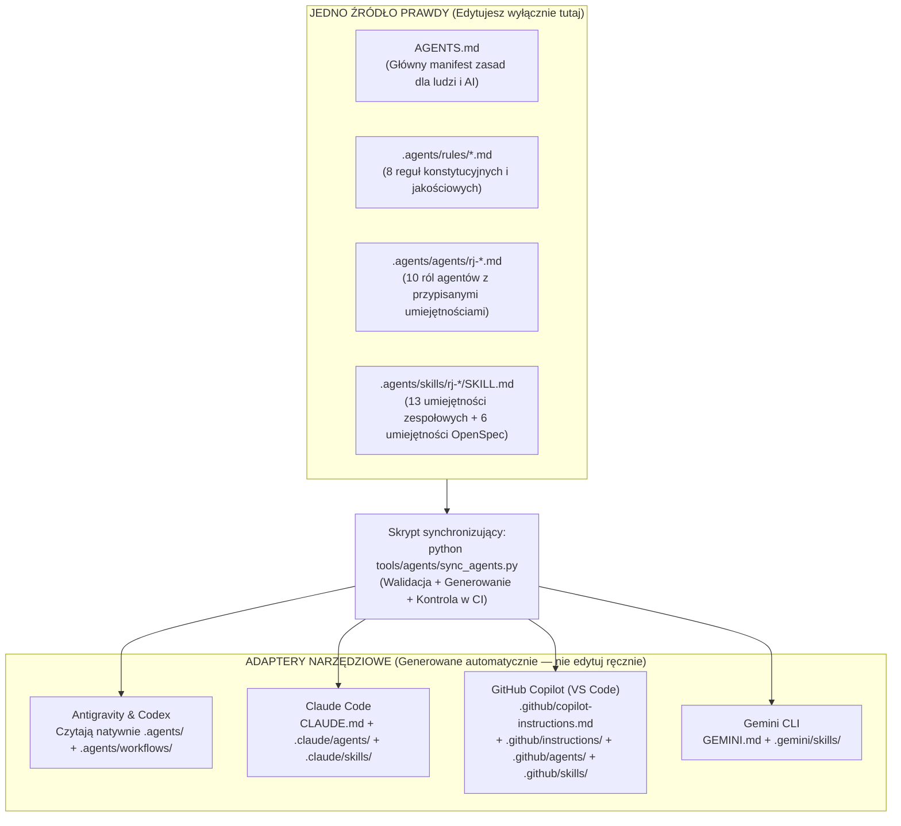

<!-- CONFLUENCE 1:1 EXPORT | Source: docs/04-system-agentow-ai/01-architektura-i-konfiguracja-agentow.md @ a2bf2a4 (2026-11-02) -->
# 4.1 Architektura i konfiguracja systemu agentów AI

> **Źródło prawdy:** repozytorium (`docs/04-system-agentow-ai/01-architektura-i-konfiguracja-agentow.md`) · **Kategoria dokumentacji:** Dokumentacja procesowa — standardy inżynierii agentowej i narzędzi · **Etap SDD:** Fundamenty · **Powiązana decyzja:** [ADR-0009](../01-dokumentacja-systemowa/07-decyzje-adr/0009-kanon-agentow-i-adaptery.md)

Sześć osób w zespole korzysta z różnych środowisk i asystentów AI: **Claude Code**, **Antigravity**, **GitHub Copilot (VS Code)**, **Gemini CLI**, **OpenAI Codex** oraz czatów w przeglądarce (**ChatGPT**, **DeepSeek**). Chcemy, żeby wszyscy agenci stosowali te same zasady architektury, te same konwencje nazw i ten sam proces SDD (Spec-Driven Development, czyli „najpierw specyfikacja, potem kod”). Dlatego mamy jedno źródło prawdy, katalog `.agents/`, i skrypt, który generuje z niego adaptery dla poszczególnych narzędzi.

---

## 1. Jak zbudowany jest system agentowy w repozytorium?



### Cztery filary katalogu `.agents/`

| Katalog | Co zawiera | Jak to działa w praktyce? |
|---|---|---|
| **`.agents/rules/`** | Konstytucja i reguły nadrzędne | Osiem plików z granicami projektu. Trzy agent wczytuje zawsze: `00-konstytucja.md`, `10-prawda-i-niepewnosc.md` i `60-kontekst-i-tokeny.md`. Pozostałe wczytuje wtedy, gdy dotyczą zadania: `20-plan-i-zakres.md`, `30-architektura-i-kontrakty.md`, `40-kod-i-testy.md`, `50-git-i-jira.md` i `70-dokumentacja.md`. |
| **`.agents/agents/`** | Role agentów (subagenci) | Dziesięć wyspecjalizowanych profili, np. `rj-architect`, `rj-backend-engineer`, `rj-qa-verifier`. Każdy profil określa grupę (`category`), dozwolone narzędzia (`tools`), wbudowane skille (`skills`), procedurę działania i listę zakazów. |
| **`.agents/skills/`** | Umiejętności (skille) | Procedury krok po kroku zapisane w plikach `SKILL.md`. Gdy zlecasz zadanie (np. dodanie karty albo przygotowanie PR, czyli pull requesta), agent wczytuje pasujący skill i wykonuje go punkt po punkcie. |
| **`.agents/workflows/`** | Komendy ukośnikowe (`/rj-...`) | Wygenerowane skróty. Pozwalają wywołać skill prosto z czatu w IDE, np. `/rj-start-feature`, `/rj-pr-ready` albo `/opsx:propose`. |

---

## 2. Jak uruchomić agentów w swoim IDE?

Po sklonowaniu repozytorium konfiguracje agentów są już gotowe i zapisane w repozytorium. Poza wybranym narzędziem AI nie musisz instalować żadnych wtyczek.

| Twoje narzędzie AI | Skąd bierze zasady projektu? | Jak wywołać rolę agenta albo skill? |
|---|---|---|
| **Claude Code** | Sam wczytuje `CLAUDE.md` (który wskazuje na `AGENTS.md`), subagentów z `.claude/agents/` i skille z `.claude/skills/`. | - **Skill / workflow:** wpisz `/rj-start-feature` albo `/opsx:propose` w terminalu Claude.<br/>- **Rola subagenta:** napisz *„Użyj subagenta `rj-qa-verifier` do sprawdzenia zmian na bieżącej gałęzi”*. |
| **Antigravity** | Wczytuje `AGENTS.md` i cały katalog `.agents/` (`rules`, `agents`, `skills`, `workflows`). | - **Rola agenta:** wybierz rolę (np. `rj-orchestrator` albo `rj-backend-engineer`) z menu agentów.<br/>- **Skill / workflow:** wpisz `/rj-add-card` albo `/opsx-propose`. |
| **GitHub Copilot (VS Code)** | Sam wczytuje `.github/copilot-instructions.md`, reguły z `.github/instructions/`, agentów z `.github/agents/` i skille z `.github/skills/`. | - **Rola agenta:** w oknie Copilot Chat wybierz własnego agenta (np. `@rj-architect` albo `@rj-qa-verifier`).<br/>- **Skill:** wpisz `/opsx-propose` albo poproś o wykonanie skilla `rj-pr-ready`. |
| **Gemini CLI** | Sam wczytuje `GEMINI.md` i skille z `.gemini/skills/`. | - **Skill:** wpisz `/opsx:propose` albo podaj nazwę skilla, np. `rj-add-rule-test`.<br/>- **Rola:** napisz *„Działaj zgodnie z rolą `.agents/agents/rj-backend-engineer.md`”*. |
| **OpenAI Codex CLI** | Wczytuje `AGENTS.md` i skille z `.agents/skills/`. | - **Skill:** wywołaj `$openspec-propose` albo `$rj-start-feature`. |
| **Czaty w przeglądarce (ChatGPT, DeepSeek)** | Nie mają dostępu do plików na dysku. | Stosuj **protokół 3 plików**: na początku rozmowy wklej treść `AGENTS.md`, `docs/01-dokumentacja-systemowa/08-mapa-kodu-i-modulow.md` i `README.md` modułu, w którym pracujesz. |

---

## 3. Połączenie agentów z Jirą PB i Confluence PB (serwer MCP)

W repozytorium jest skonfigurowany opcjonalny serwer **MCP (Model Context Protocol)** o nazwie `mcp-atlassian`. Konfiguracja leży w `.mcp.json` (dla Claude Code) i w `.vscode/mcp.json` (dla VS Code). Dzięki niemu agent AI może sam odczytać zadanie z uczelnianej Jiry PB albo stronę z Confluence PB, np. *„Przeczytaj zgłoszenie REJ-45 z Jiry i przygotuj propozycję OpenSpec”*.

Serwer MCP domyślnie działa w trybie **tylko do odczytu (`READ_ONLY_MODE=true`)**. Powody są dwa: bezpieczeństwo i zasady oceniania (efekty EU2–EU4 ocenia się indywidualnie, więc zmiany w Jirze robi student, a nie agent).

### Konfiguracja połączenia MCP krok po kroku

1. **Zainstaluj menedżer narzędzi Pythona `uv`:**

   ```powershell
   winget install astral-sh.uv
   ```

2. **Wygeneruj osobiste tokeny dostępu (PAT, Personal Access Token):**
   - Zaloguj się do **Jiry PB** (`https://devtools.wi.pb.edu.pl/jira`), kliknij swój awatar w prawym górnym rogu → **Profile** → **Personal Access Tokens** → **Create token**. Nadaj nazwę (np. `rejoltance-mcp`) i skopiuj wygenerowany ciąg znaków.
   - Zrób to samo w **Confluence PB** (`https://devtools.wi.pb.edu.pl/confluence`).
   - **Pamiętaj:** token PAT daje taki sam dostęp jak Twoje hasło uczelniane. Nigdy nie wklejaj go do plików śledzonych przez git ani do wiadomości na czacie.

3. **Zapisz tokeny w zmiennych środowiskowych użytkownika Windows (PowerShell):**

   ```powershell
   [Environment]::SetEnvironmentVariable("JIRA_PERSONAL_TOKEN", "TWOJ_TOKEN_JIRA", "User")
   [Environment]::SetEnvironmentVariable("CONFLUENCE_PERSONAL_TOKEN", "TWOJ_TOKEN_CONFLUENCE", "User")
   ```

   Możesz też skopiować `.env.example` do lokalnego pliku `.env` (git go ignoruje) i wczytać z niego zmienne do sesji terminala. Plik `.mcp.json` nie zawiera tokenów, tylko odwołania do zmiennych (`${JIRA_PERSONAL_TOKEN}`, `${CONFLUENCE_PERSONAL_TOKEN}`). VS Code (`.vscode/mcp.json`) przy pierwszym starcie serwera prosi o tokeny w ukrytym polu. Tak robimy, bo token wpisany do pliku lub komendy łatwo trafia do repozytorium albo do historii poleceń, a stamtąd do innych osób.

   Po ustawieniu zmiennych uruchom ponownie terminal i IDE.

4. **Sprawdź połączenie:**
   - W **Claude Code** wpisz `/mcp` i sprawdź, czy serwer `atlassian-pb` ma status `connected`.
   - W **VS Code** otwórz paletę poleceń (`Ctrl+Shift+P`) → `MCP: List Servers` → uruchom `atlassian-pb`.
