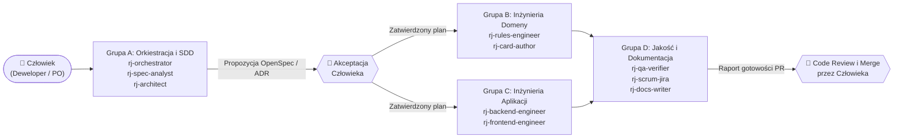

<!-- CONFLUENCE 1:1 EXPORT | Source: docs/04-system-agentow-ai/02-katalog-rol-i-wbudowanych-skilli.md @ 10829d3 (2026-11-02) -->
# 4.2 Katalog ról agentów i macierz wbudowanych umiejętności

> **Źródło prawdy:** Repozytorium (`docs/04-system-agentow-ai/02-katalog-rol-i-wbudowanych-skilli.md`) · **Kategoria dokumentacji:** Dokumentacja procesowa — Katalog ról i umiejętności AI · **Etap SDD:** Cały cykl SDD

W projekcie **RE:JOLTANCE** zdefiniowano **10 wyspecjalizowanych ról agentów AI** (w katalogu `.agents/agents/`) oraz **13 zespołowych skilli proceduralnych `rj-*` + 6 skilli OpenSpec** (w katalogu `.agents/skills/`). Aby system był przejrzysty dla ludzi i bezpieczny w działaniu, role zostały podzielone na **4 grupy tematyczne odpowiadające etapom procesu SDD i warstwom architektury**, a każdemu agentowi przypisano jawny zestaw wbudowanych skilli (`skills:`) oraz minimalny zestaw narzędzi (zasada *Least Privilege*).

---

## 1. Przepływ współpracy między rolami agentów a człowiekiem

---

## 2. Cztery grupy ról agentów i ich wbudowane umiejętności

### Grupa A: Orkiestracja i Spec-Driven Development (`A-Orkiestracja-i-SDD`)

Agenci odpowiedzialni za inicjalizację zadań, etap **`Specify`** (PRD, reguły `R-nn`, scenariusze `GIVEN/WHEN/THEN`) oraz etap **`Plan`** (SAD, kontrakty, decyzje ADR).

| Rola agenta | Odpowiedzialność w projekcie | Uprawnienia narzędziowe | Wbudowane skille (`skills`) |
|---|---|---|---|
| **`rj-orchestrator`** *(Główny Koordynator SDD)* | Przyjmuje zadanie z kluczem Jira (`REJ-123`), sprawdza bramki OpenSpec, dzieli pracę na podzadania `≤ 4 h`, deleguje kroki do specjalistów i wymusza niezależną weryfikację końcową. | Odczyt, wyszukiwanie, uruchamianie komend, delegowanie (`agent`). **Brak edycji kodu.** | `rj-start-feature`, `rj-spec-guardian`, `rj-pr-ready`, `rj-add-agent`, `rj-add-skill` |
| **`rj-spec-analyst`** *(Analityk Wymagań PRD i OpenSpec)* | Przekształca potrzeby użytkownika i zachowanie prototypu JS v11 w scenariusze `GIVEN/WHEN/THEN` w `openspec/specs/` oraz utrzymuje `03-indeks-regul-r-nn.md` i `04-rozbieznosci-prototypu.md`. | Odczyt, edycja specyfikacji i dokumentacji wymagań, uruchamianie walidatorów. | `rj-spec-guardian`, `rj-start-feature`, `rj-oracle-diff` |
| **`rj-architect`** *(Architekt Systemu SAD i Kontraktów)* | Pilnuje granic 5 modułów, chroni 5 zamrożonych kontraktów w `Rejoltance.Contracts`, opracowuje projekty techniczne (`design.md` / TDD) oraz przygotowuje decyzje `ADR-NNNN`. | Odczyt, edycja projektów technicznych i ADR, uruchamianie testów architektury i kontraktów. | `rj-write-adr`, `rj-spec-guardian`, `rj-pr-ready` |

---

### Grupa B: Inżynieria Domeny Gry (`B-Inzynieria-Domeny`)

Agenci realizujący logikę gry karcianej na etapie **`Implement`** zgodnie z zasadą *Test-First* i rygorem determinizmu.

| Rola agenta | Odpowiedzialność w projekcie | Uprawnienia narzędziowe | Wbudowane skille (`skills`) |
|---|---|---|---|
| **`rj-rules-engineer`** *(Inżynier Silnika `Rejoltance.Kernel`)* | Implementuje czysty, deterministyczny silnik reguł w C# (`Kernel.Apply`, `LegalActions`, 4 kroki rundy, walka w 4 liniach, słowa kluczowe) oraz testy jednostkowe `Rnn_` (Epik E1). | Odczyt, edycja `Rejoltance.Kernel` i `Rejoltance.Kernel.Tests`, uruchamianie `dotnet test`. | `rj-add-rule-test`, `rj-oracle-diff`, `rj-pr-ready` |
| **`rj-card-author`** *(Twórca Kart i Efektów DSL `Rejoltance.Content`)* | Przenosi karty z prototypu JS do `cards.json`, implementuje handlery efektów DSL (wyzwalacze, warunki, selektory celów, akcje) oraz testy w `Rejoltance.Cards.Tests` (Epik E2). | Odczyt, edycja `Rejoltance.Content`, handlerów efektów i testów kart, uruchamianie ekstraktora i testów. | `rj-add-card`, `rj-add-rule-test`, `rj-oracle-diff` |

---

### Grupa C: Inżynieria Aplikacji Sieciowej i Webowej (`C-Inzynieria-Aplikacji`)

Agenci budujący warstwę serwerową czasu rzeczywistego oraz klienta przeglądarkowego.

| Rola agenta | Odpowiedzialność w projekcie | Uprawnienia narzędziowe | Wbudowane skille (`skills`) |
|---|---|---|---|
| **`rj-backend-engineer`** *(Inżynier Serwera `Rejoltance.Server`)* | Buduje autorytatywny serwer ASP.NET Core + SignalR (`MatchHub`), pokoje PvP, projekcję *Fog of War* (`R-66`), autoryzację i warstwę bazy danych EF Core (Epiki E3 i E6). | Odczyt, edycja `Rejoltance.Server`, `AppHost` i `Rejoltance.Host.Tests`, uruchamianie `dotnet test`. | `rj-pr-ready`, `rj-add-rule-test`, `rj-start-feature` |
| **`rj-frontend-engineer`** *(Inżynier Klienta `src/web`)* | Buduje interfejs React 19 + TypeScript 5 + Vite: widok planszy 2×2, ręki, podświetlanie ruchów z `legalActions`, kolejkę animacji `DomainEvent[]` oraz testy Vitest/Playwright (Epik E4). | Odczyt, edycja `src/web` i `tests/e2e`, uruchamianie `npm test`, `typecheck` i `build`. | `rj-pr-ready`, `rj-start-feature` |

---

### Grupa D: Weryfikacja Jakości, Proces Scrum i Dokumentacja (`D-Jakosc-i-Dokumentacja`)

Agenci odpowiadający za etap **`Verify`** oraz **`Release`**, zarządzanie Product Backlogiem w Jirze oraz utrzymanie dokumentacji 1:1 z Confluence PB.

| Rola agenta | Odpowiedzialność w projekcie | Uprawnienia narzędziowe | Wbudowane skille (`skills`) |
|---|---|---|---|
| **`rj-qa-verifier`** *(Niezależny Audytor Jakości QA)* | Przeprowadza obiektywny audyt jakości: uruchamia pełny zestaw testów C#/TS, weryfikuje pokrycie reguł `R-nn` i wymagań `NFR-nn`, sprawdza zgodność z wyrocznią JS i brak wycieku danych w `MatchView`. | **Wyłącznie odczyt i uruchamianie testów (`brak edit`)** — gwarantuje niezależność audytu. | `rj-pr-ready`, `rj-oracle-diff`, `rj-add-rule-test`, `rj-spec-guardian` |
| **`rj-scrum-jira`** *(Asystent Scruma, Backlogu i Jiry)* | Wspiera Product Ownera sprintu: utrzymuje `backlog.toml`, pilnuje limitu zadań `≤ 4 h` (EU4), generuje pliki CSV do Jiry oraz przygotowuje raporty *Daily Scrum* i *Sprint Review/Retro*. | Odczyt, edycja `03-dokumentacja-procesowa/`, uruchamianie generatora Jiry. | `rj-backlog-to-jira`, `rj-daily-report`, `rj-sprint-report`, `rj-start-feature`, `rj-sync-confluence` |
| **`rj-docs-writer`** *(Redaktor Dokumentacji AltexSoft i Confluence)* | Utrzymuje drzewo `docs/` w układzie 1:1 z Confluence PB (PRD, SAD, podręczniki, karty modułów EU5, szablony) i dba o naturalny, czytelny styl języka polskiego. | Odczyt, edycja plików `.md` w `docs/` i `src/*/README.md`, uruchamianie lintera i eksportera Confluence. | `rj-sync-confluence`, `rj-write-adr`, `rj-spec-guardian` |

---

## 3. Kompletny katalog umiejętności (`.agents/skills/`)

### A. Zespołowe umiejętności inżynierskie i procesowe (`rj-*`)

| Nazwa skilla | Etap SDD | Przeznaczenie i artefakt wyjściowy |
|---|---|---|
| **`rj-start-feature`** | `Specify` / `Plan` | Weryfikacja zadania Jira, powiązanych reguł `R-nn` i rozbieżności `D-nn`, utworzenie gałęzi `typ/REJ-123-opis` od `develop` oraz otwarcie zmiany OpenSpec dla zadań ≥ 3 SP. |
| **`rj-spec-guardian`** | `Specify` / `Verify` | Audyt dwukierunkowej spójności pomiędzy `openspec/specs/`, `03-indeks-regul-r-nn.md`, `04-rozbieznosci-prototypu.md` i `backlog.toml`. |
| **`rj-write-adr`** | `Plan` | Utworzenie nowego rekordu decyzji architektonicznej `ADR-NNNN` w `07-decyzje-adr/` wg szablonu i aktualizacja rejestru ADR. |
| **`rj-add-rule-test`** | `Tasks` / `Implement` | Przekształcenie reguły `R-nn` w deterministyczny test xUnit `Rnn_<zachowanie>` i aktualizacja macierzy śledzenia. |
| **`rj-add-card`** | `Implement` | Przeniesienie lub dodanie karty z prototypu JS do `cards.json`, weryfikacja handlerów efektów DSL i dodanie testu w `Rejoltance.Cards.Tests`. |
| **`rj-oracle-diff`** | `Implement` / `Verify` | Porównanie rozstrzygania reguły w `Rejoltance.Kernel` z referencyjnym silnikiem `prototype/revibance/engine.js` (v11). |
| **`rj-pr-ready`** | `Verify` | Lista kontrolna przed otwarciem PR: `dotnet build -warnaserror`, `dotnet test`, testy web, `npm run check`, walidatory Pythona i szkic opisu PR. |
| **`rj-backlog-to-jira`** | `Tasks` | Edycja `backlog.toml`, weryfikacja limitu podzadań `≤ 4 h` (EU4) i wygenerowanie `BACKLOG.md` oraz plików CSV do importu w Jirze PB. |
| **`rj-daily-report`** | `Scrum` | Złożenie raportu *Daily Scrum* z aktualizacji 6 członków zespołu wg szablonu, gotowego do wklejenia w Confluence PB. |
| **`rj-sprint-report`** | `Verify` / `Release` | Przygotowanie protokołu *Sprint Review & Retrospective* z tabelą szacunków vs wykonanie (EU4) i podsumowaniem QA (EU6). |
| **`rj-sync-confluence`** | `Release` | Walidacja drzewa `docs/` (taksonomia AltexSoft + nagłówki metadanych + linki) i wygenerowanie paczki eksportowej 1:1 do Confluence PB. |
| **`rj-add-agent`** | `Constitution` | Utworzenie lub aktualizacja roli agenta w `.agents/agents/rj-*.md` i regeneracja adapterów IDE przez `sync_agents.py`. |
| **`rj-add-skill`** | `Constitution` | Utworzenie nowego skilla w `.agents/skills/rj-*/SKILL.md` i wygenerowanie adapterów dla Claude Code, Copilot, Gemini i Antigravity. |

### B. Umiejętności narzędzia OpenSpec CLI (`openspec-*`)

| Nazwa skilla | Komenda ukośnikowa | Przeznaczenie w cyklu życia zmiany |
|---|---|---|
| `openspec-explore` | `/opsx:explore` | Badanie problemu i wariantów rozwiązania przed utworzeniem formalnej propozycji zmiany. |
| `openspec-propose` | `/opsx:propose` | Utworzenie propozycji zmiany w `openspec/changes/<id>/` (`proposal.md`, `specs/`, `design.md`, `tasks.md`). |
| `openspec-update-change` | `/opsx:update` | Aktualizacja otwartej propozycji zmiany po uwagach z recenzji zespołu. |
| `openspec-apply-change` | `/opsx:apply` | Krokowa realizacja zadań z zaakceptowanego pliku `tasks.md`. |
| `openspec-sync-specs` | `/opsx:sync` | Synchronizacja delt wymagań ze specyfikacją główną w `openspec/specs/`. |
| `openspec-archive-change` | `/opsx:archive` | Archiwizacja wdrożonej zmiany po połączeniu Pull Requesta do `develop`. |

---

## 4. Macierz zbiorcza: Rola agenta ↔ Wbudowane umiejętności

| Skill ↓ \ Agent → | `orchestrator` | `spec-analyst` | `architect` | `rules-eng` | `card-author` | `backend-eng` | `frontend-eng` | `qa-verifier` | `scrum-jira` | `docs-writer` |
|---|:---:|:---:|:---:|:---:|:---:|:---:|:---:|:---:|:---:|:---:|
| **`rj-start-feature`** | ✅ | ✅ | — | — | — | ✅ | ✅ | — | ✅ | — |
| **`rj-spec-guardian`** | ✅ | ✅ | ✅ | — | — | — | — | ✅ | — | ✅ |
| **`rj-write-adr`** | — | — | ✅ | — | — | — | — | — | — | ✅ |
| **`rj-add-rule-test`** | — | — | — | ✅ | ✅ | ✅ | — | ✅ | — | — |
| **`rj-add-card`** | — | — | — | — | ✅ | — | — | — | — | — |
| **`rj-oracle-diff`** | — | ✅ | — | ✅ | ✅ | — | — | ✅ | — | — |
| **`rj-pr-ready`** | ✅ | — | ✅ | ✅ | — | ✅ | ✅ | ✅ | — | — |
| **`rj-backlog-to-jira`** | — | — | — | — | — | — | — | — | ✅ | — |
| **`rj-daily / sprint-report`** | — | — | — | — | — | — | — | — | ✅ | — |
| **`rj-sync-confluence`** | — | — | — | — | — | — | — | — | ✅ | ✅ |
| **`rj-add-agent / skill`** | ✅ | — | — | — | — | — | — | — | — | — |
