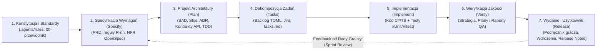

# 0.2 Architektura dokumentacji pod Spec-Driven Development (SDD) i mapowanie Confluence

> **Źródło prawdy:** repozytorium (`docs/00-przewodnik-i-setup/02-architektura-dokumentacji-sdd.md`) · **Kategoria dokumentacji:** Dokumentacja procesowa — Standardy i architektura dokumentacji · **Etap SDD:** Fundamenty i organizacja · **Powiązane decyzje:** [ADR-0003](../01-dokumentacja-systemowa/07-decyzje-adr/0003-openspec-i-konstytucja.md), [ADR-0011](../01-dokumentacja-systemowa/07-decyzje-adr/0011-dokumentacja-hybryda-repo-confluence.md)

Niniejszy dokument stanowi realizację zadania projektowego polegającego na zaprojektowaniu spójnej struktury dokumentacji w systemie **Atlassian Confluence** oraz w repozytorium Git pod dalsze prace z wykorzystaniem metodyki **Spec-Driven Development (SDD)**, z pełnym uwzględnieniem taksonomii dokumentacji technicznej opisanej w opracowaniu AltexSoft (*[Technical Documentation in Software Development: Types, Best Practices, and Tools](https://www.altexsoft.com/blog/technical-documentation-in-software-development-types-best-practices-and-tools/)*).

---

## 1. Założenia metodyki Spec-Driven Development (SDD) w projekcie RE:JOLTANCE

W tradycyjnych projektach studenckich dokumentacja bywa tworzona post-factum („na zaliczenie”), przez co szybko traci aktualność i nie wspiera zespołu w podejmowaniu decyzji projektowych. W podejściu **Spec-Driven Development (SDD)** wspieranym przez agentów AI odwracamy tę zależność: **dokumentacja jest wykonywalnym kontraktem wyprzedzającym implementację**.



### Pięć żelaznych zasad naszej dokumentacji

1. **Najpierw specyfikacja, potem kod:** Żadne zadanie zmieniające reguły gry, kontrakty komunikacyjne ani funkcjonalność o rozmiarze ≥ 3 Story Points nie może wejść w fazę kodowania bez zatwierdzonej specyfikacji (wymagania i scenariusze `GIVEN / WHEN / THEN`).
2. **Układ 1:1 między repozytorium (`docs/`) a Confluence:** Struktura katalogów w `docs/` odpowiada dokładnie strukturze stron nadrzędnych i podstron w przestrzeni Confluence PB. Eliminuje to chaos organizacyjny i pozwala przenosić dokumentację z repozytorium do Confluence w sposób zautomatyzowany (`python tools/confluence/sync_confluence.py`).
3. **Jednoznaczne źródło prawdy (Single Source of Truth):**
   - **Repozytorium Git (`docs/` oraz `openspec/`)** jest źródłem prawdy dla całej dokumentacji sterującej wytwarzaniem oprogramowania (PRD, reguły gry, SAD, stos technologiczny, ADR, API, UX, strategia testów, konfiguracja agentów AI). Każda zmiana przechodzi przez Pull Request i walidację w CI (`npm run check`).
   - **Confluence PB** zawiera pełne drzewo dokumentacji (w tym zsynchronizowane kopie dokumentów z repozytorium opatrzone nagłówkiem wersji) oraz jest natywnym miejscem edycji dla żywych protokołów i raportów tworzonych podczas spotkań (raporty z testów sprintu, protokoły Sprint Review, notatki z Daily Scrum).
   - **Jira PB** służy do operacyjnego śledzenia zadań, rejestrowania czasu pracy (*Log Work*) i generowania wykresów spalania (*Burndown Chart*).
4. **Pełna śledzalność (Traceability End-to-End):** Każde wymaganie analityczne posiada unikalny identyfikator (`R-01..R-84` dla reguł funkcjonalnych gry, `NFR-01..NFR-70` dla wymagań jakościowych ISO/IEC 25010), który łączy dokument **PRD** → specyfikację **OpenSpec** → zadanie w **Jirze (`REJ-123`)** → automatyczny test jednostkowy/integracyjny (`R14_...`) → raport testowy w **Confluence**.
5. **Język przyjazny ludziom i precyzyjny dla agentów AI:** Dokumenty piszemy czystą, profesjonalną polszczyzną inżynierską, unikając żargonu skrótowego, a wymagania behawioralne formułujemy w ustrukturyzowanym formacie scenariuszowym (`GIVEN / WHEN / THEN`), który jest jednocześnie czytelny dla człowieka i jednoznacznie interpretowalny przez modele językowe.

---

## 2. Analiza porównawcza dwóch wariantów organizacji dokumentacji

Podczas projektowania architektury dokumentacji dla projektu **RE:JOLTANCE** przeanalizowaliśmy dwa główne modele strukturyzacji drzewa w repozytorium i w Confluence:

- **Wariant A (Taksonomia AltexSoft z wbudowanym przepływem SDD):** Podział najwyższego poziomu według klasyfikacji typów dokumentacji technicznej z artykułu AltexSoft (*Product: System Documentation*, *Product: User Documentation*, *Process Documentation*), uzupełniony o dedykowany moduł *Inżynierii Agentowej* oraz *Bibliotekę Szablonów*, gdzie każdy dokument ma jawnie przypisany etap SDD.
- **Wariant B (Chronologiczny układ według faz cyklu SDD):** Podział najwyższego poziomu według kolejnych kroków procesu SDD (*1. Fundamenty*, *2. Specyfikacja/Analiza*, *3. Plan/Architektura*, *4. Realizacja*, *5. Weryfikacja/Jakość*, *6. Wydania*, *7. Proces Scrum*).

### Zestawienie porównawcze w kontekście naszego projektu

| Kryterium oceny (w kontekście projektu PB, 6 osób, SDD + AI) | Wariant A: Układ wg taksonomii AltexSoft + SDD *(Wybrany)* | Wariant B: Układ wg faz czasowych SDD *(Odrzucony po audycie)* |
|---|---|---|
| **1. Zgodność z wymaganiami prowadzącego (Zadanie 01)** | **Bardzo wysoka (10/10).** Prowadzący wprost wymaga oparcia struktury o sekcję *"Types of technical documentation"* z artykułu AltexSoft, z **PRD** i **SAD** jako głównymi dokumentami oraz pozostałymi typami jako szablonami. W Wariancie A prowadzący po otwarciu Confluence lub `docs/` od razu widzi dokładnie tę klasyfikację. | **Średnia (6/10).** Dokumenty z klasyfikacji AltexSoft są rozproszone po 7 gałęziach procesowych. Aby sprawdzić, czy zespół uwzględnił wszystkie typy z artykułu, trzeba posługiwać się dodatkową tabelą mapującą. |
| **2. Spójność tematyczna i brak rozproszenia (Ergonomia dla ludzi)** | **Bardzo wysoka (9/10).** Każdy artefakt ma jedno naturalne miejsce wynikające z tego, **czym jest** (np. cała dokumentacja systemowa w `01-dokumentacja-systemowa/`, wszystkie szablony w `05-szablony/`, cała wiedza o agentach w `04-system-agentow-ai/`). | **Niska (4/10).** Dokumentacja tej samej dziedziny ulega sztucznemu rozbiciu pomiędzy fazy czasu — np. UX trafia do trzech różnych miejsc (persony w fazie 2, mapa ekranów w fazie 3, testy użyteczności w fazie 5), a roadmapy do trzech innych. |
| **3. Łatwość utrzymania przez 6-osobowy zespół studencki** | **Bardzo wysoka (9/10).** Sześć czytelnych katalogów nadrzędnych. Student odpowiedzialny za dany epik (EU1) lub dokumentację modułu (EU5) wie dokładnie, gdzie pracować, bez przekopywania się przez 35 drobnych podstron. | **Niska (5/10).** W poprzedniej iteracji repozytorium próba połączenia 12 katalogów roboczych z 7-etapowym drzewem Confluence doprowadziła do sytuacji, w której nikt nie wiedział, gdzie szukać plików. |
| **4. Praca z agentami AI i narzędziami SDD (OpenSpec)** | **Bardzo wysoka (10/10).** Agenci mają stałe, deterministyczne ścieżki do wymagań (`01-dokumentacja-systemowa/`), reguł wykonywalnych (`openspec/specs/`) oraz własnych procedur (`04-system-agentow-ai/` i `.agents/`). | **Dobra (7/10).** Agenci radzą sobie ze ścieżkami, jeśli są one wpisane w regułach, ale ludzie sprawdzający pracę agentów gubią się w rozproszonych katalogach. |
| **5. Synchronizacja Repo ↔ Confluence (1:1)** | **W pełni automatyczna (10/10).** Drzewo katalogów w `docs/` i drzewo stron w Confluence są identyczne 1:1. Jeden skrypt (`sync_confluence.py`) eksportuje i waliduje całą przestrzeń. | **Utrudniona (5/10).** Wymaga utrzymywania ręcznej tablicy przekierowań między strukturą plików w repozytorium a strukturą stron na wiki. |

**Wniosek architektoniczny:** Wybieramy **Wariant A (Układ 1:1 wg taksonomii AltexSoft zintegrowany z cyklem SDD)**. Jako strukturę folderów i drzewa Confluence przyjmujemy przejrzysty podział z artykułu AltexSoft, natomiast każdy dokument posiada w nagłówku i w tabeli nawigacyjnej **jawnie przypisaną fazę SDD** (`Constitution`, `Specify`, `Plan`, `Tasks`, `Implement`, `Verify`, `Release`). Daje to 100% zgodności z poleceniem prowadzącego przy zachowaniu pełnej dyscypliny procesu Spec-Driven Development.

---

## 3. Pełne pokrycie typów dokumentacji wg AltexSoft w naszej strukturze

Poniższa tabela pokazuje, w jaki sposób każdy typ dokumentacji wymieniony w sekcji *"Types of technical documentation"* artykułu AltexSoft został odwzorowany w naszej architekturze (wraz z podziałem na **pełne opracowania dla PRD i SAD** oraz **szablony i specyfikacje dla pozostałych typów**):

| Kategoria AltexSoft | Typ dokumentacji (wg artykułu AltexSoft) | Status w projekcie RE:JOLTANCE | Ścieżka w repozytorium (`docs/`) / Miejsce w Confluence | Etap SDD |
|---|---|---|---|---|
| **Product: System** | **Product Requirements Document (PRD)** | **Pełny dokument analityczny** + szablon | [`01-dokumentacja-systemowa/01-prd-wymagania-produktu.md`](../01-dokumentacja-systemowa/01-prd-wymagania-produktu.md) (+ szablon [`05-szablony/szablon-prd.md`](../05-szablony/szablon-prd.md)) | `Specify` |
| **Product: System** | **Functional & Non-Functional Requirements (SRS / Rules)** | **Pełna specyfikacja (55 reguł R‑nn + 19 NFR)** | [`01-dokumentacja-systemowa/02-specyfikacja-regul-gry.md`](../01-dokumentacja-systemowa/02-specyfikacja-regul-gry.md), [`03-indeks-regul-r-nn.md`](../01-dokumentacja-systemowa/03-indeks-regul-r-nn.md) oraz `openspec/specs/*` | `Specify` |
| **Product: System** | **UX Design: Personas, Scenarios & Story Maps** | **Opracowane w PRD/DIP** + szablon | [`01-dokumentacja-systemowa/01-prd-wymagania-produktu.md`](../01-dokumentacja-systemowa/01-prd-wymagania-produktu.md) §3 + szablon [`05-szablony/szablon-ux-persona-scenariusz.md`](../05-szablony/szablon-ux-persona-scenariusz.md) | `Specify` |
| **Product: System** | **UX Design: Site Map, User Flows, Wireframes, UI Style Guide, Prototype** | **Pełny dokument UX** + działający prototyp JS | [`01-dokumentacja-systemowa/10-ux-design-i-przeplywy.md`](../01-dokumentacja-systemowa/10-ux-design-i-przeplywy.md) oraz `prototype/revibance/` | `Plan` |
| **Product: System** | **UX Design: Usability Testing Reports** | **Szablon gotowy do użycia na Sprint Review** | [`05-szablony/szablon-ux-test-uzytecznosci.md`](../05-szablony/szablon-ux-test-uzytecznosci.md) | `Verify` |
| **Product: System** | **Software Architecture Document (SAD)** | **Pełny dokument architektoniczny (AltexSoft + arc42 + C4)** + szablon | [`01-dokumentacja-systemowa/05-sad-architektura-systemu.md`](../01-dokumentacja-systemowa/05-sad-architektura-systemu.md), [`06-stos-technologiczny.md`](../01-dokumentacja-systemowa/06-stos-technologiczny.md), [`07-decyzje-adr/`](../01-dokumentacja-systemowa/07-decyzje-adr/README.md) (+ szablon [`05-szablony/szablon-sad.md`](../05-szablony/szablon-sad.md)) | `Plan` |
| **Product: System** | **Technical Design Document (TDD)** | **Szablon TDD** + zmiany `openspec/changes/*/design.md` | [`05-szablony/szablon-tdd.md`](../05-szablony/szablon-tdd.md) oraz `openspec/changes/<id>/design.md` | `Plan` / `Tasks` |
| **Product: System** | **Source Code Documentation** | **Mapa modułów** + karty `src/*/README.md` + szablon | [`01-dokumentacja-systemowa/08-mapa-kodu-i-modulow.md`](../01-dokumentacja-systemowa/08-mapa-kodu-i-modulow.md), `src/*/README.md` (+ szablon [`05-szablony/szablon-karta-modulu.md`](../05-szablony/szablon-karta-modulu.md)) | `Implement` |
| **Product: System** | **Quality Assurance (QA): Test Strategy, Test Plan, Test Cases, Checklists** | **Pełna Strategia Testów** + szablony planu i raportu QA | [`01-dokumentacja-systemowa/11-strategia-testow-qa.md`](../01-dokumentacja-systemowa/11-strategia-testow-qa.md) + szablony [`szablon-qa-plan-testow.md`](../05-szablony/szablon-qa-plan-testow.md), [`szablon-qa-raport-i-checklista.md`](../05-szablony/szablon-qa-raport-i-checklista.md) | `Verify` |
| **Product: System** | **API Documentation** | **Pełna specyfikacja kontraktów REST i SignalR** | [`01-dokumentacja-systemowa/09-kontrakty-i-api.md`](../01-dokumentacja-systemowa/09-kontrakty-i-api.md) | `Plan` / `Implement` |
| **Product: User** | **End-User Documentation (Quick Start, Manual, Troubleshooting, FAQ)** | **Podręcznik gracza** + szablon | [`02-dokumentacja-uzytkownika/01-podrecznik-gracza.md`](../02-dokumentacja-uzytkownika/01-podrecznik-gracza.md) (+ szablon [`05-szablony/szablon-podrecznik-gracza.md`](../05-szablony/szablon-podrecznik-gracza.md)) | `Release` |
| **Product: User** | **System Administrator Documentation (Installation, Config, Security, Backup)** | **Instrukcja wdrożenia i utrzymania** + szablon | [`02-dokumentacja-uzytkownika/02-instrukcja-wdrozenia-i-utrzymania.md`](../02-dokumentacja-uzytkownika/02-instrukcja-wdrozenia-i-utrzymania.md) (+ szablon [`05-szablony/szablon-instrukcja-wdrozenia-admin.md`](../05-szablony/szablon-instrukcja-wdrozenia-admin.md)) | `Release` |
| **Process** | **Agile Product Roadmaps (Strategic, Technology, Release Plan)** | **Opracowane w PRD, Stosie Technologicznym i Backlogu** | [`01-prd-wymagania-produktu.md`](../01-dokumentacja-systemowa/01-prd-wymagania-produktu.md) §2, [`06-stos-technologiczny.md`](../01-dokumentacja-systemowa/06-stos-technologiczny.md) §3, [`03-dokumentacja-procesowa/02-backlog/BACKLOG.md`](../03-dokumentacja-procesowa/02-backlog/BACKLOG.md) | `Constitution` / `Plan` |
| **Process** | **Product & Sprint Backlogs** | **Pełny Backlog (TOML + CSV do Jiry)** | [`03-dokumentacja-procesowa/02-backlog/`](../03-dokumentacja-procesowa/02-backlog/README.md) | `Tasks` |
| **Process** | **Standards (Coding, Testing, Git, AI Governance)** | **Pełny zestaw standardów i konstytucja** | [`00-przewodnik-i-setup/03-proces-pracy-i-git-scrum.md`](03-proces-pracy-i-git-scrum.md), [`04-system-agentow-ai/`](../04-system-agentow-ai/README.md), `.agents/rules/` | `Constitution` |
| **Process** | **Plans, Estimates, Schedules & Project Charter (DIP)** | **Pełny Dokument Inicjujący Projekt (DIP)** | [`03-dokumentacja-procesowa/01-dip-dokument-inicjujacy.md`](../03-dokumentacja-procesowa/01-dip-dokument-inicjujacy.md) | `Constitution` / `Specify` |
| **Process** | **Working Papers (Spikes, Technical Comparisons, Discrepancy Notes)** | **Pełne analizy techniczne i rozbieżności** | [`03-dokumentacja-procesowa/04-badania-i-analizy/`](../03-dokumentacja-procesowa/04-badania-i-analizy/README.md), [`01-dokumentacja-systemowa/04-rozbieznosci-prototypu.md`](../01-dokumentacja-systemowa/04-rozbieznosci-prototypu.md) | `Plan` |
| **Process** | **Reports, Metrics (Burndown, Velocity), Release Checklists & Meeting Notes** | **Szablony Scrum, Release Notes i agenda spotkań** | [`03-dokumentacja-procesowa/03-scrum-i-spotkania/`](../03-dokumentacja-procesowa/03-scrum-i-spotkania/README.md), [`05-szablony/szablon-informacja-o-wydaniu.md`](../05-szablony/szablon-informacja-o-wydaniu.md) | `Verify` / `Release` |

---

## 4. Drzewo stron w Confluence (Struktura 1:1 z katalogiem `docs/`)

Poniższe drzewo przedstawia dokładny układ przestrzeni projektowej w **Confluence PB**, który w relacji **1:1** odpowiada katalogom i plikom w folderze `docs/`:

```text
RE:JOLTANCE — Strona Główna Przestrzeni (docs/README.md)
│
├── 0. Przewodnik, Setup i Architektura SDD (docs/00-przewodnik-i-setup/)
│   ├── 0.1 Szybki start i instalacja środowiska (01-szybki-start-i-instalacja.md)
│   ├── 0.2 Architektura dokumentacji SDD i mapowanie Confluence (02-architektura-dokumentacji-sdd.md)
│   ├── 0.3 Proces pracy, Git, Jira i Scrum (03-proces-pracy-i-git-scrum.md)
│   ├── 0.4 Ściąga komend deweloperskich i SDD (04-sciaga-komend.md)
│   ├── 0.5 Słownik pojęć domenowych i technicznych (05-slownik-pojec.md)
│   └── 0.6 Decyzje otwarte i założenia projektowe (06-decyzje-otwarte-i-zalozenia.md)
│
├── 1. Dokumentacja Produktowa — Systemowa (docs/01-dokumentacja-systemowa/)
│   ├── 1.1 Wymagania Produktu — PRD (01-prd-wymagania-produktu.md)                      [★ GŁÓWNY DOKUMENT ANALITYCZNY]
│   ├── 1.2 Specyfikacja funkcjonalna zasad gry (02-specyfikacja-regul-gry.md)
│   ├── 1.3 Indeks reguł R-nn i śledzalność testów (03-indeks-regul-r-nn.md)
│   ├── 1.4 Analiza rozbieżności prototypu D-01..D-20 (04-rozbieznosci-prototypu.md)
│   ├── 1.5 Dokument Architektury Systemu — SAD (05-sad-architektura-systemu.md)        [★ GŁÓWNY DOKUMENT ARCHITEKTURY]
│   ├── 1.6 Stos technologiczny i roadmapa IT (06-stos-technologiczny.md)               [★ DOKUMENT STOSU TECHNOLOGICZNEGO]
│   ├── 1.7 Decyzje architektoniczne — ADR (07-decyzje-adr/README.md + ADR 0001..0011)
│   ├── 1.8 Mapa kodu źródłowego i modułów (08-mapa-kodu-i-modulow.md + src/*/README.md)
│   ├── 1.9 Dokumentacja kontraktów i API REST/SignalR (09-kontrakty-i-api.md)
│   ├── 1.10 Projekt UX, przepływy i przewodnik stylu (10-ux-design-i-przeplywy.md)
│   └── 1.11 Strategia zapewnienia jakości i testów QA (11-strategia-testow-qa.md)
│
├── 2. Dokumentacja Produktowa — Użytkownika i Administratora (docs/02-dokumentacja-uzytkownika/)
│   ├── 2.1 Podręcznik gracza i szybki start (01-podrecznik-gracza.md)
│   └── 2.2 Instrukcja wdrożenia, konfiguracji i utrzymania (02-instrukcja-wdrozenia-i-utrzymania.md)
│
├── 3. Dokumentacja Procesowa i Zarządzanie Scrum (docs/03-dokumentacja-procesowa/)
│   ├── 3.1 Dokument Inicjujący Projekt — DIP (01-dip-dokument-inicjujacy.md)
│   ├── 3.2 Backlog produktu i plan wydań (02-backlog/BACKLOG.md + instrukcja-importu-jira.md)
│   ├── 3.3 Ceremonie Scrum i spotkania zespołu (03-scrum-i-spotkania/)
│   │   └── [W Confluence podstrony dla kolejnych sprintów: Sprint 0, Sprint 1..5 -> Daily, Review, Retro, Raporty QA]
│   └── 3.4 Badania techniczne i analizy porównawcze (04-badania-i-analizy/)
│
├── 4. Inżynieria Agentowa i Automatyzacja SDD (docs/04-system-agentow-ai/)
│   ├── 4.1 Architektura i konfiguracja systemu agentów AI (01-architektura-i-konfiguracja-agentow.md)
│   ├── 4.2 Katalog ról agentów i wbudowanych skilli (02-katalog-rol-i-wbudowanych-skilli.md)
│   ├── 4.3 Przewodnik pisania specyfikacji w OpenSpec (03-jak-pisac-specyfikacje-openspec.md)
│   └── 4.4 Warsztat: jak samodzielnie budować agentów, skille, karty i dokumentację (04-warsztat-tworzenie-agentow-skilli-i-kart.md)
│
└── 5. Biblioteka Szablonów Dokumentacji (docs/05-szablony/)
    ├── 5.1 Standard nagłówka strony Confluence (naglowek-strony-confluence.md)
    ├── 5.2 Szablon PRD — Wymagania Produktu (szablon-prd.md)
    ├── 5.3 Szablon SAD — Architektura Systemu (szablon-sad.md)
    ├── 5.4 Szablon TDD — Projekt Techniczny Zmiany (szablon-tdd.md)
    ├── 5.5 Szablon UX — Persony, scenariusze i mapa historyjek (szablon-ux-persona-scenariusz.md)
    ├── 5.6 Szablon UX — Raport z testów użyteczności (szablon-ux-test-uzytecznosci.md)
    ├── 5.7 Szablon Dokumentacji Modułu Kodu — EU5 (szablon-karta-modulu.md)
    ├── 5.8 Szablon QA — Plan testów i przypadki testowe — EU6 (szablon-qa-plan-testow.md)
    ├── 5.9 Szablon QA — Raport z wykonania testów i checklista — EU6 (szablon-qa-raport-i-checklista.md)
    ├── 5.10 Szablon Dokumentacji Użytkownika — Podręcznik gracza (szablon-podrecznik-gracza.md)
    ├── 5.11 Szablon Dokumentacji Administratora — Wdrożenie i utrzymanie (szablon-instrukcja-wdrozenia-admin.md)
    └── 5.12 Szablon Informacji o Wydaniu — Release Notes (szablon-informacja-o-wydaniu.md)
```

---

## 5. Mechanizm synchronizacji: Repozytorium Git → Confluence (`sync_confluence.py`)

Aby wyeliminować ręczne formatowanie i rozjeżdżanie się wersji pomiędzy repozytorium a przestrzenią Confluence PB, w projekcie przygotowano narzędzie `tools/confluence/sync_confluence.py` oraz powiązany skill agentowy `rj-sync-confluence`.

### Jak działa proces przenoszenia dokumentacji z repozytorium do Confluence?

1. **Walidacja spójności drzewa (`--check`):**
   Polecenie `python tools/confluence/sync_confluence.py --check` weryfikuje, czy wszystkie strony zdefiniowane w strukturze docelowej istnieją w katalogu `docs/`, posiadają poprawny format Markdown oraz nie zawierają uszkodzonych odnośników. Krok ten jest automatycznie wykonywany w potoku CI.
2. **Generowanie paczki eksportowej dla Confluence (`--export`):**
   Polecenie `python tools/confluence/sync_confluence.py` buduje gotowe do publikacji pliki w katalogu `.artifacts/confluence-export/` (ignorowanym przez Git), automatycznie dołączając do każdego dokumentu ustandaryzowany **Nagłówek Metadanych Confluence**:

   ```text
   Źródło prawdy: Repozytorium Git — docs/01-dokumentacja-systemowa/05-sad-architektura-systemu.md (gałąź develop)
   Kategoria AltexSoft: Product: System Documentation (SAD) · Etap SDD: Plan · Status: Zatwierdzony
   ```

3. **Publikacja w Confluence PB (ręczna lub przez REST API):**
   - **Tryb ręczny (bez tokena):** Otwórz wygenerowany plik z `.artifacts/confluence-export/`, skopiuj jego zawartość i w edytorze Confluence PB wybierz *Wstaw (Insert) → Znaczniki (Markup) → Markdown*.
   - **Tryb automatyczny (z tokenem PAT):** Po ustawieniu zmiennych środowiskowych `CONFLUENCE_URL`, `CONFLUENCE_SPACE_KEY` oraz `CONFLUENCE_PERSONAL_TOKEN` polecenie `python tools/confluence/sync_confluence.py --publish` automatycznie tworzy lub aktualizuje drzewo stron przez REST API Confluence Server/Data Center 8.4.
