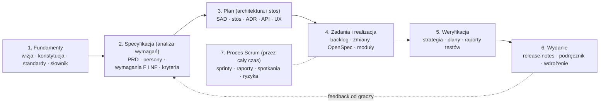

# Mapa dokumentacji SDD — struktura dokumentacji RE:JOLTANCE

**Zadanie 01 (Projekt zespołowy 2026/27):** struktura dokumentacji w Confluence pod spec‑driven development (SDD),
oparta na typach dokumentacji technicznej ([AltexSoft, *Technical Documentation in Software Development*](https://www.altexsoft.com/blog/technical-documentation-in-software-development-types-best-practices-and-tools/))
oraz standardach: arc42 + C4 (architektura), ISO/IEC 25010:2023 (jakość), GIVEN/WHEN/THEN (kryteria akceptacji).
Decyzja o podziale repo ↔ Confluence: [ADR-0011](../04-adr/0011-dokumentacja-hybryda-repo-confluence.md).

## 1. Zasady

1. **Dokumentacja prowadzi pracę, a nie ją opisuje po fakcie.** W SDD najpierw powstaje specyfikacja (co i dlaczego), potem plan (jak), potem zadania i kod. Dokument bez wpływu na pracę zespołu nie powstaje.
2. **Każdy dokument ma jedno źródło prawdy:**
   - **repo** — wszystko, co steruje implementacją i jest czytane przez agentów AI (wymagania, architektura, stos, API, ADR, standardy, strategia testów); zmiana przez PR z recenzją;
   - **Confluence** — dokumenty ludzkie i procesowe (użytkownicy, protokoły, raporty, notatki, dokumentacja użytkownika); edycja w Confluence;
   - **Jira** — praca (backlog, sprinty, czas, Burndown).
3. **Confluence zawiera całe drzewo.** Strony ze źródłem w repo są kopiami z nagłówkiem (sekcja 5) — czytelnik nie musi znać repo.
4. **Śledzalność:** wymaganie (R‑nn / NFR‑nn) → story w Jirze (REJ‑…) → zmiana OpenSpec → test o nazwie z numerem → wynik w CI.
5. **Żywe dokumenty:** dokument jest aktualizowany w tym samym PR co kod, którego dotyczy (Definition of Done).

## 2. Dokumenty na kolejnych etapach SDD



| Etap SDD | Pytanie | Wejście dla | Narzędzie |
|---|---|---|---|
| Fundamenty (*constitution*) | jakie zasady obowiązują zawsze? | wszystkich etapów, agentów AI | `.agents/rules/`, `AGENTS.md` |
| Specyfikacja (*specify*) | co ma robić system i jak sprawdzimy, że robi? | planu, testów | `openspec/specs`, `/opsx:propose` |
| Plan (*plan*) | jak to zbudujemy i dlaczego tak? | zadań, implementacji | `docs/03-architecture`, ADR, `design.md` zmiany |
| Zadania (*tasks*) | jakie kroki ≤ 4 h? | sprintu w Jirze | `tasks.md`, `backlog.toml` → Jira |
| Realizacja (*implement*) | kod + testy zgodne ze specyfikacją | weryfikacji | `/opsx:apply`, PR |
| Weryfikacja (*verify*) | czy spełnia specyfikację? | wydania | CI, testy R‑nn/NFR‑nn, raporty |
| Wydanie | co dostał użytkownik? | feedbacku → specyfikacji | release notes, podręcznik |

## 3. Drzewo stron w Confluence

Legenda „Źródło”: 🗂 **repo** (strona w Confluence to kopia) · 📝 **Confluence** (pisane w Confluence) · 📋 **Jira** (raport / link).
Kolumna „Typ” wskazuje typ dokumentacji wg AltexSoft. Szablony: [`docs/10-szablony/`](../10-szablony/README.md).

```text
RE:JOLTANCE — strona główna (cel projektu, zespół, linki: repo, Jira, prototyp, CI)
├─ 0. Mapa dokumentacji SDD
├─ 1. Fundamenty
│  ├─ 1.1 Wizja produktu i roadmapa strategiczna
│  ├─ 1.2 Dokument Inicjujący Projekt (DIP)
│  ├─ 1.3 Konstytucja i standardy pracy
│  └─ 1.4 Słownik pojęć
├─ 2. Analiza wymagań  (SDD: specify)
│  ├─ 2.1 Wymagania produktu (PRD)
│  ├─ 2.2 Użytkownicy: persony, scenariusze, mapa historyjek
│  ├─ 2.3 Wymagania funkcjonalne — zasady gry (R-0x…R-8x)
│  │  └─ 2.3.1…2.3.9 obszary: przygotowanie meczu, runda, zagrywanie kart, walka, słowa kluczowe,
│  │                  śmierć i usuwanie, efekty kart, koniec meczu, autorytet serwera
│  ├─ 2.4 Wymagania funkcjonalne — platforma (konta, lobby, talie, panel admina)
│  ├─ 2.5 Wymagania niefunkcjonalne (ISO/IEC 25010)
│  ├─ 2.6 Rozbieżności i decyzje o zasadach
│  └─ 2.7 Backlog produktu i plan wydań
├─ 3. Architektura i stos technologiczny  (SDD: plan)
│  ├─ 3.1 Dokument architektury (SAD: arc42 + C4)
│  ├─ 3.2 Stos technologiczny i roadmapa technologiczna
│  ├─ 3.3 Decyzje architektoniczne (ADR) → 3.3.x po jednej stronie na ADR
│  ├─ 3.4 Kontrakty i API (REST, SignalR)
│  └─ 3.5 UX: mapa ekranów, przepływy, przewodnik stylu
├─ 4. Realizacja  (SDD: tasks / implement)
│  ├─ 4.1 Jak pracujemy (Jira → specyfikacja → kod → PR)
│  ├─ 4.2 Zmiany w toku (OpenSpec)
│  ├─ 4.3 Dokumentacja modułów → Kernel, Content, Contracts, Server, AppHost, Klient web
│  └─ 4.4 Środowisko deweloperskie
├─ 5. Jakość  (SDD: verify)
│  ├─ 5.1 Strategia testów
│  ├─ 5.2 Plany testów (per sprint)
│  ├─ 5.3 Raporty z testów i pokrycie wymagań
│  └─ 5.4 Testy użyteczności (rada graczy)
├─ 6. Wydania i użytkownicy
│  ├─ 6.1 Informacje o wydaniach (po każdym sprincie)
│  ├─ 6.2 Podręcznik gracza
│  └─ 6.3 Instrukcja wdrożenia i utrzymania
└─ 7. Proces Scrum
   ├─ 7.1 Organizacja zespołu (role, RACI, rotacja PO, DoR/DoD)
   ├─ 7.2 Sprinty → Sprint N → Planning · Daily · Review i protokół odbioru · Retro i Burndown
   ├─ 7.3 Rejestr ryzyk
   ├─ 7.4 Spotkania
   └─ 7.5 Badania i spike'i
```

### Opis stron

| Strona | Zawartość | Źródło | Typ (AltexSoft) | Szablon | Właściciel | Stan |
|---|---|---|---|---|---|---|
| Strona główna | cel, zespół, linki, status sprintu | 📝 | — | — | PO sprintu | do założenia |
| 0 Mapa dokumentacji | ten dokument | 🗂 `docs/00-start/mapa-dokumentacji.md` | proces: standardy | — | zespół | ✅ |
| 1.1 Wizja i roadmapa strategiczna | problem, cel, wartość, fale W0–W3, kamienie milowe | 📝 (na bazie DIP §1, `BACKLOG.md`) | proces: roadmapa strategiczna | — | PO | szkic w DIP |
| 1.2 DIP | dokument uczelniany | 🗂 `docs/01-dip/DIP.md` → po zatwierdzeniu v1.0 📝 | PRD (wersja uczelniana) | szablon kickoff‑kit | zespół | v0.9 |
| 1.3 Konstytucja i standardy | zasady dla ludzi i agentów, kod, testy, git | 🗂 `.agents/rules/`, `AGENTS.md` | proces: standardy | — | zespół (zmiana = ADR) | ✅ |
| 1.4 Słownik | pojęcia gry i techniczne | 🗂 `docs/00-start/slownik.md` | — | — | zespół | ✅ |
| 2.1 PRD | cele, zakres i poza zakresem, założenia, role, pytania otwarte, linki do wymagań | 📝 | PRD | `prd.md` | PO | do założenia |
| 2.2 Użytkownicy | persony, scenariusze, mapa historyjek | 📝 | UX: persony, scenariusze, mapy | `persona-scenariusz.md` | właściciel E4 | szkic w DIP §2 |
| 2.3 Zasady gry (FR) | 9 obszarów, 55 wymagań R‑nn ze scenariuszami | 🗂 `openspec/specs/*`, `docs/02-rules/` | PRD: wymagania funkcjonalne | format OpenSpec | właściciel E1/E2 | ✅ |
| 2.4 Platforma (FR) | konta, lobby, talie, admin | 🗂 `openspec/specs/*` (do utworzenia zmianami OpenSpec) | PRD: wymagania funkcjonalne | format OpenSpec | właściciele E3/E6 | luka — dziś tylko story |
| 2.5 Wymagania NF | NFR‑nn wg ISO/IEC 25010, mierzalne scenariusze | 🗂 `openspec/specs/quality-attributes` | PRD + SAD: wymagania niefunkcjonalne | format OpenSpec | zespół | ✅ v1 |
| 2.6 Rozbieżności | D‑01…D‑20 i decyzje | 🗂 `docs/02-rules/ROZBIEZNOSCI.md` | notatki robocze | — | właściciel E1 | ✅ |
| 2.7 Backlog i plan wydań | epiki, story, sprinty, linia cięcia | 📋 Jira + 🗂 `docs/05-backlog/BACKLOG.md` | proces: backlog, plan wydań | `backlog.toml` | PO | ✅ |
| 3.1 SAD | kontekst, ograniczenia, strategia, bloki, przebiegi, wdrożenie, koncepcje przekrojowe, dane, ryzyka | 🗂 `docs/03-architecture/SAD.md` | SAD | arc42‑lite (`sad.md`) | architekt / właściciel E1 | ✅ v1 |
| 3.2 Stos i roadmapa tech. | technologie, wersje, uzasadnienie, plan zmian | 🗂 `docs/03-architecture/STOS.md` | proces: roadmapa technologiczna | — | właściciel E6 | ✅ v1 |
| 3.3 ADR | decyzje 0001–0011 | 🗂 `docs/04-adr/` | SAD: uzasadnienie decyzji | `0000-szablon.md` | autor decyzji | ✅ |
| 3.4 Kontrakty i API | REST, metody i zdarzenia SignalR, błędy, format JSON | 🗂 `docs/03-architecture/API.md` | dokumentacja API | — | właściciel E3 | ✅ v1 |
| 3.5 UX | mapa ekranów, przepływy, przewodnik stylu, makiety | 🗂 `docs/03-architecture/UX.md` (+ makiety 📝) | UX: mapa ekranów, style guide, wireframe'y | — | właściciel E4 | ✅ v1 (bez makiet) |
| 4.1 Jak pracujemy | cykl pracy, SDD krok po kroku | 🗂 `docs/00-start/jak-pracujemy.md`, `jak-pisac-spec.md` | proces: standardy | — | zespół | ✅ |
| 4.2 Zmiany w toku | lista zmian OpenSpec i ich stan | 🗂 `openspec/changes/` | TDD (projekt techniczny) | format OpenSpec | autor zmiany | mechanizm gotowy |
| 4.3 Moduły | po stronie na moduł: po co, API, niezmienniki, testy, właściciel | 🗂 `src/*/README.md` | dokumentacja kodu | `strona-modulu.md` | właściciel modułu (EU5/EU6) | ✅ v1 |
| 4.4 Środowisko | instalacja, uruchomienie, problemy | 🗂 `docs/00-start/jak-zaczac.md` | admin: instalacja | — | właściciel E6 | ✅ |
| 5.1 Strategia testów | poziomy, narzędzia, kryteria, śledzalność | 🗂 `docs/09-jakosc/STRATEGIA-TESTOW.md` | QA: strategia testów | — | właściciel E6 | ✅ v1 |
| 5.2 Plany testów | zakres sprintu, przypadki, środowisko, kryteria wejścia/wyjścia | 📝 | QA: plan testów | `plan-testow.md` | PO sprintu | szablon |
| 5.3 Raporty z testów | wyniki CI, pokrycie R‑nn/NFR‑nn, błędy | 📝 (dane z CI) | QA: raporty, checklisty | `raport-testow.md` | właściciel E6 | szablon |
| 5.4 Testy użyteczności | sesje z radą graczy, wnioski | 📝 | UX: raporty z testów użyteczności | `test-uzytecznosci.md` | PO sprintu | szablon |
| 6.1 Wydania | co nowego, znane problemy, link do tagu | 📝 | proces: release notes | `informacja-o-wydaniu.md` | PO sprintu | szablon |
| 6.2 Podręcznik gracza | szybki start, zasady w skrócie, FAQ | 📝 | dokumentacja użytkownika | `podrecznik-gracza.md` | właściciel E4 | szablon |
| 6.3 Wdrożenie i utrzymanie | instalacja, konfiguracja, kopie zapasowe, bezpieczeństwo | 🗂 `docs/09-jakosc/` → przy E6‑S05 | dokumentacja administratora | `instrukcja-wdrozenia.md` | właściciel E6 | szablon |
| 7.1 Organizacja | role, RACI, rotacja PO, DoR/DoD | 🗂 `DIP.md` §6, §8 | proces: standardy | — | zespół | ✅ |
| 7.2 Sprinty | planning, daily, review + protokół, retro + Burndown | 📝 + 📋 | proces: plany, raporty i metryki | `docs/06-scrum/` | PO sprintu | szablony |
| 7.3 Ryzyka | rejestr ryzyk (żywy) | 📝 (start: DIP §7) | proces: plany | — | PO sprintu | szkic w DIP |
| 7.4 Spotkania | agendy i notatki | 📝 | proces: notatki ze spotkań | agenda startowa | prowadzący spotkanie | ✅ agenda |
| 7.5 Badania | spike'i, porównania | 🗂 `docs/08-research/` | notatki robocze | — | autor | ✅ |

## 4. Pokrycie typów dokumentacji (AltexSoft → nasza struktura)

| Typ dokumentacji | Gdzie u nas |
|---|---|
| **Produktowa → systemowa** | |
| Product requirements document (PRD) | 2.1 PRD + 2.3–2.5 wymagania + 1.2 DIP |
| UX: persony, scenariusze, mapy scenariuszy i historyjek | 2.2 Użytkownicy |
| UX: przewodnik stylu, mapa ekranów, wireframe'y, makiety, prototypy | 3.5 UX (prototyp JS jako działający prototyp) |
| UX: raporty z testów użyteczności | 5.4 |
| Software architecture design document (SAD) | 3.1 SAD + 3.3 ADR |
| Technical design document (TDD) | 4.2 zmiany OpenSpec (`design.md`) |
| Dokumentacja kodu źródłowego | 4.3 moduły + komentarze w kodzie |
| QA: strategia, plan, przypadki, checklisty | 5.1–5.3 (przypadki = scenariusze GIVEN/WHEN/THEN + testy R‑nn) |
| Dokumentacja API | 3.4 |
| **Produktowa → użytkownika** | |
| Dokumentacja użytkownika końcowego | 6.2 podręcznik gracza |
| Dokumentacja administratora | 6.3 wdrożenie i utrzymanie, 4.4 środowisko |
| **Procesowa** | |
| Roadmapy (strategiczna, technologiczna, plan wydań) | 1.1, 3.2, 2.7 |
| Backlogi, mapa historyjek | 2.7 (Jira), 2.2 |
| Plany, szacunki, harmonogramy | 2.7, 7.2 |
| Raporty i metryki (Burndown, velocity) | 7.2 (Jira) |
| Notatki robocze | 7.5, 2.6 |
| Standardy | 1.3, 4.1 |
| Notatki ze spotkań, korespondencja | 7.4 |

## 5. Zasady stron w Confluence

**Nagłówek każdej strony** (pierwszy akapit, makro *Info*):

```text
Źródło prawdy: repo — docs/03-architecture/SAD.md (develop @ 61d8fe4, 2026-11-01)   |   albo: Źródło prawdy: Confluence
Właściciel: <imię>   ·   Etap SDD: Plan   ·   Status: szkic / do przeglądu / zatwierdzony   ·   Jira: REJ-…
```

- Strona „🗂 repo” — **nie edytuj w Confluence**; zmień plik w repo przez PR i opublikuj kopię (aktualizuj commit w nagłówku).
- Strona „📝 Confluence” — edycja w Confluence; ważne decyzje z niej → ADR lub wymaganie w repo.
- Etykiety stron: `sdd-fundamenty`, `sdd-specyfikacja`, `sdd-plan`, `sdd-realizacja`, `sdd-weryfikacja`, `sdd-wydanie`, `scrum`, `zrodlo-repo` / `zrodlo-confluence`.
- Kolejność stron jak w drzewie (numer w tytule) — łatwa nawigacja dla prowadzącego.
- Dokumentacja modułu (4.3) i testów (5.x) to wymóg indywidualny (EU5/EU6) — każdy student jest autorem strony swojego modułu.

## 6. Publikacja repo → Confluence

1. Zmiana w repo trafia do `develop` przez PR.
2. Właściciel strony aktualizuje kopię w Confluence i commit w nagłówku. Markdown wstawia się w edytorze przez *Wstaw → Znaczniki (Markup) → Markdown* [Z — do sprawdzenia w Confluence PB 8.4].
3. Diagramy Mermaid: jeśli w Confluence PB nie ma makra Mermaid — eksport do PNG (np. z podglądu GitHub) i wklejenie obrazu.
4. Sprawdzenie zgodności przy końcu sprintu (PO): lista stron 🗂 i ich commit vs `develop`.

Automatyzacja (później, opcjonalnie): skrypt publikujący pliki przez REST API Confluence z tokenem PAT (`docs/00-start/jira-confluence-mcp.md`).
