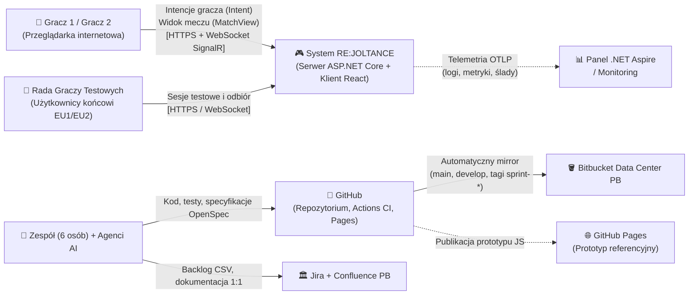
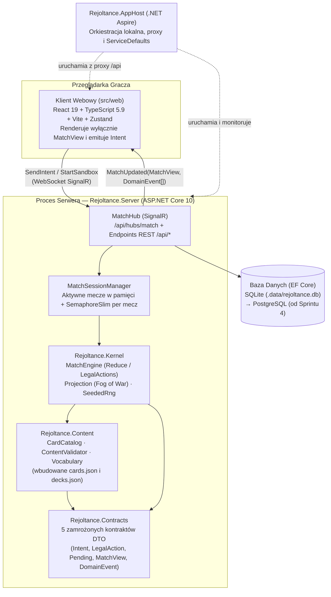
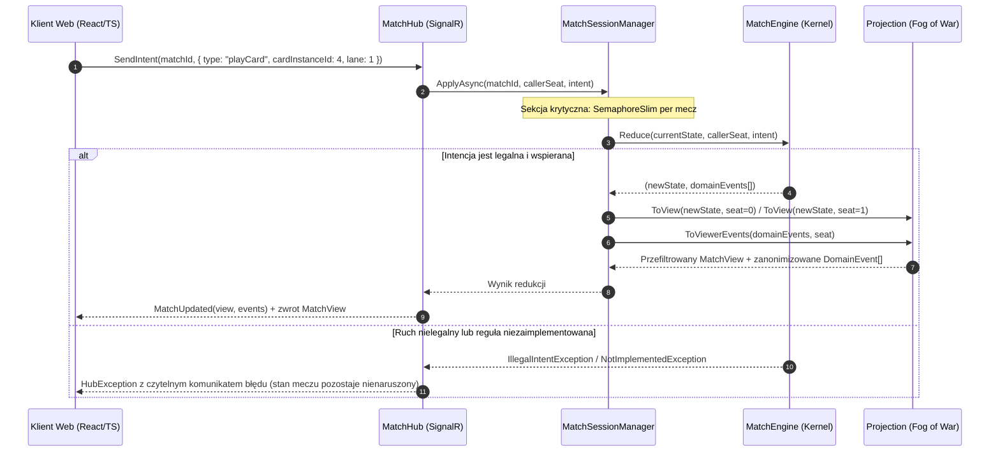
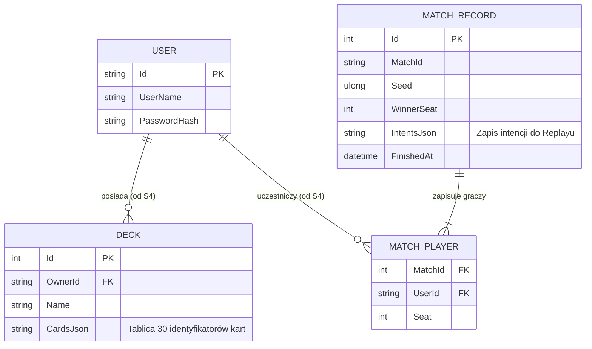
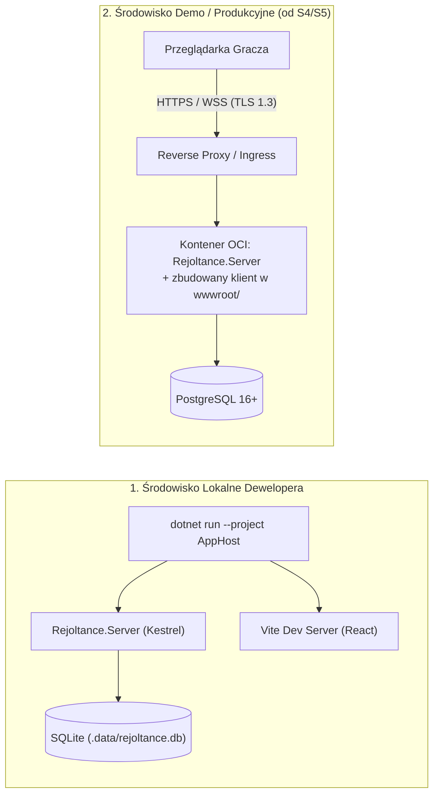

# 1.5 Dokument architektury systemu (SAD) — RE:JOLTANCE

> **Źródło prawdy:** repozytorium (`docs/01-dokumentacja-systemowa/05-sad-architektura-systemu.md`) · **Kategoria dokumentacji:** Dokumentacja produktowa — systemowa (architektura systemu, SAD) · **Etap SDD:** Planowanie · **Struktura:** AltexSoft SAD + arc42 + model C4 · **Wersja:** 1.1 (2026-11-02)

Ten dokument to SAD (Software Architecture Document), czyli opis architektury systemu RE:JOLTANCE. Znajdziesz tu podział na kontenery i moduły, kontrakty komunikacyjne, model danych, strategie przekrojowe i sposób wdrożenia. Układ opiera się na wytycznych AltexSoft oraz na dwóch szablonach: arc42 (struktura dokumentu architektury) i C4 (model diagramów w czterech poziomach szczegółowości: kontekst, kontenery, komponenty, kod).

SDD (Spec-Driven Development) to nasz sposób pracy: specyfikacja powstaje przed kodem. SAD należy do etapu *Planowanie*.

Biblioteki i ich wersje opisuje dokument [1.6 Stos technologiczny i roadmapa IT](06-stos-technologiczny.md). Uzasadnienia pojedynczych decyzji są w rejestrze [1.7 Decyzje architektoniczne (ADR)](07-decyzje-adr/README.md). ADR (Architecture Decision Record) to krótki zapis jednej decyzji architektonicznej.

---

## 1. Przegląd, tło i cele architektoniczne

### 1.1 Cel dokumentu i kontekst problemu

Prototyp przeglądarkowy działał w modelu P2P (Peer-to-Peer, JavaScript / PeerJS). Był podatny na oszustwa i niedeterministyczny. Zastępujemy go aplikacją webową klient–serwer, w której:

1. **Serwer jest jedynym autorytetem stanu gry.** Żaden klient nie widzi ukrytych informacji przeciwnika (*Fog of War*). Żaden klient nie może wykonać nielegalnego ruchu.
2. **Silnik reguł (`Rejoltance.Kernel`) jest deterministyczny i oddzielony od infrastruktury.** Dzięki temu łatwo testujemy 55 reguł domenowych i uruchamiamy symulacje bot-vs-bot. Powtórkę meczu (*replay*) odtwarzamy z samego ziarna losowości (`Seed`) i listy intencji graczy.
3. **Sześć osób pracuje równolegle i nie blokuje się nawzajem.** Pozwalają na to zamrożone kontrakty komunikacyjne i automatyczne testy granic architektonicznych.

### 1.2 Najważniejsze cele jakościowe

Pełne drzewo wymagań jakościowych wg normy ISO/IEC 25010:2023 (`NFR-01..NFR-70`) jest w specyfikacji [`openspec/specs/quality-attributes/spec.md`](../../openspec/specs/quality-attributes/spec.md). NFR (Non-Functional Requirement) to wymaganie niefunkcjonalne. Architekturę podporządkowaliśmy czterem priorytetom:

| Priorytet | Cel jakościowy | Wymagania | Jak architektura to realizuje |
|---|---|---|---|
| **1** | Uczciwość rozgrywki i bezpieczeństwo stanu (*Server Authority & Fog of War*) | `R-80..R-82`, `NFR-40..NFR-42` | Pełny stan `MatchState` nigdy nie opuszcza serwera. Klient dostaje tylko przefiltrowaną projekcję `MatchView` (`Projection.ToView`) i wysyła tylko intencje (`Intent`). |
| **2** | Determinizm i testowalność reguł (*Determinism & Testability*) | `R-83`, `R-84`, `NFR-51` | Czysty reduktor `MatchEngine.Reduce`, deterministyczny generator `SeededRng` (SplitMix64) i zakaz `System.Random`, zegara oraz I/O. Zakaz pilnuje kompilator (`BannedSymbols.txt`). |
| **3** | Modułowość i równoległa praca zespołu (*Modularity*) | `NFR-11`, `NFR-50` | Modularny monolit z jednokierunkowym grafem zależności. `NetArchTest` (`BoundaryTests.cs`) sprawdza go w każdym PR. Zgodność kontraktów C# ↔ TS sprawdza próbka JSON. |
| **4** | Niski próg wejścia i łatwe uruchomienie (*Operability & Portability*) | `NFR-20`, `NFR-60`, `NFR-61` | .NET Aspire (`AppHost`) uruchamia lokalnie serwer, klienta Vite i bazę SQLite jednym poleceniem. W pierwszych sprintach nie trzeba instalować Dockera. |

---

## 2. Podsumowanie wymagań i ograniczenia

### 2.1 Zakres funkcjonalny z perspektywy architektury

System obsługuje cały cykl życia meczu karcianego 1 na 1 na czterech liniach:

- ładuje i sprawdza katalog 78 kart (69 kolekcjonerskich + 9 tokenów) i 5 talii startowych z plików JSON wygenerowanych z prototypu,
- zarządza sesjami meczowymi w pamięci serwera (piaskownica, gra z botem AI, pokoje 1v1 przez kod zaproszenia),
- komunikuje się z klientem w obie strony w czasie rzeczywistym przez WebSocket (SignalR),
- trwale przechowuje w relacyjnej bazie danych konta, własne talie i zapisy zakończonych meczów.

### 2.2 Ograniczenia techniczne i organizacyjne

| Ograniczenie | Opis | Konsekwencja dla architektury |
|---|---|---|
| **Czas zespołu** | 6 studentów × ok. 5 h tygodniowo przez 5 dwutygodniowych sprintów w Semestrze 1. | Rezygnujemy ze złożonych wzorców rozproszonych (mikroserwisy, zewnętrzny Event Store). Wybieramy prosty modularny monolit ([ADR-0001](07-decyzje-adr/0001-stos-technologiczny.md), Konstytucja Art. VIII). |
| **Infrastruktura uczelniana** | Musimy korzystać z uczelnianych instancji Jira, Confluence i Bitbucket Data Center PB. | Na co dzień pracujemy i uruchamiamy CI/CD na GitHubie, z automatycznym mirrorem do Bitbucket PB ([ADR-0002](07-decyzje-adr/0002-github-i-mirror-bitbucket.md)). Struktura `docs/` odpowiada 1:1 drzewu Confluence ([ADR-0011](07-decyzje-adr/0011-dokumentacja-hybryda-repo-confluence.md)). |
| **Komputery studentów** | Różne laptopy z Windows 11 (polityka Smart App Control, na części maszyn brak Dockera). | W Sprintach 0–3 używamy bazy SQLite. Kontener PostgreSQL wchodzi dopiero od Sprintu 4 ([ADR-0007](07-decyzje-adr/0007-sqlite-potem-postgresql.md)). |

CI/CD (Continuous Integration / Continuous Delivery) to automatyczne budowanie, testowanie i wdrażanie kodu.

---

## 3. Architektura wysokopoziomowa (model C4 — poziom 1 i 2)

### 3.1 Kontekst systemu (C4 poziom 1)

Diagram pokazuje system jako jedną całość oraz ludzi i systemy zewnętrzne, z którymi się komunikuje.

### 3.2 Kontenery i bloki (C4 poziom 2)

Serwer to modularny monolit: jeden proces podzielony na moduły z jasnymi granicami. W przeglądarce działa SPA (Single Page Application), czyli aplikacja, która nie przeładowuje strony.

---

## 4. Szczegółowy projekt systemu (model C4 — poziom 3)

### 4.1 Moduły i reguły zależności

Każdy moduł ma jasno określoną odpowiedzialność. Zależności mogą prowadzić **tylko w dół tabeli**: od prezentacji i transportu w stronę czystych kontraktów. Pilnują tego testy `tests/Rejoltance.Architecture.Tests/BoundaryTests.cs`.

| Moduł / projekt | Warstwa | Odpowiedzialność i główne klasy | Dozwolone zależności | Właściciel (epik) |
|---|---|---|---|---|
| **`src/web`** | Prezentacja (klient TS) | Renderuje `MatchView`, podświetla dozwolone akcje z `legalActions`, obsługuje połączenie SignalR (`MatchTransport`) i stan lokalny (`Zustand`). **Klient nie zawiera logiki reguł gry.** | Kontrakt JSON (`src/web/src/contracts`) | Epik E4 |
| **`Rejoltance.AppHost`** i **`ServiceDefaults`** | Orkiestracja i telemetria | Konfiguracja lokalnego środowiska .NET Aspire, OpenTelemetry (logi, metryki, ślady) i punktów kontrolnych `/health` oraz `/alive`. | `Rejoltance.Server` | Epik E6 |
| **`Rejoltance.Server`** | Transport, sesje i trwałość | Hub SignalR (`MatchHub`), sesje meczowe w pamięci z synchronizacją per mecz (`MatchSessionManager`), endpointy REST (`/api/cards`, `/api/decks`, `/api/info`), kontekst EF Core (`RejoltanceDb`). | `Kernel`, `Content`, `Contracts`, `ServiceDefaults` | Epik E3 / E6 |
| **`Rejoltance.Sim`** *(planowany od S2)* | Sztuczna inteligencja i symulacje | Polityki botów (`IBotPolicy`), symulator wielu gier bot-vs-bot, wyrocznia testów różnicowych względem prototypu JS. | `Kernel`, `Content`, `Contracts` | Epik E5 |
| **`Rejoltance.Kernel`** | Czysta domena (silnik reguł) | Niemutowalny stan meczu (`MatchState`), czysty reduktor `MatchEngine.Reduce(state, seat, intent)`, generator ruchów `MatchEngine.LegalActions`, projekcja *Fog of War* (`Projection.ToView`), deterministyczny `SeededRng`. | `Content`, `Contracts` *(zakaz I/O, zegara i `System.Random`)* | Epik E1 |
| **`Rejoltance.Content`** | Dane domenowe i walidacja DSL | Ładuje wbudowane `cards.json` i `decks.json` (`CardCatalog`). Zawiera słownik słów kluczowych, wyzwalaczy i akcji (`Vocabulary`) oraz walidator kart i talii (`ContentValidator`). | `Contracts` | Epik E2 |
| **`Rejoltance.Contracts`** | Zamrożone kontrakty (DTO) | Proste rekordy danych przesyłane przez sieć, bez logiki biznesowej. Sprawdza to test refleksyjny `Contracts_contain_no_logic_types`. | **Brak zależności** | Wspólny (backend + frontend) |

DTO (Data Transfer Object) to obiekt, który tylko przenosi dane. DSL (Domain-Specific Language) to nasz mały język opisu efektów kart.

### 4.2 Pięć zamrożonych kontraktów komunikacyjnych

Klient webowy, bot AI, serwer i silnik reguł komunikują się wyłącznie przez pięć niemutowalnych struktur. Są zdefiniowane w `Rejoltance.Contracts`, a ich odpowiedniki w TypeScript są w `src/web/src/contracts/index.ts`:

1. **`Intent` (klient / bot → serwer → Kernel).** Jedyny sposób, w jaki gracz mówi, co chce zrobić (`MulliganIntent`, `ChooseOrderIntent`, `PlayCardIntent`, `EndStepIntent`, `AnswerPendingIntent`, `SurrenderIntent`).
2. **`LegalAction` (Kernel → serwer → klient / bot).** Lista ruchów dozwolonych w danej chwili, z poprawnymi celami i liniami. To **jedyne źródło prawdy o legalności ruchu**. Interfejs nigdy sam nie liczy, czy ruch jest legalny.
3. **`PendingInteraction` (Kernel → serwer → klient / bot).** Pytanie, które silnik zadaje graczowi, np. które karty wymienić w mulliganie albo jaki cel wybrać dla efektu. Dzięki temu Kernel nigdy nie blokuje wątku w oczekiwaniu na gracza.
4. **`MatchView` (`Projection` w Kernelu → serwer → klient / bot).** Przefiltrowany widok meczu dla jednego miejsca przy stole (`yourSeat`). Zawiera pełną rękę gracza. O przeciwniku (`OpponentView`) podaje tylko liczbę kart w ręce, w talii i na stosie odrzuconych (*Fog of War*).
5. **`DomainEvent` (Kernel → `Projection` → serwer → klient).** Uporządkowana lista faktów, które wydarzyły się po intencji (np. `CardDrawn`, `FatigueDamage`, `MatchFinished`). Klient na jej podstawie odtwarza animacje i dźwięki. Nie musi porównywać stanów (*diffing*).

### 4.3 Widok wykonania — jeden ruch gracza

Diagram pokazuje, co dzieje się od kliknięcia karty do odświeżenia widoku u obu graczy.

### 4.4 Dane i model trwałości

Oddzielamy **ulotny stan trwającego meczu** od **danych trwałych**:

- **Trwające mecze (`MatchState`)** są w pamięci serwera (`ConcurrentDictionary` w `MatchSessionManager`). Nie zapisujemy ich do bazy przy każdym kliknięciu, więc opóźnienia są minimalne.
- **Dane trwałe (`RejoltanceDb` — Entity Framework Core)** to konta użytkowników, zapisane talie i archiwum zakończonych meczów. Dla każdego meczu zapisujemy ziarno losowości (`Seed`) i listę intencji, żeby móc odtworzyć powtórkę (*replay*).

---

## 5. Strategie techniczne i koncepcje przekrojowe

| Zagadnienie | Strategia i rozwiązanie |
|---|---|
| **Determinizm i odtwarzalność (replay)** | Cała losowość w `Rejoltance.Kernel` pochodzi z niemutowalnej struktury `SeededRng` (algorytm *SplitMix64*). Jej stan (`State: ulong`) jest częścią `MatchState`. Użycie `System.Random`, `DateTime` lub `Guid.NewGuid()` w Kernelu kończy się błędem kompilacji. Pilnują tego analizator `Microsoft.CodeAnalysis.BannedApiAnalyzers` i plik `BannedSymbols.txt`. |
| **Ochrona przed podglądaniem kart (*Fog of War*, R-80…R-82)** | Talia przechowuje tylko definicje kart (`CardId`). Karta dostaje identyfikator egzemplarza (`InstanceId`) dopiero wtedy, gdy wychodzi z talii do ręki lub na planszę (`R-81`). Dzięki temu kolejność numerów `InstanceId` nie zdradza układu talii. `Projection.ToViewerEvents` zamienia identyfikatory kart dobieranych przez przeciwnika na `0`. |
| **Współbieżność i izolacja meczów** | Każda sesja w `MatchSessionManager` ma własny `SemaphoreSlim(1, 1)`. Żądania z różnych meczów wykonują się równolegle na wielu wątkach. Intencje w jednym meczu wykonują się ściśle po kolei. Wyjątek w jednym meczu jest przechwytywany i logowany z `matchId` i `seed`. Nie wpływa na inne mecze (`NFR-31`). |
| **Zasada głośnej porażki (*fail loud*)** | Zabraniamy cichego obchodzenia błędów, np. zwracania pustej tablicy celów albo losowania celu, gdy gracz go nie wybrał. Nieznane słowo w danych kart zatrzymuje start serwera wyjątkiem `ContentValidationException`. Niezaimplementowana akcja lub nielegalna intencja zwraca czytelny `HubException`. |
| **Zgodność kontraktów C# ↔ TypeScript** | Test integracyjny `ContractSampleTests` serializuje prawdziwy `MatchView` z Kernela C# do pliku `src/web/src/contracts/match-view.sample.json`. Test `contracts.test.ts` sprawdza zgodność tego pliku z typami TypeScript. Każda rozbieżność pól zatrzymuje potok CI ([ADR-0010](07-decyzje-adr/0010-kontrakt-csharp-ts-przez-probke.md)). |
| **Obserwowalność i telemetria (*observability*)** | Projekt `Rejoltance.ServiceDefaults` konfiguruje **OpenTelemetry**: logi strukturalne, metryki czasu odpowiedzi HTTP/SignalR i ślady rozproszone widoczne w panelu .NET Aspire. Konfiguruje też punkty kontrolne `/health` i `/alive`. |

---

## 6. Infrastruktura i wdrożenie

System działa w trzech środowiskach. Dodatkowo publikujemy statycznie prototyp referencyjny.

| Środowisko | Jak działa | Baza danych | Do czego służy |
|---|---|---|---|
| **1. Lokalne środowisko deweloperskie** | `Rejoltance.AppHost` uruchamia natywnie serwer Kestrel i serwer deweloperski Vite z proxy `/api`. | Plik SQLite `.data/rejoltance.db` (Sprinty 0–3) albo lokalny kontener PostgreSQL zarządzany przez Aspire (od Sprintu 4). | Codzienne programowanie i ręczne testy nowych funkcji. |
| **2. Środowisko CI (GitHub Actions)** | Maszyny `ubuntu-latest` uruchamiają 3 równoległe zadania: `.NET build & tests` (z testem integracyjnym `AppHostSmokeTests`), `Web lint, typecheck, tests, build` oraz `Specs, docs, agents, content`. | Baza w pamięci albo tymczasowy plik SQLite na czas testów. | Automatyczna bramka jakości dla każdego Pull Requesta i commita na `develop`/`main`. |
| **3. Środowisko demonstracyjne (demo)** | Jeden obraz kontenera budowany przez .NET (`PublishWithContainerFiles`). Serwer ASP.NET Core serwuje API/SignalR i statyczne pliki klienta React z `wwwroot/`. | Zarządzana instancja lub kontener PostgreSQL 16+. | Testy użyteczności z Radą Graczy i prezentacje na *Sprint Review*. |
| **4. Hosting prototypu referencyjnego** | Workflow `.github/workflows/prototype-pages.yml` publikuje katalog `prototype/revibance/` na **GitHub Pages**. | Brak (aplikacja działa tylko w przeglądarce). | Stały punkt odniesienia przy sprawdzaniu zasad gry v11. |

---

## 7. Ryzyka architektoniczne i dług techniczny

| Ryzyko lub dług techniczny | Możliwy skutek | Jak ograniczamy ryzyko |
|---|---|---|
| **Trwające mecze żyją tylko w pamięci jednego procesu serwera** | Restart serwera przerywa trwające pojedynki. | W projekcie uczelnianym to akceptowalne. Przebieg meczu odtworzymy deterministycznym replayem z zapisanego `Seed` i listy intencji (`E6-S07`). |
| **Typy TypeScript utrzymujemy ręcznie, równolegle do rekordów C#** | Łatwo o pomyłkę przy dodawaniu nowych zdarzeń i efektów. | Chroni nas test próbki JSON w CI (`ContractSampleTests` + `contracts.test.ts`). Po Sprincie 2 wrócimy do decyzji [ADR-0010](07-decyzje-adr/0010-kontrakt-csharp-ts-przez-probke.md) i rozważymy generator typów. |
| **Prototyp JS ma na sztywno zakodowane efekty pasywne 3 kart (`Tea Maid`, `Wyvern`, `Survivalist`)** | Nowych kart z efektami pasywnymi lub aurami nie da się dodać bez zmiany kodu silnika. | W zadaniu `E2-S07` przeniesiemy efekty pasywne do schematu DSL w `cards.json` (rozbieżność `D-11`). |
| **Smart App Control blokuje biblioteki DLL na części laptopów z Windows 11** | Na niektórych komputerach nie da się uruchomić Aspire jednym poleceniem. | Mamy skrypt diagnostyczny `tools/doctor.ps1`. Opisaliśmy też uruchamianie serwera i klienta w dwóch osobnych terminalach, bez DCP (Developer Control Plane — komponent Aspire, który uruchamia procesy) (`01-szybki-start-i-instalacja.md`). |
