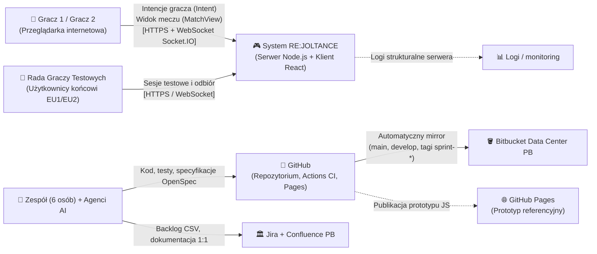
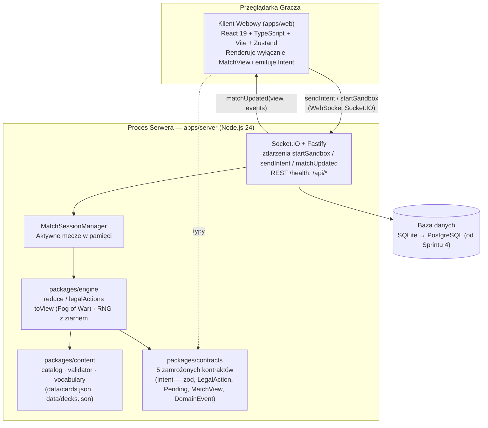
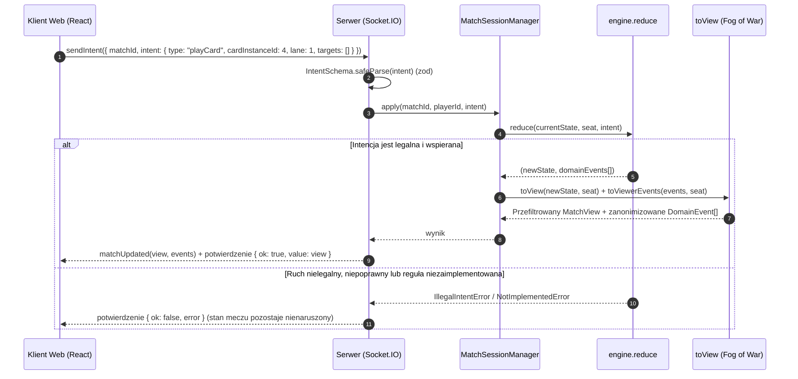
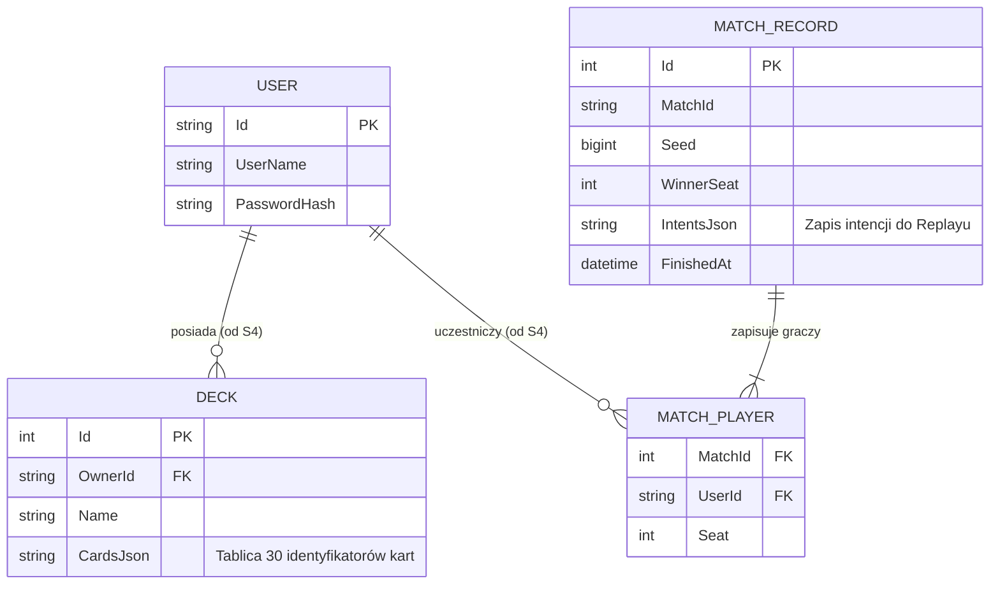
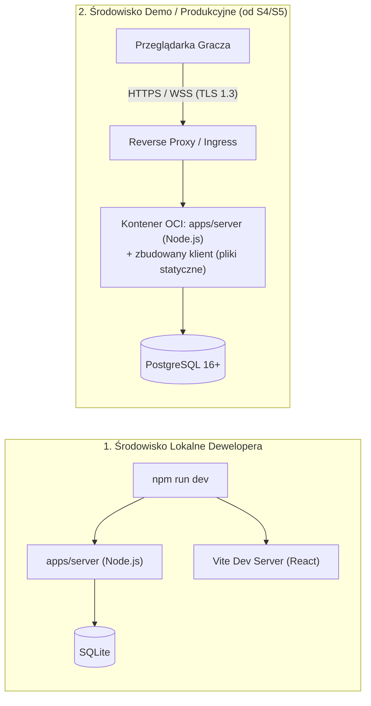

# 1.5 Dokument architektury systemu (SAD) — RE:JOLTANCE

> **Źródło prawdy:** repozytorium (`docs/01-dokumentacja-systemowa/05-sad-architektura-systemu.md`) · **Kategoria dokumentacji:** Dokumentacja produktowa — systemowa (architektura systemu, SAD) · **Etap SDD:** Planowanie · **Struktura:** AltexSoft SAD + arc42 + model C4 · **Wersja:** 1.1 (2026-11-02)

Ten dokument to SAD (Software Architecture Document), czyli opis architektury systemu RE:JOLTANCE. Znajdziesz tu podział na kontenery i moduły, kontrakty komunikacyjne, model danych, strategie przekrojowe i sposób wdrożenia. Układ opiera się na wytycznych AltexSoft oraz na dwóch szablonach: arc42 (struktura dokumentu architektury) i C4 (model diagramów w czterech poziomach szczegółowości: kontekst, kontenery, komponenty, kod).

SDD (Spec-Driven Development) to nasz sposób pracy: specyfikacja powstaje przed kodem. SAD należy do etapu *Planowanie*.

Biblioteki i ich wersje opisuje dokument [1.6 Stos technologiczny i roadmapa IT](06-stos-technologiczny.md). Uzasadnienia pojedynczych decyzji są w rejestrze [1.7 Decyzje architektoniczne (ADR)](07-decyzje-adr/README.md). ADR (Architecture Decision Record) to krótki zapis jednej decyzji architektonicznej.

---

## 1. Przegląd, tło i cele architektoniczne

### 1.1 Cel dokumentu i kontekst problemu

Prototyp przeglądarkowy działał w modelu P2P (Peer-to-Peer, JavaScript / PeerJS). Był podatny na oszustwa i niedeterministyczny. Zastępujemy go aplikacją webową klient–serwer, w której:

1. **Serwer jest jedynym autorytetem stanu gry.** Żaden klient nie widzi ukrytych informacji przeciwnika (*Fog of War*). Żaden klient nie może wykonać nielegalnego ruchu.
2. **Silnik reguł (`packages/engine`) jest deterministyczny i oddzielony od infrastruktury.** Dzięki temu łatwo testujemy 55 reguł domenowych i uruchamiamy symulacje bot-vs-bot. Powtórkę meczu (*replay*) odtwarzamy z samego ziarna losowości (`Seed`) i listy intencji graczy.
3. **Sześć osób pracuje równolegle i nie blokuje się nawzajem.** Pozwalają na to zamrożone kontrakty komunikacyjne i automatyczne testy granic architektonicznych.

### 1.2 Najważniejsze cele jakościowe

Pełne drzewo wymagań jakościowych wg normy ISO/IEC 25010:2023 (`NFR-01..NFR-70`) jest w specyfikacji [`openspec/specs/quality-attributes/spec.md`](../../openspec/specs/quality-attributes/spec.md). NFR (Non-Functional Requirement) to wymaganie niefunkcjonalne. Architekturę podporządkowaliśmy czterem priorytetom:

| Priorytet | Cel jakościowy | Wymagania | Jak architektura to realizuje |
|---|---|---|---|
| **1** | Uczciwość rozgrywki i bezpieczeństwo stanu (*Server Authority & Fog of War*) | `R-80..R-82`, `NFR-40..NFR-42` | Pełny stan `MatchState` nigdy nie opuszcza serwera. Klient dostaje tylko przefiltrowaną projekcję `MatchView` (`toView`) i wysyła tylko intencje (`Intent`). |
| **2** | Determinizm i testowalność reguł (*Determinism & Testability*) | `R-83`, `R-84`, `NFR-51` | Czysty reduktor `engine.reduce`, deterministyczny RNG (SplitMix64, `rng.ts`) i zakaz `Math.random`, zegara oraz I/O. Zakaz pilnuje ESLint. |
| **3** | Modułowość i równoległa praca zespołu (*Modularity*) | `NFR-11`, `NFR-50` | Modularny monolit (npm workspaces) z jednokierunkowym grafem zależności; ESLint i `tools/architecture.test.ts` sprawdzają go w każdym PR. Kontrakty to jeden pakiet TypeScript dla serwera i klienta. |
| **4** | Niski próg wejścia i łatwe uruchomienie (*Operability & Portability*) | `NFR-20`, `NFR-60`, `NFR-61` | `npm run dev` uruchamia lokalnie serwer i klienta Vite jednym poleceniem. W pierwszych sprintach nie trzeba instalować Dockera. |

---

## 2. Podsumowanie wymagań i ograniczenia

### 2.1 Zakres funkcjonalny z perspektywy architektury

System obsługuje cały cykl życia meczu karcianego 1 na 1 na czterech liniach:

- ładuje i sprawdza katalog 159 kart (130 kolekcjonerskich + 29 tokenów) i 4 talie startowe z plików JSON wygenerowanych z prototypu,
- zarządza sesjami meczowymi w pamięci serwera (piaskownica, gra z botem AI, pokoje 1v1 przez kod zaproszenia),
- komunikuje się z klientem w obie strony w czasie rzeczywistym przez WebSocket (Socket.IO),
- trwale przechowuje w relacyjnej bazie danych konta, własne talie i zapisy zakończonych meczów.

### 2.2 Ograniczenia techniczne i organizacyjne

| Ograniczenie | Opis | Konsekwencja dla architektury |
|---|---|---|
| **Czas zespołu** | 6 studentów × ok. 5 h tygodniowo przez 5 dwutygodniowych sprintów w Semestrze 1. | Rezygnujemy ze złożonych wzorców rozproszonych (mikroserwisy, zewnętrzny Event Store). Wybieramy prosty modularny monolit ([ADR-0001](07-decyzje-adr/0001-stos-technologiczny.md), Konstytucja Art. VIII). |
| **Infrastruktura uczelniana** | Musimy korzystać z uczelnianych instancji Jira, Confluence i Bitbucket Data Center PB. | Na co dzień pracujemy i uruchamiamy CI/CD na GitHubie, z automatycznym mirrorem do Bitbucket PB ([ADR-0002](07-decyzje-adr/0002-github-i-mirror-bitbucket.md)). Struktura `docs/` odpowiada 1:1 drzewu Confluence ([ADR-0011](07-decyzje-adr/0011-dokumentacja-hybryda-repo-confluence.md)). |
| **Komputery studentów** | Różne laptopy z Windows 11, macOS i Linuxem (na części maszyn brak Dockera). | W Sprintach 0–3 używamy bazy SQLite. Kontener PostgreSQL wchodzi dopiero od Sprintu 4 ([ADR-0007](07-decyzje-adr/0007-sqlite-potem-postgresql.md)). |

CI/CD (Continuous Integration / Continuous Delivery) to automatyczne budowanie, testowanie i wdrażanie kodu.

---

## 3. Architektura wysokopoziomowa (model C4 — poziom 1 i 2)

### 3.1 Kontekst systemu (C4 poziom 1)

Diagram pokazuje system jako jedną całość oraz ludzi i systemy zewnętrzne, z którymi się komunikuje.

### 3.2 Kontenery i bloki (C4 poziom 2)

Serwer to modularny monolit: jeden proces podzielony na moduły z jasnymi granicami. W przeglądarce działa SPA (Single Page Application), czyli aplikacja, która nie przeładowuje strony.

---

## 4. Szczegółowy projekt systemu (model C4 — poziom 3)

### 4.1 Moduły i reguły zależności

Każdy moduł ma jasno określoną odpowiedzialność. Zależności mogą prowadzić **tylko w dół tabeli**: od prezentacji i transportu w stronę czystych kontraktów. Pilnują tego ESLint (`eslint.config.js`) i test `tools/architecture.test.ts`.

| Moduł / pakiet | Warstwa | Odpowiedzialność i główne pliki | Dozwolone zależności | Właściciel (epik) |
|---|---|---|---|---|
| **`apps/web`** | Prezentacja (klient) | Renderuje `MatchView`, podświetla dozwolone akcje z `legalActions`, połączenie Socket.IO (`MatchTransport`) i stan lokalny (Zustand). **Klient nie zawiera logiki reguł gry.** | `contracts` | Epik E4 |
| **`apps/server`** | Transport, sesje i trwałość | Fastify (REST: `/health`, `/api/cards`, `/api/decks`, `/api/info`), Socket.IO (`startSandbox`, `sendIntent`, `matchUpdated`), sesje meczów w pamięci (`MatchSessionManager`), walidacja `Intent` schematem zod. | `engine`, `content`, `contracts` | Epik E3 / E6 |
| **Bot i symulator** *(planowane)* | Sztuczna inteligencja i symulacje | Polityki botów, symulator gier bot-vs-bot, wyrocznia testów różnicowych z prototypem JS w tym samym procesie. | `engine`, `content`, `contracts` | Epik E5 |
| **`packages/engine`** | Czysta domena (silnik reguł) | Niemutowalny stan meczu (`MatchState`), reduktor `reduce(state, seat, intent)`, `legalActions`, projekcja *Fog of War* (`toView`, `toViewerEvents`), RNG z ziarnem (`rng.ts`). | `content`, `contracts` *(zakaz I/O, zegara i `Math.random`)* | Epik E1 |
| **`packages/content`** | Dane domenowe i walidacja DSL | `data/cards.json` i `data/decks.json` (z prototypu), słownik słów DSL (`vocabulary.ts`), walidator kart i talii (`validator.ts`), katalog (`loadCatalog`). | — | Epik E2 |
| **`packages/contracts`** | Zamrożone kontrakty | Typy przesyłane przez sieć i protokół Socket.IO; `Intent` jako schemat zod. Bez logiki gry. | — | Wspólny (backend + frontend) |

DTO (Data Transfer Object) to obiekt, który tylko przenosi dane. DSL (Domain-Specific Language) to nasz mały język opisu efektów kart.

### 4.2 Pięć zamrożonych kontraktów komunikacyjnych

Klient webowy, bot AI, serwer i silnik reguł komunikują się wyłącznie przez pięć niemutowalnych struktur. Są zdefiniowane raz, w `packages/contracts`, i importują je serwer, silnik i klient:

1. **`Intent` (klient / bot → serwer → silnik).** Jedyny sposób, w jaki gracz mówi, co chce zrobić (`type`: `mulligan`, `chooseOrder`, `playCard`, `endStep`, `answerPending`, `surrender`; serwer sprawdza każdą intencję schematem zod).
2. **`LegalAction` (silnik → serwer → klient / bot).** Lista ruchów dozwolonych w danej chwili, z poprawnymi celami i liniami. To **jedyne źródło prawdy o legalności ruchu**. Interfejs nigdy sam nie liczy, czy ruch jest legalny.
3. **`PendingInteraction` (silnik → serwer → klient / bot).** Pytanie, które silnik zadaje graczowi, np. które karty wymienić w mulliganie albo jaki cel wybrać dla efektu. Dzięki temu silnik nigdy nie blokuje wątku w oczekiwaniu na gracza.
4. **`MatchView` (`toView` w silniku → serwer → klient / bot).** Przefiltrowany widok meczu dla jednego miejsca przy stole (`yourSeat`). Zawiera pełną rękę gracza. O przeciwniku (`OpponentView`) podaje tylko liczbę kart w ręce, w talii i na stosie odrzuconych (*Fog of War*).
5. **`DomainEvent` (silnik → `toViewerEvents` → serwer → klient).** Uporządkowana lista faktów, które wydarzyły się po intencji (np. `cardDrawn`, `fatigueDamage`, `matchFinished`). Klient na jej podstawie odtwarza animacje i dźwięki. Nie musi porównywać stanów (*diffing*).

### 4.3 Widok wykonania — jeden ruch gracza

Diagram pokazuje, co dzieje się od kliknięcia karty do odświeżenia widoku u obu graczy.

### 4.4 Dane i model trwałości

Oddzielamy **ulotny stan trwającego meczu** od **danych trwałych**:

- **Trwające mecze (`MatchState`)** są w pamięci serwera (`Map` w `MatchSessionManager`). Nie zapisujemy ich do bazy przy każdym kliknięciu, więc opóźnienia są minimalne.
- **Dane trwałe (baza SQLite, potem PostgreSQL — ADR-0007)** to konta użytkowników, zapisane talie i archiwum zakończonych meczów. Dla każdego meczu zapisujemy ziarno losowości (`Seed`) i listę intencji, żeby móc odtworzyć powtórkę (*replay*).

---

## 5. Strategie techniczne i koncepcje przekrojowe

| Zagadnienie | Strategia i rozwiązanie |
|---|---|
| **Determinizm i odtwarzalność (replay)** | Cała losowość w `packages/engine` pochodzi z RNG SplitMix64 (`rng.ts`, 64-bitowy stan na `BigInt`), którego stan jest częścią `MatchState`. ESLint zabrania w silniku `Math.random`, `Date`, timerów i modułów `node:*`; test `R83_…` sprawdza, że to samo ziarno daje ten sam mecz. |
| **Ochrona przed podglądaniem kart (*Fog of War*, R-80…R-82)** | Talia przechowuje tylko identyfikatory kart (`cardId`). Karta dostaje identyfikator egzemplarza (`instanceId`) dopiero wtedy, gdy wychodzi z talii do ręki lub na planszę (`R-81`). Dzięki temu kolejność numerów `instanceId` nie zdradza układu talii. `toViewerEvents` zamienia identyfikatory kart dobieranych przez przeciwnika na `0`. |
| **Współbieżność i izolacja meczów** | Node wykonuje kod jednego meczu po kolei, a silnik jest synchroniczny, więc dwie intencje jednego meczu nigdy się nie przeplatają. Błąd reguły wraca do gracza jako `{ ok: false, error }`; nieoczekiwany wyjątek jest logowany i nie wpływa na inne mecze (`NFR-31`). |
| **Zasada głośnej porażki (*fail loud*)** | Zabraniamy cichego obchodzenia błędów, np. zwracania pustej tablicy celów albo losowania celu, gdy gracz go nie wybrał. Nieznane słowo w danych kart zatrzymuje start serwera błędem `ContentValidationError`. Niezaimplementowana akcja lub nielegalna intencja wraca jako czytelny komunikat `{ ok: false, error }`. |
| **Zgodność kontraktów serwer ↔ klient** | Kontrakty są jednym pakietem (`packages/contracts`), więc zmiana typu to błąd `tsc` po obu stronach. Serwer sprawdza intencje schematem zod. Test silnika porównuje projekcję z próbką `match-view.sample.json`, z której korzystają testy klienta ([ADR-0015](07-decyzje-adr/0015-backend-node-typescript.md)). |
| **Obserwowalność (*observability*)** | Fastify zapisuje logi strukturalne (JSON) każdego żądania; `/health` służy do sprawdzania gotowości. Metryki i ślady (np. OpenTelemetry) dodamy przy wdrożeniu demo. |

---

## 6. Infrastruktura i wdrożenie

System działa w trzech środowiskach. Dodatkowo publikujemy statycznie prototyp referencyjny.

| Środowisko | Jak działa | Baza danych | Do czego służy |
|---|---|---|---|
| **1. Lokalne środowisko deweloperskie** | `npm run dev` uruchamia serwer gry (Node, restart po zmianie) i serwer deweloperski Vite z proxy `/api` i `/socket.io`. | SQLite (do Sprintu 3), potem lokalny PostgreSQL. | Codzienne programowanie i ręczne testy nowych funkcji. |
| **2. Środowisko CI (GitHub Actions)** | Maszyny `ubuntu-latest` uruchamiają 3 zadania: `Lint, typecheck, tests, build` (w tym testy serwera przez prawdziwe połączenie Socket.IO), `Specs, docs, agents, content` (`npm run check`) i `naming` (konwencje PR). | Brak albo baza w pamięci na czas testów. | Automatyczna bramka jakości dla każdego Pull Requesta i commita na `develop`/`main`. |
| **3. Środowisko demonstracyjne (demo)** | Jeden obraz kontenera z serwerem Node.js, który serwuje API, Socket.IO i zbudowany klient React. | Zarządzana instancja lub kontener PostgreSQL 16+. | Testy użyteczności z Radą Graczy i prezentacje na *Sprint Review*. |
| **4. Hosting prototypu referencyjnego** | Workflow `.github/workflows/prototype-pages.yml` publikuje katalog `prototype/game/` na **GitHub Pages**. | Brak (aplikacja działa tylko w przeglądarce). | Stały punkt odniesienia przy sprawdzaniu zasad gry (ADR-0013). |

---

## 7. Ryzyka architektoniczne i dług techniczny

| Ryzyko lub dług techniczny | Możliwy skutek | Jak ograniczamy ryzyko |
|---|---|---|
| **Trwające mecze żyją tylko w pamięci jednego procesu serwera** | Restart serwera przerywa trwające pojedynki. | W projekcie uczelnianym to akceptowalne. Przebieg meczu odtworzymy deterministycznym replayem z zapisanego `Seed` i listy intencji (`E6-S07`). |
| **Brak gotowego panelu telemetrii (po rezygnacji z Aspire)** | Trudniej diagnozować problemy wydajności na demo. | Logi strukturalne Fastify od początku; metryki i ślady dodamy w zadaniu wdrożenia demo (`E6-S05`). |
| **Prototyp JS ma na sztywno zakodowane efekty pasywne 3 kart (`Tea Maid`, `Wyvern`, `Survivalist`)** | Nowych kart z efektami pasywnymi lub aurami nie da się dodać bez zmiany kodu silnika. | W zadaniu `E2-S07` przeniesiemy efekty pasywne do schematu DSL w `cards.json` (rozbieżność `D-11`). |
| **Zespół dopiero uczy się backendu w TypeScript** | Wolniejsze pierwsze zadania serwerowe. | Mały, czytelny serwer (`apps/server`), testy jako przykłady użycia, zasady w `.agents/rules/30` i `40`, [ADR-0015](07-decyzje-adr/0015-backend-node-typescript.md). |
