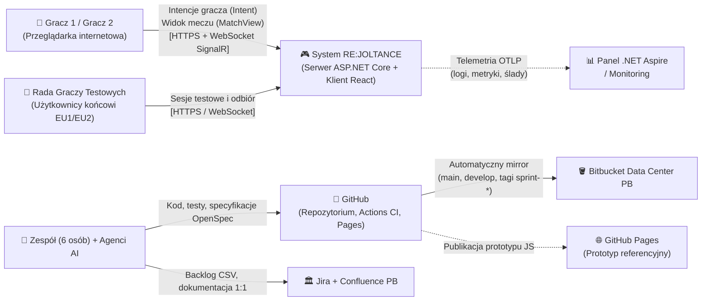
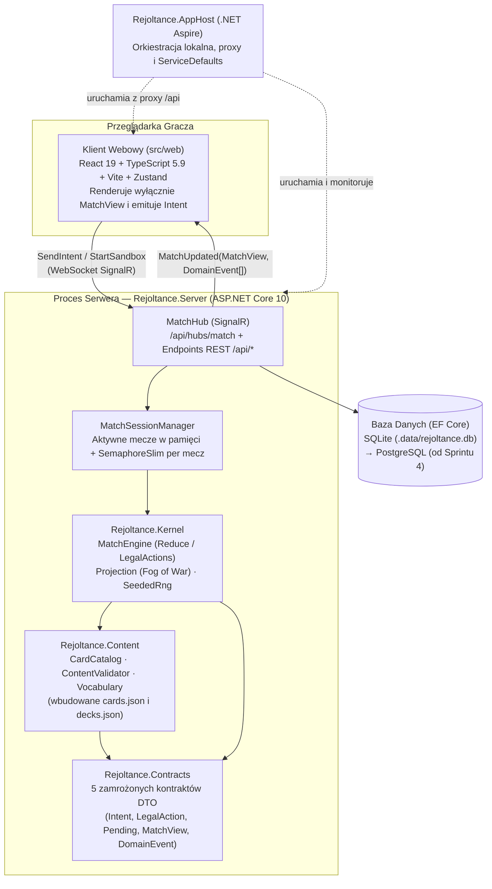
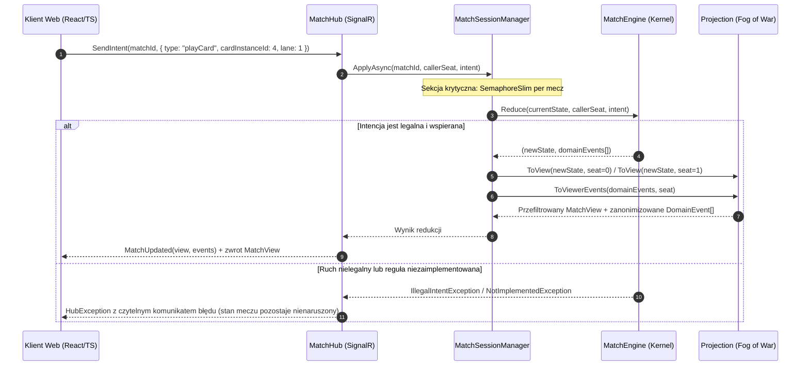
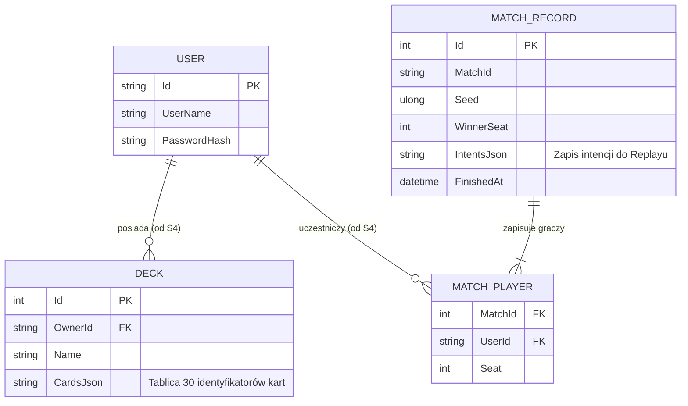
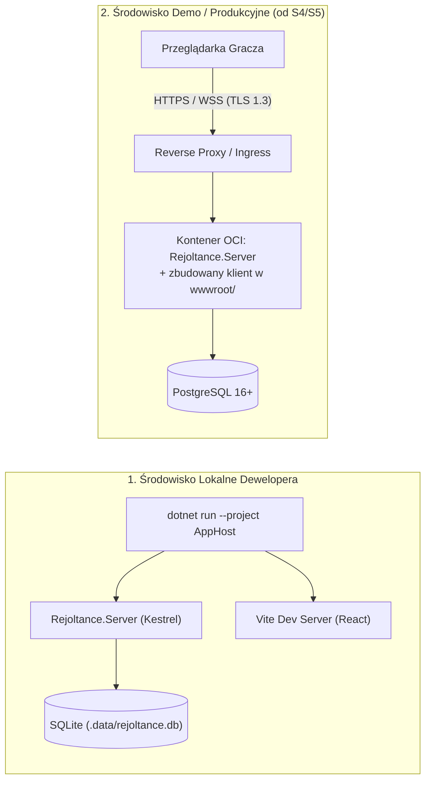

# 1.5 Dokument architektury systemu (SAD) — RE:JOLTANCE

> **Źródło prawdy:** repozytorium (`docs/01-dokumentacja-systemowa/05-sad-architektura-systemu.md`) · **Kategoria dokumentacji:** Dokumentacja produktowa — systemowa (Architektura systemu SAD) · **Etap SDD:** Planowanie · **Struktura:** AltexSoft SAD + arc42 + model C4 · **Wersja:** 1.1 (2026-11-02)

Niniejszy **Dokument Architektury Oprogramowania (SAD)** definiuje strukturę architektoniczną systemu **RE:JOLTANCE**, podział na kontenery i moduły, kontrakty komunikacyjne, model danych, strategie przekrojowe oraz architekturę wdrożenia. Dokument został opracowany zgodnie z wytycznymi AltexSoft oraz standardami **arc42** i **C4**.

Szczegółowy wykaz bibliotek i wersji znajduje się w dokumencie **[1.6 Stos technologiczny i roadmapa IT](06-stos-technologiczny.md)**, natomiast formalne uzasadnienia pojedynczych decyzji architektonicznych znajdują się w rejestrze **[1.7 Decyzje architektoniczne (ADR)](07-decyzje-adr/README.md)**.

---

## 1. Przegląd, tło i cele architektoniczne

### 1.1 Cel dokumentu i kontekst problemu

Zadaniem architektury **RE:JOLTANCE** jest zastąpienie podatnego na oszustwa, niedeterministycznego prototypu przeglądarkowego P2P (JavaScript / PeerJS) nowoczesną aplikacją webową typu klient–serwer, w której:

1. **Serwer jest jedynym autorytetem stanu gry** — żaden klient nie ma dostępu do ukrytych informacji przeciwnika (*Fog of War*) ani możliwości wykonania nielegalnego ruchu.
2. **Silnik reguł gry (`Rejoltance.Kernel`) jest w 100% deterministyczny i odizolowany od infrastruktury** — co pozwala na natychmiastowe testowanie 55 reguł domenowych, uruchamianie symulacji bot-vs-bot oraz odtwarzanie powtórek meczów (*replay*) wyłącznie z ziarna losowości (`Seed`) i listy intencji graczy.
3. **Sześciu członków zespołu może pracować równolegle bez wzajemnego blokowania się** — dzięki zamrożonym kontraktom komunikacyjnym i automatycznym testom granic architektonicznych.

### 1.2 Najważniejsze cele jakościowe

Pełne drzewo wymagań jakościowych zgodne z normą **ISO/IEC 25010:2023** (`NFR-01..NFR-70`) znajduje się w specyfikacji [`openspec/specs/quality-attributes/spec.md`](../../openspec/specs/quality-attributes/spec.md). Architektura systemu jest podporządkowana czterem nadrzędnym priorytetom:

| Priorytet | Cel jakościowy | Powiązane wymagania | Mechanizm architektoniczny realizujący cel |
|---|---|---|---|
| **1** | **Uczciwość rozgrywki i bezpieczeństwo stanu (*Server Authority & Fog of War*)** | `R-80..R-82`, `NFR-40..NFR-42` | Pełny stan `MatchState` nigdy nie opuszcza serwera. Klient otrzymuje wyłącznie przefiltrowaną projekcję `MatchView` (`Projection.ToView`) i wysyła wyłącznie intencje (`Intent`). |
| **2** | **Determinizm i weryfikowalność reguł (*Determinism & Testability*)** | `R-83`, `R-84`, `NFR-51` | Czysty funkcyjnie reduktor `MatchEngine.Reduce` + deterministyczny generator `SeededRng` (SplitMix64) + zakaz używania `System.Random`, zegara i IO wymuszony przez kompilator (`BannedSymbols.txt`). |
| **3** | **Modułowość i równoległość pracy zespołu (*Modularity*)** | `NFR-11`, `NFR-50` | Architektura modularnego monolitu z jednokierunkowym grafem zależności weryfikowanym w każdym PR przez `NetArchTest` (`BoundaryTests.cs`) oraz kontrolą zgodności kontraktów C# ↔ TS przez próbkę JSON. |
| **4** | **Niski próg wejścia i łatwość uruchomienia (*Operability & Portability*)** | `NFR-20`, `NFR-60`, `NFR-61` | Orkiestracja lokalna .NET Aspire (`AppHost`) uruchamiająca serwer, klienta Vite i bazę SQLite jednym poleceniem bez konieczności instalacji Dockera w pierwszych sprintach. |

---

## 2. Podsumowanie wymagań i ograniczenia

### 2.1 Zakres funkcjonalny z perspektywy architektury

System obsługuje cykl życia taktycznego meczu karcianego 1 na 1 na czterech liniach:

- ładowanie i walidację katalogu 78 kart (69 kolekcjonerskich + 9 tokenów) oraz 5 talii startowych z plików JSON wygenerowanych z kanonicznego prototypu,
- zarządzanie sesjami meczowymi w pamięci serwera (tryb piaskownicy, gra z botem AI, pokoje 1v1 przez kod zaproszenia),
- dwukierunkową komunikację czasu rzeczywistego przez protokół WebSocket (SignalR),
- trwałe przechowywanie kont użytkowników, własnych talii oraz zapisów zakończonych meczów w relacyjnej bazie danych.

### 2.2 Ograniczenia techniczne i organizacyjne

| Kategoria ograniczenia | Opis ograniczenia | Konsekwencja dla architektury |
|---|---|---|
| **Zasoby czasowe zespołu** | 6 studentów × ok. 5 h tygodniowo przez 5 dwutygodniowych sprintów w Semestrze 1. | Odrzucenie złożonych wzorców rozproszonych (mikroserwisy, zewnętrzny Event Store) na rzecz prostego modularnego monolitu ([ADR-0001](07-decyzje-adr/0001-stos-technologiczny.md), Konstytucja Art. VIII). |
| **Infrastruktura uczelniana** | Wymóg korzystania z uczelnianych instancji Jira, Confluence i Bitbucket Data Center PB. | Praca codzienna i CI/CD na GitHubie z automatycznym mirrorem do Bitbucket PB ([ADR-0002](07-decyzje-adr/0002-github-i-mirror-bitbucket.md)) oraz strukturą `docs/` odpowiadającą 1:1 drzewu Confluence ([ADR-0011](07-decyzje-adr/0011-dokumentacja-hybryda-repo-confluence.md)). |
| **Środowiska studenckie** | Zróżnicowane laptopy z systemem Windows 11 (polityki Smart App Control, brak Dockera na części maszyn). | Zastosowanie bazy SQLite w Sprintach 0–3 oraz wprowadzenie kontenera PostgreSQL dopiero od Sprintu 4 ([ADR-0007](07-decyzje-adr/0007-sqlite-potem-postgresql.md)). |

---

## 3. Architektura wysokopoziomowa (Model C4 — Poziom 1 i 2)

### 3.1 Kontekst systemu (C4 Poziom 1)

### 3.2 Architektura kontenerów i bloków (C4 Poziom 2)

System działa w oparciu o wzorzec **Modularnego Monolitu** po stronie serwera oraz aplikacji **Single Page Application (SPA)** po stronie przeglądarki:

---

## 4. Szczegółowy projekt systemu (Model C4 — Poziom 3)

### 4.1 Podział na moduły i reguły zależności

Wszystkie moduły posiadają ściśle określone granice odpowiedzialności. Strzałki zależności mogą prowadzić **wyłącznie w dół tabeli** (od warstwy prezentacji i transportu ku czystym kontraktom). Zasada ta jest automatycznie egzekwowana przez zestaw testów `tests/Rejoltance.Architecture.Tests/BoundaryTests.cs`.

| Moduł / Projekt | Warstwa | Odpowiedzialność i główne klasy | Dozwolone zależności | Właściciel (Epik) |
|---|---|---|---|---|
| **`src/web`** | Prezentacja (Klient TS) | Renderowanie stanu `MatchView`, podświetlanie dozwolonych akcji z `legalActions`, obsługa połączenia SignalR (`MatchTransport`) i stanu lokalnego (`Zustand`). **Klient nie zawiera żadnej logiki reguł gry.** | Kontrakt JSON (`src/web/src/contracts`) | Epik E4 |
| **`Rejoltance.AppHost`** i **`ServiceDefaults`** | Orkiestracja i Telemetria | Konfiguracja lokalnego środowiska uruchomieniowego .NET Aspire, OpenTelemetry (logi, metryki, ślady) oraz punktów kontrolnych `/health` i `/alive`. | `Rejoltance.Server` | Epik E6 |
| **`Rejoltance.Server`** | Transport, Sesje i Trwałość | Hub SignalR (`MatchHub`), zarządzanie sesjami meczowymi w pamięci z synchronizacją per mecz (`MatchSessionManager`), punkty końcowe REST (`/api/cards`, `/api/decks`, `/api/info`), kontekst EF Core (`RejoltanceDb`). | `Kernel`, `Content`, `Contracts`, `ServiceDefaults` | Epik E3 / E6 |
| **`Rejoltance.Sim`** *(planowany od S2)* | Sztuczna Inteligencja i Symulacje | Polityki decyzyjne botów (`IBotPolicy`), masowy symulator gier bot-vs-bot oraz wyrocznia testów różnicowych względem prototypu JS. | `Kernel`, `Content`, `Contracts` | Epik E5 |
| **`Rejoltance.Kernel`** | Czysta Domena (Silnik Reguł) | Niemutowalny stan meczu (`MatchState`), czysty reduktor `MatchEngine.Reduce(state, seat, intent)`, generator ruchów `MatchEngine.LegalActions`, projekcja *Fog of War* (`Projection.ToView`) oraz deterministyczny generator `SeededRng`. | `Content`, `Contracts` *(zakaz IO, zegara i `System.Random`)* | Epik E1 |
| **`Rejoltance.Content`** | Dane Domenowe i Walidacja DSL | Ładowanie wbudowanych zasobów `cards.json` i `decks.json` (`CardCatalog`), słownik dozwolonych słów kluczowych, wyzwalaczy i akcji (`Vocabulary`) oraz walidator kart i talii (`ContentValidator`). | `Contracts` | Epik E2 |
| **`Rejoltance.Contracts`** | Zamrożone Kontrakty (DTO) | Czyste rekordy danych przesyłane przez sieć, pozbawione jakiejkolwiek logiki biznesowej (weryfikowane testem refleksyjnym `Contracts_contain_no_logic_types`). | **Brak zależności** | Wspólny (Backend + Frontend) |

### 4.2 Pięć zamrożonych kontraktów komunikacyjnych

Komunikacja pomiędzy klientem webowym, botem AI, serwerem a silnikiem reguł opiera się wyłącznie na pięciu niemutowalnych strukturach zdefiniowanych w `Rejoltance.Contracts` (i odzwierciedlonych w `src/web/src/contracts/index.ts`):

1. **`Intent` (Klient / Bot → Serwer → Kernel):** Jedyny sposób wyrażenia woli gracza (`MulliganIntent`, `ChooseOrderIntent`, `PlayCardIntent`, `EndStepIntent`, `AnswerPendingIntent`, `SurrenderIntent`).
2. **`LegalAction` (Kernel → Serwer → Klient / Bot):** Kompletna lista dozwolonych w danej chwili ruchów wraz z prawidłowymi celami i liniami. Stanowi **jedyne źródło prawdy o legalności ruchu** — interfejs użytkownika nigdy nie oblicza legalności na własną rękę.
3. **`PendingInteraction` (Kernel → Serwer → Klient / Bot):** Jawny opis pytania zadawanego graczowi przez silnik (np. wybór kart do wymiany w mulliganie lub wskazanie celu dla efektu karty). Dzięki temu Kernel nigdy nie blokuje wątku w oczekiwaniu na odpowiedź użytkownika.
4. **`MatchView` (Kernel `Projection` → Serwer → Klient / Bot):** Przefiltrowany widok stanu meczu dla konkretnego miejsca przy stole (`yourSeat`). Zawiera pełne dane własnej ręki gracza, natomiast dla przeciwnika (`OpponentView`) udostępnia wyłącznie liczebność ręki, talii i stosu odrzuconych (*Fog of War*).
5. **`DomainEvent` (Kernel → `Projection` → Serwer → Klient):** Uporządkowana lista faktów domenowych wygenerowanych w wyniku zastosowania intencji (np. `CardDrawn`, `FatigueDamage`, `MatchFinished`), stanowiąca podstawę do odtwarzania animacji i dźwięków w kliencie bez konieczności porównywania stanów (*diffingu*).

### 4.3 Widok wykonania — przebieg pojedynczego ruchu gracza

### 4.4 Architektura danych i model trwałości

System wyraźnie rozdziela **ulotny stan aktywnego meczu** od **danych trwałych**:

- **Aktywne mecze w toku (`MatchState`)** są przechowywane w pamięci operacyjnej serwera (`ConcurrentDictionary` w `MatchSessionManager`), co zapewnia minimalne opóźnienia (brak zapisu do bazy przy każdym kliknięciu karty).
- **Dane trwałe (`RejoltanceDb` — Entity Framework Core)** obejmują konta użytkowników, zapisane talie graczy oraz archiwum zakończonych meczów wraz z ziarnem losowości (`Seed`) i listą intencji na potrzeby powtórek (*replay*).

---

## 5. Strategie techniczne i koncepcje przekrojowe

| Zagadnienie przekrojowe | Zastosowana strategia i rozwiązanie architektoniczne |
|---|---|
| **Determinizm i odtwarzalność (Replay)** | Cała losowość w `Rejoltance.Kernel` pochodzi z niemutowalnej struktury `SeededRng` (algorytm *SplitMix64*), której stan (`State: ulong`) jest częścią `MatchState`. Użycie `System.Random`, `DateTime` lub `Guid.NewGuid()` w Kernelu powoduje błąd kompilacji dzięki analizatorowi `Microsoft.CodeAnalysis.BannedApiAnalyzers` i plikowi `BannedSymbols.txt`. |
| **Ochrona przed podglądaniem kart (*Fog of War*)** | Karty znajdujące się w talii są przechowywane wyłącznie jako lista definicji (`CardId`). Unikalny identyfikator egzemplarza (`InstanceId`) jest nadawany karcie dopiero w momencie jej wyjścia z talii do ręki lub na planszę (`R-81`), dzięki czemu kolejność numerów `InstanceId` nie zdradza układu talii. Projekcja `Projection.ToViewerEvents` zamienia identyfikatory kart dobieranych przez przeciwnika na wartości zerowe (`0`). |
| **Współbieżność i izolacja meczów** | Każda sesja meczowa w `MatchSessionManager` posiada własny obiekt `SemaphoreSlim(1, 1)`. Równoległe żądania z różnych meczów wykonują się współbieżnie na wielu wątkach, natomiast intencje w obrębie jednego meczu są ściśle serializowane. Wyjątek w jednym meczu jest przechwytywany i logowany wraz z `matchId` i `seed`, nie wpływając na pozostałe trwające mecze (`NFR-31`). |
| **Zasada Głośnej Porażki (*Fail Loud*)** | System kategorycznie zabrania cichych obejść błędów (takich jak zwracanie pustej tablicy celów czy losowanie celu w przypadku braku wyboru gracza). Nieznane słowo w danych kart zatrzymuje start serwera wyjątkiem `ContentValidationException`, a niezaimplementowana akcja lub nielegalna intencja zwraca czytelny `HubException`. |
| **Synchronizacja kontraktów C# ↔ TypeScript** | Test integracyjny `ContractSampleTests` serializuje rzeczywisty obiekt `MatchView` wygenerowany przez Kernel C# do pliku `src/web/src/contracts/match-view.sample.json`, a test `contracts.test.ts` weryfikuje jego zgodność z typami TypeScript. Każde rozjechanie się pól po którejkolwiek stronie natychmiast zatrzymuje potok CI ([ADR-0010](07-decyzje-adr/0010-kontrakt-csharp-ts-przez-probke.md)). |
| **Obserwowalność i telemetria (*Observability*)** | Projekt `Rejoltance.ServiceDefaults` automatycznie konfiguruje bibliotekę **OpenTelemetry** ( zbieranie logów strukturalnych, metryk czasu odpowiedzi HTTP/SignalR oraz śladów rozproszonych prezentowanych w panelu .NET Aspire) oraz punkty kontrolne `/health` i `/alive`. |

---

## 6. Infrastruktura i architektura wdrożenia

System obsługuje trzy środowiska uruchomieniowe oraz statyczną publikację prototypu referencyjnego:

| Środowisko | Sposób uruchomienia i topologia | Baza danych | Przeznaczenie |
|---|---|---|---|
| **1. Lokalne środowisko deweloperskie** | Proces `Rejoltance.AppHost` uruchamia natywnie proces serwera Kestrel oraz serwer deweloperski Vite ze skonfigurowanym proxy `/api`. | Lokalny plik SQLite `.data/rejoltance.db` (Sprinty 0–3) lub lokalny kontener PostgreSQL zarządzany przez Aspire (od Sprintu 4). | Codzienna praca programistyczna i manualne testowanie nowych funkcji. |
| **2. Środowisko CI (GitHub Actions)** | Maszyny wirtualne `ubuntu-latest` uruchamiające 3 równoległe zadania: `.NET build & tests` (wraz z pełnym testem integracyjnym `AppHostSmokeTests`), `Web lint, typecheck, tests, build` oraz `Specs, docs, agents, content`. | Baza w pamięci / tymczasowy plik SQLite tworzony na czas testów. | Automatyczna bramka jakości dla każdego Pull Requesta i commita na `develop`/`main`. |
| **3. Środowisko demonstracyjne (Demo)** | Pojedynczy obraz kontenera budowany przez platformę .NET (`PublishWithContainerFiles`), w którym serwer ASP.NET Core serwuje jednocześnie API/SignalR oraz statyczne pliki zbudowanego klienta React z katalogu `wwwroot/`. | Zarządzana instancja lub kontener PostgreSQL 16+. | Sesje testów użyteczności z Radą Graczy oraz prezentacje na *Sprint Review*. |
| **4. Hosting prototypu referencyjnego** | Automatyczny workflow `.github/workflows/prototype-pages.yml` publikujący katalog `prototype/revibance/` na **GitHub Pages**. | Brak (aplikacja czysto kliencka). | Stały punkt odniesienia przy weryfikacji kanonicznych zasad gry v11. |

---

## 7. Ryzyka architektoniczne i dług techniczny

| Zidentyfikowane ryzyko lub dług techniczny | Potencjalny skutek | Strategia mitygacji i plan działania |
|---|---|---|
| **Przechowywanie aktywnych meczów wyłącznie w pamięci jednego procesu serwera** | Restart procesu serwera przerywa aktualnie trwające pojedynki. | Rozwiązanie w pełni akceptowalne w skali projektu uczelnianego. Odtwarzanie przebiegu meczu zapewnia mechanizm deterministycznego replayu z zapisanego `Seed` i listy intencji (`E6-S07`). |
| **Ręczne utrzymywanie deklaracji typów TypeScript odpowiadających rekordom C#** | Ryzyko pomyłki przy rozbudowie kontraktów o nowe zdarzenia i efekty. | Zabezpieczone automatycznym testem próbki JSON w CI (`ContractSampleTests` + `contracts.test.ts`). Po Sprincie 2 przewidziano przegląd decyzji [ADR-0010](07-decyzje-adr/0010-kontrakt-csharp-ts-przez-probke.md) pod kątem ewentualnego generatora typów. |
| **Zaszyte na sztywno efekty pasywne 3 kart w prototypie JS (`Tea Maid`, `Wyvern`, `Survivalist`)** | Utrudnione dodawanie nowych kart z efektami pasywnymi/aurami bez modyfikacji kodu silnika. | Zaplanowano przeniesienie deklaracji efektów pasywnych bezpośrednio do schematu DSL w pliku `cards.json` w ramach zadania `E2-S07` (rozbieżność `D-11`). |
| **Blokowanie bibliotek DLL przez politykę Smart App Control na części laptopów z Windows 11** | Brak możliwości uruchomienia orkiestratora Aspire jednym poleceniem na niektórych komputerach. | Przygotowano skrypt diagnostyczny `tools/doctor.ps1` oraz udokumentowano tryb uruchamiania serwera i klienta w dwóch osobnych terminalach bez udziału DCP (`01-szybki-start-i-instalacja.md`). |
