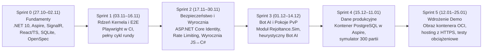

# 1.6 Stos technologiczny i roadmapa technologiczna

> **Źródło prawdy:** repozytorium (`docs/01-dokumentacja-systemowa/06-stos-technologiczny.md`) · **Kategoria dokumentacji:** Dokumentacja produktowa — systemowa (stos technologiczny i roadmapa IT) · **Etap SDD:** Planowanie · **Powiązane decyzje:** [ADR-0001](07-decyzje-adr/0001-stos-technologiczny.md), [ADR-0003](07-decyzje-adr/0003-openspec-i-konstytucja.md), [ADR-0007](07-decyzje-adr/0007-sqlite-potem-postgresql.md)

Ten dokument opisuje stos technologiczny projektu RE:JOLTANCE. Podajemy dokładne wersje narzędzi i bibliotek. Sprawdziliśmy je w plikach `global.json`, `Directory.Packages.props` i `package.json`. Wyjaśniamy też, dlaczego wybraliśmy dane technologie i kiedy je wprowadzamy (*technology roadmap*).

Skróty: SDD (Spec-Driven Development) to praca „najpierw specyfikacja, potem kod”. ADR (Architecture Decision Record) to zapis jednej decyzji architektonicznej.

---

## 1. Stos technologiczny

### 1.1 Backend, silnik reguł i orkiestracja (.NET)

| Warstwa | Technologia / pakiet | Wersja | Rola w systemie | Decyzja |
|---|---|---|---|---|
| **Język i platforma** | C# 14 / .NET SDK | `10.0` LTS (`rollForward: latestFeature`) | Silnik reguł (`Kernel`), katalog kart (`Content`), kontrakty (`Contracts`) i serwer gry (`Server`). | [ADR-0001](07-decyzje-adr/0001-stos-technologiczny.md) |
| **Serwer HTTP i komunikacja w czasie rzeczywistym** | ASP.NET Core + SignalR | `10.0.0` | Endpointy REST (`/api/*`), dwukierunkowy kanał WebSocket (`/api/hubs/match`), serwowanie zbudowanego klienta w wersji demo. | [ADR-0001](07-decyzje-adr/0001-stos-technologiczny.md), [ADR-0006](07-decyzje-adr/0006-serwer-autorytatywny-fog-of-war.md) |
| **Dostęp do danych (ORM)** | Entity Framework Core | `10.0.14` | Mapowanie obiektowo-relacyjne kont, talii i zapisów zakończonych meczów (`RejoltanceDb`). | [ADR-0007](07-decyzje-adr/0007-sqlite-potem-postgresql.md) |
| **Baza danych (Sprinty 0–3)** | SQLite (`Microsoft.EntityFrameworkCore.Sqlite`) | `10.0.14` | Lokalna baza w pliku `.data/rejoltance.db`. Nie wymaga Dockera na laptopach zespołu. | [ADR-0007](07-decyzje-adr/0007-sqlite-potem-postgresql.md) |
| **Baza danych (od Sprintu 4)** | PostgreSQL | `16+` | Docelowa baza dla wersji demo i produkcyjnej. Lokalnie działa jako kontener w Aspire. | [ADR-0007](07-decyzje-adr/0007-sqlite-potem-postgresql.md) |
| **Orkiestracja deweloperska** | .NET Aspire (`Aspire.AppHost.Sdk`, `Aspire.Hosting.JavaScript`) | `13.6.4` | Uruchamia backend i klienta Vite jednym poleceniem. Ustawia zmienne środowiskowe, proxy i panel diagnostyczny. | [ADR-0001](07-decyzje-adr/0001-stos-technologiczny.md) |
| **Telemetria i obserwowalność** | OpenTelemetry (.NET) | `1.17.0` | Zbiera logi strukturalne, metryki i ślady wykonania (*distributed tracing*) w `Rejoltance.ServiceDefaults`. | [ADR-0001](07-decyzje-adr/0001-stos-technologiczny.md) |

ORM (Object-Relational Mapping) to warstwa, która zamienia obiekty C# na wiersze w bazie i odwrotnie. LTS (Long-Term Support) to wersja z wydłużonym wsparciem.

### 1.2 Klient webowy (frontend SPA)

SPA (Single Page Application) to aplikacja webowa, która działa na jednej stronie i nie przeładowuje jej przy każdej akcji.

| Warstwa | Technologia / pakiet | Wersja | Rola w systemie | Decyzja |
|---|---|---|---|---|
| **Biblioteka UI** | React + React DOM | `19.3.0` | Komponenty planszy 4 linii, wachlarza ręki, nakładek interakcji (`PendingInteraction`) i ekranów menu. | [ADR-0001](07-decyzje-adr/0001-stos-technologiczny.md) |
| **Język i typy** | TypeScript | `5.9.0` | Ścisłe typy kontraktów (`MatchView`, `Intent`, `DomainEvent`) i komponentów UI. | [ADR-0010](07-decyzje-adr/0010-kontrakt-csharp-ts-przez-probke.md) |
| **Budowanie i serwer deweloperski** | Vite | `8.3.0` | Szybki serwer deweloperski z HMR (Hot Module Replacement, podmiana kodu bez przeładowania strony). Optymalizuje paczkę produkcyjną (budżet ≤ 500 kB gzip). | [ADR-0001](07-decyzje-adr/0001-stos-technologiczny.md) |
| **Stan klienta** | Zustand | `5.0.13` | Lekki magazyn stanu (`createMatchStore`) oddzielony od transportu. Łatwo go testować na sztucznym transporcie. | — |
| **Klient komunikacji w czasie rzeczywistym** | `@microsoft/signalr` | `10.0.0` | Połączenie WebSocket z `MatchHub`, automatyczne wznawianie połączenia, odbiór zdarzeń `MatchUpdated`. | [ADR-0006](07-decyzje-adr/0006-serwer-autorytatywny-fog-of-war.md) |

### 1.3 Jakość kodu, testy, SDD i narzędzia AI

| Obszar | Technologia / narzędzie | Wersja | Do czego używamy |
|---|---|---|---|
| **Testy jednostkowe i integracyjne .NET** | xUnit + `Microsoft.AspNetCore.Mvc.Testing` | `2.9.3` / `10.0.14` | Testy reguł (`Rnn_...`), determinizmu i projekcji. Testy serwera w pamięci z prawdziwym klientem SignalR. |
| **Testy granic architektury** | `NetArchTest.Rules` | `1.3.2` | Sprawdza, że moduły nie mają niedozwolonych zależności, a kontrakty nie zawierają logiki (`NFR-50`). |
| **Testy dymne całej aplikacji** | `Aspire.Hosting.Testing` | `13.6.4` | Uruchamia cały graf zasobów Aspire. Sprawdza odpowiedź `/health` i proxy klienta (`NFR-60`). |
| **Analiza statyczna C#** | Roslyn Analyzers + `BannedApiAnalyzers` | `5.6.0` | Blokuje w `Rejoltance.Kernel` niedeterministyczne API (`System.Random`, `DateTime`, `File`) już przy kompilacji. |
| **Testy jednostkowe i komponentów UI** | Vitest + React Testing Library + jsdom | `4.1.0` / `16.3.2` | Testy komponentów React, magazynu Zustand i zgodności próbki kontraktu JSON po stronie TypeScript. |
| **Testy end-to-end (E2E)** | Playwright | *Planowane w S1 (`E6-S01`)* | Automatyczne scenariusze całej rozgrywki w Chromium, Firefox i WebKit (`NFR-10`). |
| **Spec-Driven Development** | OpenSpec (`@fission-ai/openspec`) | `1.15.0` | Żywe specyfikacje (`openspec/specs/`) i propozycje zmian (`openspec/changes/`). CI sprawdza je poleceniem `openspec validate --strict`. |
| **Walidacja dokumentacji** | `markdownlint-cli2` | `0.20.0` | Sprawdza formatowanie wszystkich plików Markdown w repozytorium. |
| **Skrypty (`tools/`)** | Python (biblioteka standardowa, `tomllib`) | `3.11+` (zalecany `3.13`) | Synchronizacja adapterów agentów AI (`sync_agents.py`), ekstrakcja kart (`extract_cards.py`), CSV do Jiry (`gen_jira_csv.py`), eksport do Confluence (`sync_confluence.py`). |
| **Agenci AI** | Claude Code, Antigravity, GitHub Copilot, Gemini CLI, OpenAI Codex | — | Wspierają proces SDD. Wszystkie korzystają z jednego źródła zasad w `.agents/` i `AGENTS.md` ([ADR-0009](07-decyzje-adr/0009-kanon-agentow-i-adaptery.md)). |

---

## 2. Dlaczego te technologie i co odrzuciliśmy

| Obszar decyzji | Wybór | Odrzucone alternatywy | Uzasadnienie |
|---|---|---|---|
| **Serwer i język domeny** | **C# / .NET 10 LTS** | Full-stack TypeScript (Node.js), C# + Godot | Większość zespołu zna C# z wcześniejszych projektów. .NET 10 daje silnie typowane rekordy, dojrzały SignalR, EF Core i długie wsparcie LTS. Wsparcie .NET 8 kończy się w listopadzie 2026 r. |
| **Komunikacja w czasie rzeczywistym** | **ASP.NET Core SignalR** | Surowe WebSockety, WebRTC / PeerJS (P2P) | P2P w prototypie pozwalało oszukiwać i podglądać karty przeciwnika. SignalR wspiera autorytatywny serwer, grupy meczowe, automatyczne wznawianie połączeń i silnie typowane huby. |
| **Klient webowy** | **React 19 + TypeScript + Vite** | Czysty JS (Vanilla DOM z prototypu), Blazor WebAssembly | Czysty JS w prototypie dał trudny w utrzymaniu kod imperatywny i podatność XSS (`innerHTML`). React + TypeScript bezpiecznie renderuje `MatchView` z komponentów. Paczka zostaje mała, a style CSS z prototypu łatwo przenieść. |
| **Baza danych** | **SQLite (S0–S3) → PostgreSQL (od S4)** | PostgreSQL w kontenerze od pierwszego dnia | Gdyby 6 osób musiało w pierwszym tygodniu zainstalować i skonfigurować Dockera, start prac mógłby się zablokować. EF Core ukrywa szczegóły dostawcy bazy. Pracujemy więc na pliku SQLite, a w Sprincie 4 przechodzimy na kontener PostgreSQL. |
| **Narzędzie do SDD** | **OpenSpec 1.15 + Konstytucja w `.agents/`** | GitHub Spec Kit (`specify-cli`), BMAD | Porównaliśmy narzędzia (`04-badania-i-analizy/faza-1-porownanie.md`). Spec Kit miał konflikty przy instalacji dla kilku narzędzi AI naraz i generował prawie 10 tys. linii szablonów. OpenSpec instaluje się czysto dla wszystkich 5 narzędzi AI i ma szybki walidator CLI do CI. |
| **Zgodność kontraktów C# ↔ TS** | **Wspólna próbka JSON (`match-view.sample.json`)** | Generator OpenAPI / NSwag, brak automatycznej kontroli | Główne komunikaty gry idą przez SignalR, a OpenAPI go nie obejmuje. Testy C# generują wzorcowy plik JSON, a kompilator TypeScript (`tsc`) go sprawdza. To pewnie wykrywa każdą niezgodność bez dodatkowych generatorów. |

XSS (Cross-Site Scripting) to atak polegający na wstrzyknięciu skryptu do strony. P2P (Peer-to-Peer) to komunikacja bezpośrednio między przeglądarkami, bez serwera.

---

## 3. Roadmapa technologiczna

Harmonogram pokazuje, w którym sprincie wprowadzamy kolejne technologie i z którymi historyjkami backlogu są związane.

| Sprint / etap | Co wprowadzamy | Zadanie w backlogu | Sprawdzane wymaganie jakościowe |
|---|---|---|---|
| **Sprint 0** *(zrealizowany)* | Szkielet solucji .NET 10, `Rejoltance.AppHost` (Aspire), `MatchHub` (SignalR), klient React + Vite, baza SQLite, walidacja OpenSpec, CI w GitHub Actions. | `E0-S01`, `E0-S02` | `NFR-11`, `NFR-50`, `NFR-52`, `NFR-60` |
| **Sprint 1** | Testy przeglądarkowe end-to-end w **Playwright** (Chromium, Firefox, WebKit) w GitHub Actions. | `E6-S01` | `NFR-10` |
| **Sprint 2** | **ASP.NET Core Identity** (rejestracja, logowanie, ciasteczka `HttpOnly`), **Rate Limiting** dla huba SignalR i **wyrocznia testów różnicowych**, która uruchamia silnik prototypu JS w Node.js. | `E6-S02`, `E3-S06`, `E5-S02` | `NFR-40`, `NFR-41`, `NFR-51` |
| **Sprint 3** | Projekt **`Rejoltance.Sim`** z interfejsem `IBotPolicy` i botem AI, który gra przez zwykły kontrakt `Intent`. | `E5-S03` | `NFR-20` |
| **Sprint 4** | Kontener **PostgreSQL 16+** w `Rejoltance.AppHost`, sprawdzenie migracji EF Core na obu bazach, symulator wielu gier bot-vs-bot. | `E6-S03`, `E5-S04` | `NFR-01`, `NFR-31`, [ADR-0007](07-decyzje-adr/0007-sqlite-potem-postgresql.md) |
| **Sprint 5** | Jeden **obraz kontenera OCI** (`PublishWithContainerFiles`) i publiczna instancja demo z certyfikatem TLS/HTTPS. | `E6-S05` | `NFR-30`, `NFR-61` |
| **Semestr 2** | Tabela talii (`Deckbuilder`), zapis pełnego dziennika intencji do deterministycznego **replayu**, ocena generatora kontraktów C# → TS. | `E6-S04`, `E6-S07` | [ADR-0010](07-decyzje-adr/0010-kontrakt-csharp-ts-przez-probke.md) |

---

## 4. Zasady zarządzania wersjami i zależnościami

1. **Centralne zarządzanie pakietami NuGet (Central Package Management).** Wszystkie wersje pakietów .NET są w jednym pliku `Directory.Packages.props` w katalogu głównym. Pliki `.csproj` nie mogą deklarować własnego atrybutu `Version`.
2. **Powtarzalne instalacje npm.** Katalog główny i projekt `src/web` mają zatwierdzone pliki `package-lock.json`. CI i skrypty startowe używają polecenia `npm ci`.
3. **Automatyczne aktualizacje bezpieczeństwa.** GitHub **Dependabot** (`.github/dependabot.yml`) co tydzień sprawdza aktualizacje pakietów NuGet, npm i akcji GitHub. Grupuje poprawki z ekosystemów Microsoft i Aspire. Podatności o priorytecie wysokim i krytycznym aktualizujemy w ciągu ≤ 7 dni (`NFR-42`).
