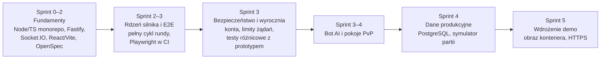

# 1.6 Stos technologiczny i roadmapa technologiczna

> **Źródło prawdy:** repozytorium (`docs/01-dokumentacja-systemowa/06-stos-technologiczny.md`) · **Kategoria dokumentacji:** Dokumentacja produktowa — systemowa (stos technologiczny i roadmapa IT) · **Etap SDD:** Planowanie · **Powiązane decyzje:** [ADR-0015](07-decyzje-adr/0015-backend-node-typescript.md), [ADR-0001](07-decyzje-adr/0001-stos-technologiczny.md), [ADR-0003](07-decyzje-adr/0003-openspec-i-konstytucja.md), [ADR-0007](07-decyzje-adr/0007-sqlite-potem-postgresql.md)

Ten dokument opisuje stos technologiczny projektu RE:JOLTANCE. Wersje pochodzą z `package.json` i `package-lock.json` (stan na 21.11.2026). Wyjaśniamy też, dlaczego wybraliśmy dane technologie i kiedy wprowadzamy kolejne (*technology roadmap*).

Od 21.11.2026 całe repozytorium jest w TypeScript na Node.js ([ADR-0015](07-decyzje-adr/0015-backend-node-typescript.md)); wcześniej backend był w .NET (ADR-0001).

Skróty: SDD (Spec-Driven Development) to praca „najpierw specyfikacja, potem kod”. ADR (Architecture Decision Record) to zapis jednej decyzji architektonicznej.

---

## 1. Stos technologiczny

### 1.1 Wspólne: język, środowisko, organizacja kodu

| Warstwa | Technologia | Wersja | Rola w systemie |
|---|---|---|---|
| **Język** | TypeScript (`strict`) | `5.9.3` | Cały kod: silnik, serwer, klient, skrypty. Node uruchamia pliki `.ts` bez kompilacji (dozwolona tylko składnia usuwalna, `erasableSyntaxOnly`). |
| **Środowisko** | Node.js | `24` LTS | Serwer, testy i skrypty w `tools/`. |
| **Organizacja kodu** | npm workspaces | — | Pakiety `packages/contracts`, `packages/content`, `packages/engine` i aplikacje `apps/server`, `apps/web` w jednym repozytorium. |
| **Kontrakty i walidacja** | zod | `4.6.7` | Schemat `Intent` wspólny dla serwera i klienta; serwer odrzuca każdą wiadomość, która mu nie odpowiada. |

### 1.2 Serwer gry (`apps/server`)

| Warstwa | Technologia | Wersja | Rola w systemie | Decyzja |
|---|---|---|---|---|
| **Serwer HTTP** | Fastify | `5.12.8` | Endpointy REST (`/health`, `/api/*`). | [ADR-0015](07-decyzje-adr/0015-backend-node-typescript.md) |
| **Komunikacja w czasie rzeczywistym** | Socket.IO | `4.8.4` | Zdarzenia meczu (`startSandbox`, `sendIntent`, `matchUpdated`) z typami z `packages/contracts`, automatyczne wznawianie połączeń. | [ADR-0006](07-decyzje-adr/0006-serwer-autorytatywny-fog-of-war.md), [ADR-0015](07-decyzje-adr/0015-backend-node-typescript.md) |
| **Baza danych (do Sprintu 3)** | SQLite (np. wbudowany moduł `node:sqlite`) | — | Konta, talie i zakończone mecze. Dochodzi razem z pierwszą funkcją, która jej potrzebuje. | [ADR-0007](07-decyzje-adr/0007-sqlite-potem-postgresql.md) |
| **Baza danych (od Sprintu 4)** | PostgreSQL | `16+` | Docelowa baza wersji demo. | [ADR-0007](07-decyzje-adr/0007-sqlite-potem-postgresql.md) |

### 1.3 Klient webowy (`apps/web`)

SPA (Single Page Application) to aplikacja webowa, która działa na jednej stronie i nie przeładowuje jej przy każdej akcji.

| Warstwa | Technologia | Wersja | Rola w systemie |
|---|---|---|---|
| **Biblioteka UI** | React + React DOM | `19.3.1` | Plansza 4 linii, wachlarz ręki, nakładki interakcji (`PendingInteraction`), menu. |
| **Budowanie i serwer deweloperski** | Vite | `8.3.8` | Szybki serwer z podmianą kodu bez przeładowania strony; proxy `/api` i `/socket.io` do serwera gry; budżet paczki ≤ 500 kB gzip. |
| **Stan klienta** | Zustand | `5.1.0` | Magazyn stanu (`createMatchStore`) oddzielony od transportu; łatwo go testować na sztucznym transporcie. |
| **Transport** | `socket.io-client` | `4.8.4` | Połączenie z serwerem gry. |

### 1.4 Jakość kodu, testy, SDD i narzędzia

| Obszar | Narzędzie | Wersja | Do czego używamy |
|---|---|---|---|
| **Testy** | Vitest (+ React Testing Library `16.3.3`, jsdom `27.4.0`) | `4.1.12` | Jedno `npm test`: reguły `Rnn_…`, determinizm, projekcja, serwer przez prawdziwe połączenie Socket.IO, komponenty React, narzędzia. |
| **Lint i granice modułów** | ESLint + typescript-eslint | `10.15.0` / `8.73.0` | Styl kodu, granice pakietów (`no-restricted-imports`) i determinizm silnika (zakaz `Math.random`, `Date`, timerów, `node:*`) — `NFR-50`. |
| **Testy end-to-end** | Playwright | *planowane (`E6-S01`)* | Scenariusze rozgrywki w Chromium, Firefox i WebKit (`NFR-10`). |
| **Spec-Driven Development** | OpenSpec (`@fission-ai/openspec`) | `1.15.0` | Specyfikacje (`openspec/specs/`) i propozycje zmian (`openspec/changes/`); CI uruchamia `openspec validate --strict`. |
| **Walidacja dokumentacji** | `markdownlint-cli2` | `0.20.0` | Formatowanie plików Markdown. |
| **Skrypty (`tools/`)** | TypeScript na Node + `smol-toml` `1.9.1` | — | Adaptery agentów AI, ekstrakcja kart, CSV do Jiry, eksport i publikacja w Confluence — wszystko przez `npm run …` ([`tools/README.md`](../../tools/README.md)). |
| **Agenci AI** | Claude Code, Codex, Cursor, Antigravity | — | Wspierają proces SDD; jedno źródło zasad w `.agents/` i `AGENTS.md` ([ADR-0009](07-decyzje-adr/0009-kanon-agentow-i-adaptery.md), [ADR-0014](07-decyzje-adr/0014-odchudzenie-systemu-agentow.md)). |

---

## 2. Dlaczego te technologie i co odrzuciliśmy

| Obszar decyzji | Wybór | Odrzucone alternatywy | Uzasadnienie |
|---|---|---|---|
| **Język całego systemu** | **TypeScript na Node.js 24** | C# / .NET 10 (pierwotny wybór, ADR-0001) | Kanon zasad gry jest w JS, więc silnik w TS można porównywać z prototypem w tym samym procesie. Kontrakty są jednym pakietem dla serwera i klienta. Jedno środowisko zamiast trzech (.NET, Node, Python). Kod C# był jeszcze mały, więc zmiana była tania ([ADR-0015](07-decyzje-adr/0015-backend-node-typescript.md)). |
| **Komunikacja w czasie rzeczywistym** | **Socket.IO** | surowe WebSockety (`ws`), WebRTC / PeerJS (P2P) | P2P w prototypie pozwalało oszukiwać i podglądać karty przeciwnika. Socket.IO daje autorytatywny serwer, pokoje, potwierdzenia odpowiedzi i automatyczne wznawianie połączeń, a jego zdarzenia typujemy z `packages/contracts`. |
| **Serwer HTTP** | **Fastify** | Express | Szybki, z wbudowanym testowaniem żądań bez sieci (`app.inject`) i dobrą obsługą TypeScript. |
| **Klient webowy** | **React 19 + TypeScript + Vite** | czysty JS z prototypu, Blazor | Czysty JS dał trudny w utrzymaniu kod imperatywny i podatność XSS (`innerHTML`). React bezpiecznie renderuje `MatchView`. |
| **Baza danych** | **SQLite → PostgreSQL (od S4)** | PostgreSQL w kontenerze od pierwszego dnia | Bez Dockera na laptopach na starcie; przejście w Sprincie 4 ([ADR-0007](07-decyzje-adr/0007-sqlite-potem-postgresql.md)). |
| **Narzędzie do SDD** | **OpenSpec + konstytucja w `.agents/`** | GitHub Spec Kit, BMAD | Spec Kit miał konflikty instalacji i generował ok. 10 tys. linii szablonów; OpenSpec instaluje się czysto i ma walidator do CI (`04-badania-i-analizy/faza-1-porownanie.md`). |

XSS (Cross-Site Scripting) to atak polegający na wstrzyknięciu skryptu do strony. P2P (Peer-to-Peer) to komunikacja bezpośrednio między przeglądarkami, bez serwera.

---

## 3. Roadmapa technologiczna

| Etap | Co wprowadzamy | Zadanie w backlogu | Sprawdzane wymaganie |
|---|---|---|---|
| **Zrealizowane** | Monorepo Node/TS, Fastify + Socket.IO, klient React + Vite, ESLint z granicami modułów, Vitest, OpenSpec, CI w GitHub Actions. | `E0-S01`, `E6-S01` (część) | `NFR-11`, `NFR-50`, `NFR-52`, `NFR-60` |
| **Kolejny sprint** | Testy end-to-end w **Playwright** (Chromium, Firefox, WebKit). | `E6-S01` | `NFR-10` |
| **Bezpieczeństwo** | Konta graczy (hasła jako skrót, ciasteczko `HttpOnly`), limity żądań dla Socket.IO, wyrocznia testów różnicowych z silnikiem prototypu w tym samym procesie Node. | `E6-S02`, `E3-S06`, `E5-S02` | `NFR-40`, `NFR-41`, `NFR-51` |
| **Bot AI** | Bot grający przez zwykły kontrakt `Intent`. | `E5-S03` | `NFR-20` |
| **Dane produkcyjne** | PostgreSQL 16+, symulator wielu gier bot-vs-bot. | `E6-S03`, `E5-S04` | `NFR-01`, `NFR-31` |
| **Wdrożenie demo** | Jeden obraz kontenera (serwer Node + zbudowany klient), publiczna instancja z HTTPS. | `E6-S05` | `NFR-30`, `NFR-61` |
| **Semestr 2** | Deckbuilder, zapis dziennika intencji do deterministycznego replayu. | `E6-S04`, `E6-S07` | — |

---

## 4. Zasady zarządzania wersjami i zależnościami

1. **Jeden lockfile.** Wszystkie pakiety repozytorium mają wspólny `package-lock.json` w katalogu głównym; CI i `npm run setup` używają `npm ci`.
2. **Nowa zależność npm = zgoda człowieka.** Agent AI pyta przed dodaniem paczki (`AGENTS.md`, reguła 20); silnik i katalog kart nie mają zależności spoza repozytorium (test `tools/architecture.test.ts`).
3. **Automatyczne aktualizacje bezpieczeństwa.** Dependabot (`.github/dependabot.yml`) co tydzień sprawdza npm i co miesiąc akcje GitHub. Podatności wysokie i krytyczne aktualizujemy w ciągu ≤ 7 dni (`NFR-42`). Nowej głównej wersji TypeScript nie podnosimy automatycznie.
