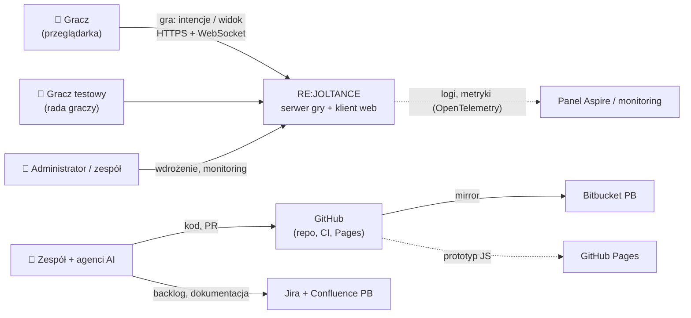
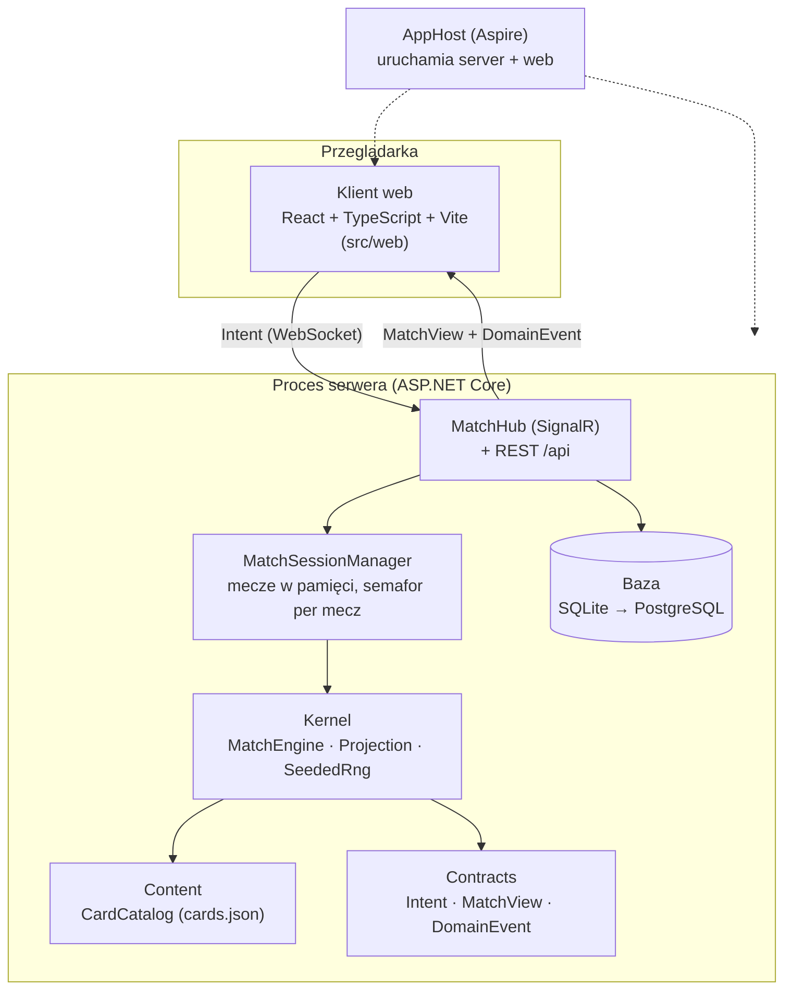
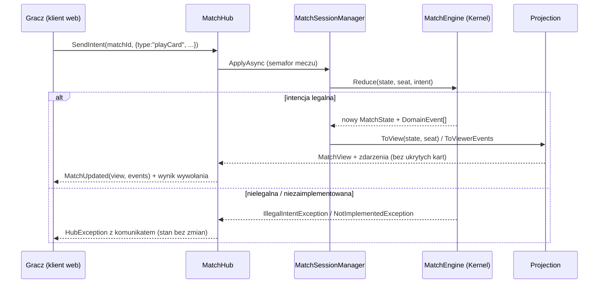
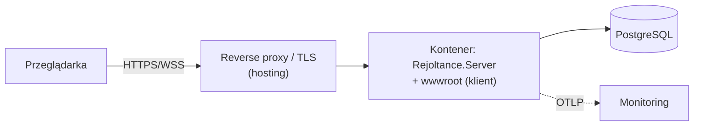
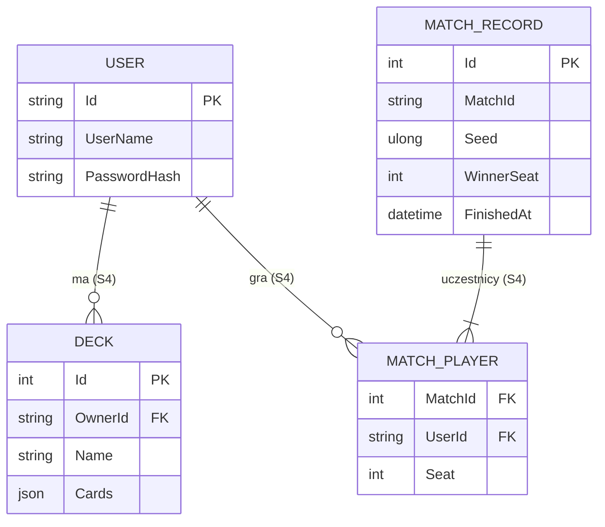

# RE:JOLTANCE — dokument architektury (SAD)

**Wersja:** 1.0 · 2026-11-01 · **Struktura:** arc42 (lekka) + diagramy C4 · **Źródło prawdy:** repo
Krótka mapa dla programistów: [`MAP.md`](MAP.md). Uzasadnienia decyzji: [ADR](../04-adr/README.md). Etykiety: [V] zweryfikowane, [Z] plan / założenie.

## 1. Cele i wymagania

**Produkt:** dwuosobowa gra karciana typu lane battler w przeglądarce — mecz online przez link lub z botem, bez instalacji.
Wymagania funkcjonalne: 55 reguł R‑nn (`openspec/specs`), story platformy w backlogu.

**Najważniejsze cele jakościowe** (pełna lista: `openspec/specs/quality-attributes`):

| # | Cel | Wymaganie | Dlaczego najważniejszy |
|---|---|---|---|
| 1 | **Uczciwość** — klient nie widzi ukrytych kart i nie zmieni stanu | R-80…R-82, NFR-41/42 | prototyp P2P pozwalał oszukiwać (D-05, D-13, D-14) |
| 2 | **Poprawność reguł i powtarzalność** | R-83, NFR-51 | 55 reguł z przypadkami brzegowymi; replay i testy wymagają determinizmu |
| 3 | **Równoległa praca 6 osób** | NFR-50, NFR-11 | granice modułów i kontraktów chronią przed blokowaniem się |
| 4 | **Łatwy start** — jedno polecenie, link do gry | NFR-60, NFR-20 | rada graczy testuje między zajęciami |

**Interesariusze:** gracze (rada graczy), zespół (6 osób, rotujący PO), prowadzący (ocena EU1–EU7), agenci AI (czytają specyfikacje).

## 2. Ograniczenia

| Ograniczenie | Skutek |
|---|---|
| 6 osób × ok. 5 h/tydz., 5 sprintów w semestrze 1 | linia cięcia W0–W3, prostota (konstytucja art. VIII) |
| Stos: C#/.NET (decyzja zespołu), klient webowy | ADR-0001 |
| Narzędzia uczelni: Jira, Confluence, Bitbucket PB (licencja tylko do dydaktyki) | ADR-0002, ADR-0011 |
| Laptopy z Windows (Smart App Control, OneDrive, długie ścieżki) | `tools/doctor.ps1`, CI jako dowód działania |
| Kanon zasad = prototyp JS v11 | ADR-0005 |

## 3. Kontekst (C4 poziom 1)

| Interfejs zewnętrzny | Protokół | Opis |
|---|---|---|
| Przeglądarka gracza | HTTPS, WebSocket (SignalR) | REST `/api/*`, hub `/api/hubs/match` — [API.md](API.md) |
| GitHub Actions | — | build, testy, mirror, publikacja prototypu |
| Jira / Confluence PB | REST (MCP, tylko odczyt) | kontekst dla agentów AI (opcjonalnie) |

## 4. Strategia rozwiązania

1. **Serwer autorytatywny** (ADR-0006): klient wysyła tylko `Intent`, dostaje tylko `MatchView` swojej strony.
2. **Czysty, deterministyczny Kernel** (ADR-0004): `reduce(state, seat, intent) → (state, events)`, losowość z seeda w stanie; build blokuje `System.Random`, zegar, IO.
3. **Karty jako dane** (ADR-0005): `cards.json` z prototypu, słownik DSL, walidacja przy starcie (fail loud).
4. **Pięć zamrożonych kontraktów** (konstytucja art. IV): `Intent`, `LegalAction`, `PendingInteraction`, `MatchView`, `DomainEvent`; zgodność C#↔TS przez próbkę JSON (ADR-0010).
5. **Modularny monolit** z testami granic zamiast mikroserwisów (konstytucja art. VIII).
6. **Aspire** do lokalnej orkiestracji i telemetrii, SQLite na start, PostgreSQL od S4 (ADR-0001, ADR-0007).
7. **Spine‑first** i pionowe plastry (ADR-0008); specyfikacja przed kodem (OpenSpec, ADR-0003).

## 5. Widok bloków

### Kontenery (C4 poziom 2)

### Moduły (C4 poziom 3)

| Moduł | Odpowiedzialność | Zależy od | Właściciel |
|---|---|---|---|
| `Rejoltance.Contracts` | 5 kontraktów, zero logiki | — | wspólny |
| `Rejoltance.Content` | katalog kart, słownik DSL, walidacja talii | Contracts | E2 |
| `Rejoltance.Kernel` | reguły, legalne ruchy, projekcja (fog of war), RNG | Content, Contracts | E1 |
| `Rejoltance.Server` | hub, sesje, REST, baza, konta (od S2) | Kernel | E3 / E6 |
| `Rejoltance.AppHost`, `ServiceDefaults` | orkiestracja, telemetria, health | Server | E6 |
| `src/web` | renderowanie widoku, wysyłanie intencji | (kontrakt JSON) | E4 |
| `Sim` (planowany, E5) | boty jako `Policy`, symulator, wyrocznia | Kernel | E5 |

Zasada: zależności tylko w dół; pilnuje `tests/Rejoltance.Architecture.Tests` (NFR-50). [V]

## 6. Widok wykonania — jeden ruch gracza

Inne kluczowe przebiegi (do opisania przy realizacji): walka 4 linii z `PendingInteraction` (E1-S08), dołączenie do pokoju (E3-S01), reconnect (E3-S05).

## 7. Widok wdrożenia

| Środowisko | Jak działa | Stan |
|---|---|---|
| **Lokalne** | `dotnet run --project src/Rejoltance.AppHost`: serwer (Kestrel) + Vite dev server, SQLite w `.data/`, panel Aspire | [V] |
| **CI** | GitHub Actions (ubuntu): build, testy, smoke AppHost, walidacja specyfikacji | [V] |
| **Demo** | jeden kontener: serwer ASP.NET Core serwuje zbudowany klient z `wwwroot` (`PublishWithContainerFiles`), PostgreSQL, HTTPS; hosting — pytanie otwarte #8 | [Z] E6-S05 |
| **Prototyp** | statyczny JS na GitHub Pages | [Z] po konfiguracji Pages |

## 8. Koncepcje przekrojowe

| Koncepcja | Rozwiązanie | Gdzie |
|---|---|---|
| **Model domeny** | `MatchState` (gracze, ręka, talia jako id kart, linie, RNG, faza) — niemutowalny rekord | `Kernel/MatchState.cs` |
| **Determinizm i replay** | `SeededRng` (SplitMix64) w stanie; replay = seed + lista intencji | R-83, ADR-0004 |
| **Interakcja z graczem** | `PendingInteraction` zamiast blokowania | R-84 |
| **Fog of war** | jedna projekcja `Projection.ToView`; identyfikatory instancji nadawane przy wyjściu z talii | R-80, R-81 |
| **Współbieżność** | mecze w pamięci, `SemaphoreSlim` per mecz | `MatchSessionManager` |
| **Błędy** | fail loud: wyjątek z komunikatem → `HubException`; nieznane słowo DSL → błąd przy starcie | konstytucja art. VI |
| **Dane trwałe** | EF Core; dziś `MatchRecord` (wynik meczu, seed); od S2 konta (Identity), od S4 talie i historia | niżej |
| **Bezpieczeństwo** | walidacja intencji i miejsca na serwerze, limity żądań, hashowane hasła, HTTPS, sekrety poza repo | NFR-40…42 |
| **Telemetria** | OpenTelemetry (logi, metryki, ślady) z `ServiceDefaults`, `/health`, `/alive` | panel Aspire |
| **Testowalność** | testy R‑nn, testy granic, próbka kontraktu, smoke AppHost, fake transport w kliencie | [strategia testów](../09-jakosc/STRATEGIA-TESTOW.md) |
| **Agenci AI** | jeden kanon zasad, adaptery generowane, specyfikacje w repo | ADR-0009, ADR-0011 |

### Model danych (trwały)

[V] `MATCH_RECORD` istnieje (`Server/Data/RejoltanceDb.cs`); pozostałe tabele — [Z] plan (E6-S02, E6-S04, E6-S07). Intencje do replayu (E6-S07) zapisujemy jako JSON przy meczu.

## 9. Decyzje

[ADR 0001–0011](../04-adr/README.md): stos, GitHub + mirror, OpenSpec, Kernel od nowa, kanon zasad, serwer autorytatywny, SQLite → PostgreSQL, spine‑first, kanon agentów, kontrakt przez próbkę, dokumentacja hybrydowa.

## 10. Wymagania jakościowe

Drzewo jakości (ISO/IEC 25010:2023) i scenariusze: [`openspec/specs/quality-attributes/spec.md`](../../openspec/specs/quality-attributes/spec.md) — NFR-01…NFR-70.

## 11. Ryzyka i dług techniczny

| Ryzyko / dług | Skutek | Działanie |
|---|---|---|
| Zakres reguł (55) vs pojemność zespołu | brak pełnej gry w semestrze 1 | linia cięcia, talia MVP 12 kart |
| Mecze tylko w pamięci jednego procesu | restart serwera kończy mecze | akceptowane; replay z seeda (E6-S07) |
| Sprzężenie z Aspire w dev | problem na niektórych laptopach | uruchamianie serwera i klienta osobno (`jak-zaczac.md`) |
| Kontrakt TS pisany ręcznie | rozjazd przy większych zmianach | próbka JSON w CI; rewizja ADR-0010 po S2 |
| Pasywne efekty kart zakodowane po id w prototypie | trudne dodawanie kart | E2-S07 (DSL) |

## 12. Słownik

[`docs/00-start/slownik.md`](../00-start/slownik.md).
