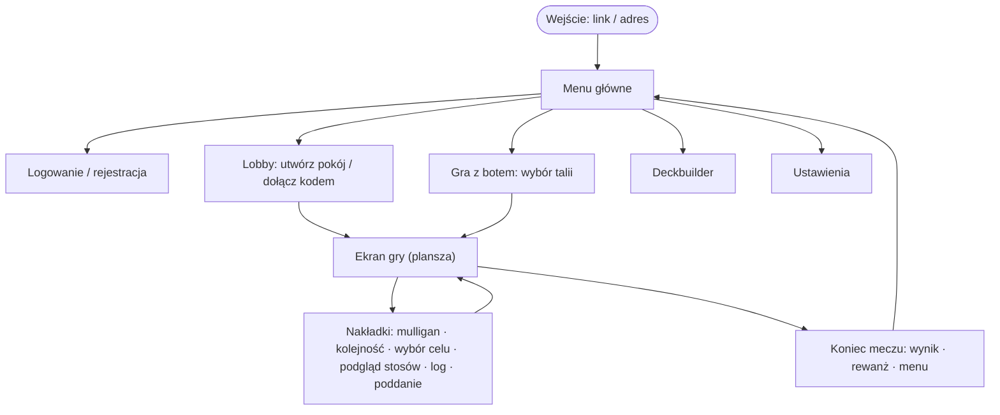
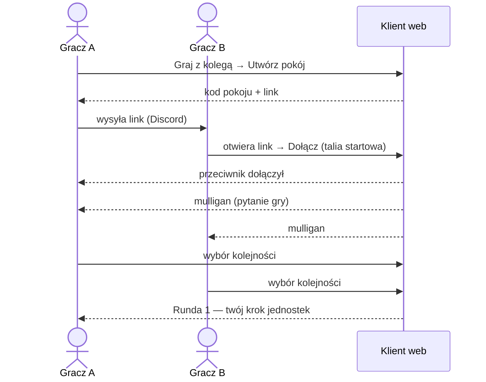

# UX — mapa ekranów, przepływy i przewodnik stylu

**Stan:** 2026-11-01 · **Źródło prawdy:** repo (makiety i wyniki testów użyteczności — Confluence 5.4).
Referencja wizualna i działający prototyp interakcji: [`prototype/revibance`](../../prototype/README.md) [V]. Persony: DIP §2 / Confluence 2.2.

## 1. Mapa ekranów



| Ekran | W prototypie (`index.html`) | Nowy klient | Story |
|---|---|---|---|
| Menu główne | `#menu` (kafle: gra z kolegą, gra z botem) | — | E4-S07 |
| Logowanie / rejestracja | brak | — | E6-S09 |
| Lobby (kod pokoju, link, wybór talii) | `#lobby` | — | E4-S07, E3-S01 |
| Gra z botem: wybór talii | `#botmenu` | — | E5-S05 |
| Deckbuilder (filtry, licznik x/30, zapis) | `#bld` | — | E6-S04 (semestr 2) |
| Ustawienia (nazwa, trudność bota, czcionka, głośność) | `#setmenu` | — | semestr 2 |
| **Ekran gry** | `#game` | ✅ szkielet (plansza, ręka, HP/Blood) | E4-S01, E4-S02 |
| Nakładki: mulligan, kolejność, wybór z talii, stosy | `#mul` | ⏳ mulligan (przycisk) | E4-S03 |
| Log rozgrywki | `#hist` | — | E4-S05 |
| Potwierdzenie poddania | `#modal` | — | E4-S06 |
| Koniec meczu (wygrana / przegrana / rewanż) | `#ov` | — | E4-S06 |
| Powiększenie karty + glosariusz słów kluczowych | `#zoom` | — | E4-S04 |

## 2. Układ ekranu gry (wireframe)

```text
┌──────────────────────────────────────────────────────────────────────────┐
│ [Poddaj]   Faza: krok jednostek (Ty)   [Log] [Ustawienia]      Runda 3   │
│ Ostatnie zagrania: ▢ ▢ ▢ ▢                                               │
├──────────────────────────────────────────────────────────────────────────┤
│ Przeciwnik  ❤ 17   Blood ●●○   ręka: ▮▮▮▮   talia: 22   stos: 3           │
│   ┌────────┐ ┌────────┐ ┌────────┐ ┌────────┐                            │
│   │ linia 0│ │ linia 1│ │ linia 2│ │ linia 3│   ← jednostki przeciwnika  │
│   └────────┘ └────────┘ └────────┘ └────────┘                            │
│   ┌────────┐ ┌────────┐ ┌────────┐ ┌────────┐                            │
│   │ linia 0│ │ linia 1│ │ linia 2│ │ linia 3│   ← twoje jednostki        │
│   └────────┘ └────────┘ └────────┘ └────────┘                            │
│ Ty  ❤ 20   Blood ●●●   talia: 21   stos: 2                  [Koniec kroku]│
│          ╭───╮╭───╮╭───╮╭───╮╭───╮   ← wachlarz ręki (koszt w kółku)      │
└──────────────────────────────────────────────────────────────────────────┘
```

Zasady interakcji (z prototypu, R-20, NFR-21):

- kliknięcie karty → podświetlenie **tylko** linii/celów z `legalActions`; drugie kliknięcie lub przeciągnięcie → zagranie;
- karta z jednym legalnym celem wybiera go sama; prawy przycisk / Esc anuluje;
- klawiatura (NFR-22): `1–8` wybór karty, `Enter`/`Spacja` koniec kroku lub zatwierdzenie, `L` log, `Esc` anuluj.

## 3. Przepływ: pierwszy mecz z kolegą



## 4. Przewodnik stylu (z prototypu)

| Element | Wartość | Źródło |
|---|---|---|
| Tło | `#050505` | `style.css` (`--bg`) |
| Linie, ramki | `#2a2a2a` | `--ln` |
| Tekst podstawowy | `#8d8d8d` | `--tx` |
| Tekst wyróżniony | `#cfcfcf` | `--hi` |
| Akcent (Blood, zagrożenie) | `#c4161c` | `--red` |
| Elementy nieaktywne | `#3a3a3a` | `--dim` |
| Czcionki (do wyboru w ustawieniach) | Pixelify Sans, Silkscreen, DotGothic16, Jersey 15 (pikselowe); Cinzel + Alegreya Sans (klasyczne) | `prototype/revibance/fonts` |
| Scena | 1920×1080, skalowana do okna; komunikat „obróć urządzenie” w pionie | `ui.js` |
| Karty | `img/<id>.webp`, rewers `back.webp`, ramka `CardFront.png` | `prototype/revibance/img` |
| Dźwięk | 17 efektów × 3 warianty, muzyka warstwowa zależna od HP i rundy | `sfx/`, `music.js` |

Kontrast na tle `#050505` (wzór WCAG 2.1) [V — policzone]: tekst `#8d8d8d` 6,1 : 1 i `#cfcfcf` 13,1 : 1 — spełniają AA (NFR-22);
akcent `#c4161c` 3,4 : 1 — tylko duży tekst (≥ 24 px) i elementy graficzne; `#3a3a3a` 1,8 : 1 — wyłącznie dla elementów nieaktywnych, nie dla tekstu do czytania.
Animacje: bez błysków > 3/s, respektować `prefers-reduced-motion` (NFR-70).

## 5. Do zrobienia (luki UX)

- [ ] Makiety (wireframe'y) lobby i nakładek — Confluence 3.5 / E4-S03, E4-S07
- [ ] Persony i scenariusze z rozmów z radą graczy — Confluence 2.2 / E0-S03
- [ ] Pierwszy test użyteczności (NFR-20) — Confluence 5.4 / Review S3
