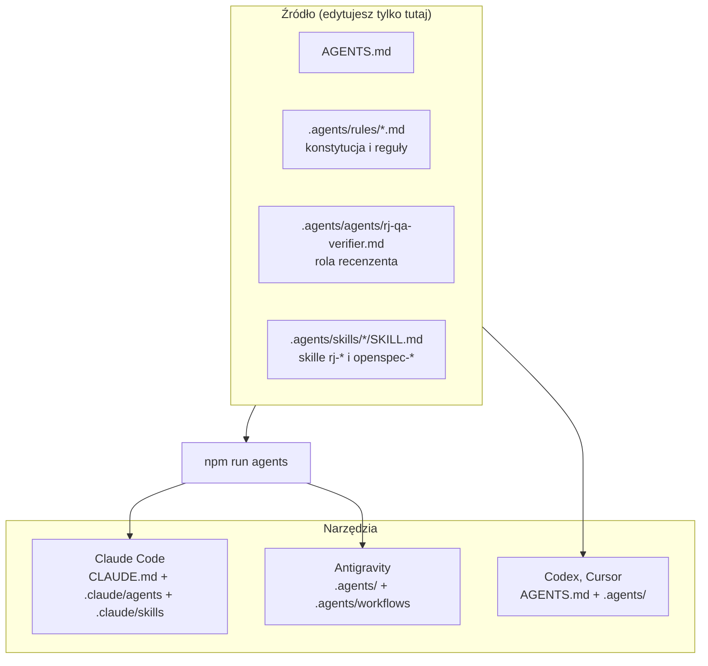

# 4.1 Architektura i konfiguracja systemu agentów AI

> **Źródło prawdy:** repozytorium (`docs/04-system-agentow-ai/01-architektura-i-konfiguracja-agentow.md`) · **Kategoria dokumentacji:** Dokumentacja procesowa — standardy inżynierii agentowej i narzędzi · **Etap SDD:** Fundamenty · **Powiązane decyzje:** [ADR-0009](../01-dokumentacja-systemowa/07-decyzje-adr/0009-kanon-agentow-i-adaptery.md), [ADR-0014](../01-dokumentacja-systemowa/07-decyzje-adr/0014-odchudzenie-systemu-agentow.md)

Zespół korzysta z **Claude Code** oraz z narzędzi, które same czytają `AGENTS.md` i katalog `.agents/`: **Codex**, **Cursor** i **Antigravity**. Wszystkie stosują te same zasady, bo mają jedno źródło: `AGENTS.md` i `.agents/`. Dla Claude Code skrypt generuje z niego adaptery.

---

## 1. Jak to jest zbudowane



| Katalog | Co zawiera |
|---|---|
| `.agents/rules/` | Konstytucja (`00`) i reguły tematyczne. Agent zawsze czyta konstytucję i regułę `10` (prawda i niepewność), pozostałe — gdy dotyczą zadania. |
| `.agents/agents/` | Jedna rola: `rj-qa-verifier`, niezależny recenzent z dostępem tylko do odczytu. |
| `.agents/skills/` | Procedury krok po kroku (`SKILL.md`): skille zespołu `rj-*` i skille OpenSpec. |
| `.agents/workflows/` | Komendy ukośnikowe dla Antigravity, generowane przez skrypt. |

---

## 2. Jak korzystać w swoim narzędziu

| Narzędzie | Skąd bierze zasady | Jak wywołać skill albo recenzję |
|---|---|---|
| **Claude Code** | `CLAUDE.md` → `AGENTS.md`, `.claude/agents/`, `.claude/skills/` | `/rj-pr-ready`, `/opsx:propose`; recenzja: *„Użyj subagenta `rj-qa-verifier` do sprawdzenia zmian na tej gałęzi”*. |
| **Antigravity** | `AGENTS.md` i cały `.agents/` | `/rj-add-card`, `/opsx-propose`. |
| **Codex** | `AGENTS.md` i `.agents/skills/` | `$rj-start-feature`, `$openspec-propose`. |
| **Cursor** | `AGENTS.md` | Poproś o wykonanie skilla, np. *„Wykonaj `.agents/skills/rj-pr-ready/SKILL.md`”*. |
| **Czat w przeglądarce** | — | Wklej `AGENTS.md`, `docs/01-dokumentacja-systemowa/08-mapa-kodu-i-modulow.md` i README modułu, w którym pracujesz. |

---

## 3. Połączenie z Jirą i Confluence PB (MCP, opcjonalne)

Plik `.mcp.json` konfiguruje serwer **MCP** `mcp-atlassian` dla Claude Code. Dzięki niemu agent może odczytać zadanie z Jiry PB albo stronę z Confluence PB. Serwer działa w trybie **tylko do odczytu** (`READ_ONLY_MODE=true`): zmiany w Jirze robi student, bo efekty EU2–EU4 ocenia się indywidualnie.

1. Zainstaluj `uv`: `winget install astral-sh.uv`.
2. Wygeneruj osobiste tokeny (PAT) w Jirze PB i Confluence PB: awatar → **Profile** → **Personal Access Tokens** → **Create token**. Token daje taki dostęp jak hasło — nie wklejaj go do plików śledzonych przez git ani do czatu.
3. Ustaw zmienne środowiskowe użytkownika i uruchom ponownie terminal:

   ```powershell
   [Environment]::SetEnvironmentVariable("JIRA_PERSONAL_TOKEN", "TWOJ_TOKEN_JIRA", "User")
   [Environment]::SetEnvironmentVariable("CONFLUENCE_PERSONAL_TOKEN", "TWOJ_TOKEN_CONFLUENCE", "User")
   ```

4. W Claude Code wpisz `/mcp` i sprawdź, czy serwer `atlassian-pb` ma status `connected`.
