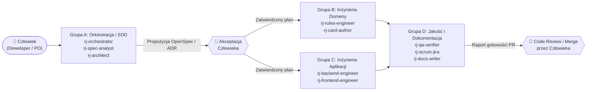

# 4.2 Katalog ról agentów i macierz wbudowanych umiejętności

> **Źródło prawdy:** repozytorium (`docs/04-system-agentow-ai/02-katalog-rol-i-wbudowanych-skilli.md`) · **Kategoria dokumentacji:** Dokumentacja procesowa — katalog ról i umiejętności AI · **Etap SDD:** cały cykl SDD

W projekcie **RE:JOLTANCE** mamy **10 ról agentów AI** (katalog `.agents/agents/`) oraz **19 skilli**: 13 zespołowych `rj-*` i 6 skilli OpenSpec (katalog `.agents/skills/`). Skill to zapisana procedura krok po kroku, którą agent wykonuje na żądanie. Role dzielimy na **4 grupy**, które odpowiadają etapom procesu SDD (Spec-Driven Development) i warstwom architektury. Każdy agent ma jawną listę wbudowanych skilli (`skills:`) i tylko te narzędzia, których naprawdę potrzebuje (zasada najmniejszych uprawnień, *least privilege*).

---

## 1. Jak role współpracują ze sobą i z człowiekiem

---

## 2. Cztery grupy ról i ich wbudowane skille

Wszystkie role mają narzędzia `read`, `search`, `execute` i `todo`. Różnią się narzędziem `edit` (zapis plików) i `agent` (przekazywanie pracy innym agentom). Opis „edycja X” w tabelach mówi, za jakie pliki rola odpowiada. Samo narzędzie `edit` nie ogranicza zapisu do tych katalogów.

### Grupa A: Orkiestracja i Spec-Driven Development (`A-Orkiestracja-i-SDD`)

Ci agenci przyjmują zadania i prowadzą dwa pierwsze etapy SDD: **`Specify`** (PRD, czyli dokument wymagań produktu, reguły `R-nn`, scenariusze `GIVEN/WHEN/THEN`) i **`Plan`** (SAD, czyli dokument architektury, kontrakty, decyzje ADR).

| Rola agenta | Za co odpowiada | Narzędzia | Wbudowane skille (`skills`) |
|---|---|---|---|
| **`rj-orchestrator`** *(koordynator SDD)* | Przyjmuje zadanie z kluczem Jira (`REJ-123`), sprawdza bramki OpenSpec, dzieli pracę na podzadania `≤ 4 h`, przekazuje kroki specjalistom i na końcu wymaga niezależnej weryfikacji. | Odczyt, wyszukiwanie, uruchamianie komend, delegowanie (`agent`). **Nie edytuje kodu.** | `rj-start-feature`, `rj-spec-guardian`, `rj-pr-ready`, `rj-add-agent`, `rj-add-skill` |
| **`rj-spec-analyst`** *(analityk wymagań PRD i OpenSpec)* | Zamienia potrzeby użytkownika i zachowanie prototypu JS v11 na scenariusze `GIVEN/WHEN/THEN` w `openspec/specs/`. Utrzymuje `03-indeks-regul-r-nn.md` i `04-rozbieznosci-prototypu.md`. | Odczyt, edycja specyfikacji i dokumentów wymagań, uruchamianie walidatorów. | `rj-spec-guardian`, `rj-start-feature`, `rj-oracle-diff` |
| **`rj-architect`** *(architekt systemu i kontraktów)* | Pilnuje granic 5 modułów i chroni 5 zamrożonych kontraktów w `Rejoltance.Contracts`. Pisze projekty techniczne (`design.md`, TDD, czyli Technical Design Document) i przygotowuje decyzje `ADR-NNNN`. | Odczyt, edycja projektów technicznych i ADR, uruchamianie testów architektury i kontraktów. | `rj-write-adr`, `rj-spec-guardian`, `rj-pr-ready` |

---

### Grupa B: Inżynieria domeny gry (`B-Inzynieria-Domeny`)

Ci agenci piszą logikę gry na etapie **`Implement`**. Najpierw powstaje test, potem kod (*test-first*), a silnik musi być deterministyczny.

| Rola agenta | Za co odpowiada | Narzędzia | Wbudowane skille (`skills`) |
|---|---|---|---|
| **`rj-rules-engineer`** *(inżynier silnika `Rejoltance.Kernel`)* | Implementuje czysty, deterministyczny silnik reguł w C# (`Kernel.Apply`, `LegalActions`, 4 kroki rundy, walka w 4 liniach, słowa kluczowe) i testy jednostkowe `Rnn_` (epik E1). | Odczyt, edycja `Rejoltance.Kernel` i `Rejoltance.Kernel.Tests`, uruchamianie `dotnet test`. | `rj-add-rule-test`, `rj-oracle-diff`, `rj-pr-ready` |
| **`rj-card-author`** *(twórca kart i efektów DSL w `Rejoltance.Content`)* | Przenosi karty z prototypu JS do `cards.json`. Implementuje handlery efektów DSL (języka opisu efektów: wyzwalacze, warunki, selektory celów, akcje) i testy kart w planowanym projekcie `Rejoltance.Cards.Tests` (epik E2). | Odczyt, edycja `Rejoltance.Content`, handlerów efektów i testów kart, uruchamianie ekstraktora i testów. | `rj-add-card`, `rj-add-rule-test`, `rj-oracle-diff` |

> Projekt `tests/Rejoltance.Cards.Tests` jeszcze nie istnieje. Do czasu jego utworzenia testy katalogu kart są w `tests/Rejoltance.Kernel.Tests` (`ContentTests`).

---

### Grupa C: Inżynieria aplikacji sieciowej i webowej (`C-Inzynieria-Aplikacji`)

Ci agenci budują serwer czasu rzeczywistego i klienta w przeglądarce.

| Rola agenta | Za co odpowiada | Narzędzia | Wbudowane skille (`skills`) |
|---|---|---|---|
| **`rj-backend-engineer`** *(inżynier serwera `Rejoltance.Server`)* | Buduje autorytatywny serwer ASP.NET Core + SignalR (`MatchHub`), pokoje PvP, projekcję *Fog of War* (ukrywanie informacji przed przeciwnikiem, `R-66`), autoryzację i warstwę bazy danych EF Core (epiki E3 i E6). | Odczyt, edycja `Rejoltance.Server`, `Rejoltance.AppHost` i ich testów (`Rejoltance.Server.Tests`, `Rejoltance.AppHost.Tests`), uruchamianie `dotnet test`. | `rj-pr-ready`, `rj-add-rule-test`, `rj-start-feature` |
| **`rj-frontend-engineer`** *(inżynier klienta `src/web`)* | Buduje interfejs w React 19 + TypeScript 5 + Vite: planszę 2×2, rękę, podświetlanie ruchów z `legalActions`, kolejkę animacji `DomainEvent[]` oraz testy Vitest i Playwright (epik E4). | Odczyt, edycja `src/web` i `tests/e2e`, uruchamianie `npm test`, `typecheck` i `build`. | `rj-pr-ready`, `rj-start-feature` |

---

### Grupa D: Jakość, proces Scrum i dokumentacja (`D-Jakosc-i-Dokumentacja`)

Ci agenci prowadzą etapy **`Verify`** i **`Release`**, pomagają zarządzać Product Backlogiem w Jirze i utrzymują dokumentację w układzie 1:1 z Confluence PB.

| Rola agenta | Za co odpowiada | Narzędzia | Wbudowane skille (`skills`) |
|---|---|---|---|
| **`rj-qa-verifier`** *(niezależny audytor jakości QA)* | Sprawdza jakość: uruchamia wszystkie testy C# i TS, weryfikuje pokrycie reguł `R-nn` i wymagań niefunkcjonalnych `NFR-nn`, porównuje wyniki z wyrocznią JS (prototypem) i sprawdza, czy `MatchView` nie ujawnia ukrytych danych. | **Tylko odczyt i uruchamianie testów (bez `edit`).** Dzięki temu audyt jest niezależny: agent nie poprawia po cichu sprawdzanego kodu. | `rj-pr-ready`, `rj-oracle-diff`, `rj-add-rule-test`, `rj-spec-guardian` |
| **`rj-scrum-jira`** *(asystent Scruma, backlogu i Jiry)* | Wspiera PO (Product Ownera) sprintu: utrzymuje `backlog.toml`, pilnuje limitu zadań `≤ 4 h` (EU4), generuje pliki CSV do Jiry i przygotowuje raporty *Daily Scrum* oraz *Sprint Review/Retro*. | Odczyt, edycja `03-dokumentacja-procesowa/`, uruchamianie generatora Jiry. | `rj-backlog-to-jira`, `rj-daily-report`, `rj-sprint-report`, `rj-start-feature`, `rj-sync-confluence` |
| **`rj-docs-writer`** *(redaktor dokumentacji AltexSoft i Confluence)* | Utrzymuje drzewo `docs/` w układzie 1:1 z Confluence PB (PRD, SAD, podręczniki, karty modułów EU5, szablony) i dba o naturalny, czytelny polski. | Odczyt, edycja plików `.md` w `docs/` i `src/*/README.md`, uruchamianie lintera i eksportera Confluence. | `rj-sync-confluence`, `rj-write-adr`, `rj-spec-guardian` |

---

## 3. Katalog skilli (`.agents/skills/`)

### A. Zespołowe skille inżynierskie i procesowe (`rj-*`)

| Nazwa skilla | Etap SDD | Do czego służy i co powstaje |
|---|---|---|
| **`rj-start-feature`** | `Specify` / `Plan` | Sprawdza zadanie w Jirze, powiązane reguły `R-nn` i rozbieżności `D-nn`. Tworzy gałąź `typ/REJ-123-opis` od `develop`, a dla zadań ≥ 3 SP (story points) otwiera zmianę OpenSpec. |
| **`rj-spec-guardian`** | `Specify` / `Verify` | Sprawdza spójność w obie strony między `openspec/specs/`, `03-indeks-regul-r-nn.md`, `04-rozbieznosci-prototypu.md` i `backlog.toml`. |
| **`rj-write-adr`** | `Plan` | Tworzy nowy rekord decyzji architektonicznej `ADR-NNNN` w `07-decyzje-adr/` według szablonu i aktualizuje rejestr ADR. |
| **`rj-add-rule-test`** | `Tasks` / `Implement` | Zamienia regułę `R-nn` w deterministyczny test xUnit `Rnn_<zachowanie>` i aktualizuje macierz śledzenia. |
| **`rj-add-card`** | `Implement` | Przenosi lub dodaje kartę z prototypu JS do `cards.json`, sprawdza handlery efektów DSL i dodaje test karty (docelowo w planowanym projekcie `Rejoltance.Cards.Tests`). |
| **`rj-oracle-diff`** | `Implement` / `Verify` | Porównuje rozstrzygnięcie reguły w `Rejoltance.Kernel` z silnikiem referencyjnym `prototype/revibance/engine.js` (v11). |
| **`rj-pr-ready`** | `Verify` | Lista kontrolna przed otwarciem PR (pull requesta): `dotnet build -warnaserror`, `dotnet test`, testy web, `npm run check`, walidatory w Pythonie i szkic opisu PR. |
| **`rj-backlog-to-jira`** | `Tasks` | Edytuje `backlog.toml`, sprawdza limit podzadań `≤ 4 h` (EU4) i generuje `BACKLOG.md` oraz pliki CSV do importu w Jirze PB. |
| **`rj-daily-report`** | `Scrum` | Składa raport *Daily Scrum* z aktualizacji 6 osób według szablonu, gotowy do wklejenia w Confluence PB. |
| **`rj-sprint-report`** | `Verify` / `Release` | Przygotowuje protokół *Sprint Review & Retrospective* z tabelą „szacunek a wykonanie” (EU4) i podsumowaniem QA (EU6). |
| **`rj-sync-confluence`** | `Release` | Sprawdza drzewo `docs/` (taksonomia AltexSoft, nagłówki metadanych, linki) i generuje paczkę eksportu 1:1 do Confluence PB. |
| **`rj-add-agent`** | `Constitution` | Tworzy lub aktualizuje rolę agenta w `.agents/agents/rj-*.md` i odświeża adaptery IDE przez `sync_agents.py`. |
| **`rj-add-skill`** | `Constitution` | Tworzy nowy skill w `.agents/skills/rj-*/SKILL.md` i generuje adaptery dla Claude Code, Copilot, Gemini i Antigravity. |

### B. Skille narzędzia OpenSpec CLI (`openspec-*`)

| Nazwa skilla | Komenda ukośnikowa | Do czego służy w cyklu życia zmiany |
|---|---|---|
| `openspec-explore` | `/opsx:explore` | Badasz problem i warianty rozwiązania, zanim napiszesz formalną propozycję zmiany. |
| `openspec-propose` | `/opsx:propose` | Tworzysz propozycję zmiany w `openspec/changes/<id>/` (`proposal.md`, `specs/`, `design.md`, `tasks.md`). |
| `openspec-update-change` | `/opsx:update` | Aktualizujesz otwartą propozycję po uwagach z recenzji zespołu. |
| `openspec-apply-change` | `/opsx:apply` | Realizujesz po kolei zadania z zaakceptowanego pliku `tasks.md`. |
| `openspec-sync-specs` | `/opsx:sync` | Przenosisz delty wymagań do głównej specyfikacji w `openspec/specs/`. |
| `openspec-archive-change` | `/opsx:archive` | Archiwizujesz wdrożoną zmianę po scaleniu pull requesta do `develop`. |

---

## 4. Macierz zbiorcza: rola agenta ↔ wbudowane skille

| Skill ↓ \ Agent → | `orchestrator` | `spec-analyst` | `architect` | `rules-eng` | `card-author` | `backend-eng` | `frontend-eng` | `qa-verifier` | `scrum-jira` | `docs-writer` |
|---|:---:|:---:|:---:|:---:|:---:|:---:|:---:|:---:|:---:|:---:|
| **`rj-start-feature`** | ✅ | ✅ | — | — | — | ✅ | ✅ | — | ✅ | — |
| **`rj-spec-guardian`** | ✅ | ✅ | ✅ | — | — | — | — | ✅ | — | ✅ |
| **`rj-write-adr`** | — | — | ✅ | — | — | — | — | — | — | ✅ |
| **`rj-add-rule-test`** | — | — | — | ✅ | ✅ | ✅ | — | ✅ | — | — |
| **`rj-add-card`** | — | — | — | — | ✅ | — | — | — | — | — |
| **`rj-oracle-diff`** | — | ✅ | — | ✅ | ✅ | — | — | ✅ | — | — |
| **`rj-pr-ready`** | ✅ | — | ✅ | ✅ | — | ✅ | ✅ | ✅ | — | — |
| **`rj-backlog-to-jira`** | — | — | — | — | — | — | — | — | ✅ | — |
| **`rj-daily / sprint-report`** | — | — | — | — | — | — | — | — | ✅ | — |
| **`rj-sync-confluence`** | — | — | — | — | — | — | — | — | ✅ | ✅ |
| **`rj-add-agent / skill`** | ✅ | — | — | — | — | — | — | — | — | — |
