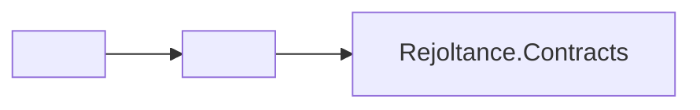

# 5.7 Szablon: Karta Modułu Inżynierskiego (Source Code Documentation)

> **Źródło prawdy:** Repozytorium (`src/<moduł>/README.md`) + Confluence PB · **Kategoria AltexSoft:** Product: System Documentation — Source Code Documentation · **Etap SDD:** Realizacja (`Implement`) · **Wymóg uczelniany:** EU5 (indywidualna ocena każdego studenta)

Każdy student opisuje w tej karcie swój moduł kodu. Zastąp pola w nawiasach `<...>`. SDD to spec-driven development (praca sterowana specyfikacją), EU — efekt uczenia się, ADR — zapis decyzji architektonicznej.

---

## Metadane modułu

| Pole | Wartość |
|---|---|
| **Nazwa modułu / pakietu** | `<np. Rejoltance.Kernel / src/web/src/components/Board>` |
| **Właściciel modułu (autor)** | `<Imię i nazwisko studenta>` |
| **Epik nadrzędny** | `<E1–E8>` |
| **Ścieżka w repozytorium** | `src/<ścieżka>` |
| **Realizowane wymagania i reguły** | `<np. R-15, R-28..R-39, NFR-01>` |
| **Powiązane decyzje ADR** | `<np. ADR-0002, ADR-0004>` |

---

## 1. Cel i odpowiedzialność modułu

- **Za co odpowiada moduł:** `<Zwięzły opis jednoznacznej odpowiedzialności komponentu>`
- **Czego moduł celowo NIE robi (granice architektoniczne):** `<np. Nie komunikuje się z bazą danych ani z siecią>`

## 2. Publiczny interfejs (Public API)

| Klasa / funkcja / komponent | Wejście → wyjście | Działanie i niezmienniki |
|---|---|---|
| `<Nazwa>` | `<Parametry → Typ zwracany>` | `<Opis>` |

## 3. Zależności i kierunek przepływu danych

- **Moduły, z których korzysta ten komponent (Imports):** `<Lista>`
- **Moduły, które korzystają z tego komponentu (Consumers):** `<Lista>`

## 4. Kluczowe decyzje implementacyjne i przypadki brzegowe

`<Dlaczego wybrane algorytmy lub struktury danych zostały zaimplementowane w ten sposób? Jak obsługiwane są sytuacje brzegowe (np. przepełnienie kolejki, remis HP, zerowe ziarno RNG)?>`

## 5. Pokrycie testami i komendy weryfikacji

| Projekt testowy / plik testu | Sprawdzane scenariusze (`R-nn`) | Komenda uruchomienia |
|---|---|---|
| `tests/<Projekt>/<PlikTestu>` | `<Lista reguł i przypadków brzegowych>` | `dotnet test --filter ...` / `npm test` |
