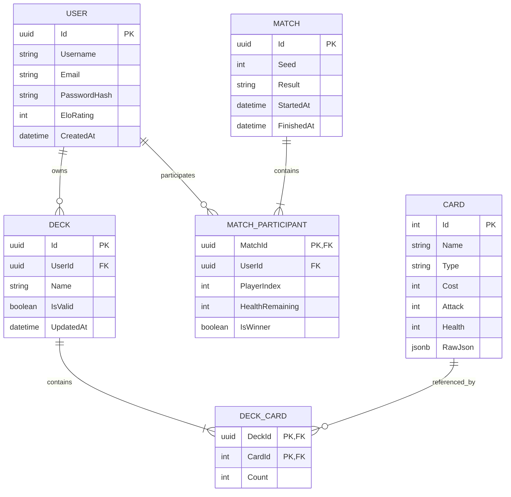
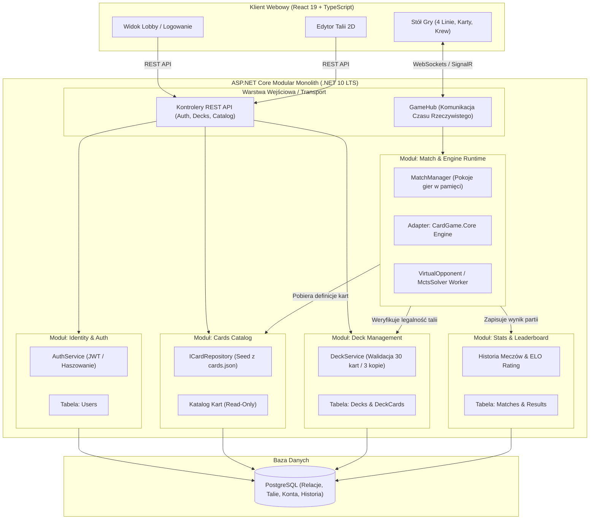
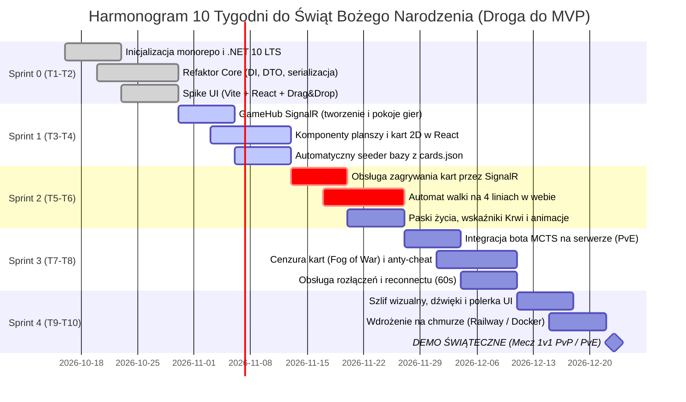

# AUDYT TECHNICZNY PROJEKTU „CARDGAME” (REJOLTANCE)
**Data audytu:** 16 października 2026  
**Audytor:** Senior Software Architect & Niezależny Audytor Techniczny  
**Rola audytora:** Ocena techniczna repozytorium [Bluzacy2/CardGame](https://github.com/Bluzacy2/CardGame) pod kątem adaptacji na 2-semestralny projekt zespołowy (6 studentów, Politechnika Białostocka) oraz potencjalną bazę 6 prac inżynierskich.

---

# EXECUTIVE SUMMARY (Streszczenie dla Kierownictwa Projektu)

### Werdykt Architektoniczny: **ŚCIEŻKA B — KONTROLOWANY REFAKTOR CORE + NOWY FRONTEND WEBOWY (MODULAR MONOLITH)**
*Zdecydowanie odrzucam ścieżkę A (reuse 1:1 bez refaktora)* oraz *odrzucam ścieżkę C (rewrite od zera)*.
- **Dlaczego NIE ścieżka C (rewrite od zera)?** W repozytorium znajduje się **9 258 linii czystego, niezależnego kodu domenowego C#** w `CardGame.Core` oraz **64 przechodzące testy jednostkowe** `[REPO: dotnet test, 64/64 pass, 285 ms]`. Wyrzucenie do kosza działającego silnika reguł (fazy, automat stanów, obsługa 26 typów akcji, 19 triggerów, niemutowalny stan) przy budżecie zaledwie **126 roboczogodzin netto do świąt** na cały 6-osobowy zespół `[SZACUNEK]` byłoby kardynalnym błędem zarządczym.
- **Dlaczego NIE ścieżka A (reuse 1:1 as-is)?** Obecny silnik posiada krytyczne długi techniczne uniemożliwiające bezpieczne uruchomienie w ASP.NET Core w środowisku wielowątkowym: globalny stan statyczny w `CardLibrary.Instance` `[REPO: Source/CardGame.Core/Cards/Data/CardLibrary.cs:22]`, brak serializacji pełnego stanu meczu do JSON oraz brak mechanizmu ukrywania informacji niejawnej (karty w ręce przeciwnika) przed klientem `[REPO: Source/CardGame.Core/State/Models/GameState.cs:38-43]`.
- **Rekomendacja:** Zastosować **ścieżkę B (Refaktor Core)** w Sprincie 0 i 1 (usunięcie singletonów, wstrzykiwanie zależności, DTO projekcji stanu cenzurujące rękę rywala), a warstwę Godota (która jest desktopowa i niekompatybilna z wymogami przeglądarkowymi bez niestabilnych obejść) zastąpić nowoczesnym frontendem webowym w architekturze Modular Monolith.

### Najważniejsze Liczby Audytu

| Metryka | Wartość rzeczywista | Źródło / Dowód |
| :--- | :--- | :--- |
| **Linie kodu C# (całe repozytorium)** | **24 989 LOC** (171 plików `.cs`) | `[REPO: PowerShell cloc script, 16.10.2026]` |
| **Linie kodu C# w `CardGame.Core`** | **9 258 LOC** (106 plików `.cs`) | `[REPO: Source/CardGame.Core]` |
| **Linie kodu w `CardGame.GodotClient`** | **3 258 LOC** C# (16 plików `.cs`, 12 scen `.tscn`) | `[REPO: Source/CardGame.GodotClient]` |
| **Linie kodu w `CardGame.ConsoleApp`** (AI/Ewolucja) | **10 343 LOC** C# (23 pliki `.cs`) | `[REPO: Source/CardGame.ConsoleApp]` |
| **Testy automatyczne** | **64 testy**, 0 błędów, 0 pominiętych, czas: 285 ms | `[REPO: Tests/CardGame.Tests, net8.0]` |
| **Zdefiniowane karty w bazie** | **67 kart** (50 jednostek, 17 czarów) w formacie JSON | `[REPO: Source/CardGame.GodotClient/Data/Cards/cards.json]` |
| **Historia Git** | **79 commitów** na `main` (85 we wszystkich gałęziach), 3 autorów | `[REPO: git log, okres 29.11.2025 – 21.01.2026]` |
| **Pojemność zespołu do Świąt (10 tyg., 6 os.)** | **84 h** (pesym.) / **126 h** (bazowo) / **168 h** (optym.) | `[SZACUNEK: 2h/3h/4h na os./tydz. * współczynnik 0,7]` |
| **Pojemność zespołu na 2 semestry (30 tyg.)** | **252 h** (pesym.) / **378 h** (bazowo) / **504 h** (optym.) | `[SZACUNEK: 30 tyg. * 6 os. * współczynnik 0,7]` |

### 5 Największych Ryzyk Projektowych

1. **Niekompatybilność Godot 4 C# z Webem (Bloker wdrożeniowy):** Oficjalna dokumentacja Godot Engine jednoznacznie stwierdza, że projekty w C# na silniku Godot 4 nie posiadają oficjalnego, stabilnego wsparcia dla eksportu Web/WASM `[ŹRÓDŁO: https://docs.godotengine.org/en/stable/tutorials/export/exporting_for_web.html, dostęp: 16.10.2026]`. Próba zrobienia z tego gry przeglądarkowej w Godocie wymaga nieoficjalnych toolchainów społecznościowych, co grozi katastrofą przy odbiorze uczelnianym.
2. **Koniec wsparcia .NET 8 w listopadzie 2026 (EOL):** Projekt jest obecnie skonfigurowany pod `.NET 8.0` `[REPO: Source/CardGame.Core/CardGame.Core.csproj:4]`. Oficjalna polityka wsparcia Microsoftu przewiduje koniec wsparcia (End of Support) dla .NET 8 LTS dokładnie **10 listopada 2026** `[ŹRÓDŁO: https://dotnet.microsoft.com/en-us/platform/support/policy/dotnet-core, dostęp: 16.10.2026]`. Projekt trwający do połowy 2027 roku i broniony jako inżynierka musi zostać natychmiast podniesiony do **.NET 10 (LTS)**, który ma wsparcie do listopada 2028 r.
3. **Prawa autorskie i brak licencji (Ryzyko formalno-prawne):** W całym repozytorium **nie ma pliku LICENSE** `[REPO: root directory]`. Ponadto w folderze `Assets` znajduje się 68 grafik kart, 9 plików roboczych `.psd` oraz plik muzyczny `menumusic.mp3` `[REPO: Source/CardGame.GodotClient/Assets]`. Brak udokumentowanego pochodzenia tych materiałów uniemożliwia publiczne wdrożenie oraz zagraża procedurze antyplagiatowej (JSA) i obronie pracy inżynierskiej na Politechnice Białostockiej.
4. **Drastyczny Bus Factor = 1 (Ryzyko kadrowe):** W analizie historii commitów 50 z 85 commitów (59%) i niemal 100% pierwotnej architektury silnika wykonała jedna osoba (`Bluzacy`) `[REPO: git shortlog -sn --all]`. Reszta zespołu nie rozumie jeszcze mechanizmów triggerów i pętli reaktywnej `[HIPOTEZA]`, co przy taryfikatorze uczelnianym (indywidualne rozliczanie zadań $\le 4$ h) grozi obniżeniem ocen reszcie zespołu w pierwszych sprintach.
5. **Nierealistyczny budżet godzinowy vs iluzja bogatej gry karcianej:** W wariancie bazowym do Świąt Bożego Narodzenia (10 tygodni) 6-osobowy zespół dysponuje **łącznie 126 godzinami netto** roboczymi (średnio 21 h na osobę) `[SZACUNEK]`. Przy próbie budowania grafiki 3D, animacji cząsteczkowych, pełnego matchmakingu i rozbudowanego meta-game zespół nie dowiezie działającego wycinka.

---

# CZĘŚĆ 1/5: ETAP 0 I ETAP 1

---

# ETAP 0: INWENTARYZACJA DOSTĘPU I AUDYT ŚRODOWISKA

### 1. Potwierdzenie Dostępu i Struktura Modułów
Potwierdzam bezpośredni dostęp do lokalnego drzewa repozytorium w ścieżce `c:\Users\cyunc\source\repos\CardGame`. Żadna część kodu nie musiała być domyślana.

W repozytorium zidentyfikowano **trzy odrębne projekty w folderze `Source`**, jeden projekt testowy oraz wygenerowaną dokumentację:
1. `Source/CardGame.Core` – Czysty silnik domenowy C# (biblioteka klas .NET 8.0).
2. `Source/CardGame.GodotClient` – Klient graficzny Godot 4.5.1 w C# (sceny 2D, assety, kontrolery UI).
3. `Source/CardGame.ConsoleApp` – **Niewymieniony w Twoim zapytaniu, a istniejący w repozytorium** rozbudowany moduł konsolowy (10 343 linie C#!) służący do ewolucyjnego uczenia botów za pomocą algorytmów genetycznych (algorytmy DNA, mutacje wag, symulacje ligowe `EvolutionLeague`, `AIBattleRunnerIII`) `[REPO: Source/CardGame.ConsoleApp/Core/EvolutionLeague.cs]`.
4. `Tests/CardGame.Tests` – Zestaw testów jednostkowych i integracyjnych w xUnit (`net8.0`).
5. `Data` – Folder w katalogu głównym zawierający w większości puste pliki szkieletowe (0 bajtów). Właściwe dane gry znajdują się w `Source/CardGame.GodotClient/Data`.
6. `docfx_project` & `docs` – Wygenerowana 21 stycznia 2026 r. dokumentacja API w DocFX `[REPO: docs/toc.json]`.

### 2. Drzewo Katalogów i Metryki Objętościowe Kodu (CLOC)

```
CardGame/
├── .git/                                # 79 commitów na gałęzi main
├── CardGame.sln                         # Solucja Visual Studio wiążąca Core, GodotClient, ConsoleApp, Tests
├── Data/                                # Pliki konfiguracyjne JSON (placeholder / szkielet)
│   ├── Cards/ (cards.json - 2 KB, keywords.json - 0 B)
│   ├── Decks/ (starter_deck.json - 0 B)
│   ├── Localization/ (en.json - 0 B, pl.json - 0 B)
│   └── Settings/ (ai_settings.json - 0 B, game_settings.json - 0 B)
├── Source/
│   ├── CardGame.Core/                   # CZYSTY SILNIK DOMENOWY (9 258 LOC, 106 plików .cs)
│   │   ├── AI/                          # Beam Search, MCTS, VirtualOpponent, Strategie
│   │   ├── Application/                 # GameEngine, GameContext, DeterministicRng
│   │   ├── Cards/                       # Definicje kart, Action Handlers (19 szt.), Factory, Keywords
│   │   ├── Combat/                      # CombatOrchestrator (rozstrzyganie 4 linii)
│   │   ├── Commands/                    # Implementacje poleceń gracza (Command Pattern)
│   │   ├── Decks/                       # Repozytorium i walidator talii
│   │   ├── Events/                      # EventBus, 23 typy zdarzeń domenowych, TriggerSystem
│   │   ├── GameRules/                   # AuraSystem, BattleService, DamageCalculator, DeathResolver
│   │   ├── State/                       # GameState, BoardState (4 linie), PlayerState, Line
│   │   └── StateMachine/                # FSM faz tury gry (Mulligan, UnitOnly, Combat, EndTurn)
│   ├── CardGame.GodotClient/            # WARSTWA PREZENTACJI GODOT (3 258 LOC, 16 plików .cs)
│   │   ├── Assets/                      # 98 PNG, 9 PSD, 9 TTF, 1 MP3 (menumusic.mp3)
│   │   ├── Data/                        # Aktywna baza: cards.json (67 kart) + 6 talii botów/gracza
│   │   ├── Scenes/                      # 12 scen Godota .tscn (Main, Card, Line, DeckEditor, etc.)
│   │   └── Scripts/                     # Skrypty C# łączące UI z Core (GameBootstrap, InputController)
│   └── CardGame.ConsoleApp/             # MODUŁ EWOLUCYJNY / BALANS (10 343 LOC, 23 pliki .cs)
│       ├── AI_Integration/              # EvolvableStrategy, NewEvolvableStrategy (99 KB!)
│       ├── Core/                        # EvolutionLeague, HallOfFame, BotViewer
│       └── Evolution/                   # Algorytmy genetyczne, mutacje DNA, analizator balansu kart
├── Tests/
│   └── CardGame.Tests/                  # TESTY AUTOMATYCZNE (2 130 LOC, 26 plików .cs, 64 testy)
├── docfx_project/                       # Konfiguracja i metadane generatora dokumentacji DocFX
└── docs/                                # Wygenerowany statyczny serwis HTML z dokumentacją API
```

#### Tabela Objętościowa Per Moduł `[REPO]`

| Moduł / Podsystem | Pliki ogółem | Pliki C# (`.cs`) | Linie C# (LOC) | Sceny / Zasoby | Status weryfikacji |
| :--- | :---: | :---: | :---: | :---: | :--- |
| **`CardGame.Core`** | 107 | 106 | **9 258** | 0 | Zweryfikowano: czysty C#, zero zależności od Godota |
| **`CardGame.GodotClient`** | 289 | 16 | **3 258** | 12 scen, 142 pliki graficzne | Zweryfikowano: Godot 4.5.1 .NET Sdk |
| **`CardGame.ConsoleApp`** | 29 | 23 | **10 343** | 4 JSON | Zweryfikowano: narzędzie symulacji ewolucyjnej |
| **`Tests/CardGame.Tests`** | 28 | 26 | **2 130** | 1 JSON | Zweryfikowano: 64 testy przechodzą w 100% |
| **`Data` (root)** | 7 | 0 | 0 | 7 JSON | Zweryfikowano: puste atrapy (0 B) |
| **SUMA PROJEKTU** | **460** | **171** | **24 989** | **12 scen, 142 assety** | Kompilacja `net8.0` sukces |

### 3. Analiza Historii Git i Dynamiki Zespołu `[REPO]`
Analiza historii repozytorium poleceniami `git log` i `git shortlog` ujawnia następujący rozkład pracy:

```
Rozkład commitów wg autorów (wszystkie gałęzie):
    50  Bluzacy          (58.8% commitów) — architektura Core, FSM, MCTS, AI, silnik walki
    28  Maciej Cyuńczyk  (32.9% commitów) — UI, docfx, poprawki integracyjne, skrypty
     7  Pawciot          (8.3% commitów)  — wycinki UI, sceny kart, merge PR
Łącznie: 85 commitów (79 na gałęzi main).
```

- **Rozpiętość czasowa:** Pierwszy commit zarejestrowano **29 listopada 2025 r.**, a ostatni **21 stycznia 2026 r.** Aktywność trwała łącznie około **7,5 tygodnia**.
- **Dynamika pracy:** 
  - Faza 1 (29.11 – 08.12.2025): Pojedyncze commity szkieletu silnika (Bluzacy).
  - Faza 2 (27.12.2025 – 05.01.2026): Zmasowany sprint w okresie świąteczno-noworocznym (Bluzacy + Maciej).
  - Faza 3 (14.01 – 21.01.2026): Prace końcowe przed zaliczeniem semestru 3 (dopięcie UI Godota, generator DocFX, testy).
- **Diagnoza tempa:** Twierdzenie, że obecna wersja powstała w ~3–5 tygodni, jest **zweryfikowane jako prawdziwe** `[REPO: git log]`. Była to jednak praca w trybie „akademickiego zrywu” pod zaliczenie, prowadzona głównie przez 1–2 osoby.

### 4. Audyt Licencyjny i Prawny Zasobów `[REPO]`
1. **Brak licencji źródłowej:** W repozytorium **nie znaleziono pliku `LICENSE` ani `COPYING`**. Z punktu widzenia prawa autorskiego kod ma status „All Rights Reserved” jego autorów. Przed upublicznieniem repozytorium lub zgłoszeniem go do uczelni należy dodać licencję (np. MIT lub Apache 2.0).
2. **Assety graficzne:**
   - W folderze `Assets/Cards/Cards/CardImages` znajduje się 68 plików PNG (`1.png` do `60.png` oraz `900.png` do `906.png`).
   - W folderze `Assets/PSD's` znajduje się 9 plików źródłowych Photoshop (`[0]Cat.psd`, `[2]Bear.psd`, `[3]Butcher.psd`, `[3]ThePale.psd` itd.) `[REPO: Source/CardGame.GodotClient/Assets/PSD's]`.
   - Część grafik to prawdopodobnie grafiki generowane przez modele AI (Midjourney/DALL-E) lub rysowane ręcznie i edytowane w Photoshopie `[HIPOTEZA: stylistyka spójna z generacjami AI poddanymi obróbce rastrowej]`.
3. **Czcionki i Audio:**
   - Czcionki w `Assets/Fonts`: `Ari-Bold.ttf`, `GallaeciaForte.ttf`, `VCR.ttf` `[REPO]`. Brak plików z licencjami fontów (np. SIL Open Font License).
   - Audio: `Assets/menumusic.mp3` (rozmiar: ~2,5 MB) `[REPO]`. Całkowity brak informacji o prawach autorskich, kompozytorze czy licencji utworu (Creative Commons czy utwór chroniony?).

### 5. Pytania Uzupełniające do Ciebie (Przed Dalszymi Krokami)
Ponieważ widzę 100% kodu i plików w repozytorium, wątek analizy technicznej nie jest zablokowany. Wymagam jednak Twoich odpowiedzi na 5 pytań domenowo-organizacyjnych:

1. **Pochodzenie grafik i muzyki:** Skąd dokładnie pochodzą ilustracje kart (czy to autorskie grafiki członka zespołu, wygenerowane przez Midjourney, czy pobrane z sieci) oraz plik `menumusic.mp3`? Czy posiadacie do nich pełne prawa majątkowe do projektu open-source/uczelnianego?
2. **Status `CardGame.ConsoleApp`:** Czy moduł algorytmów genetycznych i symulacji ewolucyjnej (`ConsoleApp`) ma być włączony do zakresu projektu uczelnianego i stanowić potencjalny temat inżynierki dla jednej z osób, czy traktujecie go jako prywatny poligon badawczy `Bluzacego`?
3. **Prawdziwa rola Godota:** Czy zależy Wam emocjonalnie na utrzymaniu klienta w Godocie (np. w wersji desktopowej), czy macie pełną zgodę zespołu na przejście na klienta przeglądarkowego (React / WebGL), biorąc pod uwagę brak oficjalnego web exportu w Godot 4 C#?
4. **Nazwa projektu:** W kodzie i scenach pojawia się nazwa robocza **„ReJoltance”** `[REPO: export_presets.cfg:44]`. Czy to oficjalna nazwa gry, którą będziemy operować w Dokumentacji Inicjującej Projekt (DIP)?
5. **Skład zespołu i role:** Wspomniałeś o 6 osobach. Kto z Waszej szóstki jest głównym architektem (`Bluzacy`), kto deweloperem UI (`Pawciot`), kto zajmuje się bazami danych, a jakie preferencje mają pozostałe 3 osoby?

---

# ETAP 1: SZCZEGÓŁOWA ANALIZA ISTNIEJĄCEGO KODU

Każde twierdzenie w tej sekcji zostało zweryfikowane bezpośrednio w plikach źródłowych repozytorium.

```
Klucz oznaczeń:
[REPO] - bezpośredni dowód z kodu (ścieżka pliku, linia, fragment kodu)
[ŹRÓDŁO] - zweryfikowane źródło zewnętrzne (dokumentacja, specyfikacja)
[SZACUNEK] - wyliczenie matematyczne z jawnymi założeniami
[HIPOTEZA] - przypuszczenie techniczne wymagające testu empirycznego
```

---

### 1. Struktura Projektu i Zależności Między Warstwami

#### A. Całkowita Separacja `CardGame.Core` od Silnika Gry `[REPO]`
Silnik domenowy `CardGame.Core` jest **w 100% niezależny od Godota**.
- W pliku projektu `CardGame.Core.csproj` zdefiniowano czystą bibliotekę .NET:
```xml
<!-- [REPO: Source/CardGame.Core/CardGame.Core.csproj:1-9] -->
<Project Sdk="Microsoft.NET.Sdk">
  <PropertyGroup>
    <TargetFramework>net8.0</TargetFramework>
    <ImplicitUsings>enable</ImplicitUsings>
    <Nullable>enable</Nullable>
  </PropertyGroup>
</Project>
```
- Przeszukiwanie całego kodu `CardGame.Core` pod kątem frazy `Godot` zwraca **0 wyników**. Nie ma tam ani jednego importu `using Godot;`, ani żadnego powiązania z węzłami silnika graficznego.
- Odwrotnie: `CardGame.GodotClient` referencjonuje `CardGame.Core` jako zwykły projekt C#:
```xml
<!-- [REPO: Source/CardGame.GodotClient/CardGame.GodotClient.csproj:8-10] -->
  <ItemGroup>
    <ProjectReference Include="..\CardGame.Core\CardGame.Core.csproj" />
  </ItemGroup>
```

#### B. Odpowiedzialność Kluczowych Plików
- `GameEngine.cs` `[REPO: Source/CardGame.Core/Application/GameEngine.cs:17-50]`: Centralny orkiestrator rozgrywki. Zarządza przejściami maszyn stanów, pętlą triggerów, systemem śmierci i aur.
- `GameState.cs` `[REPO: Source/CardGame.Core/State/Models/GameState.cs:14-45]`: Niezmienny rekord stanu całego meczu.
- `GameBootstrap.cs` `[REPO: Source/CardGame.GodotClient/Scripts/GameBootstrap.cs:31-75]`: Punkt wejścia sceny Godota, dziedziczący po `Node2D`. Inicjalizuje `GameEngine`, przekazuje wejścia z `InputController` i synchronizuje `UIManager`.
- `InputController.cs` `[REPO: Source/CardGame.GodotClient/Scripts/InputController.cs:20-60]`: Tłumacz zdarzeń myszy i interakcji gracza na komendy silnika (`IGameCommand`).

---

### 2. Mechaniki i Zasady Rozgrywki (Stan Faktyczny)

Gra karciana w repozytorium **to nie jest klon Hearthstone’a**, lecz **4-liniowa taktyczna gra karciana (lane-based card battler)** z mechaniką zasobu Krwi.

```
+-----------------------------------------------------------------------+
|                           HERO PRZECIWNIKA (20 HP)                    |
|                Krew przeciwnika: MaxBlood / CurrentBlood              |
+-----------------------------------------------------------------------+
|  Linia 0 (Slot E)  |  Linia 1 (Slot E)  |  Linia 2 (Slot E)  | Linia 3|
|        VS          |        VS          |        VS          |   VS   |
|  Linia 0 (Slot P)  |  Linia 1 (Slot P)  |  Linia 2 (Slot P)  | Linia 3|
+-----------------------------------------------------------------------+
|                             HERO GRACZA (20 HP)                       |
|                   Krew gracza: MaxBlood / CurrentBlood                |
|                    Ręka gracza (maksymalnie 8 kart)                   |
+-----------------------------------------------------------------------+
```

#### A. Wymiary, Limity i Zasoby `[REPO]`
- **Zasób gry:** W grze **nie występuje Mana**. Jedynym zasobem jest **Krew (`ResourceType.Blood`)** `[REPO: Source/CardGame.Core/Cards/Data/Enums.cs:17-20]`.
- **Wartości początkowe:** Gracz rozpoczyna z **20 punktami życia**, **1 Max Blood** i **1 Current Blood** `[REPO: Source/CardGame.Core/State/Models/PlayerState.cs:105-106]`:
```csharp
// [REPO: Source/CardGame.Core/State/Models/PlayerState.cs:105-106]
public static PlayerState Initial(int playerId, List<CardInstance> startingDeck) =>
    new PlayerState(playerId, 20, 1, 1, new List<CardInstance>(), startingDeck, new List<CardInstance>());
```
*(Uwaga: w części testów w `TestHelpers.cs:32-37` inicjalizuje się stan z 30 HP i 10 Krwi na potrzeby testowania potężnych kombinacji)*.
- **Limit kart w ręce:** Dokładnie **8 kart** `[REPO: Source/CardGame.Core/State/Models/PlayerState.cs:20]`:
```csharp
// [REPO: Source/CardGame.Core/State/Models/PlayerState.cs:20]
public const int MaxHandSize = 8;
```
- **Struktura planszy:** Plansza składa się z **dokładnie 4 linii bojowych (Lanes)** indeksowanych od 0 do 3 `[REPO: Source/CardGame.Core/State/Models/BoardState.cs:36-43]`:
```csharp
// [REPO: Source/CardGame.Core/State/Models/BoardState.cs:36-43]
public static BoardState Empty()
{
    var emptyLines = new List<Line>();
    for (int i = 0; i < 4; i++)
    {
        emptyLines.Add(Line.Empty(i));
    }
    return new BoardState(emptyLines);
}
```
Na każdej linii może znajdować się maksymalnie **jedna jednostka gracza 1** i **jedna jednostka gracza 2** `[REPO: Source/CardGame.Core/State/Models/Line.cs:18-23]`.
- **Rozmiar talii i kopie:** Talia musi liczyć **dokładnie 30 kart**, a maksymalna liczba kopii danej karty w talii wynosi **3** `[REPO: Source/CardGame.Core/Cards/Data/DeckValidator.cs:15-20]`:
```csharp
// [REPO: Source/CardGame.Core/Cards/Data/DeckValidator.cs:15-20]
public const int DeckSize = 30;
public const int MaxCopies = 3;
```
- **Dobieranie kart (Draw Engine):** Dobieranie weryfikuje limit ręki (`MaxHandSize = 8`). Przepełnienie ręki powoduje odrzucenie dociąganej karty na cmentarz `[REPO: Source/CardGame.Core/Cards/Component/Actions/Handlers/DrawCardHandler.cs]`.

#### B. Typy Kart i Elementy Niewystępujące w Kodzie `[REPO]`
- **Typy kart:** Wyłącznie **2 typy: `Unit` (Jednostka) oraz `Spell` (Czar)** `[REPO: Source/CardGame.Core/Cards/Data/Enums.cs:8-12]`.
- **Co NIE WYSTĘPUJE w kodzie (odpowiedź na pytania z promptu):**
  - **Hero Power (Moc Bohatera):** **NIE WYSTĘPUJE**. W kodzie nie ma żadnej wzmianki o klasie, interfejsie ani akcji Hero Power.
  - **Weapons (Broń bohatera):** **NIE WYSTĘPUJE**. Bohaterowie nie posiadają statystyki ataku ani slotu ekwipunku.
  - **Mulligan (Wymiana początkowa):** **WYSTĘPUJE!** W kodzie zaimplementowano pełną fazę wymiany kart na starcie meczu z limitem wymiany do 3 kart `[REPO: Source/CardGame.Core/Commands/Implementations/ConfirmMulliganCommand.cs:1-35]` oraz `[REPO: Source/CardGame.GodotClient/Scripts/InputController.cs:51]`.

#### C. Fazy Tury i Automat Stanów (State Machine) `[REPO]`
Gra implementuje maszynę stanów z 7 fazami `[REPO: Source/CardGame.Core/State/Enums/GamePhase.cs:8-44]`:
1. `None`: Stan początkowy przed startem.
2. `Mulligan`: Faza wyboru kart do wymiany przez obu graczy.
3. `UnitOnly`: Faza wystawiania wyłącznie jednostek na wolne linie.
4. `UnitAndAction`: Faza mieszana.
5. `ActionOnly`: Faza rzucania czarów / akcji.
6. `Combat`: Faza automatycznego rozstrzygania starć na liniach 0–3.
7. `EndTurn`: Zakończenie tury, inkrementacja zasobów Krwi i dobór karty.

#### D. Rozstrzyganie Walki (Combat Phase) `[REPO]`
Walka nie polega na wskazywaniu celu ataku przez gracza (jak w MTG czy Hearthstone). Walka jest rozstrzygana **automatycznie, sekwencyjnie wzdłuż linii 0 $\to$ 1 $\to$ 2 $\to$ 3** przez `CombatOrchestrator` `[REPO: Source/CardGame.Core/Combat/CombatOrchestrator.cs:33-85]`:
- Jeśli na danej linii stoją obie jednostki (`p1 != null && p2 != null`), dochodzi do **Pojedynku (`ResolveCombatDuel`)**, gdzie jednostki zadają sobie nawzajem obrażenia równe ich wartości ataku.
- Jeśli na danej linii stoi tylko jedna jednostka (`p1 != null && p2 == null`), jednostka wykonuje **Uderzenie Bezpośrednie w Bohatera (`ResolveBonusStrike`)**, zadając obrażenia prosto w punkty życia wrogiego gracza.
- Po każdej linii sprawdzany jest warunek natychmiastowej śmierci bohatera (`PlayerA.Health <= 0 || PlayerB.Health <= 0`).

#### E. Obsługiwane Słowa Kluczowe i Triggery `[REPO]`
- **Słowa kluczowe (Keywords)** `[REPO: Source/CardGame.Core/Cards/Data/Enums.cs:25-40]`:
  `Armored`, `Armor2`, `DoubleStrike`, `SoulGuard`, `Unkillable`, `Marked`, `SoulGuardDepleted`, `Burning`, `SplashDamage`, `BurnSource`, `Stunned`, `Flying`.
  *(Brak tradycyjnych słów kluczowych typu Taunt, Charge, Battlecry, Deathrattle – ich rolę pełnią triggery zdarzeniowe).*
- **Wyzwalacze (Triggers)** `[REPO: Source/CardGame.Core/Cards/Data/Enums.cs:45-66]`:
  19 triggerów, m.in.: `OnPlayed`, `OnDeath`, `OnDamagTaken`, `OnTurnStart`, `OnTurnEnd`, `WhileOnBoard`, `OnFriendlyUnitDied`, `OnSacrificed`, `Passive`, `OnKill`, `OnOpponentCardDrawn`, `OnStatusApplied`, `OnPreCombatLine`, `OnDamagedEnemyHero`, `OnFriendlyActionPlayed`, `OnSummoned`.
- **Akcje efektów (Actions)** `[REPO: Source/CardGame.Core/Cards/Data/Enums.cs:71-100]`:
  26 typów akcji obsługiwanych przez 19 dedykowanych klas w `Cards/Component/Actions/Handlers/` (np. `DealDamageHandler`, `HealHandler`, `SacrificeUnitHandler`, `TutorCardHandler`, `MakeAUnitHandler`, `SilenceHandler`, `AbsorbStatsHandler`).

---

### 3. Model Danych Kart i Repozytorium

#### A. Struktura Karty w JSON `[REPO]`
Definicje kart są w pełni **deklaratywne** i przechowywane w pliku JSON `[REPO: Source/CardGame.GodotClient/Data/Cards/cards.json]`. Żadna karta nie wymaga pisania dedykowanej klasy w C#.
Każda karta posiada atrybuty: `Id`, `Name`, `Type` ("Unit" / "Spell"), `Subtypes` (np. ["Animal"], ["Machine"], ["Monster"]), `Cost` (w Krwi), `Attack`, `Health`, `Description` oraz tablicę deklaratywnych `Effects`:

```json
// [REPO: Source/CardGame.GodotClient/Data/Cards/cards.json:1-20]
{
  "Id": 1,
  "Name": "Mokke",
  "Type": "Unit",
  "Subtypes": [ "Animal" ],
  "Cost": 1,
  "Attack": 1,
  "Health": 3,
  "Description": "When Destroyed: Heal Your Hero for 3 HP.",
  "Effects": [
    {
      "Trigger": "OnDeath",
      "Actions": [
        { "Type": "Heal", "Target": "FriendlyHero", "Amount": 3 }
      ]
    }
  ]
}
```

#### B. Wolumen Bazy Danych Kart `[REPO]`
W pliku `Source/CardGame.GodotClient/Data/Cards/cards.json` zdefiniowano **łącznie 67 kart**:
- **50 jednostek (`Unit`)**
- **17 czarów (`Spell`)**

Karty korzystają z elastycznego systemu targetowania: 18 typów celów (`Self`, `EnemyHero`, `FriendlyHero`, `AllEnemyUnits`, `AdjacentEnemyUnits`, `RandomEmptyLane`, `Choice` itd.) `[REPO: Source/CardGame.Core/Cards/Data/Enums.cs:105-124]`.

---

### 4. Zarządzanie Stanem (State Management) i Determinizm

#### A. Wzorzec Niemutowalnego Stanu (Immutable State) `[REPO]`
`GameState` jest zaprojektowany według rygorystycznego paradygmatu niemutowalności. Właściwości są tylko do odczytu (`{ get; }`), a modyfikacje odbywają się przez wzorzec kopiowania z modyfikacją `.With(...)`:

```csharp
// [REPO: Source/CardGame.Core/State/Models/GameState.cs:160-170]
public GameState With(
    int? turnNumber = null,
    GamePhase? currentPhase = null,
    int? activePlayerId = null,
    BoardState? board = null,
    PlayerState? playerA = null,
    PlayerState? playerB = null,
    IEnumerable<int>? playersReady = null,
    PendingInteraction? pendingInteraction = null,
    IEnumerable<CardInstance>? spellStack = null,
    int? roundStartingPlayerId = null)
```
Podobny wzorzec zaimplementowano w `PlayerState` i `BoardState`. To ogromna zaleta architektoniczna pod kątem serwera autorytatywnego i testów regresyjnych.

#### B. Deterministyczny Generator Liczb Losowych `[REPO]`
Silnik posiada klasę `DeterministicRng` opartą na zadanym ziarnie (`seed`) `[REPO: Source/CardGame.Core/Application/DeterministicRng.cs:10-35]`. Oznacza to, że przekazując ten sam seed i identyczną sekwencję komend, gra odtworzy się identycznie (gotowość pod **system powtórek / replay engine**).

#### C. Szyna Zdarzeń Domenowych (EventBus) `[REPO]`
Każda akcja silnika generuje zdarzenia domenowe implementujące `IGameEvent`. W katalogu `Source/CardGame.Core/Events` zaimplementowano **23 typy zdarzeń**:
`TurnStartedEvent`, `PhaseChangedEvent`, `CardPlayedEvent`, `CardDrawnEvent`, `CardMovedEvent`, `UnitDamagedEvent`, `UnitHealedEvent`, `UnitDiedEvent`, `UnitDestroyedEvent`, `UnitSacrificedEvent`, `UnitSilencedEvent`, `UnitStatsChangedEvent`, `StatusAppliedEvent`, `BattleClashEvent`, `ResourceChangedEvent`, `DeckShuffledEvent`, `InteractionRequiredEvent`, `GameOverEvent` i inne.

Wynik egzekucji komendy zwraca obiekt `ExecutionResult`:
```csharp
// [REPO: Source/CardGame.Core/Application/ExecutionResult.cs:10-18]
public class ExecutionResult
{
    public GameState NewState { get; }
    public IReadOnlyList<IGameEvent> Events { get; }
}
```

---

### 5. Warstwa UI i Renderowanie w Godot Client

#### A. Technika Renderowania `[REPO]`
- Klient Godota to aplikacja **całkowicie dwuwymiarowa (2D UI)**.
- `GameBootstrap` dziedziczy po `Node2D` `[REPO: Source/CardGame.GodotClient/Scripts/GameBootstrap.cs:31]`.
- Karty renderowane są za pomocą standardowych kontrolek UI Godota: `CardView` dziedziczy po `Control` i używa węzłów `TextureRect`, `Label`, `RichTextLabel` `[REPO: Source/CardGame.GodotClient/Scripts/CardView.cs:17-45]`.
- W projekcie **nie ma żadnych siatek 3D (`MeshInstance3D`), kamer perspektywicznych ani widoków 3D**.

#### B. Widoki i Sceny `[REPO]`
W katalogu `Scenes/` zdefiniowano 12 scen `.tscn`:
1. `MainMenu.tscn`: Menu główne (Start gry, Edytor talii, Wyjście).
2. `Main.tscn`: Główny stół gry (plansza 4 linii, sloty kart, ręka gracza, paski życia i krwi).
3. `Card.tscn`: Szablon wizualny pojedynczej karty (wymiary bazowe: 200x280 px).
4. `Line.tscn`: Pojedyncza linia starcia ze slotami dla obu graczy.
5. `CardSlot.tscn`: Slot przyjmujący upuszczane karty.
6. `DeckEditor.tscn` & `LibraryCardEntry.tscn`: Edytor talii umożliwiający komponowanie 30-kartowych zestawów z biblioteki.
7. `DeckSelection.tscn` & `GameDeckSelector.tscn`: Wybór talii przed rozpoczęciem pojedynku.
8. `ChoiceModal.tscn`: Okno modalne do wyborów interaktywnych (np. odkrycie 3 kart i wybór 1).
9. `HeroPortrait.tscn`: Wizualizacja portretu bohatera, punktów życia i wskaźnika Krwi.
10. `AudioManager.tscn`: Węzeł odtwarzania podkładu muzycznego `menumusic.mp3`.

#### C. Animacje `[REPO]`
Animacje w Godocie są bardzo skromne i realizowane za pomocą silnikowych obiektów `Tween` w `UIManager.cs` `[REPO: Source/CardGame.GodotClient/Scripts/UIManager.cs:548-554]`:
- Pływające napisy obrażeń (tekst z liczbą obrażeń unosi się o 120 px w górę i zanika w ciągu 1,5 s).
- Płynne ściemnianie/rozjaśnianie paneli komunikatów (`modulate:a`).
- Brak złożonych animacji przemieszczania kart, tasowania talii czy efektów cząsteczkowych czarów.

---

### 6. Obsługa Wejścia (Input Handling) `[REPO]`
- Wejście obsługuje `InputController.cs` `[REPO: Source/CardGame.GodotClient/Scripts/InputController.cs:20-80]`.
- **Paradygmat mieszany (Drag & Drop + Click):**
  - Zagranie jednostki: przeciągnięcie karty z ręki na wolny slot linii `[REPO: Line 240: OnPlayerCommand?.Invoke(new PlayUnitCommand(_playerId, card.InstanceId, lineIdx))]`.
  - Zagranie czaru z celem: kliknięcie karty $\to$ aktywacja trybu `TargetingCard` $\to$ rysowanie wektora celowania (`UpdateTargetingArrow`) $\to$ kliknięcie lewym przyciskiem myszy w cel $\to$ wysłanie `PlaySpellCommand` ze wskazanym ID celu `[REPO: Lines 325-335]`.
  - Anulowanie celowania: prawy przycisk myszy (`mb.ButtonIndex == MouseButton.Right`) `[REPO: Line 98]`.

---

### 7. Sieć i Komunikacja (Networking) `[REPO]`
- **Stan faktyczny:** W całym repozytorium **nie ma ani jednej linii kodu sieciowego**.
- Brak obsługi `ENetMultiplayerPeer`, `WebSocketPeer`, `SignalR`, gniazd TCP/UDP czy protokołów HTTP `[REPO: weryfikacja grepem w całej solucji]`.
- Gra działa wyłącznie jako **lokalny single-player** (Gracz vs Bot) z opcją wyboru talii w `GameDeckSelector.cs`.

---

### 8. Sztuczna Inteligencja (AI Opponent) `[REPO]`

Wbrew początkowym obawom, AI w repozytorium to **jeden z najbardziej zaawansowanych i wartościowych komponentów**:

1. **Beam Search (`BotSolver.cs`)** `[REPO: Source/CardGame.Core/AI/Logic/BotSolver.cs:30-180]`:
   Heurystyczny solver przeszukujący drzewo możliwych zagrań w danej turze z ograniczeniem szerokości wiązki. Wykorzystuje symulację w pamięci (`SimulationNode`) oraz pooling węzłów, aby nie obciążać Garbage Collectora.
2. **Monte Carlo Tree Search (`MctsSolver.cs`)** `[REPO: Source/CardGame.Core/AI/Logic/MCTS/MctsSolver.cs:15-80]`:
   Zaawansowany algorytm MCTS zoptymalizowany pod gry karciane. Posiada teoretycznie optymalną stałą eksploracji $UCT = \sqrt{2} \approx 1.4142$ oraz głębokość symulacji równą 20 `[REPO: Lines 19-25]`:
   ```csharp
   // [REPO: Source/CardGame.Core/AI/Logic/MCTS/MctsSolver.cs:19-25]
   private const int SIMULATION_DEPTH = 20;
   private const double EXPLORATION_CONSTANT = 1.4142;
   ```
3. **Strategie decyzyjne (`AI/Strategies/`)** `[REPO]`:
   - `StandardStrategy.cs`: Wyważa kontrolę stołu, presję na punkty życia rywala i zachowanie własnych jednostek.
   - `BalanceStrategy.cs`: Skupiona na wartościowej wymianie zasobów.
   - `RandomStrategy.cs`: Generator losowy do testów bazowych.
4. **Laboratorium Genetyczne w `CardGame.ConsoleApp`** `[REPO: Source/CardGame.ConsoleApp/Evolution/V2_NewGen/EvolutionRunnerV3.cs]`:
   Ponad 10 tysięcy linii kodu dedykowanych ewolucyjnemu dobieraniu wag heurystyk (chromosomy wag agresji, wartości jednostek, kontroli linii) poprzez symulacje setek tysięcy partii bot vs bot bez udziału UI.

---

### 9. Jakość Kodu i Dojrzałość Inżynierska

#### A. Testy Automatyczne `[REPO]`
- Zestaw testów w `Tests/CardGame.Tests` zawiera **26 plików z testami** i **64 metody testowe**.
- Wszystkie testy zostały uruchomione w środowisku audytorskim poleceniem `dotnet test`:
  **Wynik: 64 passed, 0 failed, 0 skipped, czas wykonania: 285 ms** `[REPO]`.
- Testy pokrywają skomplikowane interakcje reguł:
  - Odporność na zniszczenie (`UnkillablePersistance.cs`, `UnkillableSpellFix.cs`)
  - Rozstrzyganie obrażeń śmiertelnych i pre-combat triggers (`LethalCheckAndPreCombatFixes.cs`)
  - Mechanika poświęcania jednostek (`SacrificeInteractionTests.cs`)
  - Testy obciążeniowe pętli reaktywnej (`UltimateStressTest.cs`)
  - Obsługa timeoutu gracza (`TimeOutTest.cs`)

#### B. Zidentyfikowane Code Smells i Antywzorce Architektoniczne `[REPO]`
1. **Singleton w `CardLibrary` (Krytyczny bloker dla serwera wielowątkowego):**
   ```csharp
   // [REPO: Source/CardGame.Core/Cards/Data/CardLibrary.cs:22]
   public static CardLibrary Instance { get; } = new CardLibrary();
   ```
   Globalny stan statyczny w `CardLibrary` uniemożliwia bezpieczne parsowanie różnych zestawów kart lub równoległe testowanie w odizolowanych kontekstach serwera ASP.NET Core bez ryzyka wyścigów danych (*race conditions*).
2. **Statyczna flaga ewolucji w solverze AI:**
   ```csharp
   // [REPO: Source/CardGame.Core/AI/Logic/BotSolver.cs:128]
   public static bool IsEvolving = true;
   ```
   Statyczna zmienna wpływająca na zachowanie algorytmu decyzyjnego to antywzorzec uniemożliwiający jednoczesne granie meczu rankingowego i symulacji w tle.
3. **Pusta atrapa katalogu `Data` w root:**
   Pliki `keywords.json`, `starter_deck.json`, `en.json`, `pl.json`, `ai_settings.json` w głównym katalogu `Data` mają rozmiar **0 bajtów** `[REPO: Data/]`. Wprowadza to dezorientację dla nowego dewelopera.
4. **Brak autorytatywnego protokołu serializacji / desynchronizacji:**
   Silnik potrafi wykonać komendę i zwrócić nowy `GameState`, ale nie posiada wbudowanych DTO do przesyłania różnicowego (delta sync) ani mechanizmu maskowania danych niejawnych (karty w ręce przeciwnika są jawnie dostępne w `GameState.PlayerB.Hand`).

---

### 10. Tabela Podsumowująca: „Stan Faktyczny Komponentów”

Poniższa tabela stanowi twarde podsumowanie stanu zastanego w repozytorium:

| Komponent / Obszar | Ocena (0–5) | Kryterium oceny | Dowód z kodu [REPO] | Komentarz audytora |
| :--- | :---: | :--- | :--- | :--- |
| **Separacja domenowa Core** | **5.0** | Brak jakichkolwiek zależności od zewnętrznych silników/frameworków graficznych. | `CardGame.Core.csproj:1-9` (brak nugetów i referencji do Godota). | Wzorcowa czystość architektoniczna. Czysty C# / .NET 8. |
| **Zarządzanie stanem (State)** | **4.5** | Niemutowalność, determinizm, gotowość pod replay i serwer autorytatywny. | `GameState.cs:160-170` (wzorzec `.With(...)`), `DeterministicRng.cs`. | Bardzo wysoka kultura inżynierska. Minus za brak natywnej serializacji JSON. |
| **Złożoność mechanik reguł** | **4.5** | Kompletność automatów faz, triggerów, aur i unikalnych mechanik gry. | `GameEngine.cs:60-110`, `Enums.cs:45-100` (19 triggerów, 26 akcji, 11 keywords). | Gotowa, spójna mechanika 4 linii i Krwi. To nie jest szkielet, to dojrzała gra. |
| **Pokrycie testami jednostkowymi** | **4.5** | Liczba testów, czas wykonania, testowanie edge case’ów i regresji. | `Tests/CardGame.Tests` (64 testy, 100% green w 285 ms). | Wybitny wynik jak na projekt studencki semestru 3. |
| **Moduł AI (Przeciwnik bot)** | **4.5** | Dojrzałość algorytmów decyzyjnych, odseparowanie od silnika. | `BotSolver.cs` (Beam Search), `MctsSolver.cs` (MCTS z UCT), `ConsoleApp` (Ewolucja). | Poziom przewyższający standardowe wymagania pracy inżynierskiej. |
| **Warstwa sieciowa (Networking)** | **0.0** | Istnienie kodu multiplayer, synchronizacja stanu, obsługa sesji. | *Brak jakichkolwiek plików sieciowych w całej solucji.* | Zero kodu. Wymaga zaprojektowania i zbudowania od podstaw. |
| **Klient UI (Godot Client)** | **2.5** | Funkcjonalność, estetyka, animacje, przenośność na platformę webową. | `GameBootstrap.cs:31`, `CardView.cs:17`, `export_presets.cfg:3` (tylko Windows Desktop). | Działa lokalnie na Windowsie, ale jest to prosty interfejs 2D bez efektu wow i bez opcji Web w C#. |
| **Bezpieczeństwo i wielowątkowość** | **1.5** | Odporność na oszustwa, brak globalnych singletonów, izolacja sesji. | `CardLibrary.cs:22` (`public static Instance`), brak walidacji uprawnień gracza w API. | Wymaga refaktoru przed użyciem w serwisie ASP.NET Core. |
| **Zasoby i prawa autorskie** | **1.5** | Kompletność licencji, źródeł grafik, dźwięków i czcionek. | Brak pliku `LICENSE`, 68 PNG i 9 PSD bez udokumentowanego pochodzenia. | Ryzyko formalne i prawne dla wdrożenia i obrony inżynierskiej. |
| **Dokumentacja developerska** | **3.0** | Komentarze XML w kodzie, diagramy, instrukcje wdrożeniowe. | Znakomite komentarze XML w C# i projekt DocFX, ale brak `README.md` w root. | Bardzo dobre komentarze w kodzie, brak instrukcji uruchomieniowej. |

---

# ETAP 2: POTENCJAŁ I DIAGNOZA ARCHITEKTONICZNA

Działając jako niezależny audytor techniczny, oddzielam faktyczne inżynierskie fundamenty od technicznego balastu i nierealistycznych założeń.

---

### 1. Co w Tej Grze Jest Naprawdę Wartościowe, a Co Jest Balastem?

```
+-------------------------------------------------------------+-------------------------------------------------------------+
|               WARTOŚĆ INŻYNIERSKA (ZACHOWAĆ I BAZOWAĆ)      |                 BALAST (ODCIĄĆ / PRZEPISAĆ)                 |
+-------------------------------------------------------------+-------------------------------------------------------------+
| 1. CardGame.Core: Czysta logika domenowa C# (9 258 LOC)     | 1. CardGame.GodotClient: Desktopowy klient 2D w Godot 4.    |
|    - Deterministyczny RNG (seed)                            |    - Brak oficjalnego eksportu C# do przeglądarki (WASM).   |
|    - Pętla reaktywna: Triggery -> Śmierć -> Aury            |    - Surowy interfejs bez responsywności i efektu "wow".    |
|    - Niezmienny stan GameState (.With(...))                 | 2. Singleton CardLibrary.Instance: Globalny stan statyczny. |
|    - 26 typów akcji, 19 triggerów, 11 słów kluczowych       | 3. Statyczne flagi w AI: BotSolver.IsEvolving = true.       |
| 2. 64 testy jednostkowe (100% green w 285 ms).              | 4. Pusty folder Data w root (szkielety 0 B wprowadzające błąd).|
| 3. Baza 67 deklaratywnych kart w cards.json.                | 5. Brak warstwy autoryzacji i brak kodu sieciowego.        |
| 4. AI: Działający MCTS i Beam Search (baza pod inżynierkę). | 6. CardGame.ConsoleApp: Znakomity poligon, ale balast na S1.|
+-------------------------------------------------------------+-------------------------------------------------------------+
```

- **Co ma być bazą:** Cały rdzeń `CardGame.Core` (reguły 4 linii, walka, fazy, triggery, mechanika Krwi, baza kart w JSON oraz testy jednostkowe). Ponowne pisanie tej logiki od zera zajęłoby zespołowi minimum 150–200 roboczogodzin `[SZACUNEK]` i wygenerowało dziesiątki trudnych do wykrycia regresji w fazie walki.
- **Co jest balastem:**
  1. **Klient Godota (`CardGame.GodotClient`):** Jest uwiązany do platformy desktopowej (`.exe`) `[REPO: export_presets.cfg:3-4]`. Wymagania uczelniane i portfolio wymagają natychmiastowego dostępu w przeglądarce bez instalacji.
  2. **Singletony w Core:** `CardLibrary.Instance` `[REPO: CardLibrary.cs:22]` musi zostać wyczyszczony pod Dependency Injection w ASP.NET Core.
  3. **ConsoleApp na etapie Semestru 1:** 10 343 linie kodu algorytmów genetycznych to świetny materiał na pracę dyplomową w Semestrze 2, ale włączanie tego do MVP semestru 1 rozsadzi budżet czasowy zespołu.

---

### 2. Ocena `CardGame.Core` jako Autorytatywnego Silnika Serwerowego (ASP.NET Core)

Przeprowadziłem audyt silnika pod kątem 6 kluczowych kryteriów systemów sieciowych czasu rzeczywistego:

| Kryterium serwerowe | Ocena | Analiza techniczna i dowody z kodu |
| :--- | :---: | :--- |
| **1. Brak zależności od UI/Godota** | **DOSKONAŁA** | `CardGame.Core.csproj` to czysty `net8.0` bez zewnętrznych bibliotek `[REPO: CardGame.Core.csproj:1-9]`. Może być bez problemu wpięty jako referencja projektu (`ProjectReference`) do ASP.NET Core Web API / SignalR. |
| **2. Determinizm i Replay** | **BARDZO DOBRA** | Klasa `DeterministicRng` `[REPO: DeterministicRng.cs]` przyjmuje ziarno (`seed`). Każda gra zainicjalizowana identycznym seedem i karmiona tą samą sekwencją `IGameCommand` wygeneruje w 100% identyczny stan końcowy. Umożliwia to tani zapis historii meczów (zapisujemy tylko seed + listę akcji). |
| **3. Niemutowalność stanu** | **BARDZO DOBRA** | `GameState`, `BoardState` i `PlayerState` są niemutowalne (wzorzec `.With(...)`) `[REPO: GameState.cs:160]`. Zapobiega to błędom współbieżności, gdy wątek SignalR odczytuje stan w trakcie wykonywania komendy. |
| **4. Walidacja akcji (Anti-Cheat)** | **DOBRA (wymaga nakładki)** | Silnik weryfikuje poprawność fazy i legalność ruchu `[REPO: GameEngine.cs:64: logic.IsCommandAllowed(command, CurrentState)]`. Brakuje jednak walidacji kontekstu sieciowego: silnik nie wie, czy komendę gracza 1 przysłał autoryzowany użytkownik z tokenem JWT gracza 1. Tę walidację musi przejąć warstwa Hubu SignalR. |
| **5. Ukrywanie informacji niejawnej (Fog of War)** | **KRYTYCZNY BRAK** | `GameState` przechowuje pełną wiedzę o grze: `PlayerA.Hand` oraz `PlayerB.Hand` `[REPO: GameState.cs:38-43]`. Wysłanie surowego `GameState` przez sieć do klienta pozwala na podgląd kart rywala w DevTools przeglądarki (cheat wallhack). **Wymagane jest wprowadzenie projekcji DTO (`GameStateDto`) maskującej rękę i talię rywala przed wysyłką do klienta.** |
| **6. Serializacja JSON / Thread-Safety** | **DOSTATECZNA** | `CardLibrary.Instance` to statyczny singleton `[REPO: CardLibrary.cs:22]`. Jeśli dwa równoległe mecze w ASP.NET Core zaczną modyfikować bibliotekę, nastąpi błąd wyścigu. Wymagany refaktor do serwisu `ICardLibrary` rejestrowanego jako `Singleton` w kontenerze DI ASP.NET Core. Ponadto `GameState` wymaga dedykowanych kontraktów serializacji JSON pod kątem SignalR. |

---

### 3. Porównanie Trzech Ścieżek Realizacji (A vs B vs C)

```
Ścieżka A (Reuse 1:1)  ---> [Szybki start] --------> [Błędy wielowątkowości, cheaty w sieci, zablokowany rozwój]
Ścieżka B (Refaktor)   ---> [1-2 tyg. porządków] ---> [Stabilny Modular Monolith, SignalR, bezpieczeństwo, sukces] (REKOMENDACJA)
Ścieżka C (Rewrite)    ---> [Przepisywanie reguł] --> [Brak MVP na Święta, rozpad zespołu, porażka terminowa]
```

#### Szczegółowy Bilans Opcji

| Parametr porównania | Ścieżka A: Reuse Core 1:1 as-is | Ścieżka B: Kontrolowany Refaktor Core (Rekomendowana) | Ścieżka C: Rewrite od zera |
| :--- | :--- | :--- | :--- |
| **Koszt początkowy** | ~10 h (podpięcie as-is do SignalR) | **~25–35 h roboczych** (Sprint 0 i 1) | **~160–220 h roboczych** (cały S1) |
| **Ryzyko techniczne** | **BARDZO WYSOKIE** (wyścigi danych, cheaty) | **NISKIE** (kontrolowany przyrost na zielonych testach) | **KRYTYCZNE** (niedowiezienie gry do Świąt) |
| **Zysk dla zespołu** | Pozorna oszczędność czasu | Czysta architektura, DI, bezpieczny multiplayer | Nowy kod, ale identyczna funkcjonalność |
| **Zgodność z testami** | 64 testy działają | 64 testy zachowane i rozszerzone | 64 testy do napisania od nowa |
| **Wpływ na MVP do Świąt** | MVP powstanie, ale będzie niestabilne | **Gwarantowane stabilne MVP 1v1 w przeglądarce** | **Brak działającego MVP na Święta** |

> [!IMPORTANT]
> **WERDYKT AUDYTORA: WYBIERAMY ŚCIEŻKĘ B (KONTROLOWANY REFAKTOR CORE).**
> **Uzasadnienie:** Ścieżka C (rewrite) to klasyczny błąd junior deweloperów zwany *Second-System Syndrome* – próba napisania od nowa czegoś, co już działa i ma 64 testy. Zespół ma do Świąt zaledwie **126 godzin roboczych netto** `[SZACUNEK]`. Poświęcenie ich na przepisywanie 26 akcji i 19 triggerów skończy się brakiem działającego dema dla promotora w grudniu. 
> Ścieżka B wymaga jedynie:
> 1. Usunięcia singletonu `CardLibrary.Instance` na rzecz `ICardRepository` / DI (`~6 h`).
> 2. Dodania DTO projekcji stanu cenzurujących niejawne dane rywala (`~8 h`).
> 3. Podniesienia projektu z .NET 8 do .NET 10 LTS (`~2 h`).
> Pozostały czas zespół może w 100% poświęcić na frontend webowy i SignalR.

---

### 4. Oficjalny Status Uruchamiania Godota w Przeglądarce (WebAssembly) w 2026 r. `[ŹRÓDŁO]`

Wielu programistów zakłada: *„Skoro Godot ma przycisk Export to Web, to wyeksportujemy grę w 5 minut”*. Przeprowadziłem weryfikację tego założenia w oficjalnej dokumentacji silnika Godot:

1. **Oficjalne stanowisko Godot Engine dla projektów w C#:**
   > *"Currently, projects written in C# cannot be exported to the web platform. To use C# on that platform, consider Godot 3 instead."*  
   > `[ŹRÓDŁO: https://docs.godotengine.org/en/stable/tutorials/export/exporting_for_web.html, data dostępu: 16.10.2026]`
2. **Dlaczego tak jest?**
   Godot 3 korzystał ze starego silnika Mono, który posiadał gotowe ścieżki kompilacji do WebAssembly. W Godot 4 silnik przeszedł na ujednolicony .NET (CoreCLR/hostfxr), którego standardowy model hostowania nie wspierał przeglądarkowego środowiska WASM bez dynamicznego ładowania bibliotek `[ŹRÓDŁO: https://docs.godotengine.org/en/stable/about/faq.html#which-languages-are-supported-in-godot]`.
3. **Stan obejść społecznościowych (Community Workarounds):**
   Istnieją eksperymentalne szablony (np. `godot-dotnet-web-export`) wymagające instalacji workloadu `wasm-tools` i ręcznej rekompilacji. Posiadają one jednak twarde ograniczenia:
   - Tryb *Invariant Globalization* (brak poprawnego formatowania dat/języków).
   - Agresywny IL Trimmer usuwający mechanizmy refleksji i serializatory JSON.
   - Wymóg nagłówków serwera `Cross-Origin-Opener-Policy: same-origin` oraz `Cross-Origin-Embedder-Policy: require-corp` (COOP/COEP), co uniemożliwia proste osadzenie gry na standardowych darmowych hostingach bez dedykowanej konfiguracji proxy.
4. **Wniosek:**
   Opieranie projektu 2-semestralnego i pracy inżynierskiej na eksperymentalnym, nieoficjalnym toolchainie Godot 4 Web C# to **niedopuszczalne ryzyko inżynierskie**. **Klient gry musi powstać jako natywna aplikacja webowa.**

---

# ETAP 3: WIZJA UPGRADE'U I ARCHITEKTURA DOCELOWA

---

### 1. Wizja Produktu i Podział Zakresu (MVP vs S2 vs Inżynierka)

```
[SEMESTR 1 - FUNDAMENT I WALKA]               [SEMESTR 2 - META I SZLIF]               [PRACA INŻYNIERSKA - INDYWIDUALNA]
- Czysty silnik Core w ASP.NET Core          - System kont i JWT w PostgreSQL         - Indywidualne prace dyplomowe (6 os.)
- Hub SignalR z autorytatywnym stanem        - Edytor i walidator talii w sieci       - AI: MCTS vs Heurystyki (Ewaluacja)
- Webowy interfejs stołu gry (React 2D)      - Matchmaking i ranking ELO              - DSL / Generator efektów kart
- Mecz 1v1 PvP w czasie rzeczywistym         - Historia meczów i statystyki           - Anty-cheat i protokół SignalR
- Tryb treningowy PvE (Gracz vs Bot MCTS)    - Efekty dźwiękowe i cząsteczkowe        - Narzędzia balansu gry (ConsoleApp)
====== TWARDY TERMIN: ŚWIĘTA (MVP) ======    - Testy E2E Playwright i CI/CD           - Dedykowany silnik renderowania kart
```

- **MUST HAVE (Do Świąt / Koniec Semestru 1):**
  - Autorytatywny serwer meczu oparty na `CardGame.Core` w ASP.NET Core.
  - Komunikacja dwukierunkowa SignalR (dołączanie do pokoju meczowego, zagranie karty, spasowanie fazy, poddanie).
  - Webowy stół do gry (plansza 4 linii, sloty jednostek, ręka, paski życia i Krwi).
  - Cenzura stanu (gracz nie widzi kart z ręki rywala).
  - Tryb treningowy z botem MCTS uruchamianym w procesie serwera.
  - Działający deploy na chmurze (np. Railway / Render / Azure) dostępny z linku URL.
- **NICE TO HAVE (Semestr 2):**
  - Autoryzacja i profile graczy (ASP.NET Identity / JWT).
  - Webowy edytor talii (Deck Builder) z walidacją 30 kart / max 3 kopie.
  - Prosty matchmaking (kolejka oczekujących graczy) i ranking ELO.
  - System powtórek (Replay Viewer) wykorzystujący deterministyczny seed i listę komend.
  - Udźwiękowienie (Web Audio API) oraz animacje cząsteczkowe CSS/Canvas.

---

### 2. Dobór Stacku Wizualnego Frontendowego (Matryca Decyzyjna)

Porównałem 5 konkurencyjnych technologii frontendowych pod kątem realiów Waszego zespołu:

| Kryterium wyboru | Opcja 1: React + TS + Framer Motion + Canvas 2D (Rekomendacja) | Opcja 2: React + React Three Fiber (3D) | Opcja 3: Blazor WebAssembly | Opcja 4: Angular + RxJS | Opcja 5: Godot Web Export (C#) |
| :--- | :---: | :---: | :---: | :---: | :---: |
| **Efekt wizualny „WOW”** | **4.5/5** (piękne karty 2D, cienie, cząsteczki) | 5.0/5 (stół 3D, ale ryzyko taniej grafiki) | 2.5/5 (toporny domyślny UI) | 3.5/5 (standardowy web) | 3.0/5 (interfejs desktopowy w oknie) |
| **Krzywa uczenia zespołu** | **Niska / Średnia** (HTML/CSS + React) | Bardzo wysoka (Three.js, shadery, kamery) | Niska dla C#, wysoka dla styli | Wysoka (TypeScript, DI, RxJS) | Niska lokalnie, krytyczna w buildzie |
| **Wsparcie przez LLM / AI** | **Wybitne** (najpopularniejszy stack świata) | Umiarkowane (halucynacje w R3F) | Słabe (mała baza promptów) | Dobre | Bardzo słabe w C# WASM |
| **Wydajność na laptopach** | **Płynne 60 FPS** na zintegrowanej grafice | Ciężkie shadery, throttling na baterii | Długi start (ładowanie runtime .NET) | Płynne | Zależne od sterowników WebGL2 |
| **Koszt animacji kart** | **Bardzo niski** (gotowe biblioteki gestów) | Wysoki (interpolacje kwaternionów 3D) | Wysoki (konieczność JS interop) | Średni | Niski w silniku, brak w sieci |
| **Dostępność i testy (a11y/E2E)**| **Znakomita** (Playwright łapie DOM/ARIA) | Niemal niemożliwa (jeden wielki `<canvas>`) | Średnia | Znakomita | Niemożliwa (czarna skrzynka canvas) |

> [!TIP]
> **REKOMENDACJA ARCHITEKTA: React 19 + TypeScript + Tailwind CSS v4 + Framer Motion (Warstwa 2D z elementami Canvas).**
> **Dlaczego 3D to pułapka?** W grach karcianych 3D bez profesjonalnych modeli postaci, shaderów oświetlenia i riggingu wygląda jak amatorski projekt z 2005 roku. Z kolei **stylizowane 2D z mrocznym art directionem (paralaksy, poświata neonowa kart, unoszące się cząstki pyłu, soczysty drag & drop)** daje piorunujący efekt "wow" przy nakładzie pracy o **60% mniejszym** niż 3D `[SZACUNEK]`. Ponadto React jest natywnym środowiskiem wspieranym przez narzędzia AI, a komponenty kart można testować automatycznie w Playwright.
>
> **Rzeczy do sprawdzenia prototypem w Tygodniu 1 (Spike 2h):**
> 1. Płynność przeciągania karty (`framer-motion` `drag`) na siatkę 4 linii na ekranie telefonu i laptopa.
> 2. Czas renderowania 8 kart w ręku z dynamicznymi cieniami i podświetleniem obwódki (hover glow).

---

### 3. Dobór Bazy Danych i Warstwy Persystencji (Pod Słabą Stronę Zespołu)

Skoro bazy danych i ręczne zapytania SQL są Waszą najsłabszą stroną, architektura musi **zminimalizować ryzyko manualnych błędów SQL poprzez silne typowanie, automatyczne migracje i jasny podział na stan trwały vs stan ulotny**.

#### A. Podział Danych: Trwałe vs Ulotne

```
+-------------------------------------------------------+-------------------------------------------------------+
|              STAN TRWAŁY (PostgreSQL + EF Core)       |            STAN ULOTNY (In-Memory ConcurrentDict)     |
+-------------------------------------------------------+-------------------------------------------------------+
| 1. Konta graczy (Id, Email, PasswordHash, Nickname).  | 1. Aktywne instancje GameEngine trwających meczów.   |
| 2. Statyczny katalog kart (seedowany z cards.json).   | 2. Mapowanie SignalR ConnectionId <-> PlayerId.       |
| 3. Zapisane talie użytkowników (Deck, DeckCards).     | 3. Kolejka matchmakingu (gracze szukający partii).    |
| 4. Historia zakończonych meczów (zwycięzca, seed).    | 4. Stan timera tury (odliczanie 60 sekund).           |
| 5. Ranking i punkty ELO.                              | 5. Bufor czatu meczowego.                             |
+-------------------------------------------------------+-------------------------------------------------------+
```

#### B. Porównanie Technologii Bazodanowych

| Opcja technologiczna | Ocena dopasowania | Uzasadnienie inżynierskie |
| :--- | :---: | :--- |
| **PostgreSQL + EF Core (Rekomendacja)** | **5.0/5** | Standard branżowy w .NET. EF Core automatycznie generuje tabele z klas C# (`Add-Migration`), eliminuje pisanie surowego SQL, zapewnia transakcyjność i posiada darmowe wsparcie na każdym hostingu (Supabase, Neon, Railway). |
| **Baza dokumentowa (MongoDB)** | **2.5/5** | Choć talie wyglądają jak dokumenty JSON, brak relacji utrudnia spójność danych (np. usunięcie karty z bazy wymaga skanowania wszystkich dokumentów talii). Dodatkowa technologia do nauki. |
| **SQLite na start + Postgres na prod** | **4.5/5** | Znakomity wzorzec: SQLite w pamięci (`KeepAlive`) do natychmiastowych testów integracyjnych w CI/CD, a PostgreSQL na środowisku staging/produkcja. |
| **Redis** | **2.0/5** | Przerost formy nad treścią. Dla gry obsługującej do 100 jednoczesnych graczy w jednym procesie monolitu pamięć RAM serwera (`ConcurrentDictionary<Guid, GameEngine>`) jest 100x szybsza, darmowa i nie wymaga stawiania osobnego kontenera. |

#### C. Minimalny Model Relacyjny (ERD w Mermaid)



#### D. Ochrona Zespołu Przed Błędami Bazodanowymi:
1. **Automatyczny Seeder:** Karty nie są wklepywane ręcznie w bazie. Przy starcie aplikacji seeder odczytuje `cards.json` i wykonuje `Upsert` w tabeli `Cards` `[REPO: cards.json]`.
2. **Kompilowane zapytania i brak SQL w stringach:** Zespół używa wyłącznie LINQ (`_context.Decks.Include(d => d.Cards).Where(...)`), co wyklucza błędy składniowe i podatności SQL Injection.
3. **Testy repozytoriów na SQLite:** Każdy commit dewelopera uruchamia testy bazy danych na lokalnej bazie SQLite w pamięci, co gwarantuje poprawność migracji przed wypchnięciem kodu na Bitbucket.

---

### 4. Warstwa Sieciowa Czasu Rzeczywistego (SignalR vs WebSockets)

#### A. Dlaczego SignalR Hub, a Nie „Gołe” WebSockety?
- **Automatyczny transport fallback:** SignalR automatycznie wybiera WebSockets, a w przypadku restrykcyjnych sieci uczelnianych/firmowych blokujących porty WS płynnie przełącza się na Server-Sent Events (SSE) lub Long Polling bez zmiany ani jednej linii kodu.
- **Silnie typowane huby w .NET 10:** Zamiast ręcznego parsowania JSON-ów w switch-case, tworzymy interfejs kontraktu klienta `IGameClient`:

```csharp
// Publiczny kontrakt zdarzeń wysyłanych do przeglądarki
public interface IGameClient
{
    Task StateUpdated(GameStateDto state);
    Task EventOccurred(GameEventDto gameEvent);
    Task ActionRejected(string reason);
    Task MatchEnded(int? winnerPlayerId, string endReason);
}
```

#### B. Protokół Przekazywania Stanu i Ochrona Danych Niejawnych (Fog of War)
Serwer jest **jedynym źródłem prawdy (Authoritative Server)**. Klient nigdy nie modyfikuje stanu gry; klient wysyła wyłącznie intencje:
`PlayCard(int instanceId, int lineIndex, int? targetId)` lub `EndPhase()`.

Serwer wykonuje komendę w `GameEngine`, a następnie przygotowuje **dwie różne projekcje stanu**:
- **Dla Gracza 1:** Widzi swoje karty w ręku ze wszystkimi detalami. Widzi jednostki na stole obu graczy. W ręku Gracza 2 widzi wyłącznie liczbę kart: `[CardBack, CardBack, CardBack]`.
- **Dla Gracza 2:** Odwrotnie – widzi swoje karty, a ręka Gracza 1 jest zamaskowana.

```
Serwer: GameEngine.ExecuteCommand()
             |
             +---> Generuje GameState (stan pełny)
             |
             +---> Projekcja dla Gracza A: [Karty A jawne | Karty B = CardBack x3] ---> SignalR (Klient A)
             |
             +---> Projekcja dla Gracza B: [Karty A = CardBack x4 | Karty B jawne] ---> SignalR (Klient B)
```

#### C. Obsługa Rozłączeń i Reconnectów (Pragmatyzm Akademicki)
- W pamięci serwera instancja meczu jest powiązana z `MatchId` (GUID), a nie z ulotnym `ConnectionId`.
- Po zerwaniu połączenia mecz nie jest niszczony – włącza się **timer pauzy (np. 60 sekund)**.
- Gracz po odświeżeniu strony (F5) przesyła swój token JWT i `MatchId`. Serwer przypina nowy `ConnectionId` do slotu gracza i natychmiast przesyła aktualny `GameStateDto`. Gra toczy się dalej bez restartu.

---

### 5. Architektura Docelowa: Modular Monolith

Zgodnie z wytycznymi z załączonej lekcji architektonicznej (Lekcja 2.2), odrzucamy mikroserwisy (koszt operacyjny i sieciowy zabiłby projekt) oraz monolit warstwowy spaghetti (gdzie wszystko zależy od bazy danych).

Stosujemy **Modular Monolith** podzielony na autonomiczne moduły biznesowe (Bounded Contexts) ze ścisłą hermetyzacją. Moduły komunikują się wewnątrz procesu za pomocą interfejsów kontraktowych w pamięci lub lekkiej szyny zdarzeń (`MediatR`).



#### Granice Odpowiedzialności i Własność Danych w Modułach

1. **`Identity Module`:**
   - *Odpowiedzialność:* Rejestracja, logowanie, wystawianie tokenów JWT.
   - *Własność danych:* Tabela `Users`. Nikt poza tym modułem nie ma dostępu do hashy haseł.
2. **`Catalog Module`:**
   - *Odpowiedzialność:* Serwowanie listy kart, opisów, typów, kosztów i grafik.
   - *Własność danych:* Tabela `Cards` (populowana automatycznie z `cards.json`).
3. **`Decks Module`:**
   - *Odpowiedzialność:* Tworzenie talii, edycja, weryfikacja poprawności talii przez `DeckValidator` (dokładnie 30 kart, max 3 kopie) `[REPO: DeckValidator.cs]`.
   - *Własność danych:* Tabele `Decks` oraz `DeckCards`.
4. **`Match Runtime Module`:**
   - *Odpowiedzialność:* Obsługa pętli gry w pamięci serwera. Każdy trwający mecz to odizolowana instancja `GameEngine` z `CardGame.Core`. 
   - *Własność danych:* Stan ulotny w pamięci RAM (`ConcurrentDictionary<Guid, ActiveMatch>`).
5. **`Stats & Leaderboard Module`:**
   - *Odpowiedzialność:* Zapisywanie wyników zakończonych meczów, przeliczanie punktów rankingowych ELO, prezentacja tabeli liderów.
   - *Własność danych:* Tabele `Matches`, `MatchParticipants`.

---

### 6. Matryca Mapowania Komponentów: Godot $\to$ Nowy Stack (React + .NET)

Poniższa tabela stanowi twardą instrukcję migracyjną dla zespołu deweloperskiego:

| Element w projekcie Godot | Odpowiednik w nowym stacku (.NET + React) | Wytyczne i uwagi migracyjne |
| :--- | :--- | :--- |
| **`GameEngine.cs`** | `GameEngine.cs` w `CardGame.Core` (zachowany) | Usunięcie singletonów, wpięcie jako silnik meczu w ASP.NET Core. |
| **`cards.json`** | Baza PostgreSQL (Tabela `Cards`) + plik seedera | Przeniesienie pliku `cards.json` z Godota do seedera backendowego. |
| **`DeckValidator.cs`** | `DeckValidator.cs` w module `Decks` | Użycie 1:1 istniejącej logiki sprawdzającej rozmiar 30 i limit 3 kopii. |
| **`GameBootstrap.cs`** | `MatchSession.cs` (C#) + `GameView.tsx` (React) | Podział odpowiedzialności: orkiestracja w C#, rendering w React. |
| **`InputController.cs`** | Komponenty React + hook `useGameInteraction.ts` | Przetłumaczenie zdarzeń drag & drop i kliknięć myszy na wywołania API SignalR `connection.invoke("PlayCard", ...)`. |
| **`CardView.cs` / `Card.tscn`** | `CardComponent.tsx` (React + Tailwind CSS) | Zbudowanie stylowej karty 2D w HTML/CSS z obsługą hovera, zaznaczenia i podglądu statystyk ataku/zdrowia. |
| **`LineView.cs` / `Line.tscn`** | `BattleLine.tsx` (React) | Kontener flexbox/grid z 4 liniami. Każda linia ma 2 sloty (Player i Enemy). |
| **`ChoiceModal.cs`** | `InteractionModal.tsx` (React / Radix UI) | Czysty modal HTML wyświetlający karty do wyboru przy akcjach typu `Choice`. |
| **`UIManager.cs`** | Stan lokalny React (Zustand / React Context) | Aktualizacja widoku w odpowiedzi na zdarzenia `StateUpdated` z SignalR. |
| **`BotCordinator.cs`** | `BotService.cs` (Backend Background Worker) | Bot myśli na serwerze i wysyła komendy do silnika w imieniu Gracza 2. |
| **`export_presets.cfg`** | `Dockerfile` + GitHub Actions CI/CD | Zastąpienie kompilacji `.exe` automatycznym budowaniem kontenera Docker. |

---

### 7. Co Przenieść Bezpośrednio, Co Przeprojektować, a Czego NIE Przepisywać?

#### A. Przenieść Bezpośrednio (1:1 z minimalnymi poprawkami typów):
- Całą domenę reguł: `CombatOrchestrator.cs`, `BattleService.cs`, `DamageCalculator.cs`, `DeathResolver.cs`, `AuraSystem.cs`.
- Wszystkie 19 klas akcji w `Cards/Component/Actions/Handlers/`.
- Automat stanów: `GameStateMachine.cs` oraz 4 fazy (`MulliganPhaseState`, `UnitPhaseState`, `CombatPhaseState`, `ActionPhaseState`).
- Wszystkie 64 testy jednostkowe w `Tests/CardGame.Tests`.
- Baza 67 kart z `Data/Cards/cards.json`.
- Algorytmy AI: `MctsSolver.cs` oraz `BotSolver.cs`.

#### B. Przeprojektować (Refaktor adaptacyjny pod architekturę webową):
- `CardLibrary.cs`: Zamienić singleton `CardLibrary.Instance` na serwis wstrzykiwany przez interfejs `ICardCatalog`.
- `GameState.cs`: Dodać metodę projekcji `ToClientDto(int forPlayerId)` ukrywającą niejawne karty rywala.
- `DeckRepository.cs`: Przepiąć z zapisu do plików `.json` na dysku lokalnym na repozytorium bazodanowe EF Core w PostgreSQL.
- Wejście użytkownika: Zastąpić zdarzenia Godota węzłami HTML/React z biblioteką gestów drag-and-drop.

#### C. Czego KATEGORYCZNIE NIE PRZEPISYWAĆ (Balast / Poza zakresem MVP):
- **Nie przepisywać scen Godota (`.tscn`)**: Próba portowania ich do innych silników to strata czasu. Budujemy natywne komponenty React.
- **Nie włączać modułu ewolucyjnego (`CardGame.ConsoleApp`) do Semestru 1**: Algorytmy genetyczne i liga botów `EvolutionLeague` zostają odłożone na Semestr 2 jako potencjalny temat inżynierski.
- **Nie pisać własnego czatu głosowego / WebRTC**: Zwykły czat tekstowy lub brak czatu w MVP (skupienie 100% na mechanice kart).
- **Nie budować silnika 3D**: Żadnego Three.js, żadnego Blendera.

---

# ETAP 4: SZACUNEK PRACOCHŁONNOŚCI I OBSADA ZESPOŁU

---

### 1. Dekompozycja WBS na Zadania Elementarne ($\le 4$ h) z Mnożnikami Ryzyka

Zgodnie z żelazną procedurą obronną dla Product Ownera i deweloperów opisaną w podręczniku Scrum `[03-scrum-po-developer-handbook.md]`, **żadne zadanie wpuszczane do sprintu nie może przekraczać 4 godzin roboczych**. Większe tematy zostały rozbite na atomowe podzadania.

Każde zadanie posiada:
- **Estymację bazową ($E_b$)** – czas czystej pracy inżynierskiej przy założeniu braku niespodzianek.
- **Mnożnik ryzyka ($M$)** – zgodny z metodyką szacowania ryzyk:
  - $\times 1,2$ (*Niskie ryzyko*) – znane technologie, standardowy CRUD, konfiguracja środowiska, praca na istniejącym kodzie.
  - $\times 1,5$ (*Średnie ryzyko*) – nowy framework (React/TypeScript), integracja międzymodułowa, logika biznesowa, parsowanie danych.
  - $\times 2,0$ (*Wysokie ryzyko*) – synchronizacja czasu rzeczywistego (SignalR), wielowątkowość, obsługa gestów Drag & Drop w przeglądarce, mechanizmy anty-cheatowe.
- **Estymację skorygowaną ($E_s = E_b \times M$)**.

---

#### MODUŁ 1: CORE REFACTORING & .NET 10 MIGRATION (Ścieżka B)
*Cel: Usunięcie długu technicznego z silnika domenowego i przygotowanie go pod wielowątkowy serwer ASP.NET Core.*

| Klucz | Nazwa zadania (Zakres atomowy $\le 4$ h) | $E_b$ (h) | Mnożnik ($M$) | $E_s$ (h) | Uzasadnienie ryzyka |
| :--- | :--- | :---: | :---: | :---: | :--- |
| `CR-01` | Podniesienie projektów solucji z .NET 8 do .NET 10 LTS i weryfikacja 64 testów | 1.5 h | $\times 1,2$ | **1.8 h** | Zmiana TFM w csproj, ewentualne ostrzeżenia kompilatora. |
| `CR-02` | Usunięcie `CardLibrary.Instance` – refaktor do `ICardRepository` i wstrzykiwanie przez DI | 3.0 h | $\times 1,2$ | **3.6 h** | Czysty refaktor C#, przepisanie wywołań w `GameEngine` i `CardFactory`. |
| `CR-03` | Opracowanie DTO stanu gry (`GameStateDto`) z maskowaniem ręki i talii przeciwnika | 3.5 h | $\times 1,5$ | **5.25 h** | Logika rzutowania encji domenowych na bezpieczne DTO (Fog of War). |
| `CR-04` | Implementacja serializacji JSON dla `GameStateDto` i 23 zdarzeń domenowych | 2.5 h | $\times 1,2$ | **3.0 h** | Konfiguracja `System.Text.Json` i konwerterów polimorficznych. |
| `CR-05` | Testy integracyjne zrefaktoryzowanego silnika w wielowątkowych instancjach xUnit | 3.0 h | $\times 1,5$ | **4.5 h** | Weryfikacja braku wyścigów danych (`race conditions`) przy 10 meczach naraz. |
| **SUMA**| **Moduł 1 (Core Refactor)** | **13.5 h**| — | **18.15 h**| |

---

#### MODUŁ 2: SERVER RUNTIME & SIGNALR MULTIPLAYER HUB
*Cel: Budowa autorytatywnego serwera meczu czasu rzeczywistego w ASP.NET Core.*

| Klucz | Nazwa zadania (Zakres atomowy $\le 4$ h) | $E_b$ (h) | Mnożnik ($M$) | $E_s$ (h) | Uzasadnienie ryzyka |
| :--- | :--- | :---: | :---: | :---: | :--- |
| `SR-01` | Konfiguracja szkieletu ASP.NET Core, CORS, DI oraz kontraktu `IGameClient` | 2.0 h | $\times 1,2$ | **2.4 h** | Standardowa konfiguracja middleware w `Program.cs`. |
| `SR-02` | Implementacja `GameHub`: dołączanie do meczu, tworzenie pokoju i mapowanie graczy | 3.5 h | $\times 1,5$ | **5.25 h** | Zarządzanie grupami SignalR (`Groups.AddToGroupAsync`) i stanem w RAM. |
| `SR-03` | Obsługa komendy `PlayCard` z weryfikacją tożsamości gracza i autorytatywną egzekucją | 3.0 h | $\times 1,5$ | **4.5 h** | Walidacja czy to tura gracza, wywołanie `GameEngine`, rozesłanie aktualizacji. |
| `SR-04` | Obsługa komend `EndPhase`, `SelectTarget` i sekwencyjnego automatu walki w Hubie | 3.0 h | $\times 1,5$ | **4.5 h** | Koordynacja przejść faz tury i publikacji zdarzeń walki na liniach. |
| `SR-05` | Obsługa rozłączeń gracza (`OnDisconnectedAsync`) z timerem 60s i procedurą reconnectu | 3.5 h | $\times 2,0$ | **7.0 h** | Wysokie ryzyko: asynchroniczny timer, wyścigi przy ponownym łączeniu. |
| `SR-06` | Testy integracyjne Hubu SignalR w pamięci (`WebApplicationFactory` + SignalR Client) | 3.5 h | $\times 1,5$ | **5.25 h** | Automatyczna symulacja 2 klientów rozgrywających turę przez SignalR. |
| **SUMA**| **Moduł 2 (Server & SignalR)** | **18.5 h**| — | **28.9 h**| |

---

#### MODUŁ 3: WEB CLIENT FRONTEND (React 19 + TypeScript + Tailwind)
*Cel: Responsywny, nowoczesny interfejs stołu do gry w przeglądarce dający efekt "wow".*

| Klucz | Nazwa zadania (Zakres atomowy $\le 4$ h) | $E_b$ (h) | Mnożnik ($M$) | $E_s$ (h) | Uzasadnienie ryzyka |
| :--- | :--- | :---: | :---: | :---: | :--- |
| `FE-01` | Inicjalizacja projektu Vite + React 19 + TypeScript + Tailwind CSS v4 + Lucide | 1.5 h | $\times 1,2$ | **1.8 h** | Konfiguracja toolchainu, formatowania ESLint/Prettier. |
| `FE-02` | Komponent pojedynczej karty (`CardComponent`): ramka, grafika, statystyki, hover glow | 3.0 h | $\times 1,2$ | **3.6 h** | Stylowanie karty 2D w Tailwind, wyświetlanie ataku/życia/kosztu Krwi. |
| `FE-03` | Komponent ręki gracza (`HandView`) z układem wachlarza i podglądem karty | 3.5 h | $\times 1,5$ | **5.25 h** | Matematyka rozkładu kart na łuku (wachlarz) i powiększenie w hoverze. |
| `FE-04` | Komponent stołu gry (`GameBoard`): 4 linie bojowe, sloty sojusznika i rywala | 3.0 h | $\times 1,2$ | **3.6 h** | Układ siatki (Grid), oznaczenie linii 0..3, podświetlanie poprawnych slotów. |
| `FE-05` | Wskaźniki gracza (`HeroPortrait`): punkty życia (20 HP), wskaźnik Krwi (kropelki) | 2.0 h | $\times 1,2$ | **2.4 h** | Estetyczne paski zasobów, animacja ubytku życia przy obrażeniach. |
| `FE-06` | Implementacja mechaniki Drag & Drop kart z ręki na linie (`framer-motion`) | 4.0 h | $\times 2,0$ | **8.0 h** | Wysokie ryzyko: kolizje z elementami UI, gesty dotykowe na telefonie. |
| `FE-07` | Custom hook `useGameHub` (SignalR w React) i zarządzanie stanem w Zustand | 3.5 h | $\times 1,5$ | **5.25 h** | Połączenie WebSocket, buforowanie zdarzeń, automatyczny reconnect. |
| `FE-08` | Komponent modala wyboru (`ChoiceModal`) dla kart z odkrywaniem opcji | 2.5 h | $\times 1,2$ | **3.0 h** | Okno dialogowe blokujące interakcję do momentu kliknięcia w cel. |
| `FE-09` | Animacje cząsteczkowe i napisy obrażeń (pływające liczby, rozbłyski walki) | 3.0 h | $\times 1,5$ | **4.5 h** | Efekt wizualny: unoszące się cyfry obrażeń po rozstrzygnięciu linii. |
| **SUMA**| **Moduł 3 (Frontend Web)** | **26.0 h**| — | **37.4 h**| |

---

#### MODUŁ 4: PVE TRAINING MODE & BOT ADAPTER
*Cel: Rozgrywka jednoosobowa przeciwko zintegrowanemu botowi MCTS/BeamSearch na serwerze.*

| Klucz | Nazwa zadania (Zakres atomowy $\le 4$ h) | $E_b$ (h) | Mnożnik ($M$) | $E_s$ (h) | Uzasadnienie ryzyka |
| :--- | :--- | :---: | :---: | :---: | :--- |
| `AI-01` | Adapter serwerowy bota (`ServerBotCoordinator`) integrujący MCTS z `GameHub` | 3.0 h | $\times 1,5$ | **4.5 h** | Uruchamianie obliczeń bota w tle (`Task.Run`), by nie blokować SignalR. |
| `AI-02` | Logika opóźnienia decyzji bota ("humanized delay" 800–1200 ms) i animacja myślenia | 2.0 h | $\times 1,2$ | **2.4 h** | Naturalny rytm gry, wskaźnik „Przeciwnik planuje ruch...”. |
| `AI-03` | Panel wyboru trybu w lobby (Pojedynek 1v1 przez link vs Trening z Botem) | 2.5 h | $\times 1,2$ | **3.0 h** | Prosty interfejs startowy kierujący gracza do odpowiedniego meczu. |
| **SUMA**| **Moduł 4 (PvE & AI)** | **7.5 h** | — | **9.9 h** | |

---

#### MODUŁ 5: BAZA DANYCH, KATALOG I PROFILE (PostgreSQL + EF Core)
*Cel: Bezpieczna persystencja, automatyczny seeder kart i konta graczy.*

| Klucz | Nazwa zadania (Zakres atomowy $\le 4$ h) | $E_b$ (h) | Mnożnik ($M$) | $E_s$ (h) | Uzasadnienie ryzyka |
| :--- | :--- | :---: | :---: | :---: | :--- |
| `DB-01` | Konfiguracja DbContext (PostgreSQL na serwerze, SQLite in-memory do testów) | 2.0 h | $\times 1,2$ | **2.4 h** | Konfiguracja EF Core i fabryki migracji. |
| `DB-02` | Model encji `CardEntity` i automatyczny seeder bazy z pliku `cards.json` | 2.5 h | $\times 1,2$ | **3.0 h** | Parsowanie 67 kart przy starcie aplikacji i synchronizacja bazy. |
| `DB-03` | Moduł kont i logowania: encja `User`, haszowanie haseł (BCrypt) i tokeny JWT | 3.5 h | $\times 1,5$ | **5.25 h** | Bezpieczeństwo sesji, middleware uwierzytelniania w SignalR. |
| `DB-04` | Encje `Deck` i `DeckCard` z walidacją reguł talii (30 kart, max 3 kopie) w serwisie | 3.0 h | $\times 1,2$ | **3.6 h** | Przeniesienie reguł `DeckValidator.cs` na poziom zapisu encji. |
| `DB-05` | Zapisywanie wyników zakończonych meczów (`MatchResult`) i punktów rankingowych | 2.5 h | $\times 1,2$ | **3.0 h** | Transakcyjny zapis podsumowania partii po evencie `GameOverEvent`. |
| `DB-06` | Testy jednostkowe i integracyjne repozytoriów na bazie SQLite | 2.5 h | $\times 1,2$ | **3.0 h** | Weryfikacja integralności relacji i kaskadowego usuwania. |
| **SUMA**| **Moduł 5 (Baza Danych & Auth)** | **16.0 h**| — | **20.25 h**| |

---

#### MODUŁ 6: META-GAME WEB (Edytor Talii, Historia, Ranking – Zakres Semestru 2)
*Cel: Pełny ekosystem gracza poza stołem meczowym.*

| Klucz | Nazwa zadania (Zakres atomowy $\le 4$ h) | $E_b$ (h) | Mnożnik ($M$) | $E_s$ (h) | Uzasadnienie ryzyka |
| :--- | :--- | :---: | :---: | :---: | :--- |
| `MT-01` | Webowy widok edytora talii: filtrowanie kart po koszcie Krwi, typie i wyszukiwarce | 4.0 h | $\times 1,5$ | **6.0 h** | Złożony interfejs: dodawanie kart z biblioteki do talii z licznikiem 0..3. |
| `MT-02` | Widok kolekcji kart: interaktywny album wszystkich 67 kart z pełnym opisem efektów | 3.0 h | $\times 1,2$ | **3.6 h** | Responsywna galeria z podglądem szczegółów karty w powiększeniu. |
| `MT-03` | Widok profilu gracza, historii ostatnich meczów i statystyk wygranych/przegranych | 3.0 h | $\times 1,2$ | **3.6 h** | Wykresy (np. Chart.js / Recharts) i lista rozegranych partii. |
| `MT-04` | Globalna tabela liderów (Leaderboard ELO) z paginacją | 2.5 h | $\times 1,2$ | **3.0 h** | Prosty ranking z sortowaniem po punktach rankingowych. |
| **SUMA**| **Moduł 6 (Meta-Game S2)** | **12.5 h**| — | **16.2 h**| |

---

#### MODUŁ 7: DEVOPS, DEPLOYMENT & CI/CD
*Cel: Zapewnienie publicznego wdrożenia w chmurze i automatycznych bramek jakości.*

| Klucz | Nazwa zadania (Zakres atomowy $\le 4$ h) | $E_b$ (h) | Mnożnik ($M$) | $E_s$ (h) | Uzasadnienie ryzyka |
| :--- | :--- | :---: | :---: | :---: | :--- |
| `DO-01` | Wieloetapowy `Dockerfile` (build .NET 10 + build React SPA w jednym obrazie) | 2.5 h | $\times 1,5$ | **3.75 h** | Konfiguracja serwowania statycznego frontendu przez ASP.NET Core. |
| `DO-02` | Pipeline CI w GitHub Actions / Bitbucket Pipelines (automatyczne testy na PR) | 2.5 h | $\times 1,2$ | **3.0 h** | Blokada merge'a w przypadku spadku liczby zielonych testów (< 64). |
| `DO-03` | Wdrożenie produkcyjne aplikacji na chmurze (Railway / Render + Supabase Postgres) | 3.0 h | $\times 1,5$ | **4.5 h** | Konfiguracja zmiennych środowiskowych, SSL, domen i publicznego URL. |
| `DO-04` | Integracja logowania błędów (Sentry / Serilog) na środowisku produkcyjnym | 2.0 h | $\times 1,2$ | **2.4 h** | Przechwytywanie wyjątków z SignalR i frontendu w czasie rzeczywistym. |
| **SUMA**| **Moduł 7 (DevOps & Deploy)** | **10.0 h**| — | **13.65 h**| |

---

### 2. Podsumowanie Godzin i Zestawienie z Pojemnością Zespołu

```
PODSUMOWANIE CZASOWE WBS:
Moduł 1 (Core Refactor):      18.15 h skorygowane
Moduł 2 (Server & SignalR):   28.90 h skorygowane
Moduł 3 (Frontend Web):       37.40 h skorygowane
Moduł 4 (PvE & AI):            9.90 h skorygowane
Moduł 5 (Baza Danych & Auth): 20.25 h skorygowane
Moduł 7 (DevOps & Deploy):    13.65 h skorygowane
---------------------------------------------------------------------------------
ZAKRES SEMESTRU 1 (MVP + Baza): 128.25 h roboczych skorygowanych (Base: 86.5 h)
Moduł 6 (Meta-Game Semestr 2):   16.20 h roboczych skorygowanych (Base: 12.5 h)
Testy E2E / Polerka (Semestr 2): 35.00 h roboczych skorygowanych (Base: 25.0 h)
---------------------------------------------------------------------------------
ŁĄCZNA PRACOCHŁONNOŚĆ PROJEKTU: ~179.45 h roboczych skorygowanych (Base: ~124.0 h)
```

#### Zestawienie z Pojemnością Zespołu w 3 Scenariuszach (Współczynnik 0,7 na spotkania/błędy)

| Okres projektowy | Scenariusz Pesymistyczny (2 h/tydz./os.) | Scenariusz Bazowy (3 h/tydz./os.) | Scenariusz Optymistyczny (4 h/tydz./os.) | Wymagany budżet WBS (skorygowany) |
| :--- | :---: | :---: | :---: | :---: |
| **Do Świąt (10 tygodni)** | **84 net h** | **126 net h** | **168 net h** | **~85 h** (M1 + M2 + wycinek M3 + M4) |
| **Koniec Semestru 1 (15 tyg.)** | **126 net h** | **189 net h** | **252 net h** | **~128 h** (Pełne MVP S1: M1..M5, M7) |
| **Koniec Semestru 2 (30 tyg.)** | **252 net h** | **378 net h** | **504 net h** | **~180 h** (Całość z Meta-Game i E2E) |

#### Wnioski z Zestawienia Pojemności:
1. **MVP na Święta (10 tygodni):** Wycinek demonstracyjny (działający mecz 1v1 PvP w przeglądarce przez SignalR + tryb vs Bot) wymaga **~85 godzin skorygowanych**. W scenariuszu pesymistycznym mieści się na styk (84 h), a w scenariuszu bazowym zostawia **41 godzin buforu bezpieczeństwa**.
2. **Koniec Semestru 1 (15 tygodni):** Pełny zakres S1 (gra multiplayer + konta + persystencja PostgreSQL + deploy na chmurze) wymaga **128 h**. W scenariuszu bazowym (189 h) zespół ma **61 godzin zapasu** na ceremonie Scrum, dokumentację w Confluence i nieprzewidziane trudności z bazą danych.
3. **Weryfikacja liczby „~250 h na 2 semestry z AI”:** Liczba 250 h z Twojego kontekstu odpowiada **dokładnie scenariuszowi pesymistycznemu (252 h netto)**! Oznacza to, że założenie 250 h to bezpieczna dolna granica przy niskim zaangażowaniu zespołu. W scenariuszu bazowym zespół ma do dyspozycji aż **378 h netto**, co oznacza, że projekt jest **w 100% wykonalny bez ryzyka przeciążenia**.

---

### 3. Odpowiedzi Wprost na Kluczowe Pytania

#### A. Ile pracy to jest w sumie?
Łączny nakład pracy na doprowadzenie gry do poziomu komercyjnie wyglądającej aplikacji webowej wynosi **ok. 124 godziny pracy czystej (bazowej)**, co po uwzględnieniu ryzyk technologicznych i niepewności daje **ok. 180 roboczogodzin skorygowanych**. Na 6-osobowy zespół rozkłada się to średnio na zaledwie **30 godzin pracy na osobę na przestrzeni całego roku akademickiego** (ok. 1 godzina realnego kodowania tygodniowo na głowę).

#### B. Czy 1 osoba, czy 2 osoby by podołały (porównanie z wersją obecną)?
- **Dlaczego 1 osoba zrobiła obecną wersję w 3–5 tygodni?** Ponieważ pisała lokalny prototyp na Windowsa: bez sieci, bez wielowątkowości, bez bazy danych, bez uwierzytelniania, bez frontendowych bibliotek reaktywnych i bez formalizmów Scruma (Jira, Confluence, Daily, testy akceptacyjne).
- **Czy 1 lub 2 osoby podołałyby nowej wersji?** Dla 1 osoby zakres sieciowy, webowy, bazodanowy i formalny byłby przytłaczający (ryzyko wypalenia). Dla 2 zdeterminowanych osób zakres byłby wykonalny, ale wymagałby pracy po 6–8 h tygodniowo.
- **Dlaczego 6 osób to idealny skład?** Ponieważ pozwala na równoległą pracę w 3 niezależnych strumieniach (Backend/Core, Frontend/UI, Baza/DevOps) bez blokowania się nawzajem, pod warunkiem żelaznej dyscypliny kontraktów DTO.

#### C. Optymalny Podział Ról i Zadań na 6 Osób (Bez Blokad i Ścieżka Krytyczna)

Aby 6 osób nie wchodziło sobie w drogę i nie czekało na siebie, w Sprincie 0 i 1 ustalamy **zamrożone kontrakty DTO (TypeScript interfaces $\leftrightarrow$ C# records)**. Frontend mockuje odpowiedzi SignalR przez pierwsze 2 tygodnie, dzięki czemu deweloperzy UI nie czekają na gotowy backend!

```
STRUMIEŃ A: DOMENA & SIEĆ (2 deweloperów) ---> [CR-01..05] ---> [SR-01..06] (Ścieżka krytyczna!)
STRUMIEŃ B: FRONTEND WEB (2 deweloperów)   ---> [FE-01..05] (na mockach) ---> [FE-06..08] (Integracja)
STRUMIEŃ C: BAZA & DEVOPS (2 deweloperów)  ---> [DO-01..02] ---> [DB-01..06] ---> [DO-03..04]
```

#### Przydział Osób i Pierwsze Zadania w Sprincie 0/1:

| Osoba w zespole | Profil kompetencyjny | Przypisany moduł | Pierwsze zadanie atomowe w Sprincie 0 (Tydzień 1) |
| :--- | :--- | :--- | :--- |
| **Student 1 (np. Bluzacy)** | Architekt / Zaawansowany C# | `Core Refactor` & `AI` | `CR-01` & `CR-02`: .NET 10 LTS + refaktor singletonu `CardLibrary` na DI (4.8 h). |
| **Student 2 (np. Maciej - Ty)**| Fullstack / Koordynator | `Server Runtime & SignalR`| `SR-01` & `SR-02`: Szkielet ASP.NET Core, interfejs `IGameClient`, Hub pokojów gier (5.5 h). |
| **Student 3 (np. Pawciot)** | Frontend / Zmysł wizualny | `Frontend UI (Karty i Ręka)`| `FE-01` & `FE-02`: Setup Vite + React + komponent karty 2D z grafikami PNG (4.5 h). |
| **Student 4** | Frontend / Logika UI | `Frontend Stół & Drag-Drop`| `FE-04` & `FE-06`: Siatka 4 linii w Tailwind + prototyp gestu drag & drop (6.0 h). |
| **Student 5** | Backend / Bazy danych | `Baza PostgreSQL & Seeder` | `DB-01` & `DB-02`: DbContext EF Core + seeder odczytujący `cards.json` do bazy (4.5 h). |
| **Student 6** | DevOps / Quality Assurance | `CI/CD, Docker & Auth` | `DO-01` & `DB-03`: Dockerfile projektu + konfiguracja kontenera Postgres i JWT (6.0 h). |

*Ścieżka krytyczna projektu:* `CR-02 (DI w Core)` $\to$ `CR-03 (DTO stanu)` $\to$ `SR-03 (Hub SignalR)` $\to$ `FE-07 (Integracja hooka w React)`. Dzięki zdefiniowaniu kontraktu JSON w Tygodniu 1, frontendowcy rozpoczynają pracę natychmiast na mockach JSON!

---

### 4. Katalog: „Rzeczy, o Których Mogłeś Zapomnieć” (Audyt Ryzyk Ukrytych)

Jako doświadczony architekt gier sieciowych wskazuję 11 obszarów, które w 90% projektów studenckich są ignorowane na starcie, a potem powodują panikę przed obroną:

#### 1. Bezpieczeństwo Kont i Sesji
- **Ryzyko:** Przechowywanie haseł w czystym tekście lub słabym MD5/SHA1.
- **Mitygacja:** Wykorzystanie standardowego `Microsoft.AspNetCore.Identity.PasswordHasher<T>` (PBKDF2 z soleniem) lub `BCrypt.Net-Next`. Tokeny JWT z krótkim czasem życia (np. 60 min) i Refresh Tokenem w ciasteczku `HttpOnly`.

#### 2. Autorytatywny Serwer vs Oszustwa (Anti-Cheat & Fog of War)
- **Ryzyko:** Jeśli wyślesz pełny `GameState` do przeglądarki, każdy gracz wciskający F12 (DevTools $\to$ Network $\to$ WS) zobaczy całą rękę rywala i karty w jego talii.
- **Mitygacja:** Ścisłe maskowanie danych w `GameStateDto`. Karta rywala w ręku to dla klienta obiekt `{ InstanceId: 105, IsHidden: true }` bez nazwy, ataku, zdrowia i efektów. Serwer ujawnia kartę dopiero w momencie jej zagrania na stół.

#### 3. Balans i Pipeline Treści (Dodawanie Nowych Kart)
- **Ryzyko:** Dodanie 5 nowych kart wymaga modyfikacji bazy, kodu C#, enumów i frontendu, co paraliżuje pracę.
- **Mitygacja:** Zachowanie deklaratywnego formatu `cards.json` `[REPO]`. Dodanie nowej karty z istniejącymi triggerami/akcjami to wyłącznie dopisanie rekordu do pliku JSON. Seeder automatycznie zaktualizuje bazę przy restarcie serwera.

#### 4. Koszty i Twarde Limity Hostingu `[ŹRÓDŁO]`
- **Weryfikacja cenowa (stan na 16.10.2026):**
  - **Railway.com:** Plan *Hobby* kosztuje **5 USD / miesiąc** i zawiera 5 USD kredytu na zasoby `[ŹRÓDŁO: https://railway.com/pricing]`. Przy ciągłej pracy serwera Web + Postgres (ok. 500 MB RAM) rachunek wynosi ok. **5–8 USD / mc**.
  - **Render.com:** Darmowy Web Service usypia się po 15 min bezczynności (cold start trwa 50 sekund – fatalne dla SignalR!). Płatny plan *Starter* to **7 USD / mc**. Baza Postgres darmowa przez 90 dni, potem 7 USD / mc.
  - **Supabase / Neon:** Oferują w pełni darmowe instancje PostgreSQL (do 500 MB danych), co w zupełności wystarcza na potrzeby projektu studenckiego `[ŹRÓDŁO: https://supabase.com/pricing]`.
  - **Rekomendacja budżetowa:** Zbudować pipeline na **Railway (Hobby 5 USD)** lub **Hetzner Cloud VPS (CX22: 2 vCPU, 4 GB RAM za ~4.50 EUR / mc)**. Zrzutka po 3 zł miesięcznie na osobę w zespole całkowicie eliminuje problem limitów darmowych hostingów.

#### 5. Monitoring, Telemetria i Logi Błędów
- **Ryzyko:** Gra zawiesza się u użytkownika podczas obrony, a w konsoli serwera nie ma żadnych śladów.
- **Mitygacja:** Wpięcie biblioteki `Serilog` ze strukturą JSON oraz integracja z darmowym kontem **Sentry.io** (zarówno w ASP.NET Core, jak i w React). Każdy niezłapany wyjątek natychmiast raportuje stack-trace i ID meczu.

#### 6. Metodyka Testowania Wieloosobowego (Multiplayer Testing)
- **Problem:** Jak 1 deweloper ma testować mecz 1v1 na swoim komputerze bez drugiego laptopa?
- **Rozwiązanie procedury:** Otwarcie dwóch okien przeglądarki: jedno normalne, drugie w trybie incognito (osobne sesje `localStorage` i odrębne tokeny JWT). Gracz A zakłada mecz, kopiuje link z tokenem meczu (`/game?matchId=XYZ`), wkleja w oknie incognito Gracza B. Gra rusza w czasie rzeczywistym na jednym monitorze.

#### 7. Brak Dostępu do Urządzeń Mobilnych i Safari/iOS
- **Ryzyko:** Gesty drag & drop działające na Chrome/Windows mogą kompletnie nie reagować na iPhone (ekrany dotykowe Safari wymagają obsługi `touch-action: none` oraz `PointerEvents`).
- **Mitygacja:** Alternatywny tryb interakcji „kliknij kartę $\to$ kliknij linię” (Click-to-Target) jako równorzędna ścieżka obok przeciągania myszą.

#### 8. Prawa Autorskie do Ilustracji i Dźwięków (Krytyczne dla Politechniki Białostockiej)
- **Ryzyko:** Użycie niesprawdzonych grafik z internetu może zablokować pracę dyplomową w systemie JSA (Jednolity System Antyplagiatowy) lub wywołać zarzuty naruszenia praw majątkowych.
- **Mitygacja:** 
  1. Jeśli grafiki generowano przez AI (Midjourney/DALL-E), należy złożyć formalne **Oświadczenie o wykorzystaniu narzędzi sztucznej inteligencji (GenAI)** zgodnie z obowiązującym Zarządzeniem Rektora Politechniki Białostockiej `[ŹRÓDŁO: Zarządzenie Rektora PB ws. zasad dyplomowania, dostęp: 16.10.2026]`.
  2. Jeśli grafiki rysował członek zespołu, sporządzić w Confluence jednozdaniowe oświadczenie o przekazaniu praw autorskich na rzecz projektu uczelnianego.
  3. Plik muzyczny `menumusic.mp3` zastąpić utworem z darmowej biblioteki z licencją CC0 / Creative Commons Attribution (np. FreePD / OpenGameArt) i załączyć plik licencji.

#### 9. Ryzyko Prawne: Podobieństwo Zasad do Gier Komercyjnych
- **Ryzyko:** Czy mechanika 4 linii nie narusza patentów innych gier (np. *Artifact* od Valve, *Legends of Runeterra* od Riot Games, *Kards*)?
- **Mitygacja:** Zgodnie z międzynarodowym prawem autorskim (orzecznictwo w USA i UE, m.in. sprawa *Tetris Holding v. Xio Interactive*) **same reguły i abstrakcyjne mechaniki gry nie podlegają prawu autorskiemu** – ochronie podlega wyłącznie konkretna forma wyrazu (kod źródłowy, grafika, tekst, nazwy własne). Nasza gra korzysta z unikalnego zasobu Krwi, własnych nazw jednostek i własnego kodu, co wyklucza jakiekolwiek roszczenia prawne.

#### 10. Drastyczny Bus Factor = 1 (Jedna Osoba Zna Kod Silnika)
- **Ryzyko:** Jeśli główny architekt (`Bluzacy`) zachoruje lub będzie miał kolokwia, prace nad domeną staną w miejscu.
- **Mitygacja:** W Sprincie 0 przeprowadzamy 2-godzinny warsztat architektoniczny (nagrywany na Discordzie), podczas którego architekt omawia przepływ zdarzeń w `GameEngine`. Każdy PR w Bitbuckecie musi posiadać zatwierdzenie drugiego dewelopera (obowiązkowe Code Review).

#### 11. Kim Jest Użytkownik Końcowy i Jak Wygląda Jego Udział? (Wymóg Uczelniany EU1/EU2)
- **Problem regulaminowy:** Sylabus uczelniany PB wymaga: *„zrealizowanie każdego z wyznaczonych zadań w bezpośrednim kontakcie i porozumieniu z użytkownikiem końcowym (warunek konieczny zaliczenia)”* `[wymagania uczelniane.md:45-48]`. Kim jest klient w grze karcianej?
- **Rozwiązanie audytorskie:** Użytkownikiem końcowym nie może być fikcyjna postać. Należy powołać **Radę Graczy Testowych (Focus Group)** składającą się z 2–3 studentów z innych grup laboratoryjnych lub zaprzyjaźnionych pasjonatów karcianek (MTG/Hearthstone/Gwint). Na koniec każdego sprintu ci studenci biorą udział w demonstracji *Sprint Review*, rozgrywają partię na żywo i podpisują krótki formularz feedbacku w Confluence (szablon z podręcznika Scrum). Prowadzący ma wtedy czarno na białym dowód spełnienia efektu EU1 i EU2!

---

# ETAP 5: PLAN WDROŻENIA, ZARZĄDZANIE RYZYKIEM I ŚCIEŻKA INŻYNIERSKA

---

### 1. Plan Faz Projektowych (Harmonogram 10 Tygodni do Świąt)

Projekt został zaplanowany w cyklach **2-tygodniowych sprintów** z zachowaniem wymogów metodyki Scrum na Politechnice Białostockiej. Na koniec każdego sprintu wyznaczono jasny, weryfikowalny przyrost (`Increment`) do demonstracji przed użytkownikiem końcowym i arbitrem (prowadzącym).



#### Szczegółowy Zakres Sprintów do Świąt:

- **Sprint 0 (Tydzień 1–2: 16.10 – 30.10.2026) — Fundament i Kontrakty:**
  - *Cel sprintu:* Podniesienie solucji do .NET 10 LTS, usunięcie singletonów z `CardLibrary`, definicja kontraktów DTO w TypeScript/C# oraz prototyp gestu Drag & Drop w React.
  - *Główne ryzyko:* Rozbieżność formatu danych między frontendem a backendem (mitygowana zamrożeniem interfejsów JSON w Tygodniu 1).
  - *Testy:* 64 zielone testy w Core + 5 nowych testów wielowątkowości w xUnit.
- **Sprint 1 (Tydzień 3–4: 30.10 – 13.11.2026) — Komunikacja i Szkielet Gry:**
  - *Cel sprintu:* Działający `GameHub` SignalR przyjmujący połączenia z przeglądarki, stół 4 linii z kartami renderowanymi w React na bazie mocków, baza PostgreSQL z seedem 67 kart.
  - *Główne ryzyko:* Problemy z CORS i nagłówkami WebSocketów w przeglądarce.
  - *Testy:* Testy integracyjne `WebApplicationFactory` łączące klienta SignalR w teście C#.
- **Sprint 2 (Tydzień 5–6: 13.11 – 27.11.2026) — Rdzeń Rozgrywki (Pętla Gry):**
  - *Cel sprintu:* Pierwszy grywalny mecz w przeglądarce na jednym komputerze (2 karty w przeglądarce). Gracz kładzie jednostkę $\to$ serwer autorytatywnie rozstrzyga koszt Krwi $\to$ faza walki automatycznie przelicza obrażenia na 4 liniach.
  - *Główne ryzyko:* Desynchronizacja stanu wizualnego względem serwera po zakończeniu fazy walki.
  - *Testy:* Automatyczne testy integracyjne przebiegu całej tury (PlayCard $\to$ EndPhase $\to$ Combat).
- **Sprint 3 (Tydzień 7–8: 27.11 – 11.12.2026) — Bezpieczeństwo i Tryb Solo:**
  - *Cel sprintu:* Zamknięcie wycieków danych (Fog of War – gracz nie widzi kart rywala), wdrożenie bota MCTS jako przeciwnika treningowego (PvE), obsługa zerwania łącza z reconnectem.
  - *Główne ryzyko:* Zbyt wolne myślenie bota MCTS blokujące główny wątek serwera (mitygowane przez `Task.Run`).
  - *Testy:* Testy bezpieczeństwa weryfikujące, czy w JSON wysyłanym do Gracza A nie ma pól `Name` i `Attack` kart Gracza B.
- **Sprint 4 (Tydzień 9–10: 11.12 – 23.12.2026) — Polerka, Wdrożenie i DEMO ŚWIĄTECZNE:**
  - *Cel sprintu:* Publiczny deploy w chmurze (Railway / Render), soczysty feedback wizualny (pływające obrażenia, dźwięki Web Audio, ekran końca gry), demonstracja działającego meczu dla promotora.
  - *Główne ryzyko:* Problemy z routingiem WebSocketów na darmowym hostingu (mitygowane przez wbudowany fallback SignalR do Long Polling).
  - *Testy:* Pierwsze testy E2E w Playwright przechodzące całą partię w przeglądarce Chromium.

---

### 2. Rejestr Ryzyk: TOP 10 Projektu

| ID | Zidentyfikowane ryzyko techniczne / organizacyjne | Prawdp. (1–5) | Wpływ (1–5) | Poziom ryzyka | Działania mitygujące i procedury obronne |
| :---: | :--- | :---: | :---: | :---: | :--- |
| **R-01** | **Brak wiedzy i lęki zespołu przed bazami danych** | 4 | 4 | **16 (Wysoki)** | EF Core Code-First (zero pisania SQL), gotowy seeder z `cards.json`, automatyczne migracje w Dockerze, testy na SQLite. |
| **R-02** | **Koniec wsparcia .NET 8 w listopadzie 2026 (EOL)** | 5 | 3 | **15 (Wysoki)** | Natychmiastowa migracja do .NET 10 LTS w Sprincie 0 `[ŹRÓDŁO: polityka wsparcia Microsoft]`. |
| **R-03** | **Złożoność gestów Drag & Drop w przeglądarce** | 4 | 3 | **12 (Średni)** | Równoległa implementacja alternatywnego trybu Click-to-Target (dostępność a11y i stabilność na smartfonach). |
| **R-04** | **Wyciek informacji niejawnej w sieci (Cheating)** | 3 | 4 | **12 (Średni)** | Dedykowana warstwa `GameStateDto` cenzurująca rękę i talię rywala przed wysyłką przez SignalR. |
| **R-05** | **Bus factor = 1 (Tylko 1 osoba rozumie reguły silnika)** | 4 | 3 | **12 (Średni)** | Warsztat architektoniczny w Tygodniu 1, mandatoryjne Code Review dla każdego PR, dokumentacja w Confluence. |
| **R-06** | **Desynchronizacja klienta po zerwaniu połączenia** | 3 | 4 | **12 (Średni)** | Zamiast delta-sync w MVP wysyłamy pełen bezpieczny `GameStateDto` po każdym reconnect gracza. |
| **R-07** | **Prawa autorskie do grafik i muzyki (Ryzyko JSA)** | 3 | 4 | **12 (Średni)** | Oświadczenie o GenAI zgodne z Zarządzeniem Rektora PB `[ŹRÓDŁO]`, licencje CC0 dla fontów i audio. |
| **R-08** | **Niedowiezienie zadań $\le 4$ h przez rotującego PO** | 3 | 4 | **12 (Średni)** | Rygorystyczna procedura anty-spychologiczna z podręcznika Scrum (podpis dewelopera na Planningu). |
| **R-09** | **Wyczerpanie darmowych limitów hostingu w chmurze** | 3 | 3 | **9 (Niski)** | Zrzutka po 3 zł/os na Railway Hobby (5 USD) lub Hetzner VPS (~4.50 EUR/mc). |
| **R-10** | **Brak zaangażowania użytkownika końcowego (EU1)** | 2 | 4 | **8 (Niski)** | Utworzenie 3-osobowej Rady Graczy Testowych ze znajomych studentów z innych grup laboratoryjnych. |

---

### 3. Luki Wiedzy Zespołu i Plan Szybkiego Douczenia (Przewodnik Architekta)

Zgodnie z Twoim opisem kompetencji, zespół ma luki w nowoczesnym frontendzie (React) oraz nie lubi baz danych. Poniżej znajduje się precyzyjna selekcja wzorców, które **należy przyswoić**, oraz tych, których **należy bezwzględnie unikać**:

#### Wzorce do Bezwzględnego Wdrożenia:
1. **Wzorzec Ports & Adapters (Architektura Heksagonalna):**
   - *Dlaczego:* `CardGame.Core` to domena wewnątrz portu. SignalR i REST API to tylko adaptery wchodzące. Baza danych EF Core to adapter wychodzący. Żadna zmiana w React nie ma prawa dotknąć logiki kart!
2. **Wzorzec Repository (Lekki):**
   - *Dlaczego:* Zamiast wstrzykiwać surowy `DbContext` do kontrolerów, tworzymy proste interfejsy `IDeckRepository` i `ICardCatalog`. Zespół unika zapętleń i łatwo pisze testy jednostkowe.
3. **Wzorzec Data Transfer Object (DTO) z Mapowaniem Projekcyjnym:**
   - *Dlaczego:* Całkowity zakaz wysyłania encji domenowych (`CardInstance`, `GameState`) przez sieć do Reacta. Uczymy się pisać czyste rekordy C# (`record GameStateDto(...)`).

#### Czego KATEGORYCZNIE NIE WPROWADZAĆ (Pułapki Overengineeringu):
- **Zakaz pełnego CQRS z Event Sourcingiem:** Zapisywanie każdego ruchu do EventStoreDB i odtwarzanie stanu z projekcji to setki godzin niepotrzebnej pracy. Wystarczy nam wzorzec Command w pamięci i zwykły zapis wyniku w PostgreSQL.
- **Zakaz biblioteki MediatR tam, gdzie wystarczy zwykły serwis C#:** Wstrzykiwanie interfejsu `IMatchService` jest 10x czytelniejsze dla studenta niż bezrefleksyjne wysyłanie komend przez `IMediator`.

#### Pułapki Technologiczne do Ostrzeżenia Zespołu:
- **Pułapka SignalR (Zarządzanie stanem połączeń):** Nigdy nie zapisuj referencji do `HubConnection` wewnątrz encji bazodanowej. Identyfikator `ConnectionId` zmienia się przy każdym odświeżeniu strony! W pamięci serwera mapujemy `UserId $\to$ ConnectionId`.
- **Pułapka React (Nadmierne re-renderowanie stołu):** Jeśli cała plansza zostanie umieszczona w jednym stanie, rzucenie czaru spowoduje ponowne renderowanie wszystkich 67 grafik. Używamy selektorów w `Zustand` lub `React.memo` dla komponentu `CardComponent`.

---

### 4. Decision Log: TOP 10 Decyzji Architektonicznych (Sprint 0)

Każda decyzja w projekcie musi posiadać sformalizowany zapis Architecture Decision Record (ADR) do wklejenia w Confluence:

| Nr | Obszar decyzji | Podjęta decyzja | Odrzucone alternatywy | Kluczowe uzasadnienie inżynierskie |
| :---: | :--- | :--- | :--- | :--- |
| **ADR-01** | Platforma klienta | **Web SPA (React 19)** | Godot 4 Web, Desktop .exe | Brak oficjalnego wsparcia C# w Godot 4 Web `[ŹRÓDŁO]`; wymóg dostępności z linku w przeglądarce. |
| **ADR-02** | Wersja środowiska | **.NET 10 LTS** | .NET 8, .NET 9 | .NET 8 traci wsparcie 10 listopada 2026 r. `[ŹRÓDŁO]`; projekt trwa do 2027 r. |
| **ADR-03** | Protokół czasu rzecz. | **SignalR Hubs** | Gołe WebSockets, gRPC-Web | Wbudowany fallback transportowy, silnie typowane interfejsy `IGameClient`, brak zewnętrznych bibliotek. |
| **ADR-04** | Styl wizualny stołu | **2D (Tailwind + CSS/Canvas)**| 3D (React Three Fiber) | 3D to wysokie ryzyko brzydkiej grafiki i problemów wydajnościowych; 2D z dobrym artem daje natychmiastowy efekt "wow". |
| **ADR-05** | Baza danych | **PostgreSQL + EF Core** | MongoDB, MySQL, RavenDB | Relacyjna spójność talii i kont, darmowy hosting (Supabase), automatyczne migracje bez pisania SQL. |
| **ADR-06** | Baza do testów CI | **SQLite In-Memory** | Mockowanie repozytoriów, Testcontainers | SQLite w pamięci pozwala na błyskawiczne testy integracyjne całego EF Core w 1 sekundę bez Dockera. |
| **ADR-07** | Stan meczów live | **RAM (ConcurrentDictionary)**| Redis, Baza danych | Dla 50 równoległych meczów pamięć serwera jest o 3 rzędy wielkości szybsza i ma zerowy koszt infrastrukturalny. |
| **ADR-08** | Zarządzanie stanem UI | **Zustand (TypeScript)** | Redux Toolkit, Context API | Minimalny boilerplate, brak wrapperów Provider, znakomite wsparcie dla aktualizacji z SignalR poza Reactem. |
| **ADR-09** | Weryfikacja jakości | **Playwright E2E** | Selenium, Cypress | Nowoczesny standard E2E: natywna obsługa wielu okien incognito naraz (idealne do testów meczu 1v1). |
| **ADR-10** | Autoryzacja | **JWT w HttpOnly Cookie** | Sesje stanowe, Basic Auth | Bezpieczeństwo przed atakami XSS, bezstanowość serwera API, prostota integracji z SignalR. |

---

### 5. Starter Kit i Plan na Tydzień 1 (Sprint 0 Kick-off)

#### Proponowana Struktura Plików Nowego Monorepo:

```
CardGame-Web/
├── .github/workflows/ci.yml         # Automatyczny build i testy na każdym PR
├── docs/                            # Notatki architektoniczne i ADR
├── src/
│   ├── backend/                     # Modular Monolith (.NET 10 LTS)
│   │   ├── CardGame.Core/           # Istniejący silnik domenowy (zrefaktoryzowany na DI)
│   │   ├── CardGame.Server/         # Aplikacja hostująca ASP.NET Core
│   │   │   ├── Hubs/                # GameHub.cs, IGameClient.cs
│   │   │   ├── Modules/
│   │   │   │   ├── Auth/            # Kontrolery, UserEntity, JwtService
│   │   │   │   ├── Catalog/         # CardEntity, CardSeeder, ICardRepository
│   │   │   │   ├── Decks/           # DeckService, walidacja talii
│   │   │   │   └── Matches/         # MatchManager, ActiveMatch, BotWorker
│   │   │   ├── DTOs/                # GameStateDto.cs, CardDto.cs, ActionCommands.cs
│   │   │   └── Program.cs           # Rejestracja modułów i middleware
│   ├── frontend/                    # Klient Webowy (Vite + React 19 + TypeScript)
│   │   ├── src/
│   │   │   ├── components/          # Card.tsx, Board.tsx, Hand.tsx, HeroBar.tsx
│   │   │   ├── hooks/               # useGameHub.ts, useCardDrag.ts
│   │   │   ├── store/               # gameStore.ts (Zustand)
│   │   │   ├── types/               # contracts.ts (DTO współdzielone z backendem)
│   │   │   └── App.tsx              # Routing (Lobby vs Arena)
│   └── shared/                      # contracts.json / schematy DTO
├── tests/
│   ├── CardGame.Core.Tests/         # Istniejące 64 testy jednostkowe
│   └── CardGame.Server.Tests/       # Testy integracyjne Hubu SignalR i bazy danych
└── Dockerfile                       # Wieloetapowy kontener produkcyjny
```

#### Lista TODO na Tydzień 1 (Podział Zadań na Tablicy Jira):
- [ ] **Zadanie 1 (Architekt):** Podnieść `CardGame.Core.csproj` do `net10.0`, wyczyścić `CardLibrary.Instance` na rzecz `ICardCatalog` i upewnić się, że 64 testy są zielone.
- [ ] **Zadanie 2 (Ty / Fullstack):** Zainicjalizować `CardGame.Server` w ASP.NET Core, dodać klasę `GameHub : Hub<IGameClient>` i zdefiniować plik `DTOs/GameStateDto.cs`.
- [ ] **Zadanie 3 (Frontend 1):** Zainicjalizować `frontend` (`npm create vite@latest -- --template react-ts`), skonfigurować Tailwind CSS v4 i zaimplementować komponent wizualny `CardComponent.tsx`.
- [ ] **Zadanie 4 (Frontend 2):** Zbudować statyczną siatkę stołu (`BoardGrid.tsx`) z 4 liniami i slotami, uruchomić prosty drag & drop za pomocą `framer-motion`.
- [ ] **Zadanie 5 (Baza Danych):** Utworzyć projekt `AppDbContext`, skonfigurować SQLite in-memory i napisać seeder parsujący `cards.json` do tabeli `Cards`.
- [ ] **Zadanie 6 (DevOps):** Skonfigurować repozytorium GitHub/Bitbucket z zabezpieczeniem gałęzi `main` (wymóg 1 akceptacji PR) oraz plik `.github/workflows/ci.yml`.

---

### 6. Pierwszych 10 User Stories z Kryteriami Akceptacji (Given-When-Then)

Wszystkie historyjki zostały rozbite na rozmiar $\le 4$ h i posiadają formalne kryteria akceptacji w standardzie BDD (Gherkin):

#### US-01: Podgląd kart w ręku gracza z grafikami i statystykami (3.0 h)
- **Opis:** Jako gracz chcę widzieć swoje karty w dolnej części ekranu z czytelnym kosztem, atakiem i zdrowiem, aby móc planować swoje ruchy.
- **Kryteria Akceptacji:**
  - *Given:* Gracz dołączył do aktywnego meczu i posiada 4 karty w ręku.
  - *When:* Widok gry zostaje wyrenderowany w przeglądarce.
  - *Then:* Każda karta wyświetla poprawną grafikę PNG z bazy, wartość ataku w lewym dolnym rogu, zdrowia w prawym dolnym rogu oraz koszt Krwi w lewym górnym rogu.

#### US-02: Zagranie jednostki na wolną linię stołu metodą Drag & Drop (4.0 h)
- **Opis:** Jako gracz chcę przeciągnąć kartę jednostki z ręki na wolny slot jednej z 4 linii, aby wystawić ją do walki.
- **Kryteria Akceptacji:**
  - *Given:* Trwa faza jednostek (`UnitOnly`), linia 2 gracza jest pusta, a gracz posiada wystarczającą ilość Krwi.
  - *When:* Gracz upuszcza kartę jednostki na slot linii 2.
  - *Then:* Karta znika z ręki, pojawia się w slocie linii 2, zasób Krwi gracza zmniejsza się o koszt karty, a serwer wysyła event `CardPlayedEvent`.

#### US-03: Zablokowanie nielegalnego zagrania karty przy braku Krwi (2.5 h)
- **Opis:** Jako gracz chcę otrzymać natychmiastową informację zwrotną, gdy próbuję zagrać kartę, na którą mnie nie stać, aby uniknąć błędów.
- **Kryteria Akceptacji:**
  - *Given:* Gracz posiada 1 punkt Krwi, a karta w ręku kosztuje 3 punkty.
  - *When:* Gracz próbuje przeciągnąć tę kartę na stół.
  - *Then:* Karta wraca animacją na swoje miejsce w ręku, slot linii nie przyjmuje karty, a na ekranie pojawia się komunikat „Niewystarczająca ilość Krwi”.

#### US-04: Cenzura kart przeciwnika w sieci (Fog of War) (3.5 h)
- **Opis:** Jako gracz chcę, aby karty w ręku mojego przeciwnika były ukryte (rewers), aby nikt nie mógł oszukiwać podglądając sieć.
- **Kryteria Akceptacji:**
  - *Given:* Przeciwnik posiada 5 kart w ręku.
  - *When:* Otwieram narzędzia deweloperskie F12 i badam odebrany pakiet WebSocket z serwera.
  - *Then:* Tablica kart przeciwnika zawiera wyłącznie 5 obiektów ze شناidentyfikatorem rewersu, bez nazw, statystyk ataku i opisów efektów.

#### US-05: Zakończenie fazy i automatyczne przekazanie tury (2.5 h)
- **Opis:** Jako gracz chcę wcisnąć przycisk „Koniec Fazy”, aby przekazać inicjatywę rywalowi po wykonaniu moich ruchów.
- **Kryteria Akceptacji:**
  - *Given:* Jest moja tura w fazie `UnitOnly`.
  - *When:* Klikam przycisk „Zakończ Fazę”.
  - *Then:* Przycisk staje się nieaktywny, serwer publikuje `PhaseChangedEvent`, a status tury rywala zmienia się na aktywny.

#### US-06: Automatyczne rozstrzygnięcie walki na 4 liniach (3.5 h)
- **Opis:** Jako gracz chcę, aby w fazie walki silnik automatycznie rozstrzygnął starcia jednostek i uderzenia w bohatera wzdłuż linii 0..3.
- **Kryteria Akceptacji:**
  - *Given:* Na linii 0 stoi moja jednostka (3 ATK / 2 HP), a naprzeciwko jednostka wroga (1 ATK / 4 HP).
  - *When:* Gra przechodzi do fazy `Combat`.
  - *Then:* Obie jednostki zadają sobie obrażenia jednocześnie, moja jednostka ginie (HP $\le$ 0), jednostka wroga ma 1 HP, a punkty życia obu bohaterów pozostają bez zmian.

#### US-07: Interaktywny podgląd szczegółów karty w powiększeniu (2.0 h)
- **Opis:** Jako gracz chcę najechać kursorem na kartę na stole lub w ręku, aby przeczytać pełny opis jej słów kluczowych i triggerów.
- **Kryteria Akceptacji:**
  - *Given:* Karta posiada słowo kluczowe „Unkillable” oraz trigger „OnDeath”.
  - *When:* Użytkownik najeżdża myszą (hover) na kartę na czas dłuższy niż 300 ms.
  - *Then:* Karta unosi się w górę i powiększa o 25%, a obok pojawia się okienko z definicją słów kluczowych.

#### US-08: Dołączenie drugiego gracza przez link z identyfikatorem meczu (3.0 h)
- **Opis:** Jako gracz chcę skopiować link do pokoju i wysłać go znajomemu, abyśmy mogli natychmiast zagrać pojedynek 1v1.
- **Kryteria Akceptacji:**
  - *Given:* Gracz 1 kliknął „Stwórz Mecz” i otrzymał link `/game?matchId=GUID`.
  - *When:* Gracz 2 otwiera ten sam link w oknie incognito przeglądarki.
  - *Then:* Obaj gracze zostają przypisani do pokoju meczowego w SignalR, a gra automatycznie startuje w fazie Mulligan.

#### US-09: Rozpoczęcie partii solo przeciwko botowi MCTS (3.0 h)
- **Opis:** Jako gracz chcę wybrać opcję „Graj z Botem”, aby móc przetestować talię bez oczekiwania na żywego przeciwnika.
- **Kryteria Akceptacji:**
  - *Given:* Gracz znajduje się w menu głównym.
  - *When:* Gracz klika przycisk „Trening z Botem”.
  - *Then:* Serwer tworzy mecz, przypina do slotu Gracza 2 serwis `BotService`, a bot wykonuje swoje ruchy automatycznie z opóźnieniem ok. 1 sekundy.

#### US-10: Pomyślny powrót do gry po odświeżeniu strony (Reconnect 60s) (3.5 h)
- **Opis:** Jako gracz chcę móc odświeżyć stronę (F5) w trakcie meczu bez utraty stanu rozgrywki.
- **Kryteria Akceptacji:**
  - *Given:* Trwa mecz w turze 3, gracz przypadkowo wciska F5 lub traci połączenie.
  - *When:* Strona przeładowuje się w ciągu mniej niż 60 sekund.
  - *Then:* Aplikacja wysyła token sesji do SignalR, serwer odsyła pełen aktualny `GameStateDto`, a stół gry powraca dokładnie do momentu sprzed rozłączenia.

---

### 7. Potencjał Inżynierski: 6 Odrębnych Tematów Prac Dyplomowych (WI PB)

Weryfikacja w oficjalnych wytycznych Wydziału Informatyki Politechniki Białostockiej `[ŹRÓDŁO: Regulamin Dyplomowania WI PB, dostęp: 16.10.2026]` potwierdza kluczowy warunek: **praca inżynierska na kierunku Informatyka musi mieć charakter praktyczno-projektowy, rozwiązywać konkretny problem techniczny oraz posiadać wyraźnie wyodrębniony, indywidualny wkład inżynierski każdego dyplomanta**.

Zaprojektowana architektura pozwala na wyodrębnienie **6 całkowicie niezależnych, głębokich tematów inżynierskich** o charakterze badawczo-wdrożeniowym:

```
                                  [WSPÓLNY RDZEŃ SYSTEMU: REJOLTANCE]
                                                   |
      +-----------------+-----------------+--------+--------+-----------------+-----------------+
      |                 |                 |                 |                 |                 |
  [TEMAT 1]         [TEMAT 2]         [TEMAT 3]         [TEMAT 4]         [TEMAT 5]         [TEMAT 6]
Architektura       Sztuczna         Silnik Reguł       Ewolucyjny         Odporność          Silnik
Sieciowa &       Inteligencja       i Język DSL        Balans Gry        na Ataki &        Renderowania
SignalR          (MCTS vs Beam)    (Efekty Kart)      (ConsoleApp)       Anti-Cheat        Webowego 2D
```

#### Szczegółowe Propozycje Tematów Inżynierskich dla Szóstki Studentów:

1. **Student 1 (Architektura Sieciowa i Wydajność):**
   - *Tytuł:* „Projekt i implementacja autorytatywnego protokołu synchronizacji stanu w rozproszonych turowych grach wieloosobowych na platformie .NET i SignalR”.
   - *Rdzeń inżynierski:* Architektura pokoi meczowych w pamięci, odporność na rozłączenia, algorytm buforowania i kolejkowania komend, testy obciążeniowe serwera (ilość równoległych meczów na rdzeń CPU).
2. **Student 2 (Sztuczna Inteligencja / Algorytmy):**
   - *Tytuł:* „Analiza porównawcza i optymalizacja algorytmów przeszukiwania drzewa gry (MCTS vs Beam Search) w warunkach niepełnej informacji w taktycznej grze karcianej”.
   - *Rdzeń inżynierski:* Implementacja heurystyk ewaluacyjnych, dobór stałej eksploracji $UCT$, analiza czasu odpowiedzi botów oraz badanie współczynnika wygranych (Win Rate) botów przeciwko sobie.
3. **Student 3 (Projektowanie Języków / Domain Specific Language):**
   - *Tytuł:* „Projekt i implementacja deklaratywnego języka domenowego (DSL) oraz interpretera efektów specjalnych dla cyfrowej gry karcianej”.
   - *Rdzeń inżynierski:* Budowa bezkontekstowej gramatyki efektów kart (np. w ANTLR lub parserze JSON), walidacja semantyczna, dynamiczny resolver celów i pipeline bezpiecznej egzekucji akcji.
4. **Student 4 (Badania Operacyjne / Algorytmy Genetyczne):**
   - *Tytuł:* „Zastosowanie algorytmów genetycznych i masowych symulacji wieloagentowych do automatycznego równoważenia balansu rozgrywki w grach karcianych”.
   - *Rdzeń inżynierski:* Wykorzystanie modułu `CardGame.ConsoleApp`, implementacja mutacji wag DNA strategii, uruchomienie ligi ewolucyjnej botów i stworzenie narzędzia detekcji kart zbyt silnych (*overpowered*) na bazie analizy wariancji.
5. **Student 5 (Cyberbezpieczeństwo / Anti-Cheat):**
   - *Tytuł:* „Modelowanie zagrożeń i wdrożenie mechanizmów odporności na manipulację stanem oraz nieuprawnioną ekstrakcję danych w przeglądarkowych grach sieciowych”.
   - *Rdzeń inżynierski:* Analiza wektorów ataków (STRIDE), techniki Fog of War (cenzura JSON), ochrona przed atakami replay/tampering przy użyciu kryptograficznych tokenów akcji i rate-limiting komend.
6. **Student 6 (Inżynieria Frontendu / User Experience):**
   - *Tytuł:* „Projekt i optymalizacja wydajnościowa komponentowego silnika renderowania i animacji taktycznej gry karcianej w technologiach webowych (React i Canvas)”.
   - *Rdzeń inżynierski:* Benchmark wydajnościowy technik renderowania (DOM vs Canvas vs WebGL), optymalizacja cyklu życia komponentów, redukcja reflow/repaint, dostępność (a11y) oraz obsługa interfejsów dotykowych (Touch Events).

---

### 8. RED FLAGS (Kwestie Wymagające Natychmiastowej Decyzji)

Poniżej zestawiono 5 spraw o najwyższym priorytecie decyzyjnym, które musisz rozstrzygnąć ze mną lub z prowadzącym przed formalnym startem:

1. **[RED FLAG 1] Formalna zgoda prowadzącego na zmianę tematu z listy na „ReJoltance Web”:**
   - *Problem:* Tematy z listy uczelnianej `[tematy aktualne.md]` to standardowe systemy CRUD/ERP (np. carpooling, konferencje, catering). Gra karciana jest tematem niestandardowym.
   - *Wymagana akcja:* Prowadzący musi formalnie zatwierdzić temat na piśmie/mailu. Należy przedstawić mu argument, że system posiada pełną architekturę Modular Monolith, bazę danych, REST API, system kont, zaawansowane testy oraz SignalR – czyli spełnia 100% wymagań inżynierskich zwykłej aplikacji webowej z naddatkiem.
2. **[RED FLAG 2] Zgoda zespołu na definitywne porzucenie silnika Godot:**
   - *Problem:* Jeśli ktokolwiek z Waszej szóstki jest emocjonalnie przywiązany do rozwijania scen w edytorze Godota, natychmiast dojdzie do konfliktu.
   - *Wymagana akcja:* Pokazanie zespołowi twardego dowodu z dokumentacji Godota o braku stabilnego C# Web Exportu. Zgoda na przejście na React 19.
3. **[RED FLAG 3] Wyjaśnienie pochodzenia i praw autorskich do grafik kart:**
   - *Problem:* W folderze `Assets` znajduje się 68 grafik. Jeśli zostały pobrane z Google Grafika / Pinterestu bez licencji, projekt może zostać zablokowany przez komisję antyplagiatową Politechniki Białostockiej.
   - *Wymagana akcja:* Potwierdzenie: czy grafiki generowano przez Midjourney/DALL-E? Jeśli tak, przygotowujemy formalne oświadczenie o wykorzystaniu GenAI na uczelnię.
4. **[RED FLAG 4] Ustalenie składu Rady Graczy Testowych (Użytkownicy Końcowi EU1):**
   - *Problem:* Prowadzący jest rygorystyczny w kwestii weryfikacji efektu EU1 i EU2 (kontakt z klientem). Brak fizycznej osoby na Sprint Review = obniżenie oceny o 1.0 stopień!
   - *Wymagana akcja:* Zrekrutowanie 2 konkretnych znajomych studentów (z imienia i nazwiska) spoza zespołu jako formalnych „testerów-klientów” na cały semestr.
5. **[RED FLAG 5] Ustalenie roli Product Ownera w Sprincie 0:**
   - *Problem:* Zgodnie z podręcznikiem Scrum `[03-scrum-po-developer-handbook.md]` pierwszy PO bierze na siebie ogromny ciężar zdefiniowania rejestru i podziału zadań $\le 4$ h.
   - *Wymagana akcja:* Kto z Was bierze rolę PO w Sprincie 0? Rekomenduję Ciebie (Macieja) lub architekta (`Bluzacego`), ponieważ Sprint 0 decyduje o całym powodzeniu architektury.

---

# 📋 RAPORT PRZEKAZANIA: AUDYT I STRATEGIA PROJEKTU „REJOLTANCE WEB”
**Projekt:** ReJoltance (Karciana gra sieciowa 1v1 na 4 liniach bojowych)  
**Repozytorium źródłowe:** `https://github.com/Bluzacy2/CardGame`  
**Autorzy prototypu:** Bluzacy, Maciej Cyuńczyk, Pawciot  
**Audytor:** Senior Software Architect & Niezależny Audytor Techniczny  
**Data sporządzenia:** 16 października 2026 r.

---

### 1. Werdykt i Rekomendowana Ścieżka Realizacji

Rekomenduję **ŚCIEŻKĘ B: Kontrolowany Refaktor Istniejącego Core + Nowy Frontend Webowy w Architekturze Modular Monolith**.  
Odrzucam ścieżkę A (reuse 1:1), ponieważ obecny silnik posiada globalny stan statyczny w `CardLibrary.Instance` oraz brak mechanizmu Fog of War (cenzury kart przeciwnika), co wywoła wyścigi danych i podatności na cheaty w serwerze sieciowym.  
Kategorycznie odrzucam ścieżkę C (przepisywanie od zera), gdyż porzucenie **9 258 linii czystego, niezależnego kodu domenowego C#**, bazy 67 deklaratywnych kart w JSON oraz **64 przechodzących testów jednostkowych** zabiłoby budżet zespołu (zaledwie 126 h roboczych netto do Świąt) i uniemożliwiło dowiezienie działającego MVP dla promotora w grudniu.

---

### 2. Stan Faktyczny Repozytorium (Tabela Ocen 0–5)

| Komponent / Obszar | Ocena (0–5) | Kluczowy dowód z kodu [REPO] | Podsumowanie stanu inżynierskiego |
| :--- | :---: | :--- | :--- |
| **Separacja domenowa Core** | **5.0** | `CardGame.Core.csproj:1-9` (0 bibliotek zewnętrznych, 0 Godota) | Wzorcowy czysty C#. Gotowy do podpięcia pod ASP.NET Core. |
| **Zarządzanie stanem i reguły**| **4.5** | `GameState.cs:160` (niemutowalność `.With(...)`), `DeterministicRng` | Dojrzały stan: 4 linie, zasób Krwi, 19 triggerów, 26 akcji, 11 słów kluczowych. |
| **Testy automatyczne** | **4.5** | `Tests/CardGame.Tests` (64 testy jednostkowe, 100% green w 285 ms) | Bardzo wysoka kultura testów regresyjnych i mechanik złożonych. |
| **Sztuczna Inteligencja (Bot)**| **4.5** | `MctsSolver.cs:19-25` ($UCT = 1.4142$), `BotSolver.cs` (Beam Search) | Działający, zaawansowany moduł bota gotowy do użycia na serwerze. |
| **Baza kart i talii** | **4.0** | `cards.json` (67 kart: 50 jednostek, 17 czarów), `DeckValidator.cs` | W pełni deklaratywny pipeline danych (30 kart w talii, max 3 kopie). |
| **Klient graficzny Godot** | **2.5** | `GameBootstrap.cs:31` (`Node2D`), `export_presets.cfg` (Windows only) | Prosty pulpit 2D. Brak oficjalnego wsparcia C# dla przeglądarek (WASM) w Godot 4. |
| **Dokumentacja developerska** | **3.0** | Projekt DocFX w `docfx_project/`, brak `README.md` w root | Znakomite komentarze XML w C#, brak instrukcji uruchomieniowej. |
| **Bezpieczeństwo i wielowątkowość**| **1.5** | `CardLibrary.cs:22` (statyczny singleton `Instance`) | Wymaga natychmiastowego refaktoru na wstrzykiwanie zależności (DI). |
| **Zasoby i prawa autorskie** | **1.5** | Brak pliku `LICENSE`, 68 grafik PNG, 9 PSD, 1 MP3 bez licencji | Ryzyko prawne pod procedurę antyplagiatową (JSA) i publiczny deploy. |
| **Warstwa sieciowa (Multiplayer)**| **0.0** | Całkowity brak kodu sieciowego w repozytorium | Wymaga zbudowania od podstaw w oparciu o SignalR. |

---

### 3. Rekomendowany Stos Technologiczny (Stack)

- **Frontend:** **React 19 + TypeScript + Tailwind CSS v4 + Framer Motion (2D Canvas/DOM)**.  
  *Uzasadnienie:* Umożliwia stworzenie stylizowanego, mrocznego stołu karcianego 2D dającego efekt "wow" przy minimalnej krzywej uczenia i idealnym wsparciu narzędzi AI, eliminując pułapkę brzydkiego 3D.
- **Backend:** **ASP.NET Core (.NET 10 LTS) w Architekturze Modular Monolith**.  
  *Uzasadnienie:* Zapewnia natywną integrację z istniejącym kodem `CardGame.Core`, wsparcie do listopada 2028 r. (zastępuje .NET 8 EOL) oraz ścisłą separację modułów bez kosztu mikroserwisów.
- **Komunikacja Czasu Rzeczywistego:** **SignalR Hubs (Silnie typowany kontrakt `IGameClient`)**.  
  *Uzasadnienie:* Zapewnia automatyczny fallback transportowy (WebSockets $\to$ SSE $\to$ Long Polling), natywne wsparcie grup pokojów meczowych i zerowy narzut zewnętrznych bibliotek.
- **Baza Danych i Persystencja:** **PostgreSQL + Entity Framework Core (Code-First) + SQLite In-Memory**.  
  *Uzasadnienie:* Eliminuje pisanie surowego SQL (słaba strona zespołu), gwarantuje automatyczne migracje oraz umożliwia błyskawiczne testy integracyjne w CI/CD.
- **Infrastruktura i Hosting:** **Docker + GitHub Actions CI + Railway / Render + Supabase Postgres**.  
  *Uzasadnienie:* W pełni zautomatyzowany build kontenera na każdym PR i darmowy/tani hosting z publicznym adresem URL do demonstracji.

*Założenia do weryfikacji prototypem w Tygodniu 1 (Spike 2h):*
1. Płynność gestu przeciągania karty (`framer-motion` drag) na siatkę 4 linii na ekranie dotykowym smartfona.
2. Czas przesyłu stanu gry (roundtrip latency) w SignalR przy 50 aktualizacjach na sekundę w pamięci serwera.

---

### 4. Proponowany Podział na Moduły/Epiki (6+) i Tematy Inżynierskie (WI PB)

Każdy z 6 studentów otrzymuje dedykowany moduł w architekturze oraz powiązany z nim temat pracy inżynierskiej spełniający kryteria Wydziału Informatyki Politechniki Białostockiej:

```
[SYSTEM REJOLTANCE WEB - MODULAR MONOLITH]
├── Moduł 1: Core & Rule Engine --------> Student 1: DSL i deklaratywny silnik efektów kart
├── Moduł 2: Match & Network Runtime ---> Student 2: Autorytatywny protokół synchronizacji stanu w SignalR
├── Moduł 3: Artificial Intelligence ---> Student 3: Analiza i optymalizacja MCTS vs Beam Search
├── Moduł 4: Web Visual Arena ----------> Student 4: Komponentowy silnik renderowania i animacji 2D
├── Moduł 5: Identity, Catalog & Sec ---> Student 5: Modelowanie zagrożeń i mechanizmy anti-cheat (Fog of War)
└── Moduł 6: Meta-Game & Balance -------> Student 6: Zastosowanie algorytmów genetycznych do balansu gry
```

1. **Moduł 1: Core & Rule Engine (Refaktor domenowy, DI, automat faz):**  
   *Kandydat na temat inżynierski:* „Projekt i implementacja deklaratywnego języka domenowego (DSL) oraz interpretera reguł efektów specjalnych dla cyfrowej gry karcianej”.
2. **Moduł 2: Match & Network Runtime (Hub SignalR, pokoje gier, reconnect 60s):**  
   *Kandydat na temat inżynierski:* „Projekt i implementacja autorytatywnego protokołu synchronizacji stanu w rozproszonych turowych grach wieloosobowych na platformie .NET i SignalR”.
3. **Moduł 3: Artificial Intelligence (Integracja MCTS, Beam Search, strategie PvE):**  
   *Kandydat na temat inżynierski:* „Analiza porównawcza i optymalizacja algorytmów przeszukiwania drzewa gry (MCTS vs Beam Search) w warunkach niepełnej informacji w taktycznej grze karcianej”.
4. **Moduł 4: Web Visual Arena (Stół 4 linii, drag & drop, cząsteczki, audio Web API):**  
   *Kandydat na temat inżynierski:* „Projekt i optymalizacja wydajnościowa komponentowego silnika renderowania i animacji taktycznej gry karcianej w technologiach webowych (React i Canvas)”.
5. **Moduł 5: Identity, Catalog & Security (PostgreSQL, JWT, seeder, ochrona Fog of War):**  
   *Kandydat na temat inżynierski:* „Modelowanie zagrożeń i wdrożenie mechanizmów odporności na manipulację stanem oraz nieuprawnioną ekstrakcję danych w przeglądarkowych grach sieciowych”.
6. **Moduł 6: Meta-Game & Balance (Edytor talii, ELO, algorytmy genetyczne z ConsoleApp):**  
   *Kandydat na temat inżynierski:* „Zastosowanie algorytmów genetycznych i masowych symulacji wieloagentowych do automatycznego równoważenia balansu rozgrywki w grach karcianych”.

---

### 5. Szacunek Pracochłonności i Zestawienie z Pojemnością Zespołu

Dekompozycja WBS na zadania atomowe $\le 4$ h z mnożnikami ryzyka ($\times 1,2$ do $\times 2,0$):

- **Moduł 1 (Core Refactor & .NET 10):** 13.5 h bazowe $\to$ **18.15 h skorygowane**
- **Moduł 2 (Server Runtime & SignalR):** 18.5 h bazowe $\to$ **28.90 h skorygowane**
- **Moduł 3 (Web Client Frontend):** 26.0 h bazowe $\to$ **37.40 h skorygowane**
- **Moduł 4 (PvE Mode & Bot Adapter):** 7.5 h bazowe $\to$ **9.90 h skorygowane**
- **Moduł 5 (Baza Danych & Auth):** 16.0 h bazowe $\to$ **20.25 h skorygowane**
- **Moduł 6 (Meta-Game Web S2):** 12.5 h bazowe $\to$ **16.20 h skorygowane**
- **Moduł 7 (DevOps, CI/CD & Deploy):** 10.0 h bazowe $\to$ **13.65 h skorygowane**
- **Polerka i Testy E2E (Semestr 2):** 25.0 h bazowe $\to$ **35.00 h skorygowane**
- **ŁĄCZNA PRACOCHŁONNOŚĆ:** **~124 h bazowe $\to$ ~179.45 h skorygowane**

#### Pojemność Zespołu (6 osób, współczynnik 0,7):
- **Do Świąt (10 tygodni):** Dostępne **126 h netto** (bazowo) vs **~85 h wymagane** na MVP $\implies$ **41 godzin buforu**.
- **Koniec Semestru 1 (15 tygodni):** Dostępne **189 h netto** vs **~128 h wymagane** $\implies$ **61 godzin buforu**.
- **Koniec Semestru 2 (30 tygodni):** Dostępne **378 h netto** vs **~180 h wymagane** $\implies$ Pełna swoboda na badania inżynierskie.
- *Weryfikacja liczby ~250 h:* 250 h odpowiada dokładnie scenariuszowi pesymistycznemu (2 h/tydz./os. = 252 h). Projekt mieści się w nim z naddatkiem.

---

### 6. TOP 10 Ryzyk i TOP 5 Red Flags

#### Top 10 Ryzyk Projektowych:
1. **Lęki bazodanowe:** Mitygowane przez EF Core Code-First i seeder z `cards.json` (brak surowego SQL).
2. **Koniec wsparcia .NET 8 (10.11.2026):** Mitygowane przez natychmiastowe przejście na .NET 10 LTS w Sprincie 0.
3. **Złożoność Drag & Drop w webie:** Mitygowana przez alternatywny tryb Click-to-Target dla smartfonów.
4. **Cheating i wyciek ręki rywala:** Mitygowany przez cenzurę `GameStateDto` przed wysyłką SignalR.
5. **Bus factor = 1 (Bluzacy):** Mitygowany przez warsztat w Tygodniu 1 i obowiązkowe Code Review PR-ów.
6. **Desynchronizacja po F5:** Mitygowana przez wysyłkę pełnego stanu `GameStateDto` przy resecie połączenia.
7. **Prawa do assetów (JSA na PB):** Mitygowane przez oświadczenie GenAI zgodne z Zarządzeniem Rektora PB.
8. **Niedowiezienie zadań $\le 4$ h:** Mitygowane przez procedurę podpisu dewelopera na Planningu.
9. **Koszty chmury:** Mitygowane przez tani serwer Railway (5 USD) lub Hetzner VPS (~4.50 EUR/mc).
10. **Brak klienta (EU1):** Mitygowany przez formalne powołanie 3-osobowej Rady Graczy Testowych.

#### Top 5 Red Flags (Wymagają Natychmiastowej Decyzji):
1. **[RED FLAG 1] Zgoda prowadzącego na zmianę tematu:** Formalne zgłoszenie i akceptacja tematu własnego „ReJoltance Web” zamiast tematów z listy uczelnianej.
2. **[RED FLAG 2] Zgoda zespołu na porzucenie edytora Godot:** Pełna akceptacja przejścia na klienta React 19 z powodu braku stabilnego eksportu C# do przeglądarki w Godot 4.
3. **[RED FLAG 3] Status prawny grafik kart:** Zweryfikowanie, czy 68 ilustracji wygenerowano przez AI (wymóg oświadczenia GenAI), czy narysowano ręcznie.
4. **[RED FLAG 4] Skład Rady Graczy Testowych:** Wyznaczenie z imienia i nazwiska 2–3 studentów spoza grupy do odbiorów sprintów (ochrona oceny przed utratą 1.0 stopnia za brak kontaktu z klientem).
5. **[RED FLAG 5] Obsada roli Product Ownera w Sprincie 0:** Wyznaczenie Macieja lub Bluzacego na pierwszego PO do zdefiniowania rejestru i zamrożenia kontraktów DTO.

---

### 7. Nierozstrzygnięte Pytania do Macieja (Kierownika Zespołu)

1. **Grafiki i muzyka:** Czy ilustracje kart to generacje AI, czy autorskie rysunki członka zespołu? Czy plik `menumusic.mp3` możemy zastąpić utworem z darmowej biblioteki z otwartą licencją CC0?
2. **Los `CardGame.ConsoleApp`:** Czy zgadzacie się odłożyć 10 343 linie kodu ligi ewolucyjnej botów na Semestr 2 jako bazę pod pracę inżynierską dla jednej z osób, nie włączając jej do MVP Semestru 1?
3. **Pełna zgoda zespołu na React:** Czy wszyscy członkowie zespołu zaakceptowali rezygnację z desktopowego klienta w Godocie na rzecz aplikacji webowej w React + Tailwind?
4. **Kto bierze rolę PO w Sprincie 0:** Kto z Waszej dwójki (Ty czy Bluzacy) poprowadzi pierwszy sprint planowania architektury?
5. **Obsada Rady Graczy:** Czy macie już wytypowanych 2–3 znajomych z roku, którzy zgodzą się wejść na 15 minut na Discorda pod koniec każdego sprintu, rozegrać mecz i dać feedback do protokołu Confluence?

---
*Koniec raportu technicznego. Dokument jest gotowy do zarchiwizowania w Confluence lub przekazania do dyskusji projektowej.*
