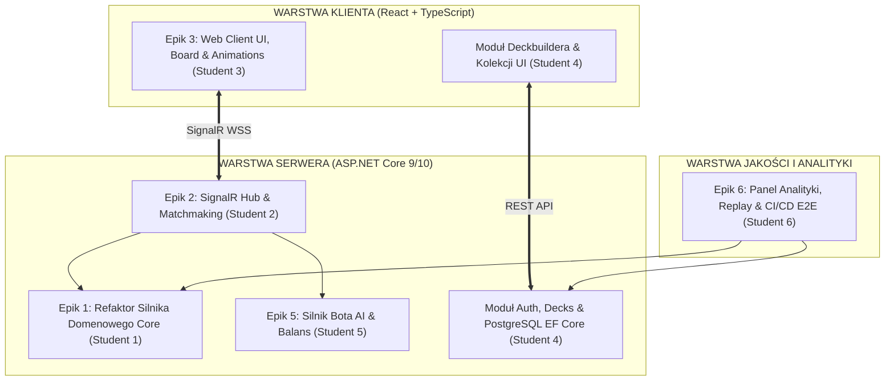

# ⚔️ Brainstorm Inżynierski i Architektura: Temat 15 — Sieciowa Taktyczna Gra Karciana (CCG) z Autorytatywnym Serwerem i Klientem Webowym (Rework Rejoltance)

> [!NOTE]
> **Kontekst Uczelniany i Cel Dokumentu:**
> Niniejsze opracowanie stanowi pełną dekompozycję i inżynierski plan modernizacji (**Reworku Ścieżki B**) dla projektu gry karcianej **„Rejoltance” (CardGame)** w formacie zgodnym z katalogiem tematów Projektu Zespołowego PB (`tematy aktualne.md`).
> Dokument powstał na bazie ustaleń z audytu technicznego ([`AUDYT_TECHNICZNY_REJOLTANCE.md`](file:///c:/Users/cyunc/Downloads/AUDYT_TECHNICZNY_REJOLTANCE.md)), analizy integracyjnej z [[appendix-react-dotnet-cardgame|Appendixu 2.3]] oraz standardów sylabusowych Wydziału Informatyki Politechniki Białostockiej (wymóg weryfikacji z użytkownikiem końcowym **EU1/EU2**, ceremonie Scrum, podział na 6 niezależnych Epików dla 6 studentów).

---

## 📋 CZĘŚĆ I: Oficjalna Karta Tematu (Struktura Katalogowa)

### Tytuł Tematu:
**Temat 15: Sieciowa Taktyczna Gra Karciana (CCG) czasu rzeczywistego z autorytatywnym serwerem .NET i responsywnym klientem React SPA**

### Tło problemu
Cyfrowe gry karciane (CCG/TCG — np. *Hearthstone*, *Gwent*, *Marvel Snap*) to jedne z najbardziej wymagających systemów informatycznych pod względem integralności reguł, synchronizacji stanu i doświadczenia użytkownika. W ramach wcześniejszych prac laboratoryjnych zespół opracował autorski silnik taktycznej gry karcianej **„Rejoltance”** w języku C# (`CardGame.Core`), wprowadzający unikalną mechanikę 4 niezależnych linii walki, system zasobów oparty na Krwi (`Blood`) oraz bogatą pulę jednostek i zaklęć (zweryfikowaną 64 testami jednostkowymi xUnit).

Dotychczasowy prototyp cierpi jednak na fundamentalne ograniczenia architektoniczne:
1. Warstwa wizualna została sprzężona z desktopowym silnikiem **Godot**, co uniemożliwia łatwe uruchamianie gry na dowolnym urządzeniu bez pobierania instalatorów (WASM w Godot wymaga pobierania 40+ MB binarek i rodzi problemy z izolacją wątków).
2. Gra działa wyłącznie lokalnie (brak modułu sieciowego, brak matchmakingu i rozgrywki wieloosobowej online).
3. Logika gry została zanieczyszczona statycznymi singletonami (`CardLibrary.Instance`, `GameEngine.Instance`), co wyklucza wielowątkowe hostowanie wielu równoległych meczów na serwerze.

### Zidentyfikowane problemy
- **Brak dostępności wieloplatformowej:** Gry desktopowe wymagają instalacji, uprawnień administratora i pobierania dużych plików, co drastycznie obniża bazę graczy.
- **Brak autorytatywnej architektury sieciowej:** Logika wykonywana lokalnie na maszynie gracza jest podatna na oszustwa (*cheating*, podglądanie pamięci procesu).
- **Złamanie zasady odwrócenia zależności (DIP):** Sprzężenie silnika domenowego z silnikiem graficznym uniemożliwia reużycie kodu w architekturze klient-serwer.
- **Brak systemu tożsamości i ekonomii:** Brak kont graczy, historii meczów (Match History), rankingu ELO oraz bezpiecznego konstruktora talii (Deckbuilder).
- **Złożoność synchronizacji czasu rzeczywistego:** Konieczność ochrony informacji niejawnych (*Fog of War* — ukrywanie ręki przeciwnika) przy jednoczesnym zapewnieniu płynnych animacji (60 FPS).

### Cel i wyzwanie projektowe
Przeprowadzenie kontrolowanego refaktoringu silnika domenowego `CardGame.Core` (usunięcie długu technicznego, singletonów i izolacja reguł biznesowych) oraz osadzenie go w wielowątkowym, autorytatywnym serwerze **ASP.NET Core (Kestrel + SignalR)**. Równolegle zaprojektowanie i wdrożenie nowoczesnego, ultralekkiego klienta webowego **React SPA (Vite + TypeScript + Tailwind CSS)** z dynamiczną wizualizacją kart w przestrzeni perspektywicznej (CSS 3D / Framer Motion).

System powinien obsługiwać co najmniej cztery role użytkowników:
1. **Gracz (Player):** Logowanie, zarządzanie kolekcją kart, tworzenie talii (z walidacją reguł), dołączanie do kolejki matchmakingu, rozgrywanie pojedynków online PvP oraz PvE (przeciwko botowi AI).
2. **Obserwator (Spectator):** Oglądanie trwających pojedynków na żywo z opóźnieniem anty-cheatowym.
3. **Projektant Balansu (Game Designer):** Dedykowany panel do edycji statystyk kart w bazie PostgreSQL, symulacji meczów botów (AI vs AI) i podglądu metryk win-rate.
4. **Administrator Systemu:** Zarządzanie kontami, monitoring serwera Kestrel, inspekcja aktywnych sesji meczowych i banowanie cheaterów.

### Wymagania funkcjonalne

#### 1. Autorytatywny Silnik Rozgrywki (C# Match Engine)
- Deterministyczna maszyna stanów (`GameStateMachine`): Faza Dobierania (`Draw`), Faza Akcji (`Action Phase`), Faza Walki (`Combat Phase`), Faza Końca (`Turn End`).
- Obsługa pola bitwy o 4 liniach (`BattleLine 0..3`) z rozróżnieniem jednostek zwarciowych (`Melee`) i dystansowych (`Ranged`).
- Obsługa zasobu Krwi (`Blood`): koszt zagrania, zużycie, regeneracja per tura.
- Pełna obsługa słów kluczowych: Prowokacja (`Taunt`), Kamuflaż (`Stealth`), Szarża (`Charge`), Trucizna (`Poison`), Tarcza (`Shield`) oraz efektów wejścia i śmierci (`OnPlayed`, `OnDeath`).
- Kompletna separacja od wejścia/wyjścia: silnik przyjmuje komendy `IGameCommand` i emituje zdarzenia domenowe `IGameEvent`.

#### 2. Warstwa Sieciowa Czasu Rzeczywistego (SignalR WebSockets)
- Dwukierunkowa, silnie typowana komunikacja przez `GameHub : Hub<IGameClient>`.
- Ochrona informacji niejawnych (**Fog of War**): serwer przygotowuje dwie odrębne projekcje DTO — gracz widzi swoje karty, a w ręku przeciwnika widzi wyłącznie liczbę zamaskowanych rewersów (`CardBack`).
- Protokół automatycznego wznawiania połączenia (**Heartbeat & Reconnect**): gracz po utracie pakietów Wi-Fi ma 60 sekund na powrót do trwającego meczu z pełnym odtworzeniem stanu stołu.
- Zabezpieczenie przed wyścigami danych (*Race Conditions*) i atakami desynchronizacji.

#### 3. Matchmaking i Zarządzanie Poczekalnią (Lobby)
- Kolejka dobierania graczy w oparciu o ranking ELO lub system punktowy.
- Tworzenie prywatnych pokojów pojedynkowych na kod/link (Direct Challenge z kolegą z roku).
- Tryb treningowy offline/online z botem sztucznej inteligencji (`AI Player Controller`).

#### 4. Responsywny Klient Webowy (React SPA)
- Płynny interfejs stołu gry w 60 FPS działający w przeglądarkach Chrome, Firefox, Safari i Edge bez żadnych wtyczek.
- Interakcja **Drag & Drop** (lub dwuklik) do zagrywania kart z ręki na wolne sloty linii walki.
- Wizualizacja kart z dynamicznym efektem nachylenia 3D (*Card Tilt*) reagującym na pozycję kursora myszy (`CSS perspective / Framer Motion`).
- Wizualne oznaczenia celowania zaklęć i ataków (strzałki wektorowe SVG/Canvas).
- System animacji zdarzeń: rzucenie karty na stół, atak wręcz, obrażenia, rozbłyski śmierci jednostek.

#### 5. Moduł Kart i Konstruktor Talii (Deckbuilder)
- Przeglądanie katalogu kart z zaawansowanym filtrowaniem (koszt Krwi, typ, podtyp rasy, słowa kluczowe, wyszukiwarka tekstowa).
- Walidator legalności talii: wymóg dokładnie 30 kart, limit maksymalnie 3 kopii tej samej karty.
- Zapisywanie wielu talii na koncie gracza, oznaczanie talii aktywnej, import/eksport kodu talii (Deckstring).

#### 6. Sztuczna Inteligencja (AI Opponent & Bot Engine)
- Zintegrowany bot decyzyjny z możliwością gry przeciwko człowiekowi.
- Implementacja algorytmu oceny planszy (heurystyka opłacalności wymian jednostek na 4 liniach).
- Obsługa trybu symulacji wsadowej (*Batch Simulation*) do automatycznego testowania balansu nowych kart.

#### 7. Tożsamość, Bezpieczeństwo i Profil Gracza
- Rejestracja i logowanie (JWT / Refresh Tokens lub ASP.NET Core Identity).
- Profil gracza: współczynnik zwycięstw (Win-Rate), rozegrane mecze, historia ostatnich 10 pojedynków z podglądem talii.
- Ochrona API przed nadużyciami (Rate Limiting).

#### 8. Panel Analityczny i Balansu (Game Admin Dashboard)
- Podgląd aktywnych meczów na serwerze (pamięć RAM, liczba podłączonych gniazd WebSocket).
- Wykresy popularności kart i współczynnika wygranych (*Card Win-Rate Matrix*).
- Zdalny edytor parametrów kart bez konieczności restartu serwera (aktualizacja w PostgreSQL).

---

## 🎯 2. Redefinicja Wizji i Wartości Biznesowej (Executive Summary)

### Dlaczego ten projekt jest idealnym tematem inżynierskim?
Gry karciane kojarzą się z rozrywką, ale od strony inżynierskiej są **najbardziej bezwzględnym sprawdzianem rzemiosła programistycznego**:
- Wymagają **determinizmu matematycznego**: każda akcja musi dać ten sam wynik na serwerze i u klienta.
- Wymagają **architektury odpornej na oszustwa**: model autorytatywnego serwera (*Never Trust the Client*) wymusza bezbłędne projektowanie granic domenowych.
- Wymagają **optymalizacji sieciowej**: zarządzanie stanem w pamięci RAM serwera, serializacja polimorficzna JSON i obsługa reconnectu.
- Łączą zaawansowany **backend wielowątkowy C#** z nowoczesnym, efektownym wizualnie **frontendem React**.

### 👤 Kto będzie użytkownikiem końcowym (Gwarancja EU1 i EU2 na PB)?
Projekt posiada **ogromną przewagę nad tematami korporacyjnymi/urzędowymi**:
- **Studenci Wydziału Informatyki PB (Wasi znajomi z roku):** Graczem może być każdy student posiadający przeglądarkę internetową.
- **Koła Naukowe PB (np. Koło Gamedev / Twórców Gier, Koło Informatyki):** Pasjonaci z kół z chęcią wezmą udział w testach zbalansowania rozgrywki.
- **Turniej Wydziałowy na koniec semestru:** Jako demonstrację końcową (Sprint Review) możecie zorganizować 8-osobowy mini-turniej na żywo w sali laboratoryjnej, gdzie studenci łączą się przez laptopy i telefony!
- **Zero barier instalacyjnych:** Wystarczy wysłać link na Discordzie: `https://rejoltance.twojadomena.pl`. Użytkownik klika i gra w 5 sekund. Daje to **100% gwarancji spełnienia wymogów zaliczenia EU1 i EU2**.

---

## 💡 3. Głęboka Analiza Wątków Funkcjonalnych Reworku

---

### Wątek 1: Czysta Domena i Usunięcie Długu Technicznego w `CardGame.Core`

#### Stan Faktyczny w Repozytorium:
W kodzie C# występuje doskonała logika mechaniki, ale jest ona zanieczyszczona statycznymi zależnościami:
- Klasa `CardLibrary.Instance` uniemożliwia testowanie z różnymi zestawami kart.
- `GameEngine` posiada elementy singletonowe, co uniemożliwia uruchomienie 50 instancji gry naraz w jednym procesie serwera.

#### Inżynierski Plan Naprawczy (Rework):
1. **Wstrzykiwanie Zależności (DI):** Przekształcenie `CardLibrary` w serwis implementujący `ICardRepository`.
2. **Niezmienniki Domenowe:** Wszystkie mutacje stanu (`GameState`) odbywają się poprzez czyste, atomowe komendy implementujące `IGameCommand` (np. `PlayUnitCommand`, `PlaySpellCommand`, `EndPhaseCommand`).
3. **Płytkie klonowanie stanu (Immutable State Records):** Obiekty `GameState`, `BoardState`, `Line` oraz `PlayerState` stają się rekordami C# z mutatorami typu `WithBloodSpent()` i `WithUnitPlacedAt()`. Gwarantuje to brak problemów z wielowątkowością na serwerze!

---

### Wątek 2: Architektura Serwera Czasu Rzeczywistego (ASP.NET Core + SignalR)

#### Model Zarządzania Sesjami Meczowymi w Pamięci RAM:
Ponieważ baza relacyjna jest zbyt wolna na pętlę gry 60 FPS, mecze żyją w pamięci operacyjnej serwera:
- Komponent `MatchSessionManager` (Singleton w kontenerze DI ASP.NET Core) przechowuje mapę aktywnych sesji: `ConcurrentDictionary<Guid, MatchSession>`.
- Każda instancja `MatchSession` posiada własną blokadę asynchroniczną (`SemaphoreSlim(1, 1)`), gwarantującą, że komendy od Gracza A i Gracza B nie spowodują wyścigu danych.
- Po zakończeniu meczu wynik, liczba rund, statystyki i punkty rankingowe są asynchronicznie utrwalane w bazie **PostgreSQL**.

#### Ochrona Informacji Niejawnych (Fog of War Protocol):
```
[Gracz A: Zagrywa BoomBots] ---> [Kestrel GameHub] ---> [Engine: Sukces]
                                         |
            +----------------------------+----------------------------+
            v                                                         v
[Unicast do Gracza A]                                     [Unicast do Gracza B]
StateUpdated:                                             StateUpdated:
- Twoja ręka: [Karta 1, Karta 2]                         - Ręka przeciwnika: 2 karty (same rewersy!)
- Pole bitwy: Linia 1 ma BoomBots                         - Pole bitwy: Linia 1 ma BoomBots
```

---

### Wątek 3: Interfejs Użytkownika i Wizualizacja w React (Vite + CSS 3D)

#### Eliminacja Narzutu WebGL / Three.js na Rzecz Płynnego DOM:
Zgodnie z ustaleniami z Appendixu 2.3, budowanie karcianki w pełnym WebGL/Three.js jest pułapką dla 6-osobowego zespołu studenckiego (rozmyte czcionki, skomplikowane shadery, brak gotowych kontrolek UI).

#### Nowoczesne Rozwiązanie Inżynierskie:
- **Karty jako Komponenty HTML/React:** Perfekcyjnie ostre czcionki, stylowe obramowania Tailwind CSS, cienie i animacje.
- **Efekt Holograficzny i 3D Tilt:** Za pomocą `framer-motion` i styli `perspective: 1000px`, `rotateX`, `rotateY` karta nachyla się dynamicznie pod ruchem myszy, rzucając dynamiczny cień na stół.
- **Pole Bitwy:** 4 kolumny flex/grid odpowiadające liniom walki z wyraźnymi slotami dla jednostek sojuszniczych i wrogich.
- **Zarządzanie Stanem Klienta:** Biblioteka **Zustand** (`useGameStore`). Po odebraniu pakietu SignalR store aktualizuje stan, a React Reconciler odświeża wyłącznie zmienioną linię.

---

### Wątek 4: Moduł Kolekcji, Konstruktora Talii i Bazy Danych PostgreSQL

#### Schemat Relacyjny w PostgreSQL (EF Core):
- Tabela `Users`: Konta graczy, hasła (BCrypt/Argon2), ranking ELO.
- Tabela `Cards`: Definicje kart przeniesione z pliku `cards.json` (ID, nazwa, koszt Krwi, atak, zdrowie, opis, kod efektu JSON, ścieżka do grafiki).
- Tabela `Decks`: Zapisane talie graczy powiązane relacją 1..N z tabelą pozycji `DeckCards`.
- Tabela `MatchHistory`: Zarejestrowane pojedynki (ID graczy, zwycięzca, data, czas trwania, liczba tur).

#### Walidacja Integralności Talii (Deck Validation Rules):
Przeniesienie istniejącej klasy C# `DeckValidator` do warstwy aplikacyjnej backendu:
- Dokładnie 30 kart w talii.
- Maksymalnie 3 kopie danej karty.
- Blokada zapisu talii niespełniającej kryteriów.

---

### Wątek 5: Sztuczna Inteligencja (AI Bot Opponent) i Balans

#### Integracja Istniejącego Modułu AI z Serwerem:
W Waszym repozytorium istnieje moduł `CardGame.Core/AI` (algorytmy botów i ewaluacja ruchów):
- W reworku bot staje się wirtualnym graczem podłączonym do sesji meczowej (`VirtualOpponent`).
- Gdy w pokoju meczowym brakuje drugiego gracza (lub gracz wybiera tryb Treningu), serwer powołuje instancję bota w wątku tła (`Task.Run`).
- Bot analizuje stan 4 linii, oblicza najkorzystniejsze zagrania jednostek i wywołuje te same metody `PlayUnitCommand`, co żywy gracz.

---

### Wątek 6: Infrastruktura, Telemetria i .NET Aspire

#### Środowisko Wytwórcze:
- Wykorzystanie **`.NET Aspire`** do lokalnej orkiestracji (jeden plik `AppHost.cs` uruchamiający bazę PostgreSQL, serwer Kestrel oraz serwer deweloperski Vite z HMR).
- Konteneryzacja **Docker** na potrzeby wdrożenia produkcyjnego (jeden obraz serwera ASP.NET Core serwujący zbundle'owane pliki Reacta z katalogu `wwwroot`).

---

## 🏛️ 4. Kluczowe Decyzje Architektoniczne (ADRs)

### ADR-01: Porzucenie Godot WebAssembly na Rzecz React SPA (Vite)
- **Status:** Przyjęte (Accepted).
- **Kontekst:** Eksport Godota C# do przeglądarki generuje ponad 40 MB danych, wymaga specjalnych nagłówków serwera `Cross-Origin-Opener-Policy` (blokujących komunikację zewnętrzną) i nie pozwala na responsywne dopasowanie do ekranów mobile.
- **Decyzja:** Przepisanie warstwy wizualnej na czysty **React SPA (TypeScript, Tailwind CSS, Framer Motion)**.
- **Konsekwencje:** Błyskawiczny start gry w ułamku sekundy, doskonała ostrość tekstu, 100% kompatybilność z ekosystemem webowym.

### ADR-02: Transport Czasu Rzeczywistego: SignalR zamiast Surowych WebSocketów
- **Status:** Przyjęte (Accepted).
- **Kontekst:** Złożoność obsługi ręcznego parsowania JSON-ów, reconnectu i fallbacków transportowych w restrykcyjnych sieciach akademickich.
- **Decyzja:** Zastosowanie biblioteki **ASP.NET Core SignalR** z silnie typowanym interfejsem klienta `IGameClient`.
- **Konsekwencje:** Automatyczny fallback do SSE/Long-Polling, gotowy mechanizm pokoi meczowych (`Groups.AddToGroupAsync`), silne typowanie DTO.

### ADR-03: Model Autorytatywnego Serwera z Ochroną Fog of War
- **Status:** Przyjęte (Accepted).
- **Kontekst:** Ryzyko oszustw polegających na podejrzeniu kart w ręku przeciwnika poprzez DevTools / zakładkę Network.
- **Decyzja:** Silnik `CardGame.Core` wykonuje się wyłącznie na serwerze. Klient wysyła wyłącznie intencje komend. Serwer generuje spersonalizowane projekcje stanu (zamaskowana ręka przeciwnika).
- **Konsekwencje:** Pełna odporność na cheaterów, konieczność podwójnej serializacji DTO per tura.

### ADR-04: Czysty DOM + CSS 3D zamiast WebGL/Three.js
- **Status:** Przyjęte (Accepted).
- **Kontekst:** Ryzyko przekroczenia budżetu czasowego 6 studentów przy tworzeniu shaderów, oświetlenia i kwaternionów w Three.js, a także rozmycie napisów na kartach w 3D.
- **Decyzja:** Realizacja wizualizacji kart w oparciu o sprzętowo akcelerowane transformacje **CSS 3D (`perspective`, `rotateX`, `rotateY`) i Framer Motion**.
- **Konsekwencje:** Komercyjny wygląd kart 2.5D, idealnie ostry tekst opisów, zerowe obciążenie GPU, bezbłędna testowalność Playwright.

---

## 👥 5. Wzorcowa Dekompozycja na 6 Niezależnych Epików (Podział dla 6 Studentów)

> [!IMPORTANT]
> **Żelazna gwarancja zaliczenia EU1–EU6 na ocenę 5.0 bez konfliktów w Bitbucket!**  
> Każdy z 6 członków zespołu otrzymuje jeden, całkowicie niezależny obszar inżynierski (Bounded Context). Granice modułów są zdefiniowane kontraktami DTO i interfejsami C#/TypeScript.



### Szczegółowy podział ról i zakresu odpowiedzialności:

| Nr Epiku | Moduł Domenowy | Właściciel | Rola Inżynierska | Kluczowy Zakres Zadań (Atomowe User Stories) |
| :---: | :--- | :---: | :---: | :--- |
| **E1** | **Autorytatywny Silnik Rozgrywki (Core Domain Engine)** | **Student 1** | *Backend Domain Engineer* | - Usunięcie singletonów (`CardLibrary.Instance`) i refaktor do wstrzykiwania DI.<br>- Zapewnienie niezmienności stanu (`GameState`, `BoardState` jako C# records).<br>- Pełna obsługa mechaniki 4 linii, zasobu Krwi i słów kluczowych.<br>- Rozszerzenie zestawu testów jednostkowych xUnit do min. 100 testów pokrywających reguły brzegowe (EU6). |
| **E2** | **Warstwa Sieciowa Czasu Rzeczywistego i Matchmaking** | **Student 2** | *Network & Systems Engineer* | - Implementacja `GameHub : Hub<IGameClient>` w ASP.NET Core.<br>- Implementacja wielowątkowego `MatchSessionManager` (izolacja sesji w pamięci RAM).<br>- Logika maskowania stanu **Fog of War** per gracz.<br>- System kolejki matchmakingu z rankingiem ELO i obsługa reconnectu po utracie pakietów. |
| **E3** | **Responsywny Klient Webowy, Stół Gry i Wizualizacja** | **Student 3** | *Senior Frontend Developer* | - Inicjalizacja projektu Vite + React + TypeScript + Tailwind CSS.<br>- Komponent stołu gry (`GameBoard`), 4 linii walki (`BattleLine`) i rąk graczy.<br>- Implementacja karty z efektem nachylenia perspektywicznego (**CSS 3D Tilt**) i rozbłyskiem.<br>- Obsługa gestów Drag & Drop i animacji rzucania kart (Framer Motion).<br>- Integracja klienta `@microsoft/signalr` z magazynem stanu **Zustand**. |
| **E4** | **Tożsamość, Baza Danych i Konstruktor Talii (Deckbuilder)** | **Student 4** | *Fullstack Database Engineer* | - Model relacyjny PostgreSQL: migracje EF Core dla `Users`, `Cards`, `Decks`, `MatchHistory`.<br>- Bezpieczna rejestracja/logowanie (JWT tokens, ochrona haseł).<br>- REST API do przeglądania kart i operacji CRUD na taliach.<br>- Zaawansowany komponent React do składania talii z filtrami i walidacją limitu 30 kart/3 kopii. |
| **E5** | **Sztuczna Inteligencja (AI Bot) i Balans Rozgrywki** | **Student 5** | *AI & Gameplay Engineer* | - Refaktor i optymalizacja modułu bota `CardGame.Core/AI` do pracy asynchronicznej na serwerze.<br>- Heurystyczne drzewo decyzyjne dla bota (ocena wymian jednostek na 4 liniach).<br>- Tryb gry przeciwko botowi dla pojedynczego gracza (Singleplayer PvE).<br>- Tryb symulacji wsadowej (*Headless AI vs AI Runner*) do badania balansu statystyk kart. |
| **E6** | **Panel Analityczny, Replay System i Pipeline CI/CD** | **Student 6** | *DevOps & QA Lead* | - Konfiguracja środowiska orkiestracji **.NET Aspire** oraz Docker Compose.<br>- Pipeline CI/CD na Bitbucket/GitHub (automatyczny build, linter, testy xUnit i Vitest).<br>- Moduł zapisu historii akcji meczu i odtwarzacz powtórek (**Replay Player**).<br>- Panel Administratora: monitoring aktywnych meczów, statystyki win-rate kart w czasie rzeczywistym. |

---

## 🛠️ 6. Rekomendowany Stos Technologiczny (Fullstack Tech Stack)

- **Backend Domenowy i Serwer:** C# 12 / 13 (.NET 9 / 10 LTS), ASP.NET Core Web API, SignalR (WebSockets).
- **Zarządzanie Stanem Serwera:** In-Memory Concurrent Collections (`ConcurrentDictionary`), semafory asynchroniczne (`SemaphoreSlim`).
- **Frontend Webowy:** React 19 / 18, Vite, TypeScript 5.x, Tailwind CSS v4, Lucide Icons.
- **Animacje i Interakcje:** Framer Motion, `@dnd-kit` (dostępny Drag & Drop).
- **Stan Frontendowy:** Zustand (skrajnie lekki, idealny pod strumieniowanie zdarzeń SignalR).
- **Baza Danych i ORM:** PostgreSQL 16+, Entity Framework Core 9/10 (Code-First Migrations).
- **Pamięć Podręczna / Opcjonalny Backplane:** Redis (dla kolejki matchmakingu i skalowania SignalR).
- **Narzędzia Jakości i Testów (Wymóg Semestru 2):**
  - Backend: xUnit, FluentAssertions, Moq.
  - Frontend: Vitest, React Testing Library.
  - E2E: Playwright (automatyczne testy logowania, układania talii i rozegrania 1. tury meczu).
- **Orkiestracja i Środowisko:** .NET Aspire, Docker, Docker Compose, Bitbucket Pipelines.

---

## 🚀 7. Dlaczego Zespół Powinien Wybrać Ten Temat na Spotkaniu Kick-off?

1. **Gotowy, sprawdzony kapitał startowy:** Nie zaczynacie od zera! Posiadacie już 64 działające testy jednostkowe reguł gry w C#. Waszym zadaniem jest modernizacja i „ubranie” tego w sieć i piękny web.
2. **Spektakularny efekt demonstracyjny na Review:** Podczas gdy inne zespoły pokazują monotonne tabelki CRUD z formularzami, Wy na rzutniku odpalacie dwie przeglądarki, rzucacie kartę z dynamicznym cieniem i animacją, a serwer natychmiast synchronizuje stan po obu stronach. Prowadzący i recenzenci uwielbiają takie projekty.
3. **Pewny użytkownik końcowy (Gwarancja EU1/EU2):** Wystarczy założyć kanał na Discordzie z kolegami z roku i dać im linka do poklikania w trakcie przerw.
4. **Idealny podział ról:** Dokładnie 6 wyraźnych epików technologicznych — nikt nie wchodzi sobie w drogę w repozytorium Git, a każdy student ma wybitny, samodzielny temat do pracy inżynierskiej na 4. roku!
